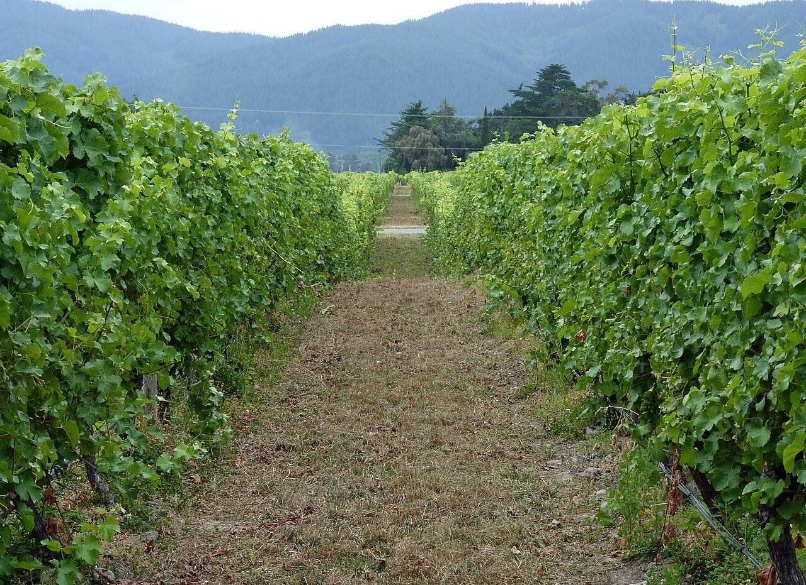

# 马尔堡葡萄酒路线

马尔堡葡萄酒路线不是一条有统一标识的公路，而是一种把酒庄、河谷与海风串起来的走法。这里只取两站：布伦海姆附近的云雾之湾，以及塞登海边的伊兰兹。两站同属马尔堡产区，却分别落在 Wairau Valley 的老河床砾石与 Awatere Valley 的沿海风带；放在同一天走，能看清同一片产区内部并不相同的成熟节奏，也能理解为什么马尔堡的长相思不能只用一种味道来概括。

图：布伦海姆云雾之湾酒庄的葡萄园，藤行间可见远处的怀劳河谷山地。图片：Matt Boulton，CC BY-SA 2.0，via [原图页面](https://commons.wikimedia.org/wiki/File:Cloudy_Bay_Vineyard.jpg)。

## 路线概览

- 第一站：[云雾之湾](ref:cloudy-bay)，230 Jacksons Road, Blenheim；酒庄门市每周七天 10:00–17:00，建议提前预约。
- 第二站：[伊兰兹](ref:yealands)，534 Seaview Road, Seddon；从布伦海姆向东南约 40 分钟，具体开放时间与是否需预约以官网为准。
- 方式：自驾。两站之间没有可依赖的公共交通，回程叫车也不稳定。
- 时长：一天可以走完，但要把品鉴、午餐与车程分开计算；想下葡萄园或参加更长的体验，建议住一晚。
- 顺序：先 Wairau 后 Awatere。上午在内陆河谷建立参照，下午到海边看风如何改变酒体。

## 从 Wairau 砾石到 Awatere 海风

[马尔堡](ref:marlborough)的葡萄园并不是一块均匀的毯子。Wairau Valley 以古老的河床砾石为主，排水快、升温早，葡萄容易达到成熟的糖度，同时保留清晰的酸度；谷地内部又有不同的朝向与降雨，沿海地块受海风调节，内陆地块更干、更早熟。Southern Valleys 环绕在周围丘陵之间，土壤更重、黏土更多，向南更凉更干，黑皮诺与芳香型品种在这里更有表现。Awatere Valley 则更靠南、更干、风更大，常有海拔变化，产量通常更低，长相思的香气更锐利，黑皮诺更偏芳香。

这条路线只走 Wairau 与 Awatere，跳过了 Southern Valleys。这不是说黏土不重要，而是两站之间的对照已经足够清楚：一端是河床砾石带来的饱满与早熟，另一端是海风与较低产量带来的紧致与张力。把这种差异喝进嘴里，比在酒标上找形容词更直接。

## 长相思的起点：1973 与 1979

马尔堡的现代葡萄酒业起步于 1970 年代。1973 年，Montana Wines（后来的 Brancott Estate）在 Wairau Valley 种下首批大规模葡萄苗；当时新西兰的葡萄园主要集中在更温暖的吉斯伯恩、霍克斯湾与奥克兰，马尔堡被认为太干、太冷。1975 年，长相思被种进这片试验性葡萄园；1979 年，马尔堡第一个长相思年份上市，香气与酸度让国际市场第一次认真看待南岛的潜力。1985 年，云雾之湾酿出它的第一个年份，把这种风格进一步推向出口市场。

这段历史的重点不是“谁第一个种”，而是品种与地点如何被重新组合。长相思在马尔堡找到了凉爽夜晚、充足日照与排水良好土壤的交汇点；[长相思](ref:sauvignon)的草本、青柠与百香果气息，被这里的成熟条件放大，却没有失去酸度。理解这一点，再看两家庄园的定位，就不会把“马尔堡长相思”当成一个单一配方。

## 2020s 的产量调整

2020 年代的关键词不是无限扩张，而是调整。新西兰葡萄种植者协会的 2026 年报告显示，2024 年采收量为 395,000 吨，明显低于前两年；2026 年采收量约 440,000 吨，较上一年下降 15%。报告把这一变化描述为让产量更接近当前市场需求，而不是简单的衰退。与此同时，马尔堡仍占全国葡萄种植面积的 73%，说明调整发生在最大的产区内部，而不是产区地位的转移。

对旅行者的含义很实际：部分地块可能休耕、改种或减少产量，酒庄的年份供应与品鉴酒单会随之变化。不要拿着几年前的酒单去点酒；到访前先看官网当前释放的年份，接受“这一款今年没有”的概率。对[白葡萄酒](ref:white-wine)市场来说，这种收缩也意味着酒庄更愿意把资源集中在能清楚表达地块差异的少量产品上。

## 第一站：云雾之湾

云雾之湾在布伦海姆的 Jacksons Road，周围是 Wairau Valley 的葡萄园与 Richmond Ranges 的山脊。酒庄 1985 年酿出第一个年份，今天的产品线从核心长相思、霞多丽与黑皮诺，延伸到 Te Koko、Te Wāhi 与 Pelorus 起泡酒。它的参观点不是把生产线全部打开，而是用门市、餐厅与葡萄园风景组成一个相对松弛的到访节奏。

门市每周七天 10:00–17:00 开放，圣诞节与耶稣受难日关闭；官方建议预约，尤其是周末与夏季。Saku 餐厅午餐每天 11:00–15:00，周四与周五加开 16:00–20:00 的晚餐。想认真比较，选带讲解的品鉴而不是临时到吧台点一杯；想只看风景，预约一个靠窗或靠葡萄园的时段更划算。地址与开放信息以官方页面为准，坐标以官方渠道为准。

## 第二站：伊兰兹

伊兰兹在塞登的 Seaview Road，葡萄园靠近海岸，风把海雾吹到藤蔓上。酒庄 2008 年 8 月 8 日启用新厂，官方叙述强调它是从建厂第一天起就获得 Toitū 碳中和认证的酒庄；厂区的可持续做法包括太阳能、风力涡轮、葡萄修剪枝条的利用与自制堆肥。品鉴室提供当地奶酪与腌肉，另有一条免费的自驾 White Road，沿路可以看葡萄园、海岸与原生植被。

它的参观点更像“海边农场”而不是“城市酒窖”：风大、光线强，步行区域多为草地或碎石，鞋子和外套要比在城市酒庄更实用。官方网站在部分地区会先弹出年龄验证，开放时间与品鉴项目因此应以能打开的官方页面或直接联系酒庄为准；本页不把未经核实的时段写成固定事实。地址为 534 Seaview Road, Seddon, Marlborough 7285，坐标以官方渠道为准。

## 车程、预约与品鉴安排

布伦海姆到塞登约 40 分钟，沿海道路风大，骑行并不适合所有人；两站都没有铁路接驳。最稳妥的是租车加指定司机，或参加含接送的小团。若自己开车，品鉴时把酒吐掉，不要用“只喝一口”来判断安全。

预约要分开处理：云雾之湾的门市建议预约，餐厅另有一套时段；伊兰兹的品鉴室与 White Road 规则要按官网或现场公告确认。不要把两家排得太紧，Wairau 到 Awatere 的车程加上品鉴，至少留出四到五小时。旺季是南半球夏季，圣诞节前后与周末最拥挤；春季与秋季人少，但海风更冷，带一件防风外套。

相关条目：[云雾之湾酒庄](ref:cloudy-bay)、[伊兰兹酒庄](ref:yealands)、[马尔堡](ref:marlborough)。

## 参考资料

本页依据云雾之湾官方到访页、新西兰葡萄种植者协会的马尔堡产区页与 2026 年报告、伊兰兹的协会档案以及 Brancott 官方品牌页核验，页面核验日期 2026-11-09。开放时间、预约规则、酒款与价格会变化，以各官方渠道为准。
