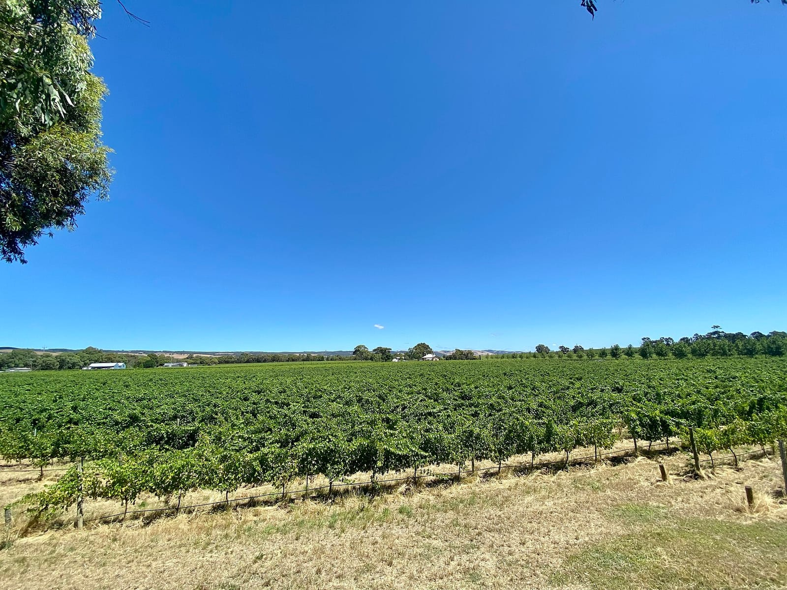

# 麦克拉伦谷葡萄酒路线

这是一条从阿德莱德出发、当天往返的麦克拉伦谷路线：先到达伦堡看百年老藤与“魔方”，再去维拉维拉看 1894 年的石造酒窖与教堂块混酿，中间留一顿饭和一段海岸线。全程约 80 公里，重点不是酒庄数量，而是把“历史、建筑、品种与海风”放在同一天里对照。

图：McLaren Vale Wine Route：Trellised vines, Coriole Vineyard, McLaren Vale South Australia (6177503952)（Wikimedia Commons）。图片：Rexness from Melbourne, Australia，CC BY-SA 2.0，via Wikimedia Commons（[原图页面](https://commons.wikimedia.org/wiki/File:Trellised_vines,_Coriole_Vineyard,_McLaren_Vale_South_Australia_(6177503952).jpg)）。

## 路线总览

建议 9:00 从阿德莱德市中心出发，走 Southern Expressway 南下，约 9:45 到达伦堡。上午在魔方与酒窖待两小时，重点看老藤西拉、篮式压榨与魔方建筑；12:00 在 d’Arry’s Verandah 吃午餐，或回麦克拉伦谷镇吃。13:30 开车十分钟到维拉维拉，下午品鉴加酒窖参观约一个半小时。15:30 之后可以去 Coriole 或 Samuel’s Gorge 做第三站，也可以直接去 Sellicks Beach 看海，17:30 返程，18:15 左右回到阿德莱德。

这条路线适合第一次来南澳的人：它把麦克拉伦谷的两种面孔放在一起——达伦堡的“当代建筑 + 老藤”，维拉维拉的“十九世纪石窖 + 现代混酿”。如果已经来过，可以把第三站换成更小的酒庄，或者把下午留给 Willunga 的市集与海岸。

## 产区背景

麦克拉伦谷在阿德莱德以南约 35 公里，东靠 Lofty 山脉、西临 St Vincent 湾，是南澳最古老、也最靠近海的产区之一。地中海气候让夏天干热，下午的峡谷风从 Sellicks 山吹下来，把葡萄园的温度压低几度；土壤从砂土、铁石砾石到石灰岩黏土都有，同一品种种在不同坡向，成熟度能差出一周以上。这里的老藤西拉、歌海娜与慕合怀特很多种于十九世纪，是澳洲老藤最集中的产区之一。产区有三十公里海岸线与七十多家酒窖，但不必贪多；把车程、午餐与品鉴算进去，一天两家最舒服。

## 第一站：达伦堡

达伦堡在 58 Osborn Road，从阿德莱德过来先到这一站最顺。1912 年 Joseph Osborn 买下这片老葡萄园，1928 年建酒窖，第四代 Chester Osborn 在 1984 年接手酿酒；今天酒庄有七十多款酒、三十多个品种，是澳洲认证有机与生物动力种植面积最大的酒庄之一。

到了之后先确认预约：魔方参观、Blending Bench 与餐厅是三个独立项目，临时到店通常只能做基础品鉴。魔方五层，顶层是品鉴中心，最高两层会旋转；如果时间有限，先上顶层喝一轮，再下到酒窖看篮式压榨机与老藤照片。达利展在魔方内，带小孩的话注意不要触摸展品。

品鉴时重点喝三款：Dead Arm Shiraz 看老藤集中度，The Coppermine Road Cabernet 看结构，The Ironstone Pressings GSM 看香料与红果。如果只想买一瓶，Dead Arm 最稳；如果想体验酒庄的多样性，带一瓶玛珊-维奥尼或甜酒走。

## 第二站：维拉维拉

维拉维拉在 255 Strout Road，从达伦堡开车约十分钟。1894 年，Robert Strangways Wigley 用当地铁石建起酒窖，1897 年出第一个年份；酒庄在 1936 年关闭，1969 年 Greg 与 Roger Trott 兄弟把废墟修回来，1972 年推出第一个 Church Block。今天的维拉维拉仍用那座石窖做品鉴与活动，建筑本身就是产区的历史标本。

这里的看点是“老酒窖 + 新混酿”：Church Block 是赤霞珠、西拉与梅洛的混酿，RSW Shiraz 以创始人的名字命名，The Angelus 是旗舰西拉，Chook Block 来自一块老藤，Scrubby Rise 与 Catapult 是更日常的系列。品鉴时可以先喝 Scrubby Rise 建立基准，再喝 Church Block 与 RSW，差别主要在浓度、橡木与陈年潜力。

维拉维拉的酒窖参观不长，但值得问一句“哪些部分是 1894 年的，哪些是后来重修的”。石墙、铁门与旧压榨设备能看出酒庄在 1936 年到 1969 年之间经历了什么；这些问题比拍一张石窖照片更有意思。

## 午餐与第三站

午餐有两个选择：达伦堡的 d’Arry’s Verandah 在酒庄内，菜单随季节变化，旺季要提前订；麦克拉伦谷镇上的餐厅更多，适合想吃得轻松的人。如果下午还要开车，午餐不要配太多酒；澳洲对酒驾零容忍，品鉴时吐酒是正常做法。

第三站可以按兴趣选：想看更多品种与橄榄园，去 Coriole；想要更小、更安静的酒庄，去 Samuel’s Gorge；想走海岸，去 Sellicks Beach 或 Aldinga Beach，把车停在 Esplanade，走一段沙滩。麦克拉伦谷有三十公里海岸线，下午的光线比酒庄更适合拍照。

如果带小孩，建议把第三站换成海岸或 Willunga 古镇，而不是继续品酒；小孩对石窖与葡萄园的耐心通常只有一小时。Willunga 周六有农夫市集，时间对得上可以顺路。

## 季节与路况

麦克拉伦谷是地中海气候，夏季干热，二月到三月是最热的时候；葡萄采收通常从二月下旬到四月。采收季酒庄最忙，品鉴名额紧张，部分道路会有卡车与采收设备，开车要慢。冬季温和多雨，酒庄人少，但海岸风大，带外套。

从阿德莱德到达伦堡约 45 分钟，从达伦堡到维拉维拉约 10 分钟，从维拉维拉回阿德莱德约 50 分钟；如果加海岸，多留 40 分钟。周五下午与周末车多，Southern Expressway 出城方向容易堵；返程尽量避开 17:00–18:00 的高峰。

## 预约与礼仪

达伦堡的魔方、Blending Bench 与餐厅都要预约；维拉维拉的品鉴与酒窖参观也要提前问。两家都不适合大型团体临时加入，超过六人最好先发邮件。品鉴时把酒吐进吐酒桶，不要拿走品鉴杯；酒庄的楼梯、石阶与葡萄园土路多，穿好走的鞋。

这条路线不画地图，也不提供实时价格；道路、营业时间与预约规则会变，出发前以两家酒庄官网与麦克拉伦谷葡萄酒协会为准。如果遇到酒庄临时关闭，别硬闯，直接去镇上的替代酒庄或海岸，行程不会因此作废。

相关条目：[达伦堡酒庄](ref:darenberg)、[维拉维拉酒庄](ref:wirra)、[麦克拉伦谷](ref:mclaren)。

## 延伸阅读与另见

- 相关条目：[darenberg](ref:darenberg)、[wirra-wirra](ref:wirra)、[mclaren-vale](ref:mclaren)、[red-wine](ref:red)、[syrah](ref:shiraz)。
- 想继续深入，可以把这条路线与巴罗萨谷路线对照：同样是西拉，麦克拉伦谷更靠海、风格更宽，巴罗萨更热、更浓。
- 如果只有半天，删掉第三站，保留达伦堡与维拉维拉；如果只有两小时，选一家，不要试图两家都到；酒庄之间的路比地图上看起来更绕，留出十分钟缓冲比多排一站更实际，也更从容。

**关键事实。**

| 项目 | 内容 |
| --- | --- |
| 一句话定位 | 从阿德莱德南下麦克拉伦谷，以达伦堡与维拉维拉两座历史酒庄为锚点；一天里看地中海气候、百年石造酒窖、西拉与多品种混酿，以及“立方体”式的当代酒庄建筑 |
| 站数 | 2 |
| 交通 | 自驾 |
| 停靠顺序 | 达伦堡酒庄、维拉维拉酒庄 |

## 相关图像

图：维拉维拉酒庄相关实景照片。图片：No Swan So Fine，CC BY-SA 4.0，via Wikimedia Commons（[原图页面](https://commons.wikimedia.org/wiki/File:Wirra_Wirra_Vineyards,_Strout_Road,_McLaren_Vale_07.jpg)）。关联图像：麦克拉伦谷葡萄酒路线。

图：Syrah Grapes on the Vine。摄影：U.S. Geological Survey，CC0，来自 Wikimedia Commons。。图片：U.S. Geological Survey，CC0，via Wikimedia Commons（[原图页面](https://commons.wikimedia.org/w/index.php?curid=114429512)）。关联图像：麦克拉伦谷葡萄酒路线。
