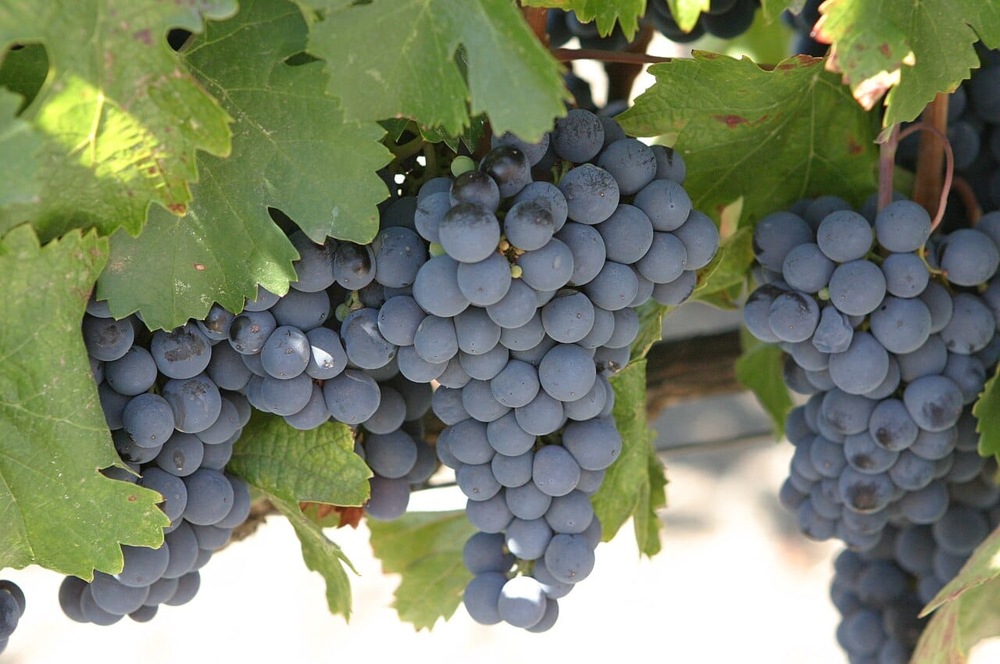

# 门多萨葡萄酒路线

门多萨葡萄酒路线没有统一的公路标识，真正决定一天的，是海拔、车程与预约时段。这条线只取两站：卢汉德库约的卡氏家族酒庄，以及迈普的苏卡尔迪家族基地。两站都在门多萨的 Primera Zona，不在 Uco Valley；正因如此，先把 Uco 的三级海拔带讲清楚，再回来看这两站的低海拔差异，才不会把门多萨简化成“高海拔等于好酒”。

图：门多萨葡萄酒路线所在的门多萨风貌配图。摄影：Mendoza Vineyard。署名：Justin De La Ornellas，CC BY 2.0，来自 Wikimedia Commons（[来源](https://commons.wikimedia.org/w/index.php?curid=25786871)）。这张照片用于说明产区环境与访问语境，不标定门多萨葡萄酒路线的门店、酒庄或活动现场。

## 为什么把两站放在同一条线上

- 第一站：[卡氏家族酒庄](ref:catena)，Cobos s/n, Luján de Cuyo (5509), Mendoza；官方给出的坐标是南纬 33°10′4.264″、西经 68°54′14.522″，参观需预约。
- 第二站：[苏卡尔迪酒庄](ref:zuccardi)，Ruta Provincial 33, Km 7,5, Fray Luis Beltrán, Maipú, Mendoza；这是家族在迈普的基地，当前对外旅游体验主要在 Uco Valley 的 Finca Piedra Infinita。
- 方式：自驾。卢汉德库约到迈普约 30–40 分钟，两站之间没有可靠的公共交通。
- 顺序：先卡氏后苏卡尔迪。前者用金字塔与高地葡萄园建立海拔参照，后者用家族史与 Santa Julia 的产品线回答“日常酒与高端酒如何并存”。
- 时长：一天可行；若要去 Uco Valley 的苏卡尔迪旗舰，需另加半天到一天。

## 海拔如何改写成熟期

门多萨的葡萄园大致分布在 650–1,500 米。Maipú 约 650–850 米，Luján de Cuyo 约 900–1,100 米，Uco Valley 约 1,000–1,500 米。海拔每升高，气温下降，夜晚更冷，葡萄在夜间呼吸消耗更少，酸度保留更好；天空更清澈，紫外线更强，果皮会合成更多黄酮类与花色苷，表皮更厚，颜色与单宁更完整。这些机制共同作用，但海拔不是越高越好：过强辐射与高温叠加会造成日灼与香气损失，叶幕管理、行向与遮阴同样重要。

这条线所在的 Primera Zona 海拔较低，成熟更早，酒体通常更宽、果味更熟；Uco 的高处则更紧致、花香更明显。把两站放在同一天，不是为了比较“谁更高端”，而是为了建立一套可复用的判断：同一品种在不同海拔上，酸度、单宁与香气会如何移动。

## 安第斯融雪与滴灌绿洲

门多萨年降雨约 220 毫米，日照超过 300 天，葡萄园几乎完全依赖安第斯融雪。Tunuyán、Mendoza 与 Diamante 等河流的融水经水库与渠道进入绿洲，现代葡萄园多采用滴灌。水分管理因此是产区的核心变量：缺水会限制产量与成熟，过量灌溉则会稀释风味。土壤以冲积物为主，包括砾石、砂、粉砂与黏土；Uco 多石且含石灰质，Maipú 土层更深、含黏土更多、保水性更强。

理解[门多萨](ref:mendoza)的关键，不是记住“干旱”两个字，而是看水如何被分配。同一片绿洲里，渠道位置、土壤保水能力与滴灌策略会让相邻地块长出不同的葡萄；酒庄的酿造选择，往往是在回应这些水分差异。

## Malbec 与 Uco Valley 的三级海拔带

按 2021 年 INV 统计，门多萨 Malbec 约 39,248 公顷，占全省葡萄园的 26.7%、全国 Malbec 面积的 20.2%。Uco Valley 约 29,105 公顷，其中 Malbec 约 16,051 公顷。Uco 的葡萄园从约 1,000 米延伸到 1,500 米，常被分成下、中、上三个海拔带；具体分界在各酒庄与 IG 之间并不统一，以官方渠道为准。下带更暖，果味更熟、酒体更宽；中带在成熟度与酸度之间较平衡；上带更凉，石灰质与石质土壤更常见，酸度更高、花香更明显。

[马尔贝克](ref:malbec)果皮颜色深、单宁中等偏厚，在门多萨常表现为黑莓、李子、紫罗兰与香料。高海拔地块的 Malbec 不一定更“浓”，但通常更紧致、更垂直；低海拔地块则更圆、更直接。把 Uco 的三级海拔带当作一张地图，再回头看 Luján 与 Maipú，就能理解为什么同一省份的[红葡萄酒](ref:red-wine)会有如此不同的骨架。

## 第一站：卡氏家族酒庄

卡氏家族酒庄 1902 年创立，官方叙述把 Nicolás Catena Zapata 与马尔贝克复兴、安第斯山麓高海拔风土的发现联系在一起；家族在 Uco 的 Adrianna 葡萄园接近 5,000 英尺（约 1,500 米），被称为南美洲的 Grand Cru。酒庄建筑以玛雅金字塔为标志，参观路线包括金字塔、发酵区、酒窖与品鉴室。

参观由专业向导带小团进行，需提前预约；官方列出的项目包括约 2 小时的酒庄参观与 5 款酒品鉴，价格按 2026 年 7 月至 9 月与 10 月至 12 月两个区间调整，另有调配体验与音乐感官体验。第一次到访建议选基础参观加品鉴，先把 1902 年、Adrianna 与 Malbec 的关系串起来；已经熟悉卡氏的人，可以把重点放在不同海拔地块的对照。地址与坐标见官方联系页，价格与时段以预约页面为准。

## 第二站：苏卡尔迪酒庄

苏卡尔迪家族 1963 年创立企业，迈普的 Ruta Provincial 33, Km 7,5 是家族早期基地，也是 Santa Julia 产品线的核心。需要说明的是，酒庄官网当前的旅游页面主要描述 Uco Valley 的 Zuccardi Valle de Uco：Paraje Altamira、Finca Piedra Infinita、每日 09:30、11:00、12:30 与 15:00 的参观，以及 2016 年 3 月开业的 Piedra Infinita 餐厅；所有项目都要预约。该酒庄在 2019 至 2022 年连续获得 World's Best Vineyards 评价，餐厅在 2024 年进入米其林指南。

因此，本条目按任务与行政区划把城市写作迈普，但到访者要分清“家族基地”与“当前接待中心”。迈普基地是否接待散客、是否开放品鉴，官网没有给出与 Uco 同等明确的说明；出发前必须通过官方渠道确认，不要直接开车过去。地址为 Ruta Provincial 33, Km 7,5, Fray Luis Beltrán, Maipú, Mendoza，坐标以官方渠道为准。

## 车程、预约与采摘季

卢汉德库约到迈普约 30–40 分钟，路况比去 Uco 简单；若把 Uco 的苏卡尔迪旗舰加入行程，从门多萨市向南约 80–130 公里，车程约 1.5–2 小时。采摘季通常在二月到四月，酒庄与道路都更忙；夏季日照强、海拔高，防晒、饮水与外套都要准备。门多萨的午后热量与夜间降温差别大，品鉴后不要在太阳下长时间步行。

两站都要预约：卡氏通过官网预约系统，苏卡尔迪通过官网或 WhatsApp。确认项目时长、是否含餐、取消规则与集合点；不要在同一天排三场，Primera Zona 的两站加车程已经占满大半天。开车的人全程不喝酒，或把样品全部吐掉；安第斯山麓的乡村道路容错更低，指定司机或包车是更稳妥的选择。

相关条目：[卡氏家族酒庄](ref:catena)、[苏卡尔迪酒庄](ref:zuccardi)、[门多萨](ref:mendoza)。

## 参考资料

本页依据卡氏家族酒庄的联系页与关于页、苏卡尔迪的官方旅游页、阿根廷国家旅游推广机构的苏卡尔迪与 Malbec 路线页面，以及 Wines of Argentina 整理的 INV 数据核验，页面核验日期 2026-11-09。开放时间、参观价格、预约规则与酒款会变化，以各官方渠道为准。

## 相关图像

图：马尔贝克。图片：Ian L，CC BY 2.0，via Wikimedia Commons（[原图页面](https://commons.wikimedia.org/wiki/File:Malbec_grapes.jpg)）。关联图像：门多萨葡萄酒路线。

图：橡木桶陈酿的编辑插图：桶壁烘烤层、酒液与取样管；AI 辅助绘制，不是酒窖实拍。。图片：Hejiu 编辑团队，使用豆包 Seedream 5.5 AI 辅助生成；项目自制，不是现场照片（[项目说明](https://hejiu.org/about/)）。关联图像：门多萨葡萄酒路线。
