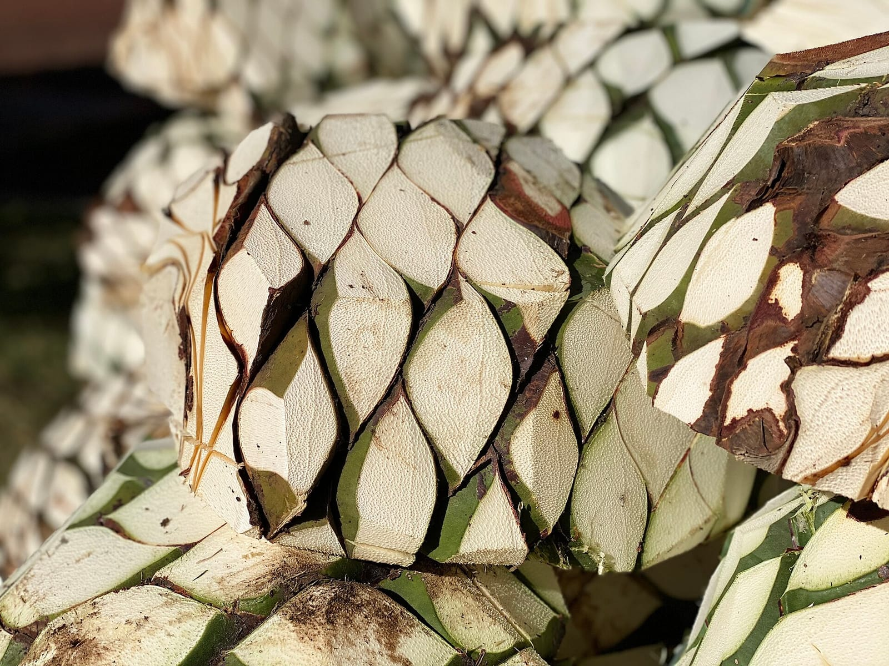
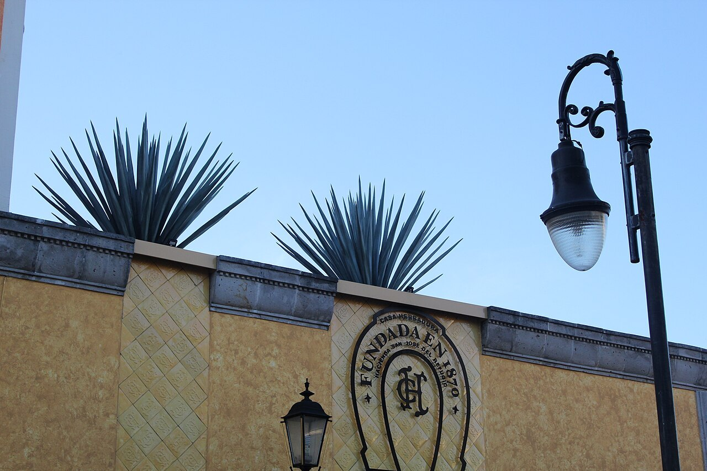

# 墨西哥龙舌兰路线

这条路线只安排两站，却足以把龙舌兰酒的核心问题看一遍：第一站在阿马蒂坦的[埃拉杜拉](ref:herradura)，第二站在特基拉镇的[福塔莱萨](ref:fortaleza)。两处都在哈利斯科州的火山低地，相距不远，做法却分向两端：一边把庄园规模、现代磨机与标准化参观结合，一边把塔霍纳、木槽与两只老铜壶留在生产线上。路线适合自驾或包车，先定预约时段与不喝酒的司机。

图：墨西哥龙舌兰路线所在的龙舌兰酒法定产区风貌配图。图片：Alfonso Jiménez，CC BY-SA 4.0，via Wikimedia Commons（[原图页面](https://commons.wikimedia.org/wiki/File:La_base_del_tequila_agave_azul_tequilana_Weber.jpg)）。这张照片用于说明产区环境与访问语境，不标定墨西哥龙舌兰路线的门店、酒庄或活动现场。

## 从瓜达拉哈拉到阿马蒂坦：火山低地的第一站

阿马蒂坦在瓜达拉哈拉与特基拉镇之间的公路线上，是官方叙事里的龙舌兰酒摇篮之一。从瓜达拉哈拉自驾约一小时，从特基拉镇过来约二十分钟，镇外有停车空间；公共交通有限，自驾或含接送的团队更稳妥。庄园地址写作圣何塞德尔雷富希奥旧庄园、多尼亚·加布里埃拉·佩尼亚·洛萨达街 405 号，邮编 45380，参观须年满 18 岁并提前在官网预约。

这一带是火山成因的低地。酒厂把这里的[蓝色韦伯龙舌兰](ref:agave)描述为带有更明显的土质与草本气息；植株要长到六至八年才收割，jimador 用 coa 削去叶片，只留下甜度集中的 piña。先走这一站，是因为它能把原料到陈年的完整链条一次看完，后面的对比才有基准。

## 阿马蒂坦的砖炉与野酵母

埃拉杜拉的历史起点定在 1870 年，地点就是阿马蒂坦的圣何塞德尔雷富希奥庄园；1928 年，“herradura”（马蹄铁）正式成为品牌名。它今天属于百富门集团，但仍以“庄园自产、自蒸馏、自装瓶”为核心。访客看到的是仍在出酒的老厂房：十九世纪的厚墙与高屋顶，接着不锈钢罐与灌装线。

工艺上最容易被忽略的一点是：它并没有完全停留在旧法。piña 仍码进手工砌起的砖砌穹顶炉，慢蒸约 26 小时，带出熟龙舌兰的焦糖与坚果气息；但磨碎环节早已改用现代设备，取代驴拉的塔霍纳石轮。开放式发酵槽不接种商业酵母，而靠庄园周边十六种以上果树带来的野生酵母，发酵约三天。铜壶二次蒸馏，掐去酒头与酒尾，只取中段；随后部分酒液进入烤过的美国白橡木桶。

产品线把陈年拉得很开：Blanco 不经桶，Silver 约 45 天，Reposado 11 个月，Añejo 至少 25 个月，Selección Suprema 在 1994 年推出，Aniversario 为纪念 150 年而陈年 100 个月。2001 年，特雷莎·拉拉·洛佩斯成为行业第一位女性生产负责人。只喝一款就选 Blanco：低地龙舌兰的草本、黑胡椒与矿物质感是否干净，一入口就清楚。

## 特基拉镇：从 La Perseverancia 到 La Fortaleza

第二站往东北进入特基拉镇。镇中心不大，但坡道多，自驾最好把车停在镇外。福塔莱萨在 Centro 区的塔巴斯科街 153 号，邮编 46400，坐在高处，能俯看旧日竞争对手的厂房；厂区是斜坡上的老宅与车间，发酵区、蒸馏间与地下酒窖顺地势分布。

家族叙事从塞诺维奥·绍萨开始。1873 年，他在特基拉镇创办第一座酒厂 La Perseverancia。后来弗朗西斯科·哈维尔在镇上最高处买地，建起带小砖炉、塔霍纳坑、木发酵槽和两只小铜壶的酒厂，取名 La Fortaleza。设备用到 1968 年，因效率太低停火；1976 年家族卖掉公司，却保留这块地与老厂；1999 年孙子吉列尔莫开始修复，2005 年品牌重新上市。

工艺照十九世纪的样子走：蓝色韦伯龙舌兰先在砖炉蒸煮，再进塔霍纳坑，用石轮把烤软的 piña 压成纤维与汁液；随后进木槽自然发酵；最后用两只老铜壶做[二次蒸馏](ref:distillation)。酒厂强调水源来自庄园泉水，不添加糖浆或增味剂。代价是产量小、成本高，回报是更厚的纤维感与更明显的矿物收尾。

## CRT 与 NOM-006：什么才算龙舌兰酒

[龙舌兰酒](ref:tequila)受墨西哥官方标准 NOM-006-SCFI-2012 约束，由龙舌兰酒监管委员会（CRT）负责认证与监督。只有用蓝色韦伯龙舌兰、在法定产区内按规范生产，才能叫 tequila；产区核心在哈利斯科，并包括瓜纳华托、米却肯、纳亚里特与塔毛利帕斯的部分市镇。阿马蒂坦与特基拉镇都在核心带，但风格不会因此相同。

标签上最实用的是原料类别与酒精度。标“100% de agave”的酒，全部糖分必须来自蓝色韦伯龙舌兰；未标明的混合型则至少有 51% 的糖分来自它，其余可来自其他可发酵糖。成品的酒精度须落在 35% 至 55% 之间。陈年名称也有下限：Reposado 至少两个月，Añejo 至少一年，Extra Añejo 至少三年。埃拉杜拉把自家陈年时间拉得远高于下限，这是品牌策略，不是法规要求。

## 两座酒厂怎么对比品鉴

最有效的喝法是先建立基准，再逐层加变量。第一轮并排喝两家的 Blanco：埃拉杜拉用现代磨机、野酵母与铜壶，酒体更干净利落；福塔莱萨用塔霍纳与木槽，纤维感与矿物收尾更粗粝。第二轮换 Reposado，注意埃拉杜拉的 11 个月桶陈带来多少香草与甜润，福塔莱萨的桶味则更克制，龙舌兰骨架仍在前面。第三轮再进 Añejo，比较烤坚果、焦糖与旧木的层次。

每杯少量，吐酒是专业做法。两家都要求年满 18 岁，可能查证件；埃拉杜拉的庄园体验约 2.5 小时，双桶仪式约 3 小时，福塔莱萨的 Vive Abuelo 约 90 分钟、Vive Bisabuelo 约 150 分钟，价格与场次会调整，以官网为准。

## 车程、预约与不喝酒的司机

瓜达拉哈拉—阿马蒂坦约一小时，阿马蒂坦—特基拉镇约二十至三十分钟，特基拉镇回瓜达拉哈拉约一小时出头；乡村道路夜间没有路灯，不要把最后一场排到天黑之后。两站都要预约：埃拉杜拉按体验收费，福塔莱萨按线路与语言分场；旺季、周末与假期名额紧张，最好提前数日预订。

最重要的一条是饮酒后不开车。一杯就可能影响判断，火山低地的公路容错更低。最稳妥的是包车、指定司机或含接送的行程；若自己开车，品鉴时全部吐掉。开放时间、预约与交通以各官方渠道为准，页面核验日期 2026-11-09。

相关条目：[埃拉杜拉酒厂：阿马蒂坦的马蹄庄园](ref:herradura)、[福塔莱萨酒厂：把 1873 年的作坊重新点火](ref:fortaleza)、[龙舌兰酒](ref:tequila)。

墨西哥龙舌兰路线跨火山低地，包车或指定司机比自驾稳妥；酒厂参观以各官网预约，品鉴后不要开车。核验于 2026-11-09。

## 相关图像

图：龙舌兰（龙舌兰属）。图片：Marc Ryckaert ( MJJR )，CC BY-SA 3.0，via Wikimedia Commons（[原图页面](https://commons.wikimedia.org/wiki/File:Agave_americana_R01.jpg)）。关联图像：墨西哥龙舌兰路线。

图：Casa Herradura。图片：Lupita Sarai，CC BY-SA 4.0，via Wikimedia Commons（[原图页面](https://commons.wikimedia.org/w/index.php?curid=84673666)）。关联图像：墨西哥龙舌兰路线。
