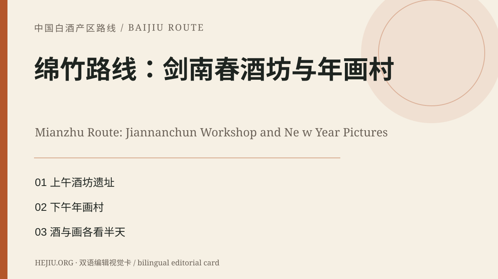
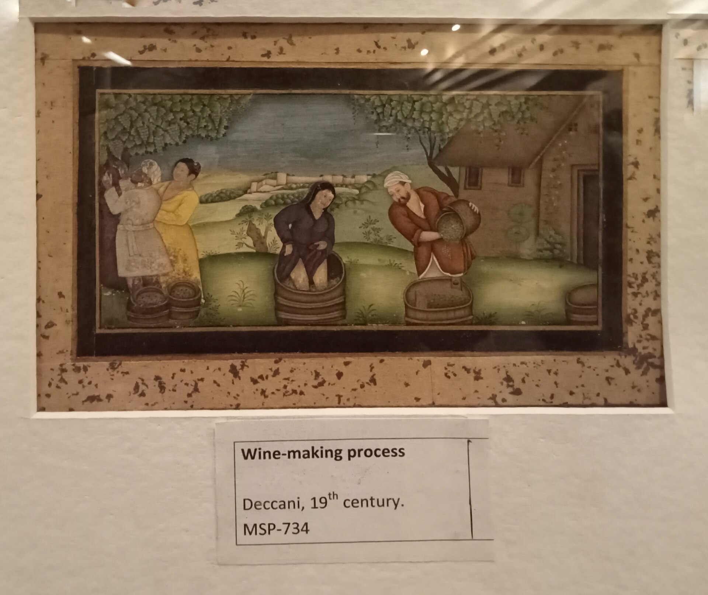

# 绵竹路线：剑南春酒坊与年画村

绵竹适合用一天看两种“手上功夫”：一种是浓香型白酒的窖池、制曲与蒸馏，一种是绵竹木版年画的刻版、套印与手绘。很多人把两者压成“酒厂加古镇”，结果上午在厂区门口等，下午在年画村赶。这条路线把酒坊放在上午、年画村放在下午，中间回市区吃饭，让两个现场都留有理解的时间。

图：绵竹路线专属双语视觉卡。项目自制双语视觉卡，用于识别主题，不是现场照片。

> **先给结论**
> **适合谁：** 想同时看浓香型酒坊与民间年画的人；适合从成都、德阳或绵竹市区出发。
> **不适合谁：** 只想在一个点深度停留、不愿转场的人；两处之间需要车程。
> **一句话：** 上午酒坊、下午年画，中午回市区，品鉴与买酒买画分开。

## 路线逻辑：酒与画各占半天

酒坊与年画村不是同一种参访：酒坊要看生产空间、窖池与作坊，信息密度高但停留时间不必太长；年画村要看工序、展廊与体验，容易被店铺和体验项目拉长时间。把酒坊放在上午，是因为上午体力与注意力更好，适合看碑、池、作坊与流程；年画村放在下午，是因为体验与购物可以灵活收尾。中午回绵竹市区吃饭，避免在厂区周边找不到合适餐馆，也让两段车程分开。

## 上午：剑南春酒坊遗址

先看国保碑与遗址范围，再看天益老号的窖池与作坊。浓香型白酒用泥窖固态发酵，窖池连续使用越久、窖泥养护越稳定，窖香与己酸乙酯才容易出来。看三件事：池壁厚度与池底泥层，作坊的通风与排水，蒸馏设备与窖池的距离。不要触摸窖泥，不把相机伸进池口；现场有人作业时保持距离。若展陈开放，先看模型与剖面，再到现场对照；若只在外围，就把碑、遗址边界与厂区外观连起来看，不要追着车间拍照。

## 下午：年画村

年画村的核心是绵竹木版年画的生产与展示，不是一条连续商业街。进村先看导览图，分清公共展廊、收费体验、作坊与店铺；不要看到开着的院门就进，有些是私人作场或团队预约区。看工序时注意起稿、刻版、调色、套印与手绘开脸，重点在版位、颜料湿度、纸张铺平与补画，而不是“颜色艳不艳”。想体验，先问是拓印现成版还是从刻版开始、成品能否带走、材料是否另收费。买画看套印、纸张与作者信息，价格明显偏低时先问是不是机器印刷。

## 交通、预约与时间

绵竹在成都平原西北，距成都约一小时多车程，距德阳更近；从成都东站或德阳站转车都可行，班次以实时查询为准。酒坊只看遗址与展陈约两小时；年画村看展廊与一个作坊约两小时，加体验与午饭半天。两处之间打车或自驾约二十分钟上下，公交班次少，返程要提前问末班。酒坊与年画村的开放、预约与收费各自独立，出发前一天分别确认；夏天酒坊气味重、年画村晒场热，带口罩、水与帽子，穿防滑鞋。

## 品鉴、买画与返程

酒坊品鉴要问清酒精度、容量与收费，小杯慢饮，不空腹；司机不喝，品鉴后不要开车。买酒去官方店或授权店，保留发票；不要把“内部酒”当成遗址的延伸。买画先看套印是否对位、纸张与颜料是否稳定、是否有作者或作坊信息；小幅印刷品与明信片适合带走，大幅原作要考虑卷装、防潮与运输。返程前回市区吃饭，试绵竹米粉、板鸭与川味家常菜；若还要去九龙山或麓棠温泉，单独留半天，不要塞进酒坊半日。

## 一日与半日版本

一日版按“酒坊遗址—市区午饭—年画村—市区晚饭”走，上午不要拖到中午，下午不要把体验排到闭村前。半日版只选酒坊，或只选年画村，不要两头赶；若带长辈，酒坊看碑、池与一段作坊，年画村只看展廊与一个作坊。若带孩子，上午酒坊控制在一小时内，下午把时间留给拓印或填色，别让他们在车间外等到失去耐心。返程前买酒买画分开，司机不参加品鉴，雨天把年画村体验改成展廊。从成都当天往返，把酒坊放在九点前后，午饭后再去年画村，返程避开晚高峰；若只选一处，酒坊看遗址与一段作坊，年画村看展廊与一个作坊。买画要包装，买酒要发票，带水与帽子，班车问末班，提前确认，慢走，带好身份证与预约码，买画包装。

## 出发前核对

- 分别确认酒坊与年画村开放
- 上午酒坊，下午年画村
- 不触摸窖泥与池口
- 体验前问清价格与材料
- 买画看套印与作者信息
- 司机不参加品鉴
- 夏天带口罩、水与帽子
- 返程班车提前问

## 这一路线不适合谁

这条路线把酒坊遗址与年画村放在一天，适合对工艺与地方手艺都感兴趣的人。若你只想看酒，年画村会占用半天；若你带着很小的孩子，酒坊参观的讲解与品鉴节奏可能偏长。

绵竹市区到两个点都需要车程，公交班次有限，打车更灵活；节假日年画村停车紧张。酒坊遗址的开放范围有限，不能进入生产保护区域。

替代方案：只看剑南春酒坊遗址，午后回绵竹老城；或只看年画村与手作体验。从成都出发当天往返可行，但不要把绵阳或其他景点再塞进来。

## 参考资料

- 绵竹市人民政府 — 美丽绵竹 — https://www.mz.gov.cn/meilimianzhu.htm（绵竹市人民政府，核对 2026-11-25）
- 剑南春 — 关于剑南春 — https://www.jnc.cn/about（四川剑南春（集团）有限责任公司，核对 2026-11-25）
- 德阳市人民政府 — https://www.deyang.gov.cn/（德阳市人民政府，核对 2026-11-25）
- GB/T 2260-2007 中华人民共和国行政区划代码（国家标准化管理委员会，核对 2026-11-25）

相关条目：[剑南春酒坊遗址](ref:cellars)、[绵竹年画村](ref:village)、[剑南春](ref:brand)、[浓香型白酒](ref:style)、[四川省](ref:region)、[酒与绘画](ref:art)、[第一次喝白酒怎么选](ref:guide)、[中国酒史纲](ref:history)。

## 相关图像

图：四川省。图片：FISU，CC BY 3.0，via Wikimedia Commons（[原图页面](https://commons.wikimedia.org/wiki/File:%E9%9B%AA%E5%B1%B1%E4%B8%8B%E7%9A%84%E6%88%90%E9%83%BD%E5%B8%82%E5%A4%A9%E9%99%85%E7%BA%BF_Chengdu_skyline_with_snow_capped_mountains.jpg)）。关联图像：绵竹路线：剑南春酒坊与年画村。

图：酒与画：宴饮图像的四种看法相关实景照片。图片：Natasha Khaitan，CC BY-SA 4.0，via Wikimedia Commons（[原图页面](https://commons.wikimedia.org/wiki/File:Wine_making_process_-_Deccan_Painting_-19th_Century.jpg)）。关联图像：绵竹路线：剑南春酒坊与年画村。
