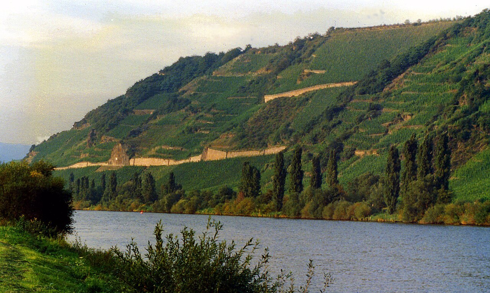

# 摩泽尔雷司令路线：中摩泽尔与萨尔的两座陡坡酒庄

摩泽尔的葡萄酒地图沿河展开，真正决定路线的不是行政区，而是坡向、板岩与河湾。这条两站路线把中摩泽尔（Mittelmosel）的贝恩卡斯特-库斯与上游萨尔（Saar）河谷的维尔廷根连在一起：前者看板岩坡地上的酒庄如何把地块装进酒标，后者看一座 1797 年以来由同一家族经营的庄园如何把一座山做成一个名字。两站都以[雷司令](ref:riesling)为核心，都能看到[橡木桶](ref:oak-ageing)与不锈钢罐的组合，却给出两种关于“陡”的答案。

图：摩泽尔雷司令路线：中摩泽尔与萨尔的两座陡坡酒庄所在的摩泽尔风貌配图。摄影：Mosel vineyard in Tittenheim。署名：Phillip Capper，CC BY 2.0，来自 Wikimedia Commons（[来源](https://commons.wikimedia.org/w/index.php?curid=4168277)）。这张照片用于说明产区环境与访问语境，不标定摩泽尔雷司令路线：中摩泽尔与萨尔的两座陡坡酒庄的门店、酒庄或活动现场。

## 为什么把贝恩卡斯特与维尔廷根放在一条线上

中摩泽尔的河湾密集，葡萄园几乎贴着水面，坡向随河道不断变化；萨尔河更窄、更冷，成熟期更晚，酒体也更收。两地同属德国葡萄酒法规与 VDP 的分级语言，却在地块尺度上分歧明显：中摩泽尔强调不同板岩与不同名园的组合，萨尔则习惯把一整座山当作一个名字来经营。

把两站串起来，能一次看到“河湾型”与“支流型”的雷司令。前者果味更开、酒体稍宽，后者酸度更利、香气更紧。自驾是唯一可靠的方式：从贝恩卡斯特到维尔廷根沿 B51 与萨尔河谷走，不到一小时；公共交通需要换乘，而酒庄多位于坡脚或村口，班次与步行距离都不适合把时间压得太紧。

## 第一站：贝恩卡斯特的卢森博士酒庄

第一站是[卢森博士酒庄](ref:dr-loosen)，位于贝恩卡斯特-库斯的圣约翰内斯霍夫（St. Johannishof）。酒庄在同一家族手里超过两百年，1988 年起由 Ernst F. Loosen 管理，1993 年成为 VDP 成员。官方叙述把“摩泽尔传统”与“板岩陡坡”放在最前面：未嫁接的老藤、历史名园与接近 1900 年前后风格的酿造，是它区别于大厂的地方。

酒单用板岩颜色做入门线索：蓝板岩、红板岩、灰板岩分别对应不同地块与口感取向，再往上才是 Großes Gewächs（GG）与 RÉSERVE。GG 来自 Erdener Treppchen、Bernkasteler Lay 等名园，RÉSERVE 则以长期桶陈换取更干的质地。对访客而言，这里最适合建立“同一品种、不同地块”的参照：先喝三块板岩，再把 GG 与入门款对照，就能理解酒庄为什么把地块写在最显眼的位置。

## 第二站：维尔廷根的伊贡·米勒与沙兹霍夫山

第二站是[伊贡·米勒酒庄](ref:egon-muller)，在维尔廷根的沙兹霍夫（Scharzhof）。家族自 1797 年起经营，酒庄与沙兹霍夫山（Scharzhofberg）几乎不可分割：南向陡坡、蓝板岩、老藤，加上极低的产量，使它的 Kabinett 与 Auslese 常被当作教科书。官方页面只以“Scharzhof, Wiltingen/Saar”与邮箱示人，这种克制也反映在酒标上——地名与年份先行，形容词很少。

这里的酒不追求宽厚，而是用酸度把甜度“吊”起来：Kabinett 的轻甜、Spätlese 的熟果、Auslese 的贵腐边缘，都靠一条高酸骨架保持清醒。同一座山的 TBA 则是另一套逻辑，靠贵腐与逐粒挑选换取浓度，甜度不再是“加糖”，而是原料本身的浓缩。把两站排在同一天，先看地块组合，再看单一名园的极致，顺序会更清楚。

## 板岩坡地、陡坡与人工采运

摩泽尔的“陡”不是修辞。坡地多为板岩碎屑，保水差、升温快，根系必须向下找水；这也解释了为什么老藤与深根在这里被反复强调。板岩的颜色与风化程度会改变酒的口感：蓝板岩常给更紧的酸度与矿物感，红板岩偏香料与果味，灰板岩则更圆。酒标上的“Schiefer”不是装饰，而是地块说明。

机械化在陡坡上作用有限。采摘、修剪与搬运仍大量依赖人工，部分地块只能靠小型履带车或索道；也正因为人工成本高，酒庄更愿意把产量压低，把差别做进少数几款酒里。参观时如果只记住“陡”，会漏掉另一半：坡脚的酒窖、村内的旧建筑与家族住宅，才是把坡地变成酒的地方。

## 从 Kabinett 到 Trockenbeerenauslese：残糖分级怎么读

德国传统分级按采收时的糖度，而不是按成品甜度。Kabinett 最轻，Spätlese 更熟，Auslese 开始挑果，Beerenauslese（BA）要求逐粒贵腐，Trockenbeerenauslese（TBA）要求近乎葡萄干状态的贵腐果。糖度越高，潜在酒精度越高，但酒庄可以选择提前停止发酵，把糖留下；于是同一块地的 Kabinett 可以是干型，Auslese 也可以是干型，标签必须结合“trocken / feinherb / süß”一起读。

这条分级线也解释了摩泽尔的酒精度为什么常偏低：成熟度靠糖度衡量，但发酵是否走完由酒庄决定。理解这一点，才不会把“甜”误当成“级别”，也不会把“干”误当成“没有浓度”。在卢森博士酒庄，三块板岩的干型是入口；在伊贡·米勒，Kabinett 与 Auslese 的甜型是参照。两条线索合起来，才是完整的摩泽尔。

## 车程、预约与品鉴安排

贝恩卡斯特到维尔廷根不到一小时车程，沿 B51 与萨尔河谷行驶，路窄且多弯；冬季路面可能结冰，夜间没有路灯。两家酒庄的接待都以预约为前提，具体场次与费用随季节变化。卢森博士酒庄的官方页面只给出地址与联系方式，参观与品鉴需先邮件确认；伊贡·米勒的官方页同样以联系为主，不宜假设随时可以进入酒窖。

品鉴前先问清四件事：是否收费、是否含酒窖、能否带儿童、是否提供吐酒桶。开车的人应当吐酒或只做少量品尝；摩泽尔的乡村道路容错低，一杯就可能影响判断。若只有一天，建议上午卢森博士、下午伊贡·米勒，把回程留在天亮之前。

## 另见

- [卢森博士酒庄](ref:dr-loosen)：圣约翰内斯霍夫、板岩入门线与 GG。
- [伊贡·米勒酒庄](ref:egon-muller)：1797 年以来的家族与沙兹霍夫山。
- 想补背景，可读[摩泽尔产区](ref:mosel)、[雷司令](ref:riesling)与[白葡萄酒](ref:white-wine)条目。

对照阅读：[卢森博士酒庄](ref:dr-loosen)、[摩泽尔](ref:mosel)。

摩泽尔雷司令路线含中摩泽尔与萨尔陡坡酒庄，船班、缆车与酒庄预约要分别确认；以各官网与实时交通信息为准。核验于 2026-11-09。

**关键事实。**

| 项目 | 内容 |
| --- | --- |
| 一句话定位 | 从贝恩卡斯特-库斯的卢森博士酒庄到维尔廷根的伊贡·米勒酒庄，两站沿摩泽尔与萨尔河谷展开；这条路线用板岩坡地、陡坡人工与雷司令的残糖分级，串起中摩泽尔的地块组合与沙兹霍夫山的单一名园 |
| 站数 | 2 |
| 交通 | 自驾 |
| 停靠顺序 | 卢森博士酒庄、伊贡·米勒酒庄 |
