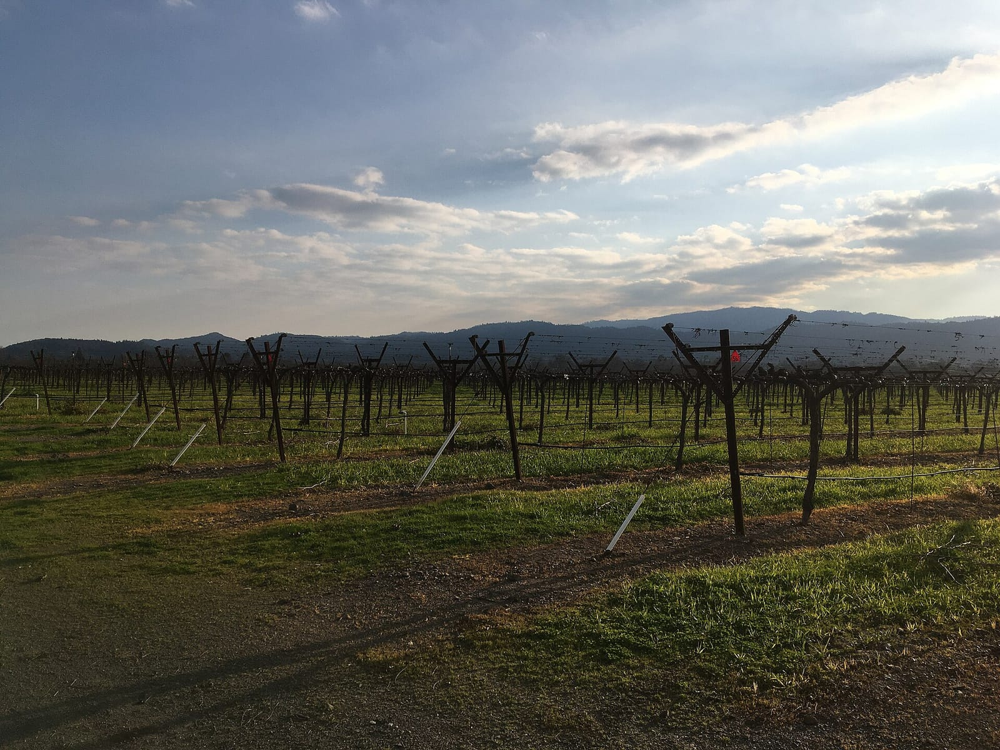
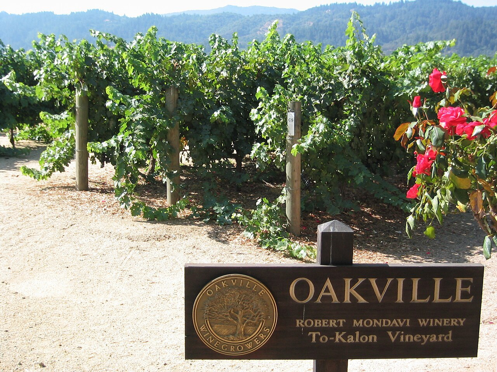
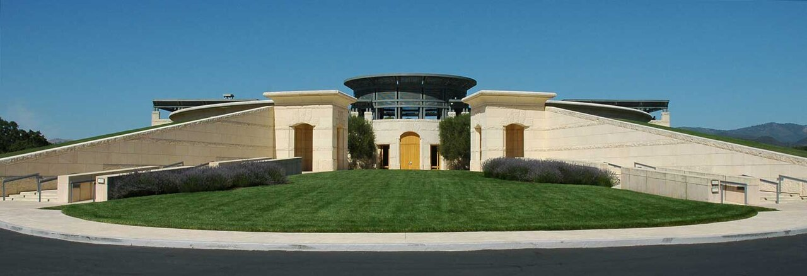

# 纳帕谷路线：1976 年巴黎审判之后的现代酒庄带

纳帕谷的酒庄路线很容易变成“一天喝五家”。这条路线只安排三家，因为它们能回答同一个问题：1976 年巴黎审判之后，纳帕如何从“美国产酒地”变成“世界葡萄酒版图上的名字”。蒙大维是推手，Opus One 是跨大西洋的合资实验，贝灵哲则是被现代叙事覆盖的老酒庄。三站都在 St Helena Highway 沿线，车程很短，但时间跨度超过一百年。

图：纳帕谷路线：1976 年巴黎审判之后的现代酒庄带相关实景照片。图片：GIANTPAPAYA，CC BY-SA 4.0，via Wikimedia Commons（[原图页面](https://commons.wikimedia.org/wiki/File:Napa_Valley,_Late_Afternoon.jpg)）。

> **先给结论**
> **一句话：** 这页判断纳帕谷路线：1976 年巴黎审判之后的现代酒庄带怎么排、走多久、哪些点不能省。
>
> - **适合谁：** 想把纳帕谷路线：1976 年巴黎审判之后的现代酒庄带排成一日或两日行程、需要知道顺序与停留重点的人。
> - **不适合谁：** 只想看单个地点、不打算按路线走的人。
> - **先看这两点：**
>   - - 第一站：罗伯特·蒙大维酒庄，7801 St Helena Highway, Oakville, CA 94562，1966 年创立。
>   - 纳帕的旺季在五月到十月，天气干热，葡萄园与酒庄都很忙；九月到十月是采收期，酒庄可能安排采收体验，但交通与住宿紧张。

## 路线概览

- 第一站：[罗伯特·蒙大维酒庄](ref:mondavi)，7801 St Helena Highway, Oakville, CA 94562，1966 年创立，To Kalon 葡萄园是其核心。
- 第二站：[Opus One 酒庄](ref:opus)，7900 St Helena Highway, Oakville, CA 94562，1979 年由罗伯特·蒙大维与菲利普·德·罗思柴尔德男爵合资，首个年份为 1979。
- 第三站：[贝灵哲酒庄](ref:beringer)，2000 Main Street, St Helena, CA 94574，1876 年由 Jacob 与 Frederick Beringer 创立，Rhine House 建于 1884 年。
- 方式：自驾为主；纳帕谷有 VINE 巴士，但酒庄之间换乘不便，品鉴后不要开车。
- 建议时长：一天。上午蒙大维，中午在 Oakville 一带吃饭，下午 Opus One 与贝灵哲；三场预约之间至少留一小时。

## 为什么走这条线

1976 年的巴黎审判是一场盲品：英国酒商 Steven Spurrier 组织法国评委对比加州与法国的白葡萄酒和红葡萄酒，结果加州在两项中都胜出。这场品鉴的意义不在于“加州比法国好”，而在于它让纳帕谷进入国际讨论，证明新世界可以做出有陈年潜力的酒。此后，纳帕的投资、技术、葡萄园扩张与品牌建设加速，蒙大维与 Opus One 都是这股浪潮的产物。

蒙大维提供“现代纳帕”的起点。1966 年，罗伯特·蒙大维在 Oakville 建立酒庄，他是意大利移民家庭出身，在 Charles Krug 家族酒庄工作后独立创业；他主张用法国橡木桶、低温发酵与葡萄园分级，把纳帕从“量产酒”推向“精品酒”。To Kalon 葡萄园是这条路线的地理核心，它位于 Oakville 的西侧，土壤以砾石与冲积土为主，赤霞珠在这里能获得成熟度与结构。

Opus One 提供“合资”的样本。1979 年，蒙大维与菲利普·德·罗思柴尔德男爵决定合办酒庄，把波尔多的调配传统与纳帕的果味结合；第一个年份 1979 在 1984 年上市，酒庄建筑在 1991 年完成。它不是“波尔多在纳帕的复制品”，而是一次关于品种比例、橡木桶与陈年时间的谈判。贝灵哲提供“更长的时间”。它 1876 年创立，是纳帕持续运营最久的酒庄之一，Rhine House 与老酒窖在禁酒令、经济危机与产业转型中保留下来；把它放在最后，是为了提醒：纳帕不是 1976 年才出现的。

## 第一站：罗伯特·蒙大维酒庄

为什么去：它把“现代纳帕”的几件事放在一个园区里——葡萄园、酒庄、品鉴室与艺术收藏。1966 年，罗伯特·蒙大维在 Oakville 的 St Helena Highway 边建立酒庄，这是禁酒令之后纳帕首批新建的酒庄之一；他以“在纳帕做出世界级葡萄酒”为目标，从法国引进橡木桶与酿造理念，也推动葡萄园的分级与合同种植。

看什么：To Kalon 葡萄园是重点。它位于 Oakville 西侧，靠近 Mayacamas 山脚，土壤以砾石、砂与冲积土为主，排水好、日照足，赤霞珠在这里能获得成熟的黑加仑风味与足够的酸度。酒庄建筑由 Cliff May 设计，带有加州 mission 风格，拱廊、庭院与葡萄园形成一条轴线；园区里的雕塑与艺术收藏也值得看，它们反映蒙大维把“酒、食物、艺术”放在一起的想法。

喝什么：蒙大维的产品线很宽，从 Napa Valley 系列的赤霞珠、霞多丽，到 To Kalon 单一园与珍藏级酒款。第一次来，先喝一款 Napa Valley 赤霞珠，再喝一款 To Kalon 或珍藏级，比较果味、橡木与单宁的差异。不要只盯着“贵的那瓶”，酒庄的价值在于把不同层级讲清楚；如果预约的是“酒庄导览”，确认是否含葡萄园步行与品鉴。

## 第二站：Opus One 酒庄

为什么去：它是一次跨大西洋的合资实验，也是纳帕“品牌化”的典型。1979 年，罗伯特·蒙大维与菲利普·德·罗思柴尔德男爵决定共同酿造一款酒，结合波尔多的调配传统与纳帕的成熟果味；第一个年份 1979 在 1984 年上市，酒庄建筑在 1991 年完成，名字来自“作品一号”的意思。它不是波尔多的复制品，也不是蒙大维的副牌，而是一家独立的酒庄公司。

看什么：酒庄建筑由 Scott Johnson 设计，半圆形屋顶、低矮的体量与葡萄园融为一体；参观动线通常包括发酵车间、酒窖与品鉴室。重点看“单园”与“调配”的关系：Opus One 的葡萄来自 Oakville 的四个地块，以赤霞珠为主，配合品丽珠、梅洛、小维多与马尔贝克；发酵与陈年在法国橡木桶中完成，新桶比例与陈年时间随年份调整。不要把“波尔多品种”与“波尔多风格”画等号，纳帕的日照与成熟度会改变酒的质地。

喝什么：Opus One 的正牌是唯一的核心产品，另有 Overture 作为副牌；年份差异明显，凉爽年份更紧致，炎热年份更饱满。第一次来，先喝当前年份的正牌，再喝一款较老的年份，比较单宁、酸度与陈年香气。参观通常需要预约，且有年龄限制；不要带未成年儿童进入品鉴空间，也不要临时到访要求加位。

## 第三站：贝灵哲酒庄

为什么去：它把“老纳帕”放回路线。1876 年，Jacob 与 Frederick Beringer 兄弟在 St Helena 创立酒庄，是纳帕持续运营最久的酒庄之一；Rhine House 建于 1884 年，由 Jacob 从德国莱茵地区请来的工匠建造，石墙、塔楼与花园是圣海伦娜的地标。禁酒令期间，酒庄靠“圣餐酒”与教堂许可维持生产；1970 年代以后，贝灵哲通过收购与品牌扩张成为纳帕的重要酒庄。

看什么：Rhine House 是重点，它把欧洲酒庄的宅邸想象搬到纳帕，也反映了 19 世纪移民与葡萄酒文化的关系；老酒窖开凿在山坡里，石墙与拱顶保留下来，用于陈年与参观。酒庄的葡萄园分布在纳帕谷多个子产区，从 St Helena 到 Rutherford、Calistoga；不要只看宅邸，问清楚导览是否含酒窖与葡萄园，否则容易变成“在花园里喝酒”。

喝什么：贝灵哲的产品线从 Private Reserve 赤霞珠到 Knights Valley、Napa Valley 系列；第一次来，先喝一款 Napa Valley 赤霞珠，再喝 Private Reserve，比较果味、橡木与单宁。贝灵哲的历史长，但不要把“1876”当成“所有酒款都来自老藤”；酒庄的葡萄来源与酒款层级差异很大，喝之前先看酒标上的产区与系列。

## 交通与节奏

三站都在 St Helena Highway（CA-29）沿线，从 Oakville 到 St Helena 是同一条谷底公路上的短程车程；自驾最方便，但品鉴后不要开车。纳帕谷有 VINE 巴士连接主要城镇，酒庄之间换乘不便，班次与路线以当天查询为准；也可以预约含接送的酒庄行程或指定司机。CA-29 在旺季与周末容易堵车，Silverado Trail 可以作为替代路线，但不要为了赶时间超速。

节奏建议：上午到蒙大维，先走葡萄园与酒庄，再品鉴；中午在 Oakville 或 Rutherford 吃饭；午后到 Opus One，按预约参加导览与品鉴；下午稍晚到贝灵哲，看 Rhine House 与酒窖。三场之间至少留一小时，不要把品鉴排得太密；味觉疲劳会让第三场变成“喝不出区别”。

纳帕的酒庄大多需要预约，尤其是 Opus One 与蒙大维的导览；贝灵哲的经典宅邸参观可以现场购票，但旺季也会满。预约时确认语言、时长、是否含葡萄园步行、是否含品鉴、是否有年龄限制；不要在同一天安排四家以上，也不要在品鉴后安排长途驾驶。

## 季节与预约

纳帕的旺季在五月到十月，天气干热，葡萄园与酒庄都很忙；九月到十月是采收期，酒庄可能安排采收体验，但交通与住宿紧张。冬季安静，酒庄营业时间缩短，部分导览减少；春季芥末花开，葡萄园景色好，但雨水多。无论哪个季节，加州的阳光都很强，带帽子、墨镜与防晒；酒庄品鉴多在户外或半户外，注意补水。

预约是这条路线的前提。Opus One 只接受预约，且有年龄限制；蒙大维的导览与品鉴按场次安排；贝灵哲的 Rhine House 参观在旺季建议提前订。不要把“到店再说”当成计划，尤其是周末与采收期。若预约不到 Opus One，可以把时间留给蒙大维的 To Kalon 葡萄园步行或贝灵哲的酒窖导览，而不是在门口等位。

## 礼仪与边界

第一，酒庄是农业与生产场所，不是主题公园。没有预约不要进入生产区，不要触摸设备、桶与展品；葡萄园里不要摘葡萄、踩藤行或跨越围栏。第二，品鉴时使用吐酒桶，开车的人不喝；加州的酒驾执法严格，指定司机要全程不喝。第三，着装以舒适、整洁为主，葡萄园地面不平，避免高跟鞋；酒窖温度低，带一件薄外套。

第四，把历史读准。1976 年的巴黎审判是盲品事件，不是“纳帕法定产区成立”；蒙大维的 1966 年是酒庄创立年，不是 To Kalon 葡萄园的最早种植年；Opus One 的 1979 年是首个年份，1984 年是上市年，1991 年是酒庄建筑完成年；贝灵哲的 1876 年是创立年，Rhine House 的 1884 年是建筑年。第五，区分“酒庄”“品牌”与“葡萄园”：To Kalon 是葡萄园名，Opus One 是酒庄与品牌，贝灵哲的所有权与酒款系列经历过多次变化，不要把三者混为一谈。

## 替代与延伸

若 Opus One 预约不到，最直接的替代是蒙大维的 To Kalon 单一园品鉴，或贝灵哲的 Private Reserve 对比；不要用“随便找一家”填满时间，纳帕的酒庄密度高，但风格差异需要选择。若想把 1976 年巴黎审判看得更完整，可以另安排一天去 Chateau Montelena 与 Stag's Leap Wine Cellars，那两家是当年盲品的胜出者，与本条路线的“现代酒庄带”形成互补。

往北可以延伸到 Calistoga 与 Knights Valley，往南可以到 Yountville 与 Carneros；这些子产区的气候与品种不同，不适合在一天里硬串。更合理的延伸是分开安排：一天给 Oakville 与 St Helena 的现代酒庄，另一天给 Calistoga 或 Carneros，把“赤霞珠的核心带”与“凉爽产区的霞多丽、黑皮诺”分开看。

相关条目：[罗伯特·蒙大维酒庄](ref:mondavi)、[作品一号酒庄](ref:opus)。

## 另见

- [罗伯特·蒙大维酒庄](ref:mondavi)：1966 年、To Kalon 与现代纳帕的起点。
- [Opus One 酒庄](ref:opus)：1979 年合资、波尔多调配与纳帕果味。
- [贝灵哲酒庄](ref:beringer)：1876 年、Rhine House 与禁酒令前后的纳帕。
- 想继续读背景，可在内容仓中查阅纳帕谷产区、葡萄酒与“产地与工艺”条目；本页不再重复登记引用。

纳帕谷酒庄多需预约，1976 年巴黎审判相关点位与现代酒庄带也不在同一处；以各酒庄官网确认场次，精确导航用实时地图。核验于 2026-11-08。

## 相关图像

图：Robert Mondavi winery。摄影：Greg Dunham from Kirkland, WA, USA，CC BY 2.0，来自 Wikimedia Commons。。图片：Greg Dunham from Kirkland, WA, USA，CC BY 2.0，via Wikimedia Commons（[原图页面](https://commons.wikimedia.org/w/index.php?curid=2945111)）。关联图像：纳帕谷路线：1976 年巴黎审判之后的现代酒庄带。

图：作品一号酒庄。图片：No machine-readable author provided. Cszmurlo assumed (based on copyright claims).，CC BY 2.5，via Wikimedia Commons（[原图页面](https://commons.wikimedia.org/wiki/File:Opus-One-Szmurlo.jpg)）。关联图像：纳帕谷路线：1976 年巴黎审判之后的现代酒庄带。
