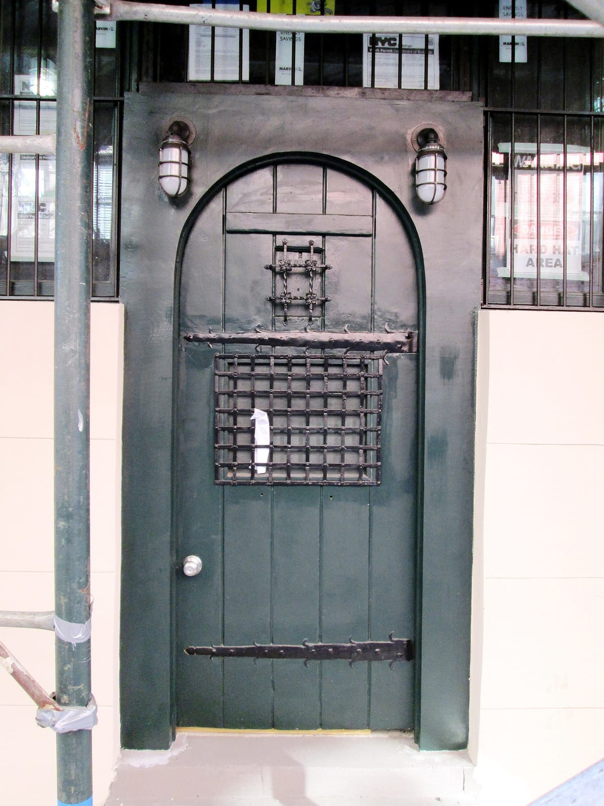
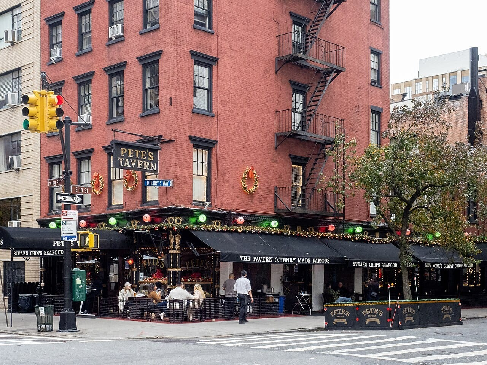

# 纽约历史酒馆路线：东村到格拉梅西

这条路线把纽约曼哈顿下城的三间老酒馆串在一起：东村的麦克索利老麦酒馆、西村的白马酒馆，以及格拉梅西公园旁的皮特酒馆。它们的“老”不是同一种老：一间把“只卖艾尔”坚持成制度，一间背着文学神话，一间是餐厅与酒馆的合体。把它们放在同一个下午到傍晚里，比单独打卡更容易看出纽约如何经营“历史”这件事。

图：纽约历史酒馆路线：东村到格拉梅西相关实景照片。图片：Beyond My Ken，CC BY-SA 4.0，via Wikimedia Commons（[原图页面](https://commons.wikimedia.org/wiki/File:86_Bedford_Street_door_to_Chumley%27s.jpg)）。

> **先给结论**
> **一句话：** 这页判断纽约历史酒馆路线：东村到格拉梅西怎么排、走多久、哪些点不能省。
>
> - **适合谁：** 想把纽约历史酒馆路线：东村到格拉梅西排成一日或两日行程、需要知道顺序与停留重点的人。
> - **不适合谁：** 只想看单个地点、不打算按路线走的人。
> - **先看这两点：**
>   - - 第一站：麦克索利老麦酒馆，地址 15 E 7th St, New York, NY 10003，1854 年由爱尔兰移民约翰·麦克索利开办。
>   - 麦克索利代表“极窄的酒单”。

## 路线概览

- 第一站：[麦克索利老麦酒馆](ref:mcsorleys)，地址 15 E 7th St, New York, NY 10003，1854 年由爱尔兰移民约翰·麦克索利开办。
- 第二站：[白马酒馆](ref:white-horse)，地址 567 Hudson St, New York, NY 10014，1880 年开业，最初服务哈德逊河码头工人。
- 第三站：[皮特酒馆](ref:petes)，地址 129 East 18th Street, New York, NY 10003，建筑建于 1851 年，底层饮酒生意始于 1864 年。
- 方式：地铁与步行为主。东村到西村、西村到格拉梅西都建议乘地铁，站间再步行；天气好时也可以把部分路段改为步行。
- 建议时长：四到六小时，从下午开始，到晚饭结束。

## 为什么是这几站

麦克索利代表“极窄的酒单”。它 1854 年开业，一百多年里只供应艾尔，而且只有淡色与深色两种选择；没有葡萄酒、鸡尾酒或烈酒菜单。店内保留木桌、旧海报、吊灯与历代顾客留下的物件，门口那句“Be Good or Be Gone”是店规，也是它的性格。它把“选择困难”刻意消除了：你只需要决定淡色还是深色。

白马代表“文学叙事”。它 1880 年开业，最初是码头工人下班后喝酒的地方，1950 年代逐渐变成作家、艺术家与音乐人的聚集地。迪伦·托马斯 1953 年的到访让它成为文学地图上的坐标；店里保留原始木结构、锡制天花板、长吧台与旧照片，酒单比麦克索利宽，以啤酒、威士忌与简单鸡尾酒为主。

皮特代表“餐厅与酒馆的合体”。它的建筑 1851 年建成时是 Portman Hotel，底层在 1864 年开出一间既卖杂货也卖酒的店；1899 年改名 Healy's Café，1922 年由 Peter D'Belles 接手后固定为 Pete's Tavern。店内有很长的玫瑰木吧台、压花锡天花板与旧瓷砖地面，酒单包含自有啤酒、生啤、相当长的威士忌清单与经典鸡尾酒，食物是美式正餐与酒吧小食。

三站的距离也构成一条城市切片：东村的狭窄街巷、西村的文学街区、格拉梅西边缘的餐饮区。它们都在曼哈顿下城，但不在同一个步行半径内，必须借助地铁才能把节奏保持住。

## 第一站：麦克索利老麦酒馆

为什么去：它是这条路线里最“单一”的一站。店面窄而深，前厅与后厅都不大，木桌、木椅、旧报纸与照片占据墙面；灯架上挂着历年顾客留下的物件。它首先是一间仍在营业的酒馆，不是博物馆；吧台前的位置是给喝酒的人，不要长时间占着拍陈设。

点什么：进门后先找位置，再直接告诉店员“Light or dark”。想喝清爽一点选淡色，想喝麦芽与烘烤味重一点选深色；不确定就各点一杯对比。店内常按两杯一组上酒，若只想喝一杯可以说明。不要问“有什么鸡尾酒”或“有没有葡萄酒”，这不是它的经营方式。菜单很轻，奶酪、饼干与洋葱等小食适合垫肚子。

停留多久：四十五到六十分钟。第一次来建议选工作日下午，人少、光线好，也能看清店内陈设；周末夜晚更像一场站着的社交实验。

实用提醒：地址是 15 E 7th St, New York, NY 10003，靠近 Cooper Union 与 Astor Place。地铁 6 号线 Astor Place 站步行数分钟；F 线 2 Av 站也可到达。营业时间、支付方式与价格以官方渠道为准；历史上长期以现金为主，出发前最好准备现金并现场确认。这里不接受普通预订，旺季需要等位；没有着装要求，casual 即可。空间狭窄，行动不便者或推婴儿车者建议先电话确认动线。

## 第二站：白马酒馆

为什么去：它把“社区酒馆”与“文学地标”叠在同一栋建筑里。1880 年开业时，它服务的是附近哈德逊河码头的装卸工与船员；1950 年代，西村的房租与生活成本还允许作家、画家与音乐人聚在一起，迪伦·托马斯、杰克·凯鲁亚克、艾伦·金斯堡、詹姆斯·鲍德温等名字先后与这里发生关系。店里保留原始木结构、锡制天花板、长吧台与旧照片，空间比麦克索利宽一些。

点什么：先绕吧台看一眼酒单，再决定坐吧台还是靠墙的桌子。想感受老酒馆气氛就坐吧台，想聊天就找角落。点单可以从一杯生啤开始；想喝威士忌，直接说品牌或风格，不要用“像迪伦·托马斯那样”来点单。若饿了，点一份简单酒吧食物配酒，比只喝酒更稳妥。

停留多久：六十到七十五分钟。工作日傍晚是最舒服的时段：本地常客还在，游客还没填满空间；周末夜晚非常拥挤，不适合第一次约会或安静谈话。

实用提醒：地址是 567 Hudson St, New York, NY 10014，位于 Hudson Street 与 West 11th Street 附近。地铁 1 号线 Christopher Street–Stonewall 站步行数分钟；从 Washington Square Park 走过来约十五分钟。营业时间、菜单与价格以官方渠道为准。通常不接受提前预订，旺季等位；着装 casual，没有硬性要求。价格按西村酒吧水平预期，带一张卡与少量现金更稳妥。空间有历史建筑的低层高与窄通道，行动不便者建议先确认。

## 第三站：皮特酒馆

为什么去：它适合作为路线的收尾，因为这里既能喝酒，也能吃饭。皮特酒馆在纽约东 18 街与 Irving Place 的转角，属于格拉梅西公园一带。它把自己称为“纽约持续经营时间最长的餐厅与酒吧”：建筑建于 1851 年，底层最初的饮酒生意始于 1864 年。店内的主体是一张约四十英尺长的玫瑰木吧台，后吧、锡天花板、瓷砖地面与卡座都按店方说法自 1864 年沿用至今。

点什么：点一杯 1864 House Ale，最能说明这家店的身份；想喝烈酒，再让服务生按预算推荐。威士忌单很长，从 Buffalo Trace、Eagle Rare 到 Pappy Van Winkle 的不同年份都有，价格跨度很大；先告诉服务生预算与偏好，不要自己盯着年份数字硬选。鸡尾酒以经典款为主，适合作为第二杯；不要要求复杂的分子调酒。若想吃正餐，菜单上的美式与意大利菜比“只点一杯酒”更能体现它作为餐厅的一面。

停留多久：七十五到九十分钟，最好留出吃饭的时间。最佳时段是工作日下午到傍晚：光线落在旧木吧台上，客人不多，服务生也有时间聊两句。官方页面列出周一至周五 16:00–18:00 的 happy hour，具体酒款与价格以现场为准。

实用提醒：地址是 129 East 18th Street, New York, NY 10003，距 Union Square 与地铁站步行不到五分钟。地铁 4、5、6、L、N、Q、R、W 线均可在 Union Square 站下车；从 14th Street 或 23rd Street 走过来也不远。官方页面列出的营业时间是每日 12:00–次日 02:00，厨房周日至周四 23:00 停止出餐、周五周六至午夜。正餐可以通过官方预订链接订位；酒吧区能否直接入座以现场安排为准。价格在曼哈顿属于中档，点稀有威士忌时另当别论；着装没有硬性要求，casual 即可。历史建筑的入口与通道条件不一，行动不便者建议先电话确认。

## 顺序与交通

建议按“麦克索利 → 白马 → 皮特”的顺序走：先在下午进入东村，避开周末夜晚的站立人潮；再向西到西村，在傍晚前坐下；最后到格拉梅西吃晚饭。皮特营业到次日 02:00，厨房周日至周四 23:00 停止出餐，把正餐放在最后一站最顺。

具体走法：

- 第一站到第二站：从麦克索利步行到 Astor Place，乘 6 号线到 Union Square，换乘 L 线到 8th Avenue，再步行约十分钟到 Hudson Street；也可以直接乘短程出租车。若想走路，两地问距约两英里，需要半小时以上，不适合赶时间的人。
- 第二站到第三站：从白马酒馆步行到 Christopher Street–Stonewall 站，乘 1 号线到 18th Street，再步行到东 18 街；或乘 1 号线到 14th Street，换 L 线到 3rd Avenue，再步行几个街区。也可以从西村直接步行穿过格林威治村到格拉梅西，约二十五分钟。
- 东村与西村之间没有一条“门到门”的地铁线，换乘是正常的；不要把时间算得太紧，尤其是晚间与周末。

地铁只能解决长距离，站间仍要靠步行。具体出入口、无障碍路线与当日运行状况，以 MTA 官方查询与现场指引为准。

## 时长与预算

四到六小时是合理区间。第一站四十五到六十分钟，步行与地铁换站约半小时，第二站六十到七十五分钟，再换站到格拉梅西约半小时，第三站七十五到九十分钟。若每站只喝一杯、不吃正餐，可以压缩到四小时左右；若在皮特点完整晚餐，时间会自然拉长。

预算在三站之间差别不大，都属于纽约中等酒吧水平：麦克索利的酒单极窄、价格中等偏低；白马按西村水平；皮特在曼哈顿属于中档，但稀有威士忌会把账单拉高。控制预算的办法是先定每站一到两杯、把正餐放在皮特，不要在三个地方都点整桌菜。

## 适合与不适合

适合：想在一个下午到傍晚看三种“纽约老酒馆”的人；两到四人的小团体；喜欢啤酒、威士忌与简单酒吧食物的人；对城市史、文学叙事与酒馆空间有兴趣的人；愿意按地铁换乘、不追求门到门便利的人。

不适合：想喝葡萄酒、鸡尾酒或精酿的多种风格的人（麦克索利只有淡色与深色艾尔）；想安静谈话、舒适座位或精致晚餐的人；十几人的大团体（三间店的空间都偏窄）；带小孩的家庭在夜间高峰；对无障碍通行有要求的人（入口与店内通道条件不一，应先确认）；讨厌拥挤与“老纽约”怀旧叙事的人。

## 实用提示与核验说明

第一，先确认营业时间与厨房时间。三间店的营业时间与菜单以官方渠道为准，皮特的厨房周日至周四 23:00 停止出餐；把正餐放在最后一站时，别把到达时间安排在厨房关闭前。

第二，支付方式要先问。麦克索利历史上长期以现金为主，白马与皮特也各有规则；带一张卡与少量现金，比在结账时找取款机更稳妥。

第三，小费按美国酒吧习惯给。刷卡时留意小费栏；大桌可能已经加收服务费，先看清单再补。

第四，把名人故事当背景，不当承诺。迪伦·托马斯的“最后一站”、O. Henry 的写作卡座、林肯与约翰·列侬的到访传说，都属于店内口述传统或店方叙事；它们解释这些地方为什么出名，不代表今天的服务质量，也不保证能坐到“某某坐过的位置”。

第五，分清“最老”的不同算法。麦克索利自称“纽约持续经营最久的酒馆”，白马称自己是“纽约第二古老的酒吧”，皮特称自己是“持续经营时间最长的餐厅与酒吧”；这些说法各有统计口径，不要把其中一个当成唯一结论。

第六，本页只描述路线结构与可核查事实，不提供实时营业状态，也不提供地图与坐标：三处场所的经纬度在内容仓中保持为空，没有可核验的坐标来源，因此按项目规则不绘制示意地图。纽约历史酒馆路线：东村到格拉梅西的停靠顺序只作阅读顺序；精确导航请用实时地图并以现场标识为准。

补充阅读：[阿尔萨斯特级园路线：凯泽斯堡与里屈埃维尔](ref:c-extra-1)、[雅文邑路线：下雅文邑的单一庄园](ref:c-extra-2)。

相关条目：[麦克索利老麦酒馆](ref:mcsorleys)、[白马酒馆](ref:white-horse)、[皮特酒馆](ref:petes)。

纽约历史酒馆路线跨东村与格拉梅西，各店营业时间与预约以官网为准；临时包场或活动以店内公告为准。核验于 2026-11-08。

## 相关图像

图：Pete's Tavern (51708610272)。摄影：ajay_suresh，CC BY 2.0，来自 Wikimedia Commons。。图片：ajay_suresh，CC BY 2.0，via Wikimedia Commons（[原图页面](https://commons.wikimedia.org/w/index.php?curid=112875512)）。关联图像：纽约历史酒馆路线：东村到格拉梅西。

图：阿尔萨斯特级园路线：凯泽斯堡与里屈埃维尔类别配图。图片：Jorge Franganillo from Barcelona, Spain，CC BY 2.0，via Wikimedia Commons（[原图页面](https://commons.wikimedia.org/wiki/File:Colmar_(32350846618).jpg)）。关联图像：纽约历史酒馆路线：东村到格拉梅西。
