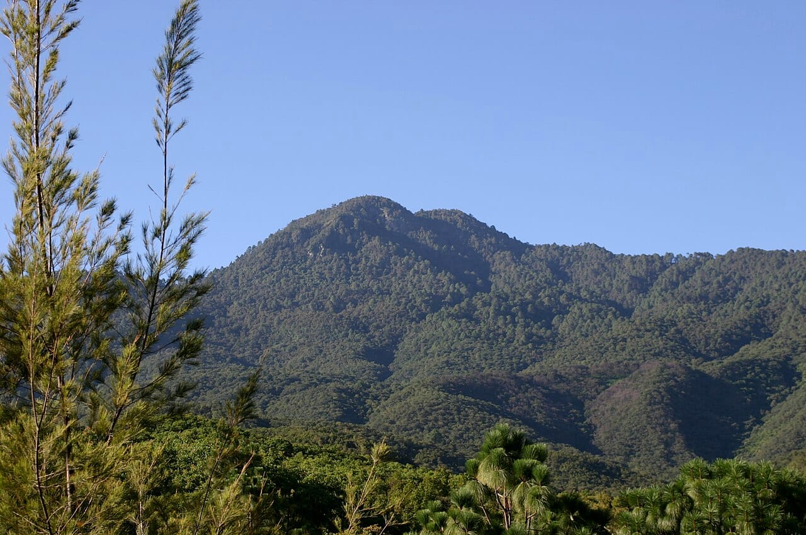
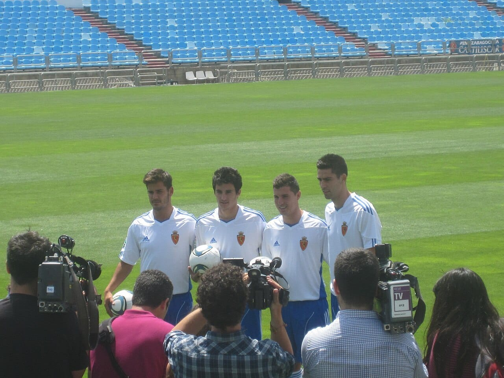

# 瓦哈卡梅斯卡尔路线

这条路线只有两站，却把梅斯卡尔的两端连起来：先在瓦哈卡市中心的[梅斯卡尔图书馆](ref:mezcaloteca)建立品种与村子的坐标，再南下圣卡塔里娜米纳斯的[雷亚尔米内罗](ref:real-minero)看土坑、木槌与陶罐。前者不生产酒，用跨州收藏组织对比品鉴；后者仍在出酒，用小批量与批次差异说话。两站之间是中央谷地的 Espadín 田、圣地亚哥马塔特兰的 palenque 群，以及 NOM-070 划出的底线。

图：瓦哈卡梅斯卡尔路线所在的瓦哈卡风貌配图。图片：Prsjl，CC BY-SA 4.0，via Wikimedia Commons（[原图页面](https://commons.wikimedia.org/wiki/File:Oaxaqa_(41).jpg)）。这张照片用于说明产区环境与访问语境，不标定瓦哈卡梅斯卡尔路线的门店、酒庄或活动现场。

## 瓦哈卡市：先在 Reforma 街建立坐标

梅斯卡尔图书馆在历史中心 Reforma 街 506 号，邮编 68000，从主广场步行约十分钟。它 2010 年开门，定位是品鉴室而不是 palenque：没有田、没有土坑，也没有蒸馏器，只有一张桌子与一套按州、村子、品种、生产者与批次整理的收藏。这里以预约制为主，按场次接待，目的是让讲解不被嘈杂打断。

第一场品鉴不要急着找“最贵”或“最稀有”，而要先建立坐标。先喝一款清淡的 Espadín，再喝同村不同生产者，或同品种不同村子；每款都问原料、地点、烘烤、[发酵](ref:fermentation)与蒸馏器。这样进村时，你知道自己在看什么，也更可能问到点子上。对刚到[瓦哈卡](ref:oaxaca)的人，它比任何酒单都更适合作为第一站。

## 从中央谷地到圣地亚哥马塔特兰

瓦哈卡市坐在中央谷地里，四周是山与干旱的坡地。往东南沿 190 号公路走，会经过特奥蒂特兰德尔瓦列、特拉科卢拉与圣地亚哥马塔特兰；后者常被称为“梅斯卡尔之都”，路两边是龙舌兰田、palenque 与卖酒的院子。这里的 Espadín 种植面积最大，因为它适应性强、成熟相对稳定，通常要养到八年以上才收割。把马塔特兰当作 Espadín 的背景，而非第三站。

真正的第二站在另一个方向。从瓦哈卡市往南走 131 号公路，约三十至四十分钟到圣卡塔里娜米纳斯；村子挂在斜坡上，主路窄，palenque 在 Iturbide 街一侧，门口不起眼。自驾最方便，也可以在城里包车或参加小团。两条路指向两种景观：一边是公路边的商品化 palenque 群，一边是仍在用土坑与陶罐的家族作坊。

## 土坑、木槌与陶罐：Real Minero 的慢工序

雷亚尔米内罗的起点是 1978 年：洛伦索·安赫莱斯·门多萨与尼古拉斯·阿雷利亚内斯买下家族第一座 palenque，也就是今天的 La Concepción。1978 年到 2002 年之间，酒没有品牌，装在塑料桶或回收瓶里，贴一张手写小纸片出售。2004 年出现第一枚正式酒标；2005 年，酒厂停用“Minero”这个旧称，改用规范里的 Mezcal Joven；2009 年首次出口德国，2015 年进入美国市场。

工艺从地下开始。采收的龙舌兰被切去叶片，只留 piña，放进锥形土坑，用木柴与火山石加热，再覆盖土与纤维闷烤数天。烤软的 piña 不送辊式磨机，而是放进木制 canoa，由人抡起木槌一下一下砸碎。接下来是自然发酵，再进入陶罐做二次蒸馏；陶罐导热慢、容量小，蒸馏师要靠闻与看火候来判断掐头去尾的时点。酒厂也做 pechuga，在第二次蒸馏时把鸡肉、水果与香料挂在罐内。

这套流程的产量远低于铜壶加大罐的组合，但风味更薄而长：烟熏不压果香，矿物感与龙舌兰的苦甜更清楚。酒厂还经营一座民族植物学花园，保存十七种龙舌兰，其中十四种已经通过种子繁殖；种子库收留数量稀少的品种，并把龙舌兰与玉米、豆类、南瓜种在同一片地里。自 2006 年起，参观被纳入这套项目，导览从“看设备”变成“看生命周期”。

## Espadín 的日常与龙舌兰的多样性

Espadín 是瓦哈卡最常见的栽培品种，也是许多酒厂的日常主力：成熟期相对可控，产量稳定，风味从青草、柑橘到熟果都有。它不“低级”，只是常见；把 Espadín 做好，比拿一个稀有品种讲故事的难度更高。Tobalá 与 Arroqueño 更稀有、价格更高，ensamble 则把不同品种放在同一批发酵里，让差异在杯中叠起来。

梅斯卡尔图书馆不把“稀有”自动等同于“好”，而是让你在同一场品鉴里喝到差异：同一品种不同村子，或同一村子不同生产者。这样喝，才知道差异来自风土、工艺还是批次。小批量的另一面是波动：同一家酒厂的不同批次，可能因为龙舌兰成熟度、酵母与火候而不同；这不是缺陷，而是这类生产的常态。

## NOM-070：合规只是起点

[梅斯卡尔](ref:mezcal)在 1994 年获得原产地命名，现行技术标准是 NOM-070-SCFI-2016：原料必须 100% 来自[龙舌兰](ref:agave)，在法定产区内按规范生产。原产地命名覆盖瓦哈卡、格雷罗、圣路易斯波托西、萨卡特卡斯与杜兰戈，以及普埃布拉、米却肯、塔毛利帕斯与瓜纳华托的部分市镇。按陈年分为 Joven、Reposado、Añejo，按生产方式又区分 artesanal 与 ancestral。

符合标准，说明它是合规的梅斯卡尔，不说明它好喝，也不说明生产者拿到了合理报酬。看瓶标的顺序应当是：先看 NOM 编号与“100% agave”，再看品种、村子与生产者，最后才看陈年与包装。雷亚尔米内罗的酒标长期使用 Mezcal Joven，因为酒液本身不经橡木桶；它的流程更接近 ancestral 的土坑、手捣、自然发酵与陶罐蒸馏，但标签选择仍按产品事实来。

## 品鉴顺序、预约与回程

梅斯卡尔图书馆以预约制为主，建议提前一至数日通过官网或电话确认场次，说明人数、语言需求与预算；常见安排是下午到晚上，具体以店方确认为准。雷亚尔米内罗的导览约三小时：先走民族植物学花园，再进 palenque 看土坑、canoa、发酵与陶罐蒸馏，最后品四款酒。成人每人 750 墨西哥比索，5 至 17 岁 500 比索；时段是周一至周五 10:00 与 15:00，周六只有 10:00，且需提前至少 48 小时预订，周日不开放；每组 1 至 25 人，讲解仅用西班牙语。

从瓦哈卡市到圣卡塔里娜米纳斯约三十至四十分钟，村内道路窄，把车停在不妨碍通行的位置；没有自驾的人可在城里包车。品鉴后不要开车：瓦哈卡州对酒后驾驶有明确限制，执法以当地为准。开放时间、预约与交通以各官方渠道为准，页面核验日期 2026-11-09。

相关条目：[梅斯卡尔图书馆：瓦哈卡市中心的一间品鉴档案室](ref:mezcaloteca)、[雷亚尔米内罗帕伦克：圣卡塔里娜米纳斯的陶罐与种子](ref:real-minero)。

瓦哈卡梅斯卡尔路线从市里到圣卡塔里娜米纳斯，村内道路窄，品鉴后不要开车；酒厂到访以各官网预约，交通用实时地图。核验于 2026-11-09。

## 相关图像

图：发酵。图片：Tjhackmann，CC BY-SA 4.0，via Wikimedia Commons（[原图页面](https://commons.wikimedia.org/wiki/File:Phylogenetic_tree_of_bacteria_and_archaea,_highlighting_those_that_carry_out_fermentation.png)）。关联图像：瓦哈卡梅斯卡尔路线。

图：File:Abraham Minero, Edu Oriol, Juan Carlos Pérez y David Mateos.JPG。摄影：Campeones 2008，CC0，来自 Wikimedia Commons。。图片：Campeones 2008，CC0，via Wikimedia Commons（[原图页面](https://commons.wikimedia.org/w/index.php?curid=15773790)）。关联图像：瓦哈卡梅斯卡尔路线。
