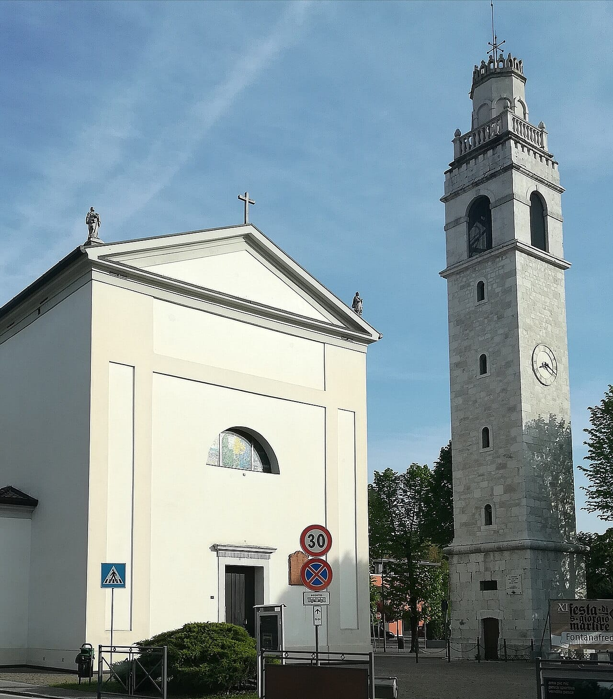

# 皮埃蒙特巴巴莱斯科路线

这条路线把两座村子连起来：巴巴莱斯科与塞拉伦加达尔巴。它们同属朗格，同以[内比奥罗](ref:nebbiolo)为骨架，却分别站在巴巴莱斯科与巴罗洛两个法定产区的两侧。第一站是嘉雅，地址清楚、参观政策不清楚；第二站是丰塔纳弗雷达，酒窖与叙述村按预约接待。两站之间约半小时车程，一天足够，但不要把“名庄”自动等同于“可以随时进入”。

图：皮埃蒙特巴巴莱斯科路线所在的皮埃蒙特风貌配图。摄影：Piedmont vineyard in autumn。署名：Giorgio Montersino，CC BY-SA 2.0，来自 Wikimedia Commons（[来源](https://commons.wikimedia.org/w/index.php?curid=5816942)）。这张照片用于说明产区环境与访问语境，不标定皮埃蒙特巴巴莱斯科路线的门店、酒庄或活动现场。

> **先给结论**
> **一句话：** 这页判断皮埃蒙特巴巴莱斯科路线怎么排、走多久、哪些点不能省。
>
> - **适合谁：** 想把皮埃蒙特巴巴莱斯科路线排成一日或两日行程、需要知道顺序与停留重点的人。
> - **不适合谁：** 只想看单个地点、不打算按路线走的人。
> - **先看这两点：**
>   - 嘉雅必须先联系；丰塔纳弗雷达通过 Villaggio Narrante 预约，旺季提前一周更稳。
>   - 从巴巴莱斯科村到塞拉伦加达尔巴，最顺的走法是经阿尔巴绕行，车程约三十到四十分钟；直线距离不远，但山路弯多，实际时间要看路况。

## 从巴巴莱斯科到塞拉伦加

从巴巴莱斯科村到塞拉伦加达尔巴，最顺的走法是经阿尔巴绕行，车程约三十到四十分钟；直线距离不远，但山路弯多，实际时间要看路况。嘉雅在村内 Via Torino 5，停车位有限；丰塔纳弗雷达在 Via Alba 15，建筑群更大，接待区与酒窖分开。把两站排成一天，建议上午在巴巴莱斯科，午餐在阿尔巴，下午到塞拉伦加。

顺序反过来也可行，但丰塔纳弗雷达的参观产品需要预约，先确认场次再定另一站。若只安排半天，就选一站：想理解“名庄边界”，去巴巴莱斯科；想进酒窖、看历史建筑与村庄式接待，去塞拉伦加。路线不必追求“打卡数量”，朗格的坡地本身值得慢开。

## 雾、晚熟与内比奥罗的脾气

朗格的秋雾不是背景，而是成熟条件的一部分。内比奥罗晚熟，通常在十月前后才达到采收窗口；雾带来湿度与温差，让果实缓慢成熟，也带来霉菌风险。酒农要在“再等几天”与“别等过头”之间判断，采收期常常拖得很长。雾季的风景很美，但对酒庄来说，那是一段紧张的等待。

内比奥罗皮厚、单宁高、颜色偏石榴红，香气从玫瑰、紫罗兰到红果、焦油、甘草。它不像赤霞珠那样靠果味取胜，而是靠酸度、单宁与陈年后的复杂度。朗格的昼夜温差与山坡排水让酸度得以保留；黏土与石灰岩的比例又影响香气与结构。理解这一点，杯中的“tar and roses”就不是形容词，而是品种与环境的共同结果。

## 同一品种，两套法定时钟

巴巴莱斯科与巴罗洛都用纯酿内比奥罗，但法定规则不同。巴巴莱斯科的产区包括巴巴莱斯科、内伊韦、特雷伊索与阿尔巴的部分地区；最低陈年两年，其中九个月在橡木桶；四年后才能标 Riserva。巴罗洛覆盖 11 个市镇，最低陈年三年，其中一年半在橡木桶；五年后才能标 Riserva。两套时钟直接改变酒的上市时间与价格。

这不是“谁更高级”的问题，而是风格与历史的结果。巴罗洛产区更大、结构更强，历史上需要更长时间；巴巴莱斯科更靠近河流与山谷，酒体通常更细，法定陈年也更短。把两者放在同一年份比较时，先看法定最低陈年，再看酒庄实际陈年，最后才谈个人偏好。规则是底线，不是风格的全部。

## 单园命名的细读

两个产区都在 2010 年前后完成了法定地理命名（MGA）的划定，酒标上的园名因此成为可核实的地理信息。巴巴莱斯科的单园常写在村名之后，例如某村某园；巴罗洛则把 11 个市镇内部的园地进一步细分。单园酒强调的是“这一坡”的个性，而不是村庄的平均风格；同一村庄里，朝向、海拔与土壤差异足以让酒完全不同。

读酒标时，先分村庄级与单园级，再看是否标了 Riserva。单园不一定比村庄级更好，它只是更具体；有些酒庄选择不做单园，是为了保留混调的平衡。嘉雅以单园闻名，丰塔纳弗雷达则覆盖从村庄级到单一园的多个层级；把两家放在一起，正好能看到“单园”在不同商业策略里的位置。

## 橡木争论的两个现场

[橡木](ref:oak)争论在朗格从未真正结束。小橡木桶增加氧气接触，带来香草、烘烤与更快的单宁软化；大桶或旧桶保留果香与结构，但需要更长时间。争论的表面是桶的尺寸与产地，实质是“酒应该在什么年龄、以什么状态被喝到”。嘉雅常被归入更国际化的那一侧，丰塔纳弗雷达则同时使用大桶与小桶，产品线更宽。

在酒窖里看桶，比在文章里读“新派/传统派”有用。注意桶的容积、使用年份、烘烤程度与排列；再对照酒款的上市时间与法定最低陈年，就能理解酒庄为什么这样选。不要把“橡木味”当成缺点或优点，它只是工具；真正的问题是桶是否盖住了果味，单宁是否与酸度平衡。

## 第一站：嘉雅的公开边界

[嘉雅](ref:gaja)在巴巴莱斯科村 Via Torino 5，官方页只给出地址、电话 +39 0173 635158 与邮箱 info@gaja.com，没有公布公众导览时段、票价或预约入口。因此这一站只能确认“酒庄在那里”，不能确认“你能进去”。出发前发邮件或打电话，说明人数、日期与目的，等待书面确认；没有确认就不要直接上门。

即使预约成功，也要把预期放低：这不是大型游客中心，而是生产与办公混合的酒庄。参观时不要触摸设备、不要越过生产区边界、不要在发酵区长时间拍摄。若只想理解酒，村内的其他酒庄、合作社与展馆提供更稳定的接待；把嘉雅作为“读酒标、看村庄”的一站，更符合它当前的公开信息。

## 第二站：丰塔纳弗雷达的叙述村

[丰塔纳弗雷达](ref:fonta)在塞拉伦加达尔巴，1858 年由意大利首位国王创立，葡萄园约 120 公顷且全部有机认证。酒窖参观通过 Villaggio Narrante 预约，产品包括历史酒窖、葡萄园步行与品鉴，时长与价格不同；官方联系页给出 info@fontanafredda.it 与电话 +39 0173 626 111。这一站能真正走进酒窖，看到大桶、历史建筑与村庄式动线。

两站放在一起，对照很清楚：一个是以品牌与单园闻名、公开信息有限的家族酒庄；一个是以规模、历史叙事与接待体系见长的“村庄”。同为朗格名庄，一个把资源投向“少而精”的表达，一个把资源投向“可进入的体验”。没有哪种更高明，只有哪种更适合你的行程。

## 预约、路况与采收季

嘉雅必须先联系；丰塔纳弗雷达通过 Villaggio Narrante 预约，旺季提前一周更稳。两站之间的山路在采收季会有拖拉机与运输车，留出缓冲时间。阿尔巴是中途补给点，餐厅与停车场都比村里多；不要在酒庄门口掉头或占道停车。

九月到十月是采收与酿酒最忙的时段，酒窖参观可能受限；春季与初夏更舒服，但也要避开节假日。冬季村里安静，部分体验产品缩减。开车的人全程不饮酒；朗格夜间照明差，雾天能见度低，指定司机或包车更稳妥。开放时间、预约与价格以官方渠道为准，本页核验日期 2026-11-09，坐标以官方渠道为准。

相关条目：[嘉雅巴巴莱斯科酒庄](ref:gaja)、[丰塔纳弗雷达酒庄](ref:fonta)、[内比奥罗](ref:nebbiolo)。

**关键事实。**

| 项目 | 内容 |
| --- | --- |
| 一句话定位 | 从巴巴莱斯科村的嘉雅到塞拉伦加达尔巴的丰塔纳弗雷达，两站相距约半小时，串起内比奥罗、巴巴莱斯科与巴罗洛的法定差异、朗格的雾与晚收，以及单园与橡木的争论；嘉雅参观政策未公开确认，出发前须联系官方 |
| 站数 | 2 |
| 交通 | 自驾 |
| 停靠顺序 | 嘉雅巴巴莱斯科酒庄、丰塔纳弗雷达酒庄 |

## 参考资料

- [Gaja 官方网站](https://www.gaja.com/)：Via Torino 5 地址、电话与邮箱；未公布公众导览时段。
- [Fontanafredda 联系页](https://www.fontanafredda.it/contatti/)：Via Alba 15 地址、电话与参观入口。
- [Villaggio Narrante 酒窖参观](https://www.villaggionarrante.it/cantine/visite-in-cantina/)：参观产品、历史酒窖与预约。
- [Barbaresco DOCG — 朗格产区协会](https://www.langhevini.it/le-denominazioni-tutelate-dal-consorzio/barbaresco-docg/)：市镇、内比奥罗与陈年规则。
- [Barolo DOCG — 朗格产区协会](https://www.langhevini.it/le-denominazioni-tutelate-dal-consorzio/barolo-docg/)：11 个市镇、三年陈年与 Riserva 规则。

补充阅读：[皮埃蒙特](ref:c-extra-1)。

## 相关图像

图：内比奥罗。图片：Hanna，CC BY 2.0，via Wikimedia Commons（[原图页面](https://commons.wikimedia.org/wiki/File:Close_up_of_Nebbiolo_cluster_in_Italy.jpg)）。关联图像：皮埃蒙特巴巴莱斯科路线。

图：丰塔纳弗雷达酒庄。图片：Marchetto da Trieste，CC BY-SA 4.0，via Wikimedia Commons（[原图页面](https://commons.wikimedia.org/wiki/File:Fontanafredda_-_chiesa_parrocchiale.jpg)）。关联图像：皮埃蒙特巴巴莱斯科路线。
