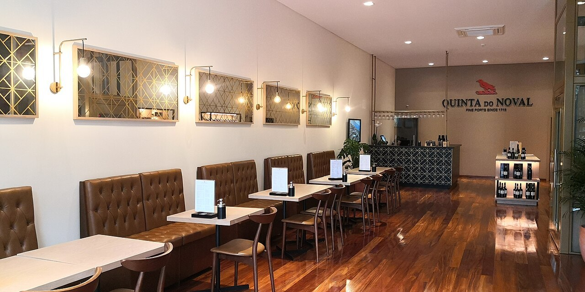
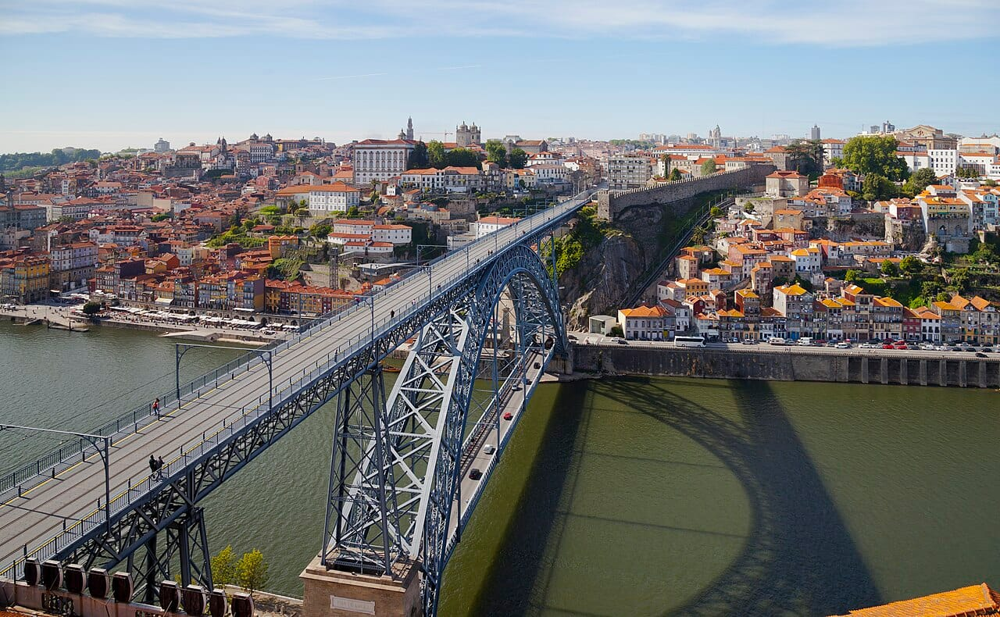

# 波特与杜罗路线：从萨布罗萨的老藤到皮尼昂的国家园

这条路线沿杜罗河右岸由西向东，从萨布罗萨（Sabrosa）Gouvinhas 的克拉斯托，到皮尼昂（Pinhão）的诺瓦尔，自驾通常在半小时到一小时之间。两站都在片岩坡地上，都同时做波特与杜罗 DOC 干型酒，但对“连续性”的解释不同：克拉斯托讲的是同一片地里老藤混种与家族接力，诺瓦尔讲的是那一小块未嫁接的 Nacional 与 20 世纪初的梯田改造。把两端放在一天里，“片岩、梯田、混种”三件事就能串成一条可以比较的线。

图：波特与杜罗路线：从萨布罗萨的老藤到皮尼昂的国家园。摄影：Porto-Matosinhos, , June 2 (53870205083)。署名：John Hayes from San Antonio, Texas, USA，CC BY-SA 2.0，来自 Wikimedia Commons（[来源](https://commons.wikimedia.org/w/index.php?curid=151531010)）。

## 路线的地理前提：片岩、河流与两条岸线

杜罗河从西班牙向东流入葡萄牙，在波尔图入海；产区沿河切出陡坡，片岩（xisto）易碎、保水差，根系必须扎得很深。传统梯田 socalcos 用石墙支撑，20 世纪上半叶开始出现更宽、可机械作业的 patamares。两类梯田今天并存，也决定了酒庄怎么讲自己的历史。

两站都在右岸：克拉斯托在 Gouvinhas，属萨布罗萨；诺瓦尔在皮尼昂附近。车程通常在半小时到一小时之间，取决于路况与是否停下来拍照。

为什么是这两站：一家是家族酒庄，把酒旅做成完整产品，午餐、品鉴与葡萄园参观串在一起；另一家是有国际集团背景的历史酒庄，核心叙事落在一块具体的地块上。先看“整片地产”，再看“一块地”，比较会具体。

## 第一站：克拉斯托的老藤与酒庄午餐

地址：[克拉斯托酒庄](ref:crasto)，Quinta do Crasto, Gouvinhas, 5060-063 Sabrosa, Portugal。

克拉斯托的名字来自拉丁语 castrum，意为“罗马堡垒”；酒庄最早提到葡萄酒生产的文献可追溯到 1615 年。1758 年，庞巴尔侯爵下令在杜罗竖立 335 根花岗岩界碑，划定世界上第一个法定葡萄酒产区，其中一根至今仍立在酒庄的百年农舍旁。1918 年，波尔图酒商 Constantino de Almeida 买下酒庄；1981 年，Leonor 与 Jorge Roquette 接手，开始把杜罗 DOC 干型酒做成主线，而不只是波特。

看什么：葡萄接收区、发酵车间与桶窖，动线不长。葡萄园以片岩为主，传统梯田由石墙支撑，部分老藤地块仍保留混合种植；红葡萄以 Touriga Nacional、Touriga Franca、Tinta Roriz、Tinta Barroca 为主，白葡萄用 Viosinho、Rabigato 等本地品种。单园与老藤酒款（Vinha Maria Teresa、Vinha da Ponte）是理解“地块差异”的入口。

为什么安排在上午到中午：酒庄的配餐参观通常要三小时左右，含午餐，节奏偏慢。先看酿造，再坐下来吃，最后回到葡萄园或桶窖，比“喝完就走”更容易记住风味从哪来。

一个常见误会：1615 年是文献起点，不是公司成立年份；家族接手是 1918 年，现代经营结构从 1981 年开始。把三个年份分清，才不会高估它的连续公司史。

## 第二站：诺瓦尔的国家园与梯田

地址：[诺瓦尔酒庄](ref:noval)，Quinta do Noval, 5085-034 Pinhão, Portugal。

诺瓦尔的名字在 1715 年首次出现在记录中。1894 年，波尔图酒商 António José da Silva 买下当时受根瘤蚜重创的酒庄，重新种植葡萄园；他的女婿 Luiz Vasconcelos Porto 把原来宽大的石墙梯田改造成更窄的台地，扩大了可种植面积，也改变了坡面的排水与日照。1993 年，Van Zeller 家族把酒庄卖给 AXA Millésimes，酒庄进入新的资本结构。

Nacional 是这一站的核心。它是一小块未嫁接的葡萄园，面积约两公顷，位于酒庄建筑旁，根系直接扎在杜罗的片岩上，没有美国砧木隔开。1931 年的 Nacional 装瓶让这块地广为人知。需要说清：Nacional 不是市场分级，也不是每一年都产的固定酒款；它是特定地块的名字，收成与是否装瓶由酒庄按年份决定。

看什么：Nacional 地块、梯田的走向、老发酵空间与桶窖。品鉴通常覆盖 Vintage、LBV、Tawny 与 Colheita，具体酒款按套餐与库存调整。第一次来，用同一年份的 Vintage 与 LBV 对照，能看出瓶陈与木桶陈年的差别；再喝一款老年份 Tawny，理解氧化与坚果气息。

## 自驾：从萨布罗萨到皮尼昂

这条路线按自驾设计。从波尔图出发到杜罗约 1.5–2 小时，从 Vila Real 到萨布罗萨约 30 分钟；两站之间沿河南下，弯多坡陡，白天开更稳，夜间尽量不自驾。皮尼昂镇内停车紧张，把车停在酒庄指定区域，不要停在葡萄园边上。

公共交通不是不能走，但接驳麻烦：杜罗线火车到皮尼昂，风景很好，班次不多；从车站到诺瓦尔仍需出租或步行一段上坡路。克拉斯托在 Gouvinhas，离火车站更远，通常要打车。具体接驳以酒庄回复为准。

建议时长：一整天。上午克拉斯托，含午餐三小时左右；下午诺瓦尔，两小时左右；两站之间留出四十分钟车程与缓冲。若想轻松一点，住皮尼昂一晚，第二天再走杜罗超级区。

## 预约窗口与采收季

两家都只按预约接待。克拉斯托的品鉴、午餐、晚餐与酒庄晚宴分档，时长与人数不同；诺瓦尔按官网或邮件预约，参观与品鉴的套餐会随季节调整。预约时说清人数、语言、是否用餐、是否需要素食，以及是否自驾。

九月至十月是采收，酒庄最忙，部分区域可能不开放，临时到访基本无法加入。春季葡萄园开花，秋季采收颜色最好；夏季午后高温，葡萄园很晒；冬季安静，但部分酒旅项目减少。周末与节假日要更早订。

酒庄是生产场所，不是餐厅或酒吧。按预约时间到达，不要迟到；不要触摸桶壁、管道与展品；拍照前看陪同人员的提示。品鉴时可以吐酒，不需要勉强喝完。

## 品鉴顺序、吐酒与清醒驾驶

顺序上，先白后红、先干后甜：杜罗 DOC 白葡萄酒、基础红、单园或老藤红、LBV、Vintage、Tawny 或 Colheita。波特不是“甜酒配甜点”这么简单：Vintage 单宁重，适合配硬奶酪与坚果；Tawny 带焦糖与干果，适合餐后；White Port 冷藏后可以作开胃酒。

驾驶是这条路线最需要提前决定的事。杜罗的道路弯多、坡陡、部分路段窄，品鉴时把酒全部吐掉，或把品鉴集中在一站、另一站只参观。安排不喝酒的司机，或住酒庄附近，是最稳的做法。葡萄牙对酒后驾驶有明确限制，具体以当地法规为准。

## 读下去：产区与风格条目

杜罗产区页讲片岩、梯田与品种；波特风格页讲 Ruby、LBV、Vintage、Tawny 的差别；加强酒页讲强化如何中止发酵；橡木桶陈年与氧化两个词条，能解释为什么同样是波特，有的靠瓶陈、有的靠桶陈。

这条路线想说明的是：波特不只在加亚新城的酒窖里，它的逻辑从葡萄园就开始。看过 Nacional 那块地，再喝一杯 Vintage，甜与力量背后会有更具体的地理。

补充阅读：[杜罗](ref:c-extra-1)、[波特](ref:c-extra-2)、[葡萄牙](ref:c-extra-3)。

对照阅读：[克拉斯托酒庄](ref:crasto)、[杜罗](ref:c-extra-1)。

相关条目：[诺瓦尔酒庄](ref:noval)。

## 相关图像

图：Quinta do Noval wine shop 1。图片：sanjorgepinho，CC BY-SA 4.0，via Wikimedia Commons（[原图页面](https://commons.wikimedia.org/w/index.php?curid=94306217)）。关联图像：波特与杜罗路线：从萨布罗萨的老藤到皮尼昂的国家园。

图：波特。图片：Diego Delso，CC BY-SA 3.0，via Wikimedia Commons（[原图页面](https://commons.wikimedia.org/wiki/File:Puente_Don_Luis_I,_Oporto,_Portugal,_2012-05-09,_DD_13.JPG)）。关联图像：波特与杜罗路线：从萨布罗萨的老藤到皮尼昂的国家园。
