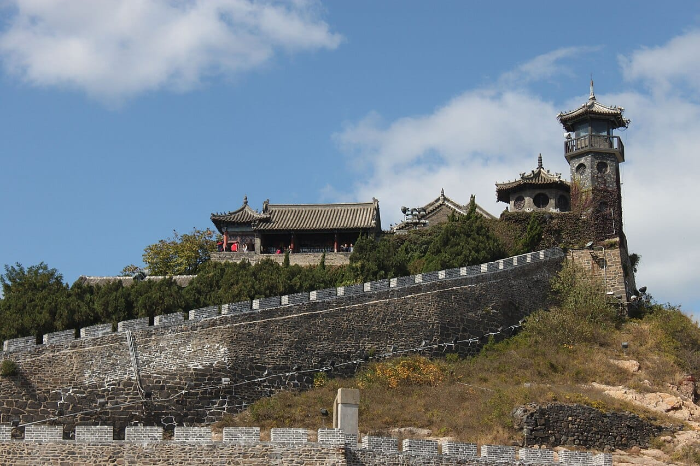

# 青岛啤酒路线：博物馆、老厂区与登州路啤酒街

青岛啤酒的参观体验有一条很短的动线：进博物馆看历史，走到玻璃廊道看生产，出门右转就是啤酒街。三站都在登州路 56 号一带，步行就能串起来，但它们回答的问题完全不同。博物馆讲“青岛啤酒从哪里来”，老厂区讲“它现在还在怎么生产”，啤酒街讲“它怎样进入一座城市的夜晚”。把这三层分开，半天就不会只变成“喝了一杯”。

图：青岛啤酒路线：博物馆、老厂区与登州路啤酒街所在的山东省风貌配图。图片：Chrishcn，CC BY 2.0，via Wikimedia Commons（[原图页面](https://commons.wikimedia.org/wiki/File:PenglaiPavilion.jpg)）。这张照片用于说明产区环境与访问语境，不标定青岛啤酒路线：博物馆、老厂区与登州路啤酒街的门店、酒庄或活动现场。

> **先给结论**
> **一句话：** 这页判断青岛啤酒路线：博物馆、老厂区与登州路啤酒街怎么排、走多久、哪些点不能省。
>
> - **适合谁：** 想把青岛啤酒路线：博物馆、老厂区与登州路啤酒街排成一日或两日行程、需要知道顺序与停留重点的人。
> - **不适合谁：** 只想看单个地点、不打算按路线走的人。
> - **先看这两点：**
>   - - 第一站：青岛啤酒博物馆，市北区登州路 56 号，2003 年开馆，馆址是 1903 年德资啤酒厂原址；建议停留 1.5–2 小时。
>   - 很多城市把“博物馆—工厂—酒吧街”安排成三个相距很远的地点，青岛的登州路是个例外。

## 路线概览

- 第一站：[青岛啤酒博物馆](ref:museum)，市北区登州路 56 号，2003 年开馆，馆址是 1903 年德资啤酒厂原址；建议停留 1.5–2 小时。
- 第二站：[青岛啤酒厂（登州路厂区）](ref:brewery)，与博物馆同一地址，是仍在运转的老厂；参观通过博物馆展线与 B 馆玻璃廊道完成，不能自行进入车间；建议停留 30–45 分钟。
- 第三站：[登州路啤酒街](ref:beer-street)，东起延安二路、西至寿光路，长约 710 米；建议停留 1–2 小时，按饭点安排。
- 方式：全程步行。博物馆与啤酒街在同一街区，老城道路窄，地铁加步行比自驾更稳。
- 节奏：上午开馆后进博物馆，中午前后出来，先在啤酒街吃午饭，傍晚再回啤酒街喝一杯；若只想半天，博物馆加一顿饭足够。

## 为什么三站其实在一个街区

很多城市把“博物馆—工厂—酒吧街”安排成三个相距很远的地点，青岛的登州路是个例外。青岛啤酒博物馆坐落在登州路 56 号仍在运转的老厂区内，博物馆的 B 馆紧贴生产车间，游客站在玻璃廊道里就能看到酿造与出厂流程；而登州路啤酒街就以这座厂区为核心，东起延安二路、西至寿光路，街长约 710 米，酒店、啤酒吧、饭店等门店几十处。也就是说，三站不是三个方向，而是同一个街区里的三个层次。

这也带来一个容易犯的错误：把“青岛啤酒厂”和“青岛啤酒博物馆”当成两个可以分别买票的景点。实际上，博物馆是厂区的游客接口，厂区是生产实体；没有博物馆的展线与预约，游客不能自行进入车间。路线把第二站单独列出来，不是为了再买一次票，而是提醒你在 B 馆的玻璃廊道多停一会儿，看清“老厂还在工作”这件事。

## 第一站：青岛啤酒博物馆

博物馆 2003 年 8 月 15 日开馆，那天是青岛啤酒的百年华诞；馆址是 1903 年德资啤酒厂的原址，建筑是红砖厂房、坡屋顶与老式工业构件的组合。它常被概括为 A、B 两馆：A 馆讲百年历史与老设备，能看到老电机、糖化锅、煮沸锅与早期档案；B 馆紧贴生产车间，玻璃廊道外是现代化的酿造与灌装线。官方介绍称馆内有 30000 余件文物，这不是“几台老机器加几张海报”的规模。

参观顺序建议先 A 后 B。A 馆把 1903 年以来的时间线铺开：德占时期的青岛、德资啤酒厂的建立、后来的品牌发展、老设备与原位遗产。B 馆则把“历史”接到“现在”：同样是糖化与发酵，老设备是铜锅与电机，新产线是不锈钢罐与自动化灌装。站在玻璃前，能直观看到“传统工艺”与“现代工业”不是两件事，而是同一条技术路线的不同阶段。

门票通常通过“青岛啤酒博物馆”微信公众号实名预约购买，普通票含 A+B 馆参观与原浆、纯生各一杯；另有品鉴票、联票与 VIP 票，具体内容以票务页为准。开放时间分季节调整，夏季七月至八月为 7:30–19:30（18:30 停止入场），冬季十一月到十二月为 8:30–17:30（16:30 停止入场）；节假日与临时闭馆以公告为准。建议开馆后一小时或下午三点后进馆，避开旅行团高峰。

## 第二站：青岛啤酒厂（登州路厂区）

从博物馆的展线走到 B 馆，你其实已经站在青岛啤酒厂的登州路厂区里。青岛市政府国资委 2026 年的报道说得很清楚：博物馆坐落在登州路 56 号仍在运转的老厂区内，B 馆紧贴生产车间，游客站在玻璃廊道里就能看见啤酒酿造出厂的全过程。这句话是理解第二站的关键——“老厂”不是停产的遗址，而是仍在出酒的生产单位。

因此，第二站不是“另一个景点”，而是“把博物馆里看到的历史放回生产现场”。看什么？看糖化、煮沸、发酵、过滤与灌装的连续关系；看老建筑如何被保留，新设备如何嵌进去；看工人、管道、阀门与运输车辆如何在一个有限的空间里协同。不要试图推开生产门、不要触摸设备与管道、不要越过玻璃廊道；生产区有安全与卫生要求，参观路线是经过设计的。

这一站也解释了为什么青岛啤酒的“工业旅游”不只是看展。博物馆把老设备、档案与品牌史保存下来，厂区把“还在生产”这件事保留下来，两者叠在一起，才有“活着的工业遗产”。如果只看 A 馆，会以为这是一座历史博物馆；如果只看啤酒街，会以为青岛啤酒只是一个消费符号。把第二站放回中间，叙事才完整。

## 第三站：登州路啤酒街

从厂区出来，门口就是登州路啤酒街。青岛政务网的介绍写它东起延安二路、西至寿光路，街长约 710 米，是以啤酒为鲜明特色的商业街；街上有各类门店约 50 处，其中酒店、啤酒吧、饭店 20 余处。青岛市文化和旅游局把这里的夜晚称作“永不落幕的啤酒节”。白天它是一条普通老街，傍晚灯亮起来，海鲜大排档与啤酒屋把桌子摆到路边，气氛才真正出来。

这里的喝法与博物馆不同。博物馆的品鉴是“对照”：原浆与纯生各一杯，比较厚度、香气与杀口感；啤酒街的喝法是“配餐”：扎啤配辣炒蛤蜊、烤海鲜、海肠、鲅鱼水饺，慢慢吃、慢慢喝。原浆保留更多酵母与悬浮物，口感厚、麦香足，需要冷藏且保质期短；纯生更清爽、稳定；扎啤按杯或按扎卖，适合多人分。青岛本地还有用塑料袋打散啤的习惯，但在啤酒街，坐下来喝扎啤才是主流。

点单先问计量单位与单价：按扎、按杯、按瓶，还是按斤；海鲜是按份还是按时价。街区推行明码标价与“码上监督”，但不同店家的菜单写法仍有差别，点之前确认，比吃完再争论更有效。不要被“临街拉客”带着走，也不必迷信排队最长的店；看菜单、看冰柜、看本地人多不多，比看招牌更可靠。

## 德式拉格与青岛啤酒

青岛啤酒的底层风格是德式拉格。拉格用下面酵母，在较低温度下主发酵，再经过一段低温贮酒，酒体更干净、香气更稳定。1903 年德资啤酒厂在青岛建立，德式设备、红砖厂房与德国的酿酒传统一起进入这座城市；青岛的水质、麦芽、酒花与酵母，后来逐渐形成了自己的表达。参观时不必追问配方比例，理解“下面发酵、低温贮酒、干净收口”这三个关键词，就足以把拉格与艾尔区分开。

博物馆的展陈会把“老设备”与“新产线”放在同一条线上，这其实是青岛啤酒最值得看的地方：它不是把传统封存起来，而是让传统在生产中继续被使用。老电机、糖化锅与煮沸锅是工业遗产，玻璃后的不锈钢罐与灌装线是当下；两者之间不是断裂，而是技术迭代。看完这一圈，再喝一口原浆，会更容易理解“新鲜”为什么是青岛啤酒的核心卖点之一。

## 交通、季节与消费边界

交通上，地铁 1 号线、2 号线台东站出站后步行可达博物馆与啤酒街；也可乘公交到“青岛啤酒博物馆”站。登州路老城道路窄、停车位有限，建议地铁加步行；打车可以让司机在登州路两端靠边下客，不要把车开进街区中线。博物馆与啤酒街之间步行十几分钟，中途会经过厂区门口与居民区，注意车辆与行人。

季节上，七月到八月是最热闹的时候，也是排队最长、天气最热的时候；博物馆夏季开得早、关得晚，可以利用早晨或傍晚。五月到六月、九月到十月气候更舒服，人流也相对可控；冬季博物馆 16:30 停止入场，啤酒街部分摊位缩短营业时间，行程要往前排。青岛国际啤酒节的主会场在西海岸金沙滩一带，不在登州路；不要把“啤酒节”和“啤酒街”当成同一个活动。

消费边界要说清：博物馆与厂区是参观场所，不要在里面开酒；啤酒街是餐饮消费，不是博物馆的延伸展厅。品鉴后不要驾车，青岛老城坡道多、单行线多，酒后排险与找路都麻烦。未成年人不得饮酒；带小孩的家庭可以把重点放在博物馆的老设备、玻璃产线与互动体验，吃饭时点无酒精饮料。遇到价格争议，先找店家沟通，必要时通过街区公示的监督渠道处理。

相关条目：[青岛啤酒博物馆](ref:museum)、[青岛啤酒厂（登州路厂区）](ref:brewery)。

## 另见

这条路线把啤酒的工业史、生产现场与城市夜生活放在同一条街上：博物馆看“从哪里来”，老厂区看“现在怎么做”，啤酒街看“怎么被喝掉”。想先读场馆背景，可以继续看[青岛啤酒博物馆](ref:museum)、[青岛啤酒厂](ref:brewery)与[登州路啤酒街](ref:beer-street)的条目；若时间只够半天，保留博物馆与一顿啤酒街的午饭，把夜宵留到下次。

开放时间、票务、菜单与预约以各官方渠道为准，页面核验日期 2026-11-08。
