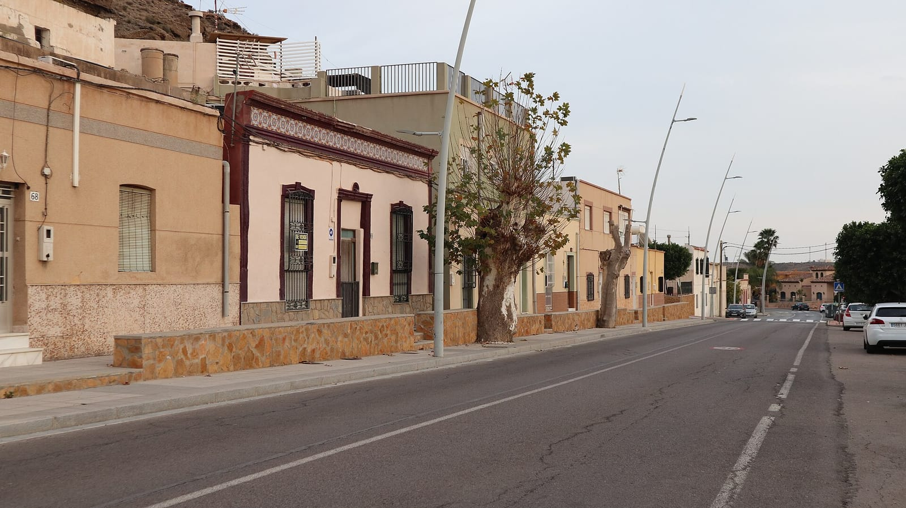

# 里奥哈哈罗车站区酒庄路线：三家百年酒庄与长时间陈年

阿罗（Haro）火车站区（Barrio de la Estación）是里奥哈最容易低估的一小片街区。从站台出来，走几分钟就能经过洛佩兹雷迪亚、里奥哈阿尔塔与 CVNE 的老厂墙；三家都创始于 19 世纪下半叶，都靠铁路把酒运往法国与大西洋港口，却走上了三条不同的路。这条路线不追求“喝很多家”，而是用三站把“美国桶、长时间陈年、预约制参观”讲清楚，并且全程可以步行完成。

图：里奥哈哈罗车站区酒庄路线：三家百年酒庄与长时间陈年相关实景照片。图片：Schumi4ever，CC BY-SA 4.0，via Wikimedia Commons（[原图页面](https://commons.wikimedia.org/wiki/File:N-340a_Rioja.jpg)）。

> **先给结论**
> **一句话：** 这页判断里奥哈哈罗车站区酒庄路线：三家百年酒庄与长时间陈年怎么排、走多久、哪些点不能省。
>
> - **适合谁：** 想把里奥哈哈罗车站区酒庄路线：三家百年酒庄与长时间陈年排成一日或两日行程、需要知道顺序与停留重点的人。
> - **不适合谁：** 只想看单个地点、不打算按路线走的人。
> - **先看这两点：**
>   - - 第一站：洛佩兹雷迪亚酒庄，Avenida de Vizcaya 3, 26200 Haro；1877 年由 Rafael López de Heredia 创立。
>   - 到阿罗最方便的方式是火车。

## 路线概览

- 第一站：[洛佩兹雷迪亚酒庄](ref:lopez)，Avenida de Vizcaya 3, 26200 Haro；1877 年由 Rafael López de Heredia 创立，以地下石窖、自有制桶与多年桶陈的 Reserva、Gran Reserva 闻名。
- 第二站：[里奥哈阿尔塔酒庄](ref:riojalta)，Avenida de Vizcaya 8, 26200 Haro；1890 年由五个里奥哈与巴斯克家族创立，以美国橡木、定期倒桶与 Viña Ardanza、Gran Reserva 904、890 闻名。
- 第三站：[CVNE 酒庄](ref:cvne)，Calle Barrio de la Estación 2, 26200 Haro；1879 年由 Real de Asúa 兄弟创立，旗下有 Cune、Viña Real 与 Imperial 等品牌。
- 方式：火车到 Haro 站，步行串联；三家庄园相距都在五到十分钟步行范围内。自驾也可，但品鉴后不开车。
- 建议时长：一整天。上午第一站，中午在阿罗老城吃饭，下午第二、第三站；三场预约之间至少留一小时，最后一场不要排得太晚，以免赶不上回程列车。

## 为什么走这条线

火车站区的形成，是 19 世纪下半叶里奥哈酒业的一次空间重组。在此之前，酒主要靠马车运往港口；铁路通车后，桶装酒可以更快、更便宜地运到法国与大西洋口岸。与此同时，法国葡萄园接连遭受白粉病（1863 年前后）与根瘤蚜的打击，酒商跨过比利牛斯山来里奥哈买酒。需求、铁路与资本叠加，酒厂开始聚在阿罗车站旁，形成今天这条“站台边的酒庄街”。当地旅游资料常把它称作世界上百年酒庄最密集的一小片街区；这个说法带有推广色彩，但三家老厂确实在几分钟步行范围内。

这条路线也把“美国桶与长时间陈年”讲成一条可比较的线。里奥哈的传统红葡萄酒常用美国橡木桶，带来香草、椰子、莳萝与甜香料；酒庄在上市前会做长时间桶陈与瓶陈，让酒在年轻时就有干果、皮革与烟草的气息。三家的差别在于“长度”和“解释方式”：洛佩兹雷迪亚把时间拉到极端，Reserva 与 Gran Reserva 的上市时间远晚于法定最短要求；里奥哈阿尔塔用美国桶与定期倒桶维持稳定风格，Viña Ardanza 较早适饮，904 与 890 则更慢；CVNE 的产品线更宽，从 Cune 的日常款到 Imperial 的旗舰款，覆盖不同价格与陈年长度。

三家的历史位置也不同。洛佩兹雷迪亚 1877 年创立，是阿罗最古老的酒庄之一；里奥哈阿尔塔 1890 年由五个家族共同创立，首任主席是 Doña Saturnina García Cid y Gárate，首任酿酒师是法国人 Monsieur Vigier；CVNE 1879 年由 Real de Asúa 兄弟创立，至今由创始家族后裔经营，已传到第五代。把年份、家族与所有权读准，比记住“传统”两个字更有用。

## 第一站：洛佩兹雷迪亚

为什么先去：它把“传统”推到极限，适合作为比较的起点。酒庄 1877 年由 Rafael López de Heredia y Landeta 在阿罗车站旁创立；当时法国葡萄园正遭受根瘤蚜危机，里奥哈因此获得进入法国市场的窗口。酒庄至今由创始家族持有，是里奥哈少数没有把品牌卖给大集团的历史名庄之一。它的“传统”不是拒绝现代设备，而是坚持一套很慢的时间表：红葡萄酒在橡木桶中陈年多年，Gran Reserva 的桶陈时间远超法定要求，每年倒桶，用新鲜蛋清下胶，再在瓶中陈年。

看什么：地下石窖是重点。酒窖在砂岩中开凿，通道很长，最深处在地面以下十多米，常年低温高湿，墙壁上留着黑色霉菌层；酒窖里放着成排的波尔多式橡木桶，酒庄至今保留自己的制桶车间，是西班牙少数仍能独立制桶的酒庄之一。走进酒窖时，空气、光线与声音都会变，这种体感比任何展板都更能解释“长期陈酿”是什么意思。参观通常围绕历史建筑、地下酒窖、制桶车间与桶陈空间展开。

喝什么：Viña Tondonia 是旗舰，红葡萄酒以 Tempranillo 为主，混入少量 Garnacha、Graciano 与 Mazuelo；白葡萄酒以 Viura 为主，经长时间桶陈后呈金黄色，带坚果、蜂蜜与氧化风味；桃红产量少，上市时已经陈年数年。Viña Bosconia 的红葡萄酒更圆润，Viña Cubillo 更早饮，Viña Gravonia 是另一条白葡萄酒线。第一次来，比较同一园子的 Reserva 与 Gran Reserva，或同一年的红与白；白葡萄酒温度不要过低，否则香气会被压住。

参观规则要提前确认。酒庄只接受预约，没有散客临时导览与品鉴；官方联系方式是 visitas@tondonia.com 与 +34 941 310 244，接待通常安排在周一至周六，周日与节假日除外，采收期会关闭。部分资料称参观主要面向业内人士、进口商与团体，普通游客能否预约、是否含品鉴，要以酒庄邮件回复为准。不要把它当成“到门口买票”的酒庄，也不要指望在品鉴室随到随喝。

## 第二站：里奥哈阿尔塔

为什么去：它把“美国桶与长时间陈年”做成一套稳定、可重复的风格，是路线的中间坐标。1890 年，五个里奥哈与巴斯克家族在阿罗火车站区共同创立“Sociedad Vinícola de La Rioja Alta”；首任主席是 Doña Saturnina García Cid y Gárate，首任酿酒师是法国人 Monsieur Vigier。酒庄把 1890 年的 Reserva 视为今天 Gran Reserva 890 的前身，904 则指向 1904 年。它至今由创立家族的股东共同持有，没有把品牌卖给大型饮料集团。

看什么：桶陈酒窖是重点。成排的美国橡木桶、昏暗的光线、墙面的霉斑与地面的湿气，构成一种很具体的“时间感”。酒庄在 Labastida 设有自己的制桶车间，能控制橡木桶的烘烤与使用；这在里奥哈并不常见，也解释了它为什么能坚持一套稳定的桶陈风格。倒桶是另一个细节：传统里奥哈会定期把酒从一桶换到另一桶，分离沉淀、让酒与氧气短暂接触；这套动作听起来简单，实际需要人力、空间与经验。

喝什么：Viña Alberdi 是较年轻的 Crianza，Viña Arana 是 Reserva，Viña Ardanza 是旗舰 Reserva，Tempranillo 与 Garnacha 的组合让它在果味之外多一层圆润与香料；Gran Reserva 904 与 890 是长时间陈年的顶级款，上市时已带干果、皮革、烟草与香草气息。美国橡木通常带来更明显的香草、椰子、莳萝与甜香料，单宁也更柔和；长时间陈年会让这些“甜桶味”与果味、酸度融合。第一次来，用 Viña Ardanza 对比 904，前者更圆、更早适饮，后者更深、更慢。

参观以预约为准，通常安排在工作日，采收期（九月至十月）会减少或暂停接待；不同套餐的时长、是否含品鉴、酒款与语言不同，预约时逐项确认。酒窖温度低、湿度大，地面可能湿滑，穿防滑平底鞋，带一件薄外套。酒庄门市有售酒，但开放时间不固定；买之前确认携带与托运规定。

## 第三站：CVNE

为什么去：它把“老厂区仍在生产”与“家族品牌的多层次”放在一起，适合作为路线的收尾。1879 年，Eusebio 与 Raimundo Real de Asúa 兄弟在阿罗火车站区创立 CVNE，全名 Compañía Vinícola del Norte de España；酒庄至今由创始家族后裔经营，已传到第五代。厂区入口内的 Aldea del Vino（葡萄酒村）是一个被石砌建筑与陶瓷瓦屋顶围合的院落，发酵、陈酿、装瓶与办公围绕它展开。最老的厂房常被称作 Nave Eiffel，导览与当地资料会把它与埃菲尔工作室联系在一起；具体归属带有历史叙事成分，以酒庄官方说明为准。

看什么：从 Aldea del Vino 进入，经过老厂房、发酵区、桶陈酒窖与瓶陈空间，最后到品鉴室。老厂房的木梁、砖墙与铁构件保留得比较完整，走在里面能感到 19 世纪工业建筑的尺度：高、窄、光线从侧窗进来，桶架一排排延伸到深处。桶陈以美国橡木为主，Crianza、Reserva 与 Gran Reserva 按法定最短陈年时间分级，但酒庄的实际陈年往往更长。留意桶的尺寸、烘烤程度与排列方式，以及酒窖墙上的年份标记。

喝什么：Cune 是最广为人知的品牌，从 Crianza、Reserva 到 Gran Reserva，风格偏经典里奥哈：红果、香草、皮革与烟草，中等结构，适合配烤羊、火腿与炖菜。Imperial 是另一条线，Reserva 与 Gran Reserva 更注重陈年与复杂度，常被视为旗舰；Viña Real 来自里奥哈阿拉维萨，通常更清新、果味更前；Monopole 是经典白葡萄酒，以 Viura 为主，经橡木桶发酵与陈年，带坚果、蜂蜜与柑橘气息。第一次来，用 Cune Reserva 对比 Imperial Reserva，再看一款 Gran Reserva 的瓶陈香气。

参观须提前预约，通常安排在工作日，采收期会减少或暂停接待；不同套餐的时长、是否含品鉴、酒款与语言不同，预约时逐项确认。酒庄门市有售酒，但开放时间不固定，部分时段只对预约访客开放。

## 交通与预约

到阿罗最方便的方式是火车。Haro 站就在车站区旁，出站步行三到五分钟就能到 CVNE，五到十分钟到洛佩兹雷迪亚与里奥哈阿尔塔。Renfe 有区域列车停靠阿罗，从洛格罗尼奥（Logroño）约四十分钟到一小时，从毕尔巴鄂（Bilbao）约两小时；班次不多，出发前查当日时刻，回程也要提前看好。自驾从洛格罗尼奥约 45 公里、从维多利亚约 50 公里、从毕尔巴鄂约 120 公里，镇内停车位有限，建议把车停在酒店或镇外。

预约是这条路线的硬前提。三家都只接受预约，没有“到门口买票”的散客导览；洛佩兹雷迪亚主要通过邮件与电话联系，里奥哈阿尔塔与 CVNE 通过官网的参观入口或电话、邮件预约。预约时确认日期、时间、语言、人数、是否含品鉴与费用；采收期（九月至十月）会关闭或减少接待，周日与节假日通常不安排。参观时长一般一到两小时，视套餐而定；酒窖温度低、湿度大，穿防滑鞋并带薄外套。

不要把三场品鉴排得太密。味觉疲劳会让第三家变成“喝不出区别”，而这条路线真正的价值是比较：同一片街区、相近的品种，为什么三家能做出不同的酒。午餐建议放在阿罗老城的和平广场（Plaza de la Paz）周边，步行可达；若当天还要开车，品鉴时全部吐掉，或把品鉴打包带走。

## 季节、礼仪与替代

旺季在五月到十月，天气好、酒庄接待也忙；九月到十月是采收期，部分酒庄关闭或减少参观，但葡萄园与酒窖的现场感最强。六月二十九日的 Haro 葡萄酒节（Batalla del Vino）会让全镇非常拥挤，想安静参观要避开。冬季安静，酒庄营业时间缩短，部分导览减少；出发前确认场次与列车，不要把行程排得太紧。

礼仪方面：酒庄是生产场所，不是酒吧。按预约时间到达，不要迟到；不要触摸酒桶、管道、老照片与展品，不要进入未开放的地窖分支；拍照前看陪同人员的提示，闪光灯与三脚架通常不受欢迎。品鉴时不要喷浓香水，不要大声喧哗；吐酒是正常做法，不需要勉强喝完。地下酒窖温度低，夏天进去会觉得凉，带一件薄外套。

替代与延伸：若只够两家，建议保留洛佩兹雷迪亚与里奥哈阿尔塔，一家看“极端传统”，一家看“稳定的长陈年”；若想比较品牌分层，则保留里奥哈阿尔塔与 CVNE。车站区还有 Muga、Gómez Cruzado、Bilbaínas 与 Roda 等酒庄，但每家都要预约；阿罗老城、布里奥内斯的 Vivanco 葡萄酒博物馆、拉瓜迪亚与里奥哈阿拉维萨都可以另安排一天。把“车站区三家”与“里奥哈阿拉维萨”分开走，比在一天里横穿整个产区更合理。

相关条目：[洛佩兹雷迪亚酒庄](ref:lopez)、[里奥哈阿尔塔酒庄](ref:riojalta)。

## 另见

- [洛佩兹雷迪亚酒庄](ref:lopez)：1877 年、地下石窖、自有制桶与超长桶陈。
- [里奥哈阿尔塔酒庄](ref:riojalta)：1890 年、美国橡木、Viña Ardanza 与 904、890。
- [CVNE 酒庄](ref:cvne)：1879 年、Aldea del Vino、Cune 与 Imperial。
- 想继续读背景，可在内容仓中查阅里奥哈产区、葡萄酒与“产地与工艺”条目；本页不再重复登记引用。

哈罗车站区三家百年酒庄可步行串联，但参观时段与酒窖开放不同；以各酒庄官网预约，铁路班次查 Renfe。核验于 2026-11-08。
