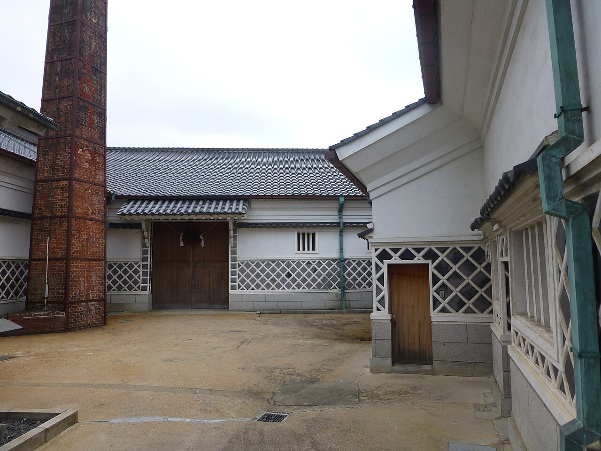

# 广岛西条酒藏路线

广岛西条酒藏路线不是一条跨县的长途公路线，而是一段可以用脚走完的街区路线：从贺茂鹤的一号藏出发，沿酒藏通走到贺茂泉的延寿藏，两站都在 JR 西条站步行圈内。它成立的理由不是“景点多”，而是七家酒造公司在约 1.5 公里范围内并排设厂，形成罕见的产业聚落；走一趟，能同时看到仍在出酒的厂房、供参观的旧藏与周末营业的试饮窗口。

图：西条酒藏街区的一座酒厂庭院，砖砌烟囱与白墙酒藏并立。图片：Max Nossin，CC BY 3.0，via [原图页面](https://commons.wikimedia.org/wiki/File:Sake_factory_-_panoramio_(1).jpg)。

## 路线概览

- 第一站：[贺茂鹤](ref:kamotsuru)，西条本町 9 番 7 号，一号藏藏元直营店；JR 西条站步行约三分钟，10:00–18:00，入馆免费。
- 第二站：[贺茂泉](ref:kamoizumi)，西条上市町 2 番 4 号，延寿藏；平日预约参观，周末与节假日由酒泉馆接待。
- 方式：步行。两站之间约十分钟脚程，中间会经过其他酒藏的仓屋与烟囱。
- 建议时长：半天。若加一场酿造藏见学或开窖活动，留到一天。
- 先确认：贺茂泉官网公告参观预约暂停，出发前打电话；贺茂鹤一号藏无需预约。

## 为什么是西条：一公里内的七家酒藏

在[日本](ref:japan)，西条常与京都伏见、兵库滩并称为日本三大酒处，但它的空间结构不一样。伏见是水路与酒藏交织的城市街区，滩是沿海的大产能带；西条则是“车站前一块地里挤着七家酒造”的尺度。海参壁、红砖烟囱与赤瓦屋顶不是单独一处景点，而是连续的城市肌理。2017 年，这片酒造设施群被国际古迹遗址理事会选入“日本二十世纪遗产二十选”；2024 年 2 月，一号藏等建筑以“西条酒藏群”之名列为国史迹。

这种密度带来的好处是“比较”变得容易。你可以在同一上午看到大吟酿主力的展售空间、纯米酒路线的试饮窗口，以及仍在运转的酿造藏；不需要开车换镇，也不必为每一家单独安排半天。代价则是每一家的开放方式不同：有的自由入馆，有的只接受预约，有的周末才开。路线设计的第一原则不是“都走到”，而是先确认当天谁开门。

## 第一站：贺茂鹤

第一站放在贺茂鹤，是因为它最容易建立时间轴。一号藏由 1872 年建成的旧藏改装，2019 年作为见学室与直营店开放，2024 年随西条酒藏群列为国史迹。馆内展示酿酒工具与资料，影片为日语配音、附英文字幕，展示板二维码提供多语言说明；试饮吧只收现金，常见组合是三杯或四杯 30 毫升、500 日元。商店卖藏元限定酒与季节酒，可办理邮寄。

一号藏是自由参观，不需要预约；二十人以上团体才要事先告知。真正的酿造藏平时不开放，只能随不定期见学团进入，每人 2000 日元，约一小时，由杜氏带队，看完影片后进藏，不设试饮，结束时送一瓶小容量大吟酿。若时间只够一处，先看一号藏；若想进生产区，提前查官网公告并预约。

## 第二站：贺茂泉

第二站往上市町方向走。贺茂泉的参观入口是延寿藏，接待方式更像“按客人时间定制”：先看约二十五分钟的酒造影片，再走藏内约十分钟，进入醸造藏约三十分钟，最后用十到十五分钟聊酒与藏、十到十五分钟试饮。平日时段为 8:30–12:00 与 13:30–16:00，原则上周末与祝日不受理；预约要在到访日一周前提出，四十人以上谢绝，二十人以上可能分组。

周末的替代方案是酒泉馆：每周六、周日与祝日 10:00–17:00，常备二十种以上贺茂泉清酒，可以小杯比较，也有酒馒头、酒水果蛋糕与仕込水咖啡；楼上酒图书室可翻阅藏书，旁边商店卖全系列与限定酒。需要再次提醒：官网目前公告藏见学预约暂停，恢复时间未定，出发前以官网与电话为准。若见学未恢复，就把这一站当作“试饮与买酒”的窗口，而不是“进藏参观”。

## 软水、山田锦与冬季酿造

西条的仕込み水来自贺茂山系伏流水，清冽偏软，发酵速度较慢，酒体倾向柔和、收口干净。当地藏元至今保留井水取水的习惯，水源与街区只隔几条巷子；软水让杂味少、口感圆，但也更依赖温度与酵母管理，不像硬水那样容易撑起厚骨架。酒米方面，山田锦颗粒大、心白明显，是吟酿造的常见选择；广岛县本身也是山田锦的重要产地，贺茂泉的旗舰纯米大吟酿即标注广岛县产山田锦 100%。

酿造季集中在冬季。秋季精米、制麹，入冬后开始[生酛与山废](ref:kimoto)或其他酒母培养，低温抑制杂菌，发酵可控；春天压榨、火入、装瓶，夏天酒藏休整。所谓“冬季酿造”不是文案，而是没有制冷设备的年代留下的生产节律，今天仍决定杜氏与藏人的工期。走路线时若看到藏屋门窗紧闭、设备停转，很可能只是季节性的休藏，而不是停业。

## 酒标上的吟酿与纯米吟酿

西条酒藏的产品线里，吟酿与纯米吟酿经常并排出现，价格与香气也不一样。按日本酒造组合中央会与国税厅的标签规则，两者的精米步合都要在 60% 以下，大吟酿与纯米大吟酿则要 50% 以下；区别在于原料：纯米吟酿只能以米、米麹与水酿造，吟酿允许添加少量醸造酒精。本酿造的精米步合在 70% 以下，纯米酒没有精米步合上限，但同样不许加酒精。[清酒](ref:sake)本身则定义为以米、米麹与水发酵、压榨，酒精分低于 22 度的酒。

读标签的实用顺序是：先看“纯米”与否，再看精米步合，最后看酒米与酵母。纯米吟酿的香气通常更内敛，米旨味与酸度更明显；吟酿的香气更外向、口感更轻。两者都不是“更高级”的代名词，差别更像两条设计路线：一条靠米与水，一条靠微量添加调整骨架。试饮时把同藏的两款并排喝，比单喝一瓶更容易理解这件事。

## 开窖日与步行安排

春季是酒藏开窖的集中期。贺茂鹤公告的 2026 年藏开定在 4 月 18 日 10:00–16:00，地点为本社藏（西条本町 4 番 31 号），免费入场、无需预约，卖限定酒与福袋，也开放部分藏内区域。日期与内容每年调整，遇到雨天或检修可能改期，出发前必须再看官网。其他酒藏也会在春季办类似活动，但时间不统一，不能假设同一天全部开门。

步行安排可以这样：上午从 JR 西条站出发，先去贺茂鹤一号藏看展与试饮，再沿酒藏通走到贺茂泉；中午在车站周边吃饭，下午若酒泉馆开门就补一轮比较，否则去其他酒藏的店头。全程步行，穿好走的鞋；藏内地面可能湿滑，试饮后不要立刻赶车。坐电车比开车省事，开窖日周边停车尤其紧张。

相关条目：[贺茂鹤酒造](ref:kamotsuru)、[贺茂泉酒造](ref:kamoizumi)、[清酒](ref:sake)。

**关键事实。**

| 项目 | 内容 |
| --- | --- |
| 一句话定位 | 从贺茂鹤一号藏步行到贺茂泉延寿藏，两站都在西条酒藏通的一公里余范围内；以七家酒藏的产业聚落、软水与山田锦、冬季酿造、吟酿与纯米吟酿的标签区别，以及春季酒藏开窖活动为线索 |
| 站数 | 2 |
| 交通 | walk |
| 停靠顺序 | 贺茂鹤酒造、贺茂泉酒造 |

## 参考资料

- [一号蔵（蔵元直营店）](https://www.kamotsuru.jp/tour/)，贺茂鹤酒造，核验地址、开放时间、试饮与见学费用。
- [蔵｜賀茂泉酒造](https://kamoizumi.co.jp/kura/index.html)，贺茂泉酒造，核验延寿藏参观时段与预约公告。
- [広島の西条酒の街](http://www.saijosake.com/japanese/town/)，西条酒藏组合，核验七家酒藏分布。
- [西条酒蔵通り](https://dive-hiroshima.com/explore/1199/)，Dive! Hiroshima，核验国史迹与二十世纪遗产。
- [日本酒の分類](https://japansake.or.jp/sake/about-sake/classification-of-sake/)，日本酒造组合中央会，核验吟酿与纯米吟酿标签规则。

页面核验日期 2026-11-09；开放时间、见学安排与活动日期以官方渠道为准。
