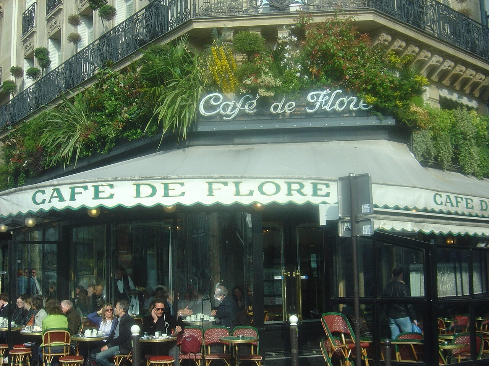

# 圣日耳曼德佩文学咖啡馆半日路线

这条路线只有两站，都在巴黎第六区圣日耳曼德佩：先到双叟咖啡馆，再去花神咖啡馆。两家店相距很近，几乎在同一街口的两侧，所以它不是“赶场式”的打卡路线，而是一段可以坐下来、观察街区、读几页书的半日行程。

图：巴黎圣日耳曼德佩的花神咖啡馆，绿色遮阳篷与露天座面向街口。图片：DIMSFIKAS，CC BY-SA 3.0，via [原图页面](https://commons.wikimedia.org/wiki/File:Cafe_de_Flore,_Paris_-_2011.JPG)。

## 路线概览

- 第一站：[双叟咖啡馆](ref:deux-magots)，地址 6 Place Saint-Germain-des-Prés，1885 年开业，位于广场一侧。
- 第二站：[花神咖啡馆](ref:flore)，地址 172 Boulevard Saint-Germain，19 世纪末开业，位于同一街口另一侧。
- 方式：步行。两站之间不需要交通工具，换站只需几分钟。
- 建议时长：半日。每家店留出至少四十分钟，剩下时间留给广场与周边街道。

## 为什么是这两站

圣日耳曼德佩在 20 世纪是作家、哲学家与艺术家的聚集区，咖啡馆是他们的会客室与办公室。双叟咖啡馆与花神咖啡馆都在这段历史里出现过：前者的名字与海明威、萨特、波伏娃等人的到访联系在一起，后者同样以知识分子顾客闻名。把两家放在同一条路线里，看的不是“哪家更有名”，而是同一街区里两种略有差异的咖啡馆气氛。

两家店离得近，也意味着你可以用走动来比较：座位朝向、露台与室内、服务节奏、价格层级。这样的比较比在单一店里坐一下午更容易看出“文学咖啡馆”作为城市空间的特点。

## 第一站：双叟咖啡馆

双叟咖啡馆在圣日耳曼德佩广场一侧，1885 年开业，店名来自店内两尊中国商人雕像。它的位置适合作为起点：广场上有教堂、书店与人流，坐在露台或靠窗的位置，可以先看清街区的基本格局。

这里的气氛比花神稍安静一些，室内有镜面、木质座椅与传统布局。适合点一杯咖啡或热巧克力，配一份简单甜点；如果想吃正餐，菜单上也有简餐。价格属于圣日耳曼德佩游客区水平，点单前最好确认露台座位是否有额外收费。

## 第二站：花神咖啡馆

从双叟出来，横过街口就是花神咖啡馆。它在 19 世纪末开业，室内保留红色座椅、镜面与传统咖啡馆布局，露台适合看街景。相比第一站，花神的“舞台感”更强：装饰更醒目，游客更多，服务节奏也更慢。

这里适合点热巧克力、咖啡或法式早餐。若想安静聊天，尽量避开周末午后；若只想过一下氛围，可以在非正餐时段来，坐半小时就够。和第一站一样，点单前确认露台服务费，别把账单上的附加项当成误会。

## 怎么走

路线没有复杂的转向：以圣日耳曼德佩广场为地标，先找到广场一侧的双叟咖啡馆，坐完后横过街口，沿 Boulevard Saint-Germain 走到花神咖啡馆。两店都在同一街口附近，步行几分钟即可，不需要地铁或公交。

建议把这段步行安排在上午或下午，避开正午餐与傍晚的高峰。若从地铁 Saint-Germain-des-Prés 站出站，先到广场会更顺；具体出入口与无障碍路线以巴黎公共交通的现场指引为准。

## 花费、预约与时间

两家店都不需要提前很久预约，但旺季的露台位置可能需要等位。花费主要由座位类型决定：露台、临街位置与室内座位在不同店可能有不同计价规则，音乐、演出或服务附加费也可能出现。两家都属于游客区价格，不要把“一杯咖啡”当成廉价选项。

时间安排上，半日足够：第一站四十至六十分钟，步行几分钟，第二站四十至六十分钟，剩下时间留给广场、书店与周边街道。若只想拍照打卡，可以压缩到一小时，但那样就失去了这条路线本来的节奏。

这条路线只有两站，重点在“坐下来的顺序”而不是打卡数量：先在双叟看广场与人流，再横过街口到花神，感受两种相邻却不同的咖啡馆气质。两店距离很近，适合半日慢走；预约、低消与高峰时段会影响体验，把它当成文学地标散步，而不是一场必须赶完的景点任务。

## 边界

营业时间、菜单、价格、座位规则与临时歇业以两店官方渠道为准；本页只描述路线结构，不保证某一天的具体营业状态。文学名人的到访属于历史叙事，不代表当前服务质量，也不保证能坐到“某某坐过的位置”。

本页不提供地图，也不提供坐标：两处场所的经纬度在内容仓中保持为空，没有可核验的坐标来源，因此按项目规则不绘制示意地图，只以文字描述步行关系。若需要精确导航，请使用实时地图服务，并以现场标识为准。

补充阅读：[认识一座城，从一间酒馆开始](ref:c-extra-1)、[走出酒馆：把一杯酒追到产地](ref:c-extra-2)、[法国](ref:c-extra-3)。

对照阅读：[双叟咖啡馆](ref:deux-magots)、[认识一座城，从一间酒馆开始](ref:c-extra-1)。

相关条目：[花神咖啡馆](ref:flore)。

**关键事实。**

| 项目 | 内容 |
| --- | --- |
| 一句话定位 | 以巴黎圣日耳曼德佩广场为中心的两站步行路线：先在双叟咖啡馆坐看广场，再横过街口到花神咖啡馆；两店相距很近，适合半日慢走，不适合赶景点 |
| 站数 | 2 |
| 交通 | walk |
| 停靠顺序 | 双叟咖啡馆、花神咖啡馆 |

**来源与边界。** 本页关于「圣日耳曼德佩文学咖啡馆半日路线」的关键事实，主要由以下来源交叉核对：Les Deux Magots（地址、开业年份与营业信息；1884 年创立与 140 周年页面信息）、Café de Flore（地址与营业信息；Prix de Flore 于 1994 年创立与近年得主）、Office de Tourisme de Paris（圣日耳曼德佩街区背景与咖啡馆文化）。价格、批次与状态会变，涉及这些字段时以页面所列来源的最新版本为准。正文为项目自写，来源只作核验，不复制原文。

**并读。** 把「圣日耳曼德佩文学咖啡馆半日路线」与「双叟咖啡馆」、「花神咖啡馆」、「认识一座城，从一间酒馆开始」放在一起读时，先确认它们是同一层级还是上下游关系：先确认停靠点与交通，再比较开放时间、预约与步行强度。本页负责给出路线的基本坐标，对照条目补上具体案例与差异；读完再回到本页，才能分清哪些差别属于路线本身，哪些只是产地、批次或品牌选择。

**适用边界。** 对「圣日耳曼德佩文学咖啡馆半日路线」而言，停靠顺序、开放时间与交通会变；出发前逐站核对官网与预约要求。
