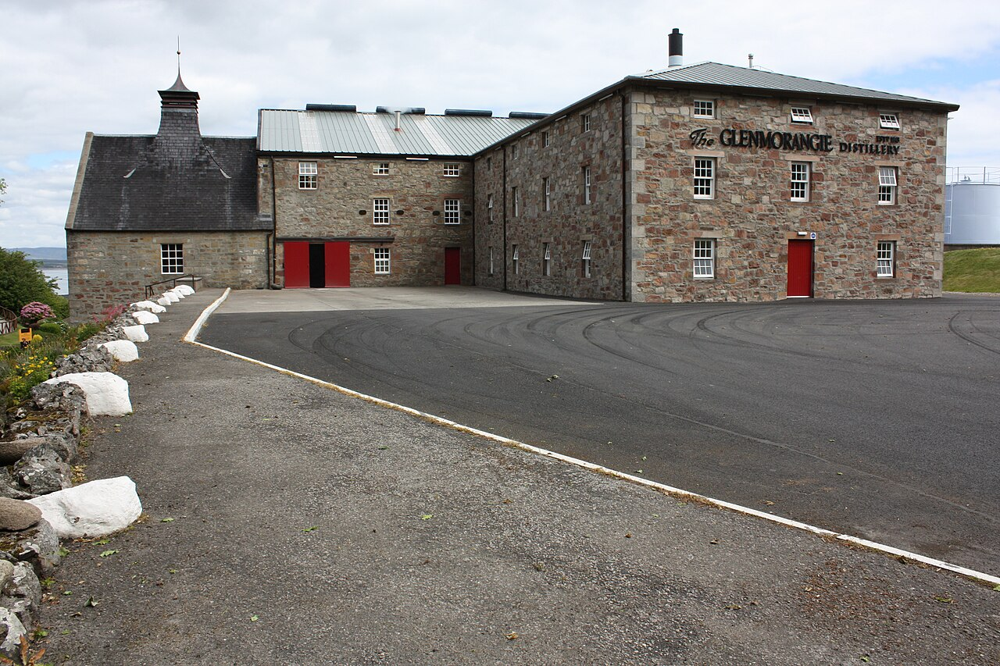

# 苏格兰高地路线：沿 A9 从泰恩到德拉莫赫特山口

“高地”是苏格兰五个法定产区中面积最大的一个，从北海边一直铺到中部山地。面积大意味着内部差异大：同样是高地，海边的酒厂与山口上的酒厂可以给出完全不同的酒体。这条路线只取两家：多诺赫湾边的格兰杰与德拉莫赫特山口南侧的达尔维尼。两站沿 A9 相距约两小时车程，一端是海风与长颈蒸馏器，一端是海拔、虫管与冷气候。

图：苏格兰高地路线：沿 A9 从泰恩到德拉莫赫特山口所经地区的一处实景。图片：Alan Jamieson，CC BY-SA 3.0，via Wikimedia Commons（[原图页面](https://commons.wikimedia.org/wiki/File:Glenmorangie_Distillery_-_panoramio.jpg)）。这张照片用于说明苏格兰高地路线：沿 A9 从泰恩到德拉莫赫特山口所经过的产区或城市环境，不标定其具体停靠点。

## 路线概览

- 第一站：[格兰杰](ref:glenmorangie)，The Distillery, Tain, Ross-shire IV19 1PZ；从因弗内斯沿 A9 北上约一小时。
- 第二站：[达尔维尼](ref:dalwhinnie)，Dalwhinnie, Inverness-shire PH19 1AA；从泰恩沿 A9 向西南约两小时，村口就在公路边。
- 方式：自驾最灵活；铁路可到泰恩与达尔维尼，但通常要在因弗内斯换乘，班次不密，以 Traveline Scotland 当日查询为准。
- 建议时长：一整天。若乘火车，建议在泰恩或因弗内斯住一晚，不要当天往返。

## 为什么沿 A9 走

A9 是苏格兰南北向的主干道，也是理解“高地”的一条剖面。从泰恩出发，先经过多诺赫湾的海岸与农田，再进入因弗内斯，随后地势抬升，最后到德拉莫赫特山口南侧。两个小时里，海拔、风、植被与路面都在变，酒厂的选址理由也跟着变：海边靠港口与泉水，山口靠铁路与道路。

这条线也避免了一个常见误区：把“高地”当成一种固定风味。高地的酒可以从清淡花果走到油质与轻烟熏，产区标签只能说明地理范围，不能替代对具体酒厂的了解。把格兰杰与达尔维尼放在一天，正好用两种设备、两种气候解释这种跨度。

## 泰恩：海边的长颈蒸馏器

1843 年，农民 William Matheson 与妻子 Anne 在泰恩把一座啤酒厂改造成蒸馏厂，名字来自盖尔语，意为“宁静之谷”。酒厂后来多次易主，现属 LVMH。官方历史里常被提到的群体是“泰恩的十六人”，一群长期在厂内工作的工匠；今天这个称呼变成“24 Distillers of Tain”，人数变了，“由本地团队掌握工艺”的叙事没有变。

Still House 被员工叫作“高地大教堂”。里面的壶式蒸馏器高 5.14 米（16 英尺 10 英寸），是苏格兰最高的一组；长而细的鹅颈让只有最轻的蒸汽到达顶部，回流比例高，新酒因此更干净、更偏花果香。水源来自塔尔洛吉泉，酒厂保护泉眼周围的林地。海风是更克制的咸鲜，而不是艾雷岛的碘味。

Classic Tour 约一小时，走糖化、发酵、蒸馏与熟成，最后品两杯；每团最多 12 人，儿童只允许参加经典导览，其他体验有年龄限制。导览建议预约，游客中心、商店与品鉴吧不需要。六月至八月每天开放，九月至五月仅周一至周五，酒厂与商店 10:00 至 17:00，品鉴吧 11:00 至 16:30。

喝什么：The Original 是基准，以波本桶为主，柑橘、桃子、香草与蜂蜜，入口柔和不单薄；Lasanta 用雪莉桶过桶，带葡萄干、巧克力与香料；Quinta Ruban 用波特桶，偏红果与薄荷巧克力；Nectar D'Or 用苏玳甜酒桶，带杏、蜂蜜与坚果。先用 Original 建立基线，再选一款过桶款对照，差别非常直接。

## 达尔维尼：山口上的虫管

1897 年，John Grant、George Sellar 与 Alexander Mackenzie 合作建厂，最初名为 Strathspey，由 Charles Doig 设计；次年遇到资金问题，由新股东接手并改用村名 Dalwhinnie。选址理由是泉水、泥煤与铁路。今天它属于帝亚吉欧，是高地单一麦芽的代表之一。

达尔维尼海拔约 355 米，官方称其为苏格兰最高、最冷的蒸馏厂之一。它卡在德拉莫赫特山口南侧，旧军用路、公路与铁路都在此交汇；冬季风雪会临时封路，酒厂就在 A9 路边。最值得看的设备是虫管冷凝器：盘成螺旋的铜管浸在水槽里冷凝酒精蒸汽，其中部分冷凝槽还是木制的。与壳管相比，虫管冷凝更慢，新酒通常更厚。

Classic Distillery Tour 约 45 分钟，走完糖化、发酵、蒸馏与 Dunnage 仓库，最后品三款单一麦芽，配苏格兰巧克力。每团最多 16 人，8 岁以下儿童不得参团；路线有台阶与两段楼梯，没有电梯，轮椅使用者无法完成全程。开放时间通常为 10:00 至 16:00，冬季可能因天气临时关闭；场次通常提前约六个月放出。

喝什么：15 年是核心款，石楠蜂蜜、青苹果、香草与轻柔烟熏，酒体顺滑；Distillers Edition 在奥罗露索雪莉桶中二次熟成，增加葡萄干、橙皮与香料。先用 15 年建立基线，再喝 Distillers Edition，就能体会雪莉桶带来的深色果味与单宁感。它与格兰杰的对比很清楚：一个偏蜂蜜与轻烟，一个偏柑橘与奶油。

## 把车钥匙交给清醒的人

自驾从因弗内斯出发，沿 A9 北上到泰恩，再原路南下经过因弗内斯，继续向西南到达尔维尼。A9 有单车道会车段与平均测速，冬季山口可能因风雪临时封闭，出发前查路况并留出余量。

铁路是可行的替代，但需要规划。泰恩在远北线上，达尔维尼在高地干线上，两地之间通常要在因弗内斯换乘；班次不密，错过一班可能影响整天的安排。时刻与票价以 Traveline Scotland 查询为准。

最重要的一条是饮酒后不开车。苏格兰的酒驾上限是每 100 毫升血液 50 毫克酒精，低于英格兰的 80 毫克；高地道路窄、弯多、天气变化快，一杯也可能影响判断。最稳妥的安排是包车、指定司机或参加含接送的行程；若自己开车，品鉴时全部吐掉，或把样品交给同行者。

## 季节、床位与高地的尺度

旺季在五月到九月，日照长、道路状况好，但酒厂导览与住宿都紧张。冬季安静，但日照短、山口天气更不稳定，部分酒厂只在工作日开放，遇到封路要改期。

住宿可以放在泰恩、因弗内斯或达尔维尼村：泰恩安静、靠海；因弗内斯选择最多，适合把铁路与公路接起来；达尔维尼村很小，住宿有限，更适合作为中途停靠而不是基地。地图上两小时的车程，加上吃饭与加油，往往会变成三小时以上。

按照 2009 年的苏格兰威士忌法规，单一麦芽必须在同一家酒厂以 100% 发芽大麦为原料、使用壶式蒸馏、在橡木桶中至少陈放三年、装瓶不低于 40%，且蒸馏酒精度不得超过 94.8%。两家都标“Highland”，但决定杯中风格的是蒸馏器、冷凝方式、桶型与仓库气候，不是标签。

相关条目：[达尔维尼酒厂](ref:dalwhinnie)。

## 另见

- [格兰杰](ref:glenmorangie)：1843 年建厂、5.14 米蒸馏器、塔尔洛吉泉与 The Original。
- [达尔维尼](ref:dalwhinnie)：1897 年 Strathspey、355 米海拔、虫管冷凝器与 15 年。
- 想补背景，可在内容仓中查阅高地与苏格兰产区、单一麦芽苏格兰威士忌与壶式蒸馏条目。

补充阅读：[高地](ref:c-extra-1)。

对照阅读：[格兰杰酒厂](ref:glenmorangie)、[高地](ref:c-extra-1)。

A9 路线跨度大，酒厂参观与山口天气都要留余量；以各酒厂官网确认场次，自驾前查路况与天气。核验于 2026-11-08。
