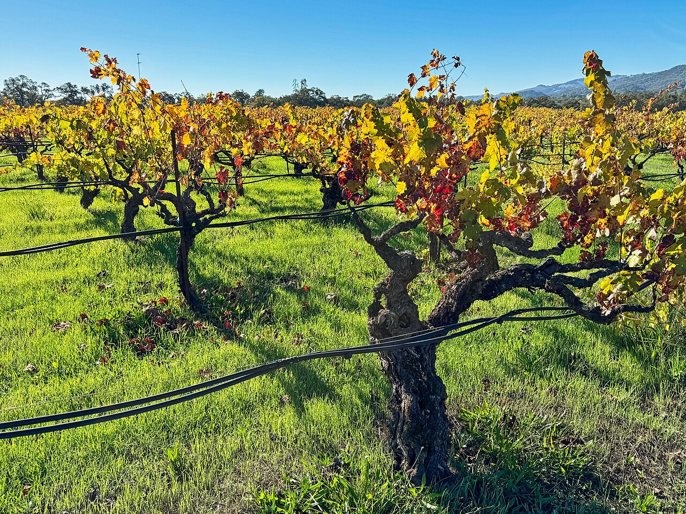
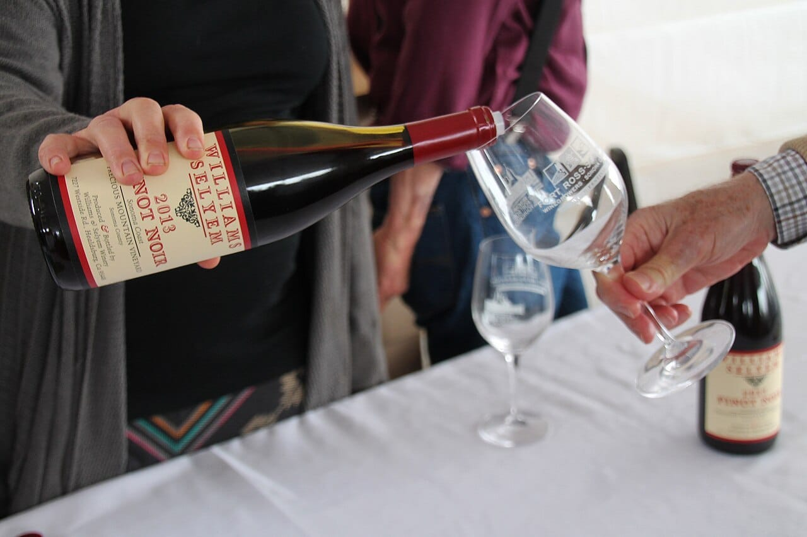

# 索诺马县葡萄酒路线

这条路线从希尔兹堡出发，上午去亚历山大谷的乔丹看赤霞珠与法式城堡，下午转进俄罗斯河谷的威廉姆斯-塞莱姆喝黑皮诺，一天里把“内陆热”与“海岸雾”两种索诺马放在同一张桌上。全程约 70 公里，重点是两座风格完全不同的酒庄，以及它们背后两种气候逻辑。

图：Sonoma County Wine Route：Bedrock Vineyard in Sonoma Valley California（Wikimedia Commons）。图片：Treephoto，CC BY-SA 4.0，via Wikimedia Commons（[原图页面](https://commons.wikimedia.org/wiki/File:Bedrock_Vineyard_in_Sonoma_Valley_California.jpg)）。

## 路线总览

建议 9:00 从希尔兹堡广场出发，走 Alexander Valley Road 向北，约 9:20 到乔丹。上午参加城堡导览与品鉴，重点喝赤霞珠与霞多丽，十二点前后在酒庄餐厅或回镇上吃午饭。13:30 从希尔兹堡向西南走 Westside Road，约 14:10 到威廉姆斯-塞莱姆；下午品鉴一个半小时，15:45 左右回程，16:15 到希尔兹堡。如果还有精力，傍晚在广场喝一杯或逛书店，不要再去第三家酒庄。

这条路线适合已经看过纳帕、想换一种节奏的人。索诺马县比纳帕更大、更分散，酒庄之间往往要开二十到四十分钟；一天两家是上限，三家就会变成赶路。乔丹与威廉姆斯-塞莱姆刚好代表两个极端：前者是法式城堡、赤霞珠与餐饮体验，后者是车库起家、黑皮诺与配额制。

## 产区背景

索诺马县在旧金山以北，面积比纳帕谷大得多，从太平洋海岸一直伸到 Mayacamas 山脉，拥有十多个法定产区。西边靠海的俄罗斯河谷、索诺马海岸受太平洋雾影响，夏天凉、成熟慢，适合黑皮诺与霞多丽；东边的亚历山大谷被山脉挡住海雾，白天更热，适合赤霞珠、梅洛与西拉。同一个县，开车一小时就能从“需要外套”的海岸雾走进“下午三十度”的内陆谷地。

这种地理分裂也解释了索诺马的酒为什么风格多样：这里没有单一的“索诺马味”，只有一个个山谷、坡向与雾线决定的微气候。路线设计如果只按酒庄名气排，很容易把两个相隔四十分钟、风格相反的点塞进同一天；按“气候带”排，反而更顺。

## 第一站：乔丹

乔丹在 1474 Alexander Valley Road，从希尔兹堡向北约十五分钟。1972 年 Tom 与 Sally Jordan 买下亚历山大谷谷底的 275 英亩土地，1974 年又置换了约 1,300 英亩山坡，请 André Tchelistcheff 做顾问、Bob Arrigoni 设计城堡；1976 年酿酒车间在采收前一周完工，第一个年份就是那一年的赤霞珠与梅洛。

乔丹只做两款酒：亚历山大谷赤霞珠与俄罗斯河谷霞多丽。赤霞珠以赤霞珠为主，混少量梅洛、小维多、马尔贝克与品丽珠，法国橡木桶陈酿，风格偏“年轻时能喝、陈年后更顺”；霞多丽是勃艮第式，部分桶发酵、带酒泥搅拌，酸度清楚。参观时先喝霞多丽再喝赤霞珠，顺序不要反过来，否则霞多丽的细节会被单宁压住。

酒庄的城堡导览会讲建筑、历史与酿酒流程，estate tour 会进葡萄园、橄榄林与花园。如果只选一个，第一次来选城堡导览加品鉴；如果对庄园农业感兴趣，选 estate tour。午餐在 d’Arry’s Verandah 或回希尔兹堡镇，前者要提前订位，后者选择更多。

## 第二站：威廉姆斯-塞莱姆

威廉姆斯-塞莱姆在 7227 Westside Road，从希尔兹堡向西南约十五到二十分钟。1978 年 Burt Williams 与 Ed Selyem 在 Forestville 的车库里开始酿酒，1982 年装瓶第一个商业年份，1984 年发布第一款 Rochioli 单一园黑皮诺；1987 年那款酒在加州州立博览会拿下大奖，酒庄从此进入“配额制”时代。

这里没有城堡，也没有大型游客中心，只有一间不大的品鉴室与一片葡萄园。参观必须预约，常见形式是坐下来喝当前 release 的几款酒，由团队讲地块、 clone 与年份；酒庄不接待大型团体，也不设随到随喝。品鉴时重点比较 Russian River Valley 级别与单一园的差别：前者更圆、更即饮，后者更瘦、更有泥土与香料。

威廉姆斯-塞莱姆的品鉴通常九十分钟，之后可以回希尔兹堡或在 Westside Road 上再选一家。Rochioli、Hartford、Gary Farrell 都在附近，但每家都要预约；如果已经喝了两家，第三家往往只是“再喝一口”，不如把时间留给晚餐。

## 午餐与替代点

午餐有三个方向：乔丹的餐厅、希尔兹堡广场、俄罗斯河谷的小镇。乔丹的餐厅适合想把参观拉长的人，菜单随季节变化，旺季要订；希尔兹堡广场选择最多，从墨西哥菜到意面都有，适合时间紧的人；俄罗斯河谷的 Farmhouse Inn 一带更贵、更安静，适合纪念日。

如果不想一天只去两家，可以把乔丹换成亚历山大谷的另一家酒庄，把威廉姆斯-塞莱姆换成俄罗斯河谷的一家；但不要同时跨到索诺马谷或索诺马海岸，车程会把一天撕成两半。带小孩的话，乔丹的花园与动物比威廉姆斯-塞莱姆的品鉴室更友好；威廉姆斯-塞莱姆更适合成人、安静的场合。

## 季节与路况

索诺马的春天与秋天最舒服，夏天下午内陆很热，冬天雨多但酒庄人少。采收通常从八月到十月，酒庄最忙，预约名额紧；俄罗斯河谷的早晨常有雾，开车要开雾灯，下午雾散后 Westside Road 风景最好。

从旧金山到希尔兹堡约一个半小时，从希尔兹堡到乔丹约十五分钟，从乔丹到威廉姆斯-塞莱姆约三十五分钟，从威廉姆斯-塞莱姆回希尔兹堡约十五分钟。周五下午与周末 101 号公路北向容易堵，返程尽量避开 16:00–18:00；Westside Road 窄且多弯，晚上不要赶路。

## 预约与礼仪

乔丹的城堡导览、estate tour 与餐厅都要预约；威廉姆斯-塞莱姆只接受预约，且名额很少。两家都不适合大型团体临时加入，超过六人最好先发邮件。品鉴时把酒吐进吐酒桶，开车的人只喝一两杯；乔丹的城堡有石阶，威廉姆斯-塞莱姆的品鉴室小，穿好走的鞋、不要带大件行李。

这条路线不画地图，也不提供实时价格；道路、营业时间与预约规则会变，出发前以两家酒庄官网与索诺马县葡萄酒协会为准。如果遇到酒庄临时关闭，别硬闯，把备选酒庄或希尔兹堡镇写进行程，一天不会因此作废。

相关条目：[乔丹酒庄](ref:jordan)、[威廉姆斯-塞莱姆酒庄](ref:selyem)、[索诺马](ref:sonoma)。

## 延伸阅读与另见

- 相关条目：[jordan-vineyard](ref:jordan)、[williams-selyem](ref:selyem)、[sonoma](ref:sonoma)、[red-wine](ref:red)、[pinot-noir](ref:pinot)。
- 想继续深入，可以把这条路线与纳帕谷路线对照：索诺马更分散、更靠海，纳帕更集中、更偏赤霞珠。
- 如果只有半天，删掉乔丹，只去威廉姆斯-塞莱姆加希尔兹堡；如果只有两小时，选一家，不要试图两家都到。

## 相关图像

图：File:Williams Selyem wine at Fort Ross State Historic Park - Jenner, California - Stierch.jpg。图片：Sarah Stierch，CC BY 4.0，via Wikimedia Commons（[原图页面](https://commons.wikimedia.org/w/index.php?curid=44884501)）。关联图像：索诺马县葡萄酒路线。

图：黑皮诺。图片：Cjp24，Public domain，via Wikimedia Commons（[原图页面](https://commons.wikimedia.org/wiki/File:Grape_near_Sancerre.jpg)）。关联图像：索诺马县葡萄酒路线。
