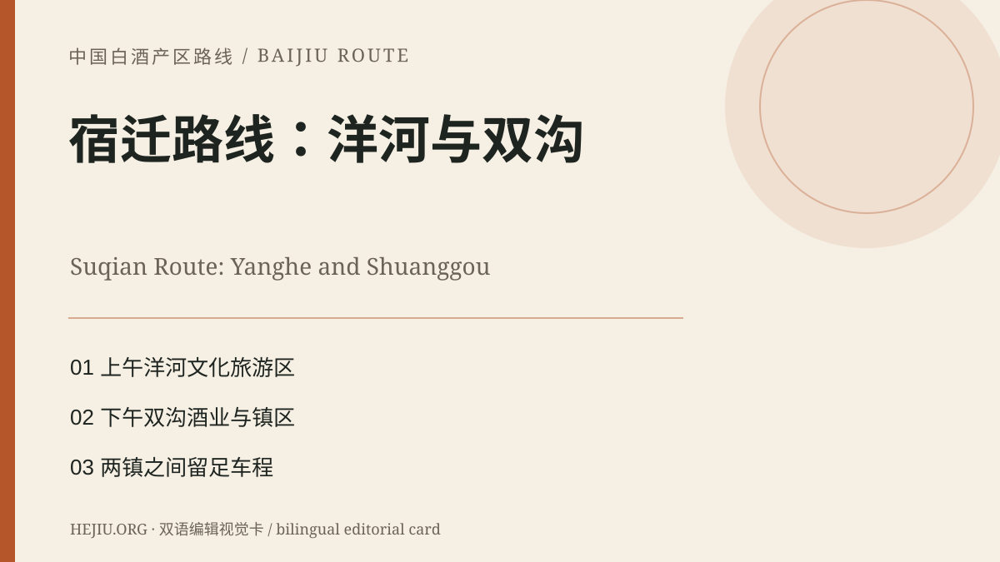

# 宿迁路线：洋河与双沟

宿迁的酒旅不是“一个厂加一个门”。洋河与双沟是两座不同的酒镇：洋河以文化旅游区、展陈与厂区参访为主，双沟以老窖、镇区与洪泽湖水乡为背景。很多人从洋河一路开到双沟，只在门口拍照，结果两边的工艺与空间都没看懂。这条路线把上午留给洋河，下午留给双沟，中间留足车程，不追求看完所有车间。

图：宿迁路线专属双语视觉卡。项目自制双语视觉卡，用于识别主题，不是现场照片。

> **先给结论**
> **适合谁：** 想一次看两座浓香酒镇、愿意自驾或包车的人；适合从宿迁或泗洪出发。
> **不适合谁：** 只想在一个点慢慢看、不愿转场的人；两镇之间车程不短。
> **一句话：** 上午洋河、下午双沟，先展陈后镇区，品鉴后不开车。

## 路线逻辑：一城两镇

洋河与双沟都在宿迁，却不是同一种参访。洋河的文化旅游区更集中，展陈、厂区外观与接待动线相对完整；双沟更贴近镇区与湿地，老窖、酒厂与生活空间混在一起。把洋河放在上午，是因为展陈与厂区需要连续时间；把双沟放在下午，是因为镇区与湿地适合傍晚收尾。两镇之间不要安排饭点转场，午饭放在洋河或途中，下午再到双沟，避免把时间耗在找餐馆。

## 上午：洋河文化旅游区

洋河以浓香型白酒为主，重点看泥窖、制曲、蒸馏与陈放。展陈里先看工艺剖面与流程图，再到厂区外观对照制曲房、窖池车间、蒸馏塔与陶坛库的位置。浓香型白酒用泥窖固态发酵，窖池连续使用越久、窖泥养护越稳定，窖香与己酸乙酯才容易出来；不要只记“老窖”两个字，要看池壁、池底泥层、通风与排水。生产区不自行进入，不翻围栏；品鉴问清酒精度、容量与收费，司机不喝。

## 下午：双沟酒业与镇区

双沟镇在淮河与洪泽湖之间，酒厂、镇区与湿地相邻。看双沟酒业的老窖与展陈，重点仍是泥窖发酵、制曲与陈放；看镇区时注意酒厂如何与住宅、菜市场、餐馆、班车共生，不要把它当成一条仿古街。若时间允许，傍晚到湿地边缘看水网，但不要下到未开放滩涂；夏天蚊虫多，穿长裤、带驱蚊用品。镇区步行可达，厂区与湿地之间要打车或自驾。

## 交通、预约与时间

洋河镇在宿迁市洋河新区，双沟镇在泗洪县南部，两镇之间车程约一小时上下，具体以实时导航为准。高铁到宿迁或泗洪后转车，班次少，自驾更灵活。只看洋河展陈与厂区外观约两小时；加双沟老窖与镇区，一天；再串洪泽湖湿地，需要两天。两处的开放、预约与收费各自独立，出发前一天分别确认；夏天湿地湿热、酒厂气味重，带水、帽子与防滑鞋。

## 品鉴、买酒与湿地

品鉴要问清酒精度、容量与收费，小杯慢饮，不空腹；司机不喝，品鉴后不要开车。买酒去官方店或授权店，保留发票，不要把“内部酒”“接待酒”当成捡漏。若加洪泽湖湿地，选一个观鸟点就够，不要把湿地深处与两座酒镇塞进同一天。吃饭可以试泗洪小龙虾、洪泽湖鱼、洋河车轮饼与苏北家常菜，配浓香酒时控制量。返程前确认末班车或代驾，别在湿地拖到天黑。若从宿迁出发，上午九点前到洋河，午饭在洋河镇，下午两点到双沟；若从泗洪出发，反向走，把双沟放在上午、洋河下午，但洋河展陈时间要留够。带长辈减少车间步行，把展陈模型先看懂；带孩子优先湿地，酒厂只走展陈。洋河与双沟的预约入口不同，出发前一天分别确认；如果只留半天，选洋河展陈加厂区外观，不要硬加双沟。两镇之间不要走乡道捷径，按导航走主路，夜间不开山路；吃饭按本地饭点，带水与帽子，班车问末班，提前准备，慢走，带好身份证与预约码；两镇预约分别确认，湿地不穿凉鞋，买酒核对批次，返程前加满油，带水。

## 一日与两日版本

一日版按“洋河展陈—午饭—双沟老窖—镇区”走，上午不要拖到中午，下午不要把湿地也塞进来。两日版把第一天留给洋河与双沟，住泗洪，第二天去洪泽湖湿地。若只留半天，选洋河展陈加厂区外观，不要硬加双沟；若带长辈，减少车间步行，把展陈模型先看懂。返程前买酒，司机不参加品鉴；夏天湿地蚊虫多，穿长裤、带驱蚊用品，别在湿地拖到天黑。

## 出发前核对

- 分别确认洋河与双沟开放
- 上午洋河，下午双沟
- 两镇之间留足车程
- 品鉴后不开车
- 买酒只走官方或授权店
- 湿地选一个观鸟点
- 夏天穿长裤带驱蚊
- 返程末班车提前问

## 这一路线不适合谁

这条路线把洋河酒厂文化旅游区与双沟酒业串起来，适合想看浓香生产与湿地粮食关系的人。若你只对品鉴感兴趣，两个厂区的展馆与步行会占掉大半时间；若你不自驾，镇际班车班次少，返程时间要留足。

宿迁市区到洋河、双沟都有车程，双沟镇道路窄、货运车辆多；夏季湿热，厂区步行距离长。节假日的预约与讲解名额紧张，现场不一定能补上。

替代方案：只看洋河旅游区，或只看双沟老作坊；若想连带洪泽湖湿地，至少留一整天。买酒比较厂区、市区与电商渠道，别在路边临时摊位解决。

## 参考资料

- 洋河酒厂文化旅游区简介 — 洋河股份 — https://www.chinayanghe.com/culture/whzl/cqly/（江苏洋河酒厂股份有限公司，核对 2026-11-25）
- 宿迁洋河工业文化旅游区 — 官网 — https://ly.chinayanghe.com/（宿迁洋河工业文化旅游区，核对 2026-11-25）
- 洋河股份 — 官网 — https://www.chinayanghe.com/（江苏洋河酒厂股份有限公司，核对 2026-11-25）
- 宿迁市人民政府 — https://www.suqian.gov.cn/（宿迁市人民政府，核对 2026-11-25）

相关条目：[洋河酒厂文化旅游区](ref:yanghe)、[双沟酒业（双沟镇）](ref:shuanggou)、[洋河（双沟母品牌）](ref:brand)、[浓香型白酒](ref:style)、[江苏省](ref:region)、[第一次喝白酒怎么选](ref:guide)、[中国酒史纲](ref:history)。
