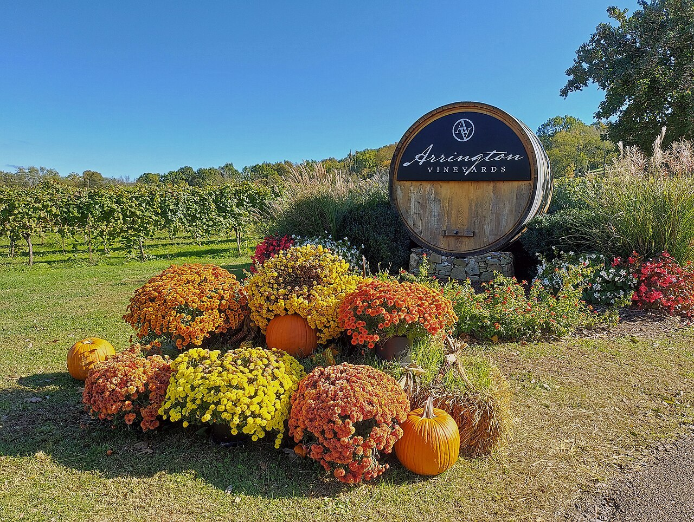

# 田纳西威士忌路线：林奇堡与 Cascade Hollow 的两个山谷

田纳西威士忌常被当成“波本加一道木炭过滤”，这句话只说对了一半。原料与桶的要求确实接近波本，但木炭过滤、州内完成与品牌选择，让田纳西形成一个独立的类别。这条路线只取两家：林奇堡的杰克丹尼与 Cascade Hollow 的乔治迪克尔。两站相距约半小时到四十分钟，做的是同一类酒，给出的却是“常温”与“低温”两种答案。

图：田纳西威士忌路线：林奇堡与 Cascade Hollow 的两个山谷所在的田纳西风貌配图。摄影：Tennessee - Arrington Vineyards。署名：P. Hughes，CC BY-SA 4.0，来自 Wikimedia Commons（[来源](https://commons.wikimedia.org/w/index.php?curid=128050365)）。这张照片用于说明产区环境与访问语境，不标定田纳西威士忌路线：林奇堡与 Cascade Hollow 的两个山谷的门店、酒庄或活动现场。

## 路线概览

- 第一站：[杰克丹尼](ref:jack-daniels)，280 Lynchburg Hwy, Lynchburg, TN 37352；从纳什维尔约一个半小时，从查塔努加约两小时。
- 第二站：[乔治迪克尔](ref:george-dickel)，1950 Cascade Hollow Rd, Tullahoma, TN 37388；从林奇堡约半小时到四十分钟，最后一段是山谷乡道。
- 方式：自驾或包车。两站都没有可用的公共交通，山谷里手机信号不稳。
- 建议时长：一整天。上午杰克丹尼，午饭在林奇堡或塔拉霍马，下午迪克尔。

## 同一道工序，两种温度

田纳西威士忌的原料与桶要求接近波本：玉米至少 51%，在新烧焦的橡木桶中熟成，装瓶酒精度不低于 40%；差别在装桶之前多了一道糖枫木炭过滤，并且必须在田纳西州境内完成。两家都做这道工序，方法却不同。杰克丹尼把新酒以滴滤方式缓慢通过厚厚一层糖枫木炭，持续数天；迪克尔先把酒液冷却，再经过木炭，官方把这种做法叫 chill-charged。低温让酒液更黏、流速更慢，酒厂认为过滤更温和。

这套差别不是玄学，但也不是全部。真正决定风格的还有发酵时间、蒸馏切酒、入桶强度与仓库位置。把两家放在同一天，最有效的比较方式是先各喝基础款，再各喝一款单桶或保税版；如果只记“木炭过滤”四个字，很容易把两家的差异归给一个变量。

还有一个小细节：迪克尔写作 whisky，不带 e，跟苏格兰传统一致；杰克丹尼写作 whiskey。拼写不改变法规类别，但它提醒你，田纳西内部也不是一块铁板。

## 抵达林奇堡：规模与泉眼

杰克丹尼把 1866 年视为注册年份，并自称“美国最老注册酒厂”；早期档案并不完整，更稳妥的写法是“官方叙述以 1866 年为起点”。1904 年，旧 7 号在圣路易斯世界博览会拿到金奖，方瓶、黑标与“Old No. 7”的编号也在这一时期固定下来。把营销史与生产史分开看，会发现它的成功一半来自工艺，一半来自很早就懂得如何让一瓶酒被记住。

林奇堡属于摩尔县，而摩尔县自禁酒令以来就是“干县”：县内不设酒类专卖店，餐馆也不能随意卖酒。唯一的例外是酒厂本身，它可以在访客中心卖酒并提供品鉴。一个以威士忌闻名的地方，日常生活里却买不到一杯酒，这种反差是理解这一站的最好入口。

标准导览约 1.8 小时，走游客中心、Cave Spring 泉眼、木炭烧制与过滤区、蒸馏车间、桶库，最后品鉴六杯。泉水常年约 56 华氏度，且不含铁；铁会让威士忌产生异味，所以无铁泉水是选址理由之一。喝什么：旧 7 号是基准，香蕉、香草、焦糖与橡木，尾段有一点炭的干涩；Gentleman Jack 经两次木炭过滤，更干净；Single Barrel 更集中；Bonded 对应保税规则。品鉴必须年满 21 岁并出示证件，未满 21 岁可以参团但不能喝。

## 转进 Cascade Hollow：低温与安静

迪克尔的品牌起点是 1870 年 George A. Dickel 在纳什维尔经营的威士忌生意，Cascade Hollow 的酒厂则在 1878 年投产。禁酒令期间关闭，二十世纪中期重建，今天归在 Diageo 旗下，运营主体写作 Cascade Hollow Distilling Co.。酒标上的 1870 是品牌起点，1878 才是这处厂址开始出酒的年份，这两个数字不要混。

山谷占地约 600 英亩，厂区被树林包住，游客中心不大，导览的节奏更像走进一家还在运转的作坊。官方写明周四至周二开放、周三闭馆；周一、周二、周四、周五与周六为 9:30 到 16:00，周日为 11:30 到 16:00。导览约一小时，生产区周一至周五运转，周末参团多半看不到正在蒸馏。儿童可以参加，但需购买 Minor 票；宠物不能进入游客中心与厂区。

喝什么：No. 8 是入门，酒体轻、甜感明显；No. 12 更厚，香料与橡木更清楚；Barrel Select 是单桶选择，差异最大；Bottled in Bond 按联邦保税规则装瓶。整体比杰克丹尼更干、更偏谷物与香料，木炭味没有那么突出。先喝 No. 8 与 No. 12，再点一杯 Barrel Select，三杯就能把年份、调配与单桶差异走一遍。

## 票、场次与最后几英里

两家的票务入口都在官网。杰克丹尼按场次售票，标准导览之外还有偏重桶陈与整日行程的产品；迪克尔建议提前预订，自助品鉴按先到先得。价格与场次会调整，本文不列固定数字，出发前以预约页为准。两处都要求品鉴者年满 21 岁并出示带照片的证件。

交通是这条线最容易被低估的部分。林奇堡与塔拉霍马之间没有可用的公共交通，打车也不稳定；从纳什维尔或查塔努加租车是最实际的方式。最后几英里是乡村道路，夜间没有路灯，导航偶尔会把车带到错误的岔路，接近时按路牌走，或提前把路线截图保存。

饮酒与驾驶的边界要提前划清：开车的人全程不喝，品鉴可以交给同行者或直接跳过；不要用“我只喝了一点”来判断自己是否适合上路。最稳妥的安排是包车或指定司机，把两站之间的车程留给不喝酒的人。

## 季节、住宿与只去一家的方案

春季与秋季最舒服，山里有颜色，路面也不容易结冰；夏天湿热，厂房与桶库更闷，导览多在户外走动，帽子和水比正装更重要；冬天游客少，但日照短，遇冰雪时乡道会变得难走。两家的闭馆日不同，安排前先看官网日历。

住宿可以放在林奇堡、塔拉霍马或纳什维尔：林奇堡镇很小，餐馆选择有限；塔拉霍马更实用；纳什维尔适合把酒厂行接在音乐现场之后。若只有半天，保留杰克丹尼就够了；想把“同一道工序的两种温度”喝明白，则两家都要去，且不要在同一天安排第三家。往西北可以回纳什维尔，往东南可以到查塔努加，把酒厂行变成一段公路旅行。

相关条目：[乔治迪克尔酒厂](ref:george-dickel)。

## 另见

- [杰克丹尼](ref:jack-daniels)：1866 年注册、1904 年金奖、Cave Spring 与常温木炭滴滤。
- [乔治迪克尔](ref:george-dickel)：1870 年品牌、1878 年厂址、冷却后过滤与 No. 8、No. 12。
- 想补背景，可在内容仓中查阅田纳西产区、田纳西威士忌风格与波本条目。

补充阅读：[田纳西](ref:c-extra-1)。

对照阅读：[杰克丹尼酒厂](ref:jack-daniels)、[田纳西](ref:c-extra-1)。

林奇堡与 Cascade Hollow 两个山谷相距较远，酒厂参观需提前订票；开放时间、场次与交通以各官网为准。核验于 2026-11-08。
