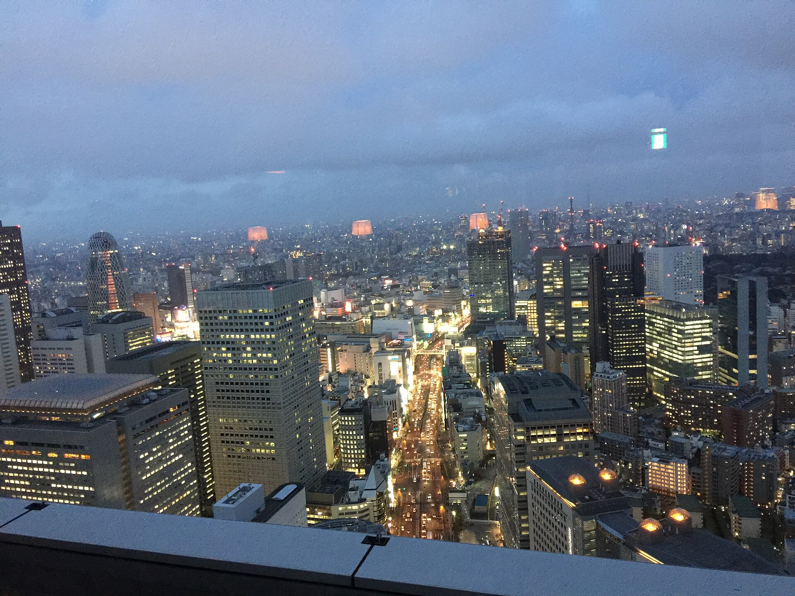

# 东京酒吧路线：银座的两位调酒师

这条路线只有两站，都在银座，靠步行连接。第一站是银座五丁目的 High Five，第二站是一丁目并木通边的星光酒吧。两家都以“专业酒吧”著称，但专业的方向相反：一家没有固定酒单，靠对话现做；一家以经典配方和老派吧台为主。把两站放在同一个傍晚，能看见银座酒吧的两种标准，也能看见同一座街区如何把“安静地喝一杯”变成一种城市习惯。

图：东京酒吧路线：银座的两位调酒师相关实景照片。图片：Jc8136，CC BY-SA 4.0，via Wikimedia Commons（[原图页面](https://commons.wikimedia.org/wiki/File:Shinjuku_at_night.JPG)）。

## 两站与时间安排

- 第一站：[High Five](ref:highfive)，银座 5-4-15 的楼宇地下一层；2008 年 7 月开业，周一至周六 17:00–01:00，最后入场 00:00，周日与日本法定假日休息。
- 第二站：[星光酒吧](ref:star)，银座一丁目、并木通一带的地下一层；每人 1100 日元座位费，酒水另计。
- 方式：步行。两站都在银座街区，不需要换乘地铁；走完再决定是否原路返回。
- 建议时长：三小时上下。第一站留六十到七十五分钟，步行十到十五分钟，第二站留六十到九十分钟。
- 顺序理由：High Five 傍晚开门，适合先喝；星光酒吧更安静、节奏更慢，适合收尾。具体最后点单以官方渠道为准。

## 两位调酒师的师承

上野秀嗣在星光酒吧工作过，之后于 2008 年开设 High Five；星光酒吧的主理人岸久则在 1996 年拿到一项国际调酒赛事的世界冠军，当时 31 岁。把这两条时间线放在一起，能看出他们不是“新旧两家网红店”的竞争关系，而是同一传统里的两代实践者。

岸久留在银座一丁目，做经典鸡尾酒，同时担任日本调酒师协会会长与银座调酒师学校校长；上野把吧台缩小，把酒单取消，让服务变成一场对话。一个把标准守住并教出去，一个把标准拆开、按客人的偏好重新组装。路线之所以成立，不是因为两家“都很有名”，而是因为它们对同一套基本功给出了两种回答。

理解这一点，也就理解了银座。这里的专业不是一种统一的腔调，而是若干种可以被辨认的做法；师承关系让这些做法互相牵连，而不是各自孤立。

## 第一站：High Five 的无酒单吧台

High Five 在银座五丁目，入口在地下一层，门面不显眼。坐下后没有酒单可翻，调酒师会先问你想要什么方向：基酒、酒精度、酸甜、果味、香气，短饮还是长饮。这种服务常被叫作“Omakase 式”，但它并不等于“调酒师替你做主”——你可以明确说不要什么，也可以在中途调整。

冰是这家店的工艺展示。调酒师把一大块透明冰手工削成钻石或球体，再放进杯子；目的不是拍照，而是减少表面积、控制融化速度，让稀释更稳定。看这个过程需要时间，所以第一站不适合赶场。价格按 The World's 50 Best 的条目，每杯平均约 16 美元，另可能有服务费或座位费；小空间不适合大团体，两三个人最合适。

High Five 自 2015 年 5 月起不接受预约，只在到店前接听电话确认空位；周日与法定假日休息，最后入场时间也早。出发前看一眼官网首页的包场与临时休业公告，比到了楼下才发现关门更省事。第一杯建议点结构清楚的经典，先把味觉校准，再让调酒师按偏好做第二杯。

## 从五丁目走到一丁目

从 High Five 出来，沿并木通向北走。先经过银座四丁目的路口，和光百货与三越在中央通一侧，并木通则平行于中央通偏西；继续穿过三丁目、二丁目，进入一丁目后留意右手边的楼宇入口。全程约十到十五分钟，不需要过桥，也不需要换乘，属于银座街区内的短距离步行。

实际路线会受施工围栏、店铺入口和当晚人流影响，以现场标识与实时导航为准。银座的门牌按“丁目—番—号”排列，同一条街两侧的编号可能不连续；不要凭“酒吧街”的印象找，按地址找楼、再找地下一层，成功率更高。

这段步行的意义不只是移动。五丁目到一丁目正好穿过银座最密集的商业段：百货、旗舰店、画廊与写字楼交替出现，酒吧藏在这些楼的地下一层或高层。走一遍，能直观看到银座酒吧为什么多是“小房间”——它们依附在垂直的商业空间里，而不是占一整条街。

## 第二站：星光酒吧的老派吧台

星光酒吧在银座一丁目、并木通一带的地下一层。吧台呈琥珀色，座椅是皮革凳，空间安静，全店禁烟；官方把它称作银座风格的传统酒吧，用经典鸡尾酒加上自家的处理方式出品。它的冰是另一套体系：手削透明冰、自社天然冰与特殊机械制冰，按三种热传递方式分工，最出名的是几乎会在杯里“消失”的忍者冰。

这里的点单逻辑与第一站相反。经典酒单是骨架，你可以点一杯结构清楚的短饮，也可以直接说偏好；但不要期待“无酒单定制”的惊喜。它卖的是准确、温度和可重复，而不是每杯都不一样。看调酒师[搅拌](ref:stirring)的动作、取冰的手势、擦杯的节奏，比问“你们的招牌是什么”更能判断这家店。

收费也换了一套算法：每人 1100 日元的座位费，酒水另计。老派酒吧的座位费买的是一段时间与一个位置，不是门票；坐下后不必急着点满，一杯喝完再点下一杯，才是这里的正常节奏。

## 预期落差：两种“专业”

消费者最容易犯的错误，是把两家店当成同一种体验的上下半场。在 High Five，客人把“没有酒单”当成服务邀请，愿意花几分钟描述偏好；在星光酒吧，客人把“经典”当成契约，期待稳定与准确，不太需要解释。带着前者的期待走进后者，会觉得对方冷淡；带着后者的期待走进前者，会觉得没有抓手。

付费买的东西也不同。High Five 按杯计价，每杯平均约 16 美元，买的是对话、定制与削冰的时间；星光酒吧按人收 1100 日元座位费，再按杯计酒水，买的是标准、老派吧台与一段不被打扰的时间。两家都不便宜，但“贵”的理由不一样，比较价格之前先比较你想要的体验。

“银座的沉默服务”常被误解为势利。它更接近一种工作伦理：调酒师少说话，把注意力放在杯子、温度和你喝的速度上；客人压低音量，不把吧台当成社交舞台。Time Out Tokyo 对银座名店的通例写得很直白：声音要低，至少穿有领衬衫，并预期座位费。把这些当成入场规则，而不是针对某个人的态度，体验会顺很多。

[酒吧与城市](ref:pubcity)的关系在这条路线上是双向的：银座塑造了酒吧的形态，酒吧也反过来规定街区的夜晚。两站都小、都安静、都不适合大团体；这不是巧合，而是同一套城市空间与行业惯例的结果。

## 营业、预约与礼仪的边界

星光酒吧的营业状态在本页标为 unknown：官网仍在，但没有可核验的当日在营信息；固定休息日、最后点单、是否接受预约与包场，以官方渠道为准。High Five 自 2015 年起不接受预约，只接受临时电话确认；两家都不建议大团体到访。

本页不提供坐标，也不绘制地图：两站的经纬度在内容仓中留空，没有可核验的坐标来源，因此只以文字描述步行关系。东京酒吧路线：银座的两位调酒师的停靠顺序只作阅读顺序；精确导航请用实时地图并以现场标识为准。

路线不保证任何一天的营业状态。若第一站满座，不要把第二站当成“备选”而仓促赶过去；银座的专业酒吧值得各留一小时，两家以内比一晚赶三四家更完整。夜间返程先确认地铁末班与出租车候车点，再决定最后一杯的时间。

相关条目：[High Five 酒吧](ref:highfive)、[星光酒吧（银座）](ref:star)、[搅拌](ref:stirring)。

## 参考资料

- [Bar High Five — Map & Access](https://www.barhighfive.com/map)，Bar High Five，核验地址、营业时间、最后入场与休息日。
- [Bar High Five — Staff](https://www.barhighfive.com/staff)，Bar High Five，核验 2008 年开业、上野秀嗣的星光酒吧经历与 2015 年取消预约。
- [High Five — The 50 Best Discovery](https://www.the50.com/discovery/Establishments/Japan/Tokyo/High-Five.html)，The World's 50 Best，核验每杯平均约 16 美元与手削冰。
- [STAR BAR GINZA 店舗紹介](https://www.starbar.jp/store-introduction-ginza)，STAR BAR，核验银座一丁目位置、手削透明冰与全席禁烟。
- [STAR BAR About Us](https://www.starbar.jp/about-us)，STAR BAR，核验经典鸡尾酒路线、三种冰与 1100 日元座位费。
- [Star Bar Ginza](https://www.timeout.com/tokyo/bars-and-pubs/star-bar-ginza)，Time Out Tokyo，核验并木通位置、1996 年夺冠与 31 岁。
- [The best Tokyo bars: meet the masters](https://www.timeout.com/tokyo/bars-and-pubs/the-best-tokyo-bars-masters)，Time Out Tokyo，核验银座名店的音量、着装与座位费通例。

页面核验日期 2026-11-09；营业时间、预约规则与价格以官方渠道为准。

补充阅读：[阿尔萨斯特级园路线：凯泽斯堡与里屈埃维尔](ref:c-extra-1)。
