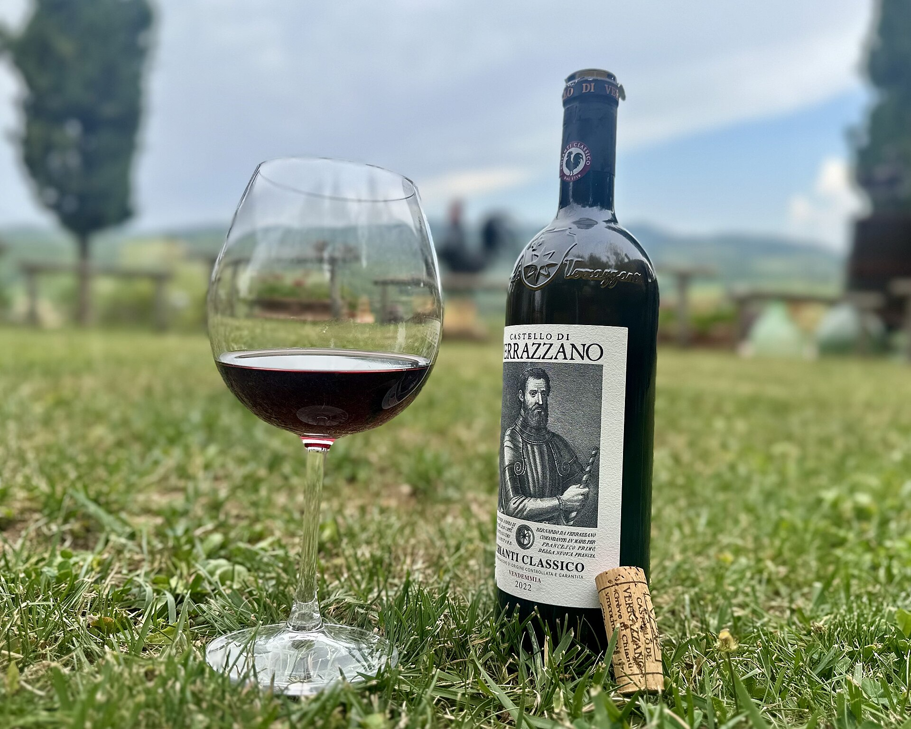

# 经典基安蒂路线：从佛罗伦萨到三座酒庄

经典基安蒂（Chianti Classico）夹在佛罗伦萨与锡耶纳之间，是意大利最容易被“打卡化”的葡萄酒产区之一。很多行程把它压缩成“去一家酒庄喝酒”，但这样会漏掉产区真正的层次：一片葡萄园如何被城堡、家族、配方与当代建筑分别讲述。这条路线用一天串起三站——Bargino 的安东尼世家酒庄、Gaiole 的布罗利奥城堡、Castelnuovo Berardenga 的费尔西纳庄园——从建筑、历史与品种三个角度进入同一个产区。

图：经典基安蒂路线：从佛罗伦萨到三座酒庄相关实景照片。图片：FranzKafka2000，CC BY-SA 4.0，via Wikimedia Commons（[原图页面](https://commons.wikimedia.org/wiki/File:Chianti_Classico_example_bottle_-_Annata_type.jpg)）。

## 路线概览

- 第一站：[安东尼世家经典基安蒂酒庄](ref:antinori)，Via Cassia per Siena 133, Loc. Bargino, 50026 San Casciano Val di Pesa (FI)，2012 年 10 月启用。
- 第二站：[布罗利奥城堡](ref:brolio)，Località Brolio, 53013 Gaiole in Chianti (SI)，里卡索利家族城堡，文献可追溯到 1141 年。
- 第三站：[费尔西纳庄园](ref:felsina)，Via del Chianti 101, 53019 Castelnuovo Berardenga (SI)，1966 年由 Poggiali 家族购入。
- 方式：自驾或包车，三站之间的公路里程约 20–35 公里一段，合计约 80–90 公里；城市段与酒庄内部步行。
- 建议时长：一整天。上午安东尼世家，午间在酒庄餐厅或 Gaiole 吃饭，下午布罗利奥与费尔西纳；若每个点都要完整导览加品鉴，建议拆成两天。
- 核心提醒：品鉴后不开车。三站都提供酒，山路弯多，指定司机、包车或参加含接送的行程是这条路线的前提。

## 为什么是经典基安蒂

经典基安蒂不是“基安蒂”的同义词。它是一个独立的 DOCG 产区，范围在佛罗伦萨与锡耶纳之间，官方给出的面积约 71800 公顷，包括 Castellina in Chianti、Gaiole in Chianti、Greve in Chianti 与 Radda in Chianti 四个市镇的全部，以及 Barberino Tavarnelle、Castelnuovo Berardenga、Poggibonsi 与 San Casciano Val di Pesa 的部分。名字里的“Classico”指历史核心区，不是“经典风格”；把它理解成“老产区”比“经典口味”准确。

产区标志是黑公鸡（Gallo Nero）。每瓶经典基安蒂的瓶颈或背标上都可以看到这个商标，它属于经典基安蒂葡萄酒协会；协会 1924 年在 Radda in Chianti 成立，2024 年刚过百年。黑公鸡不是装饰图案，而是产地与法规的识别符：酒庄可以用它，但必须遵守产区的品种、产量、陈年与装瓶规定。

这条路线的三站分别代表三种“进入产区”的方式。安东尼世家用当代建筑与重力酿造讲“生产如何被观看”；布罗利奥用城堡、家族与 1872 年配方讲“规则如何被写下”；费尔西纳用桑娇维塞克隆与地块讲“品种如何被拆开”。三站都不以“喝到最贵的酒”为目标，而是让你在一天里看到产区的三个切面。

## 第一站：安东尼世家经典基安蒂酒庄

第一站放在 Bargino，是因为它离佛罗伦萨最近，也最适合作为“进入产区”的第一课。酒庄 2012 年 10 月启用，由 Archea Associati 设计，建筑大部分埋在山坡里，地表只留下两条水平切口与屋顶餐厅。参观者从切口进入，沿螺旋楼梯下到酒窖层，发酵、陈酿与品鉴被安排在不同标高；官方把这套设计称为重力酿造，目的是减少机械输送、让酒液在工序之间自然流动。

导览按深度分档。Tinaia 导览讲家族历史与酿酒流程，最后品鉴三款代表不同庄园的酒；Bottaia 导览进入更具气氛的酒窖空间，品鉴四款酒，地点可能在悬挂式品鉴室或橡木桶陈酿室；CRU 导览面向已经熟悉安东尼世家的人，品鉴七款代表性酒款，并在屋顶餐厅 Rinuccio 1180 用午餐。第一次来，Tinaia 或 Bottaia 已经足够；若想把建筑、艺术与酒款一次看全，选 CRU，但要多留两小时。

看什么：两条水平切口、螺旋楼梯、悬挂品鉴室、屋顶餐厅与酒 shop。不要只看建筑照片就离开，酒窖层的温度、湿度与桶架排列才是“生产设施”的部分。喝什么：Pèppoli 经典基安蒂村庄级、Villa Antinori Chianti Classico Riserva 与 Vinsanto 是最直接的组合；前者看果味与酸度，第二款看 Riserva 的结构，第三款看风干葡萄的甜度。Tignanello、Solaia 等酒款来自其他庄园，不要把它们当成这座酒庄的葡萄园产品。

## 第二站：布罗利奥城堡

从 Bargino 往南，经 Greve、Radda 方向进入经典基安蒂的腹地，布罗利奥城堡会出现在 Gaiole 南侧的山脊上。它不只是一座酒庄：城堡的第一批石头可以追溯到中世纪，里卡索利家族取得它的记录早至 1141 年；此后它经历阿拉贡与西班牙军队的进攻、17 世纪的争端与第二次世界大战的轰炸，今天看到的建筑是多次重建与改建的层叠结果。中世纪防御工事、罗曼式与哥特复兴式加建、19 世纪托斯卡纳细节混在一起，读起来比“漂亮城堡”复杂得多。

这一站的核心人物是贝蒂诺·里卡索利（1809–1880），人称“铁男爵”。他在意大利统一后两次出任首相，同时在 1872 年写下了基安蒂的配方：桑娇维塞提供香气与骨架，Canaiolo 带来柔和，Malvasia 等白葡萄用于调和。要注意，这是 19 世纪的配方，不是今天的法规；经典基安蒂后来逐步淘汰白葡萄，今天要求桑娇维塞至少 80%，2006 年起可以完全用红葡萄品种酿造。把“1872 年配方”与“现行规则”分开，是这一站最重要的历史课。

看什么：城墙与塔楼、庭院、花园、里卡索利收藏与山脚下的酒 shop。城堡门票与品鉴是两套安排；只想看建筑与花园，买城堡门票即可，想系统喝酒，需要在酒 shop 预约品鉴。喝什么：Brolio 村庄级、Brolio Riserva 与 Castello di Brolio Gran Selezione 是最清楚的三档；旗舰酒只用酒庄自有葡萄，只在好年份生产，并在布罗利奥城堡的酒窖中陈年。参观时间建议 2–2.5 小时，含品鉴则再加一小时。

## 第三站：费尔西纳庄园

从布罗利奥往南，公路从经典基安蒂的橡树林过渡到 Crete Senesi 的裸土与麦田，费尔西纳就在两种地貌的交界处。它没有城堡与塔楼，外观更像一座仍在运转的农业庄园：葡萄园、橄榄园、农舍、酒窖与 Bottega 连成一片。1966 年，Domenico Poggiali 在意大利葡萄种植业困难的时期买下庄园；1970 年代后半段 Giuseppe Mazzocolin 加入，1983 年首次酿造 Rancia 与 Fontalloro，1990 年起 Giovanni Poggiali 参与经营。

这一站的重点是桑娇维塞的“分岔”。Rancia 来自同名农庄，是经典基安蒂 Riserva；Fontalloro 来自跨越经典基安蒂边界的地块，以托斯卡纳 IGT 装瓶。两款酒同年诞生，却走了不同的法定路径：一款留在产区体系内，一款用 IGT 保留更自由的混酿与陈年选择。喝这两款，比听“桑娇维塞是什么”更有效：同一品种在不同地块、不同规则下，可以呈现完全不同的结构。

看什么：凝灰岩山体里的老酒窖、1970 年代连接旧马厩的地下酒窖、1998 年加入的不锈钢发酵设备，以及葡萄园里的 mass selection。喝什么：Berardenga 村庄级、Rancia、Fontalloro，若预算允许再加 Colonia Gran Selezione。第一次来，用 Berardenga 与 Rancia 对比陈年，再用 Fontalloro 看 IGT 的自由度；不要一上来就喝最贵的酒，否则没有参照。参观加品鉴建议 2 小时。

## 从佛罗伦萨出发：动线与节奏

从佛罗伦萨出发，先走 SS2 或 Chiantigiana 方向到 San Casciano 的 Bargino，约 20 公里、半小时量级；安东尼世家酒庄入口正对面有公共停车场，接待处距停车场约 200 米。第一场导览建议约在 10:00，参观加品鉴约 1.5–2 小时。午饭可以在酒庄的 Rinuccio 1180，也可以开到 Greve 或 Gaiole 吃；若选酒庄餐厅，需提前预约午餐时段。

从 Bargino 到布罗利奥约 35 公里、50 分钟量级，走 Greve—Radda—Gaiole 方向，山路弯多，实际时间看车流与导航。布罗利奥建议约在 14:00，先看城堡与花园，再去酒 shop 品鉴；若城堡有婚礼或私人活动，部分空间可能关闭，出发前查官网。从布罗利奥到费尔西纳约 25 公里、40 分钟量级，走 Gaiole—Castelnuovo Berardenga 方向；费尔西纳建议约在 16:00，参观加品鉴约 2 小时，18:00 左右结束。

回程从费尔西纳到佛罗伦萨约 60 公里、1 小时 15 分钟，走锡耶纳—佛罗伦萨方向的高速或 SS2；若当天往返，建议在 18:30 前上路，避免夜间山路。以上里程与时间为公路估算，实际以实时导航与路况为准。三站都喝酒，最稳妥的安排是包车或指定司机；若自己开车，品鉴时使用吐酒桶，不要“只喝一点”。意大利对酒驾有严格限制，山路不适合冒险。

## 桑娇维塞、黑公鸡与 Riserva

桑娇维塞是经典基安蒂的主轴，但不是唯一品种。产区规定桑娇维塞至少 80%，其余可以是法定红葡萄品种，如 Canaiolo、Ciliegiolo、Colorino、Malvasia Nera、Mammolo，也可以包括赤霞珠、品丽珠、梅洛等国际品种；2006 年起，经典基安蒂可以完全用红葡萄品种酿造。桑娇维塞的酸度高、单宁偏干，常带酸樱桃、紫罗兰、番茄叶与泥土气息；混酿的作用是补足圆润度、颜色与香气层次。

黑公鸡是产区的集体商标。每瓶经典基安蒂的瓶颈或背标上都可以看到它，看到黑公鸡不等于“这瓶一定好喝”，但说明它来自经典基安蒂产区并符合法规。不要把“黑公鸡”与“Chianti”混为一谈：基安蒂（Chianti）是更大的产区，经典基安蒂是其中的历史核心，两者是不同的 DOCG。

Riserva 不是“更甜的珍藏”，也不是“更好的葡萄园”。按产区规定，经典基安蒂村庄级最低陈年 12 个月；Riserva 最低 24 个月，其中至少 3 个月在瓶中，最低酒精度 12.5%；Gran Selezione 最低 30 个月，其中 3 个月在瓶中，桑娇维塞至少 90%，只能用酒庄自有葡萄，最低酒精度 13%。Riserva 的核心是更长的陈年与更高的成熟度要求；Gran Selezione 才是产区金字塔的顶端，2014 年才设立。点酒时先看酒标上的类型，再谈年份与酒庄。

## 预约、季节与安全边界

预约要分三件事确认：参观类型、语言与集合地点。安东尼世家的 Tinaia、Bottaia 与 CRU 是不同产品，时长、价格与是否含餐不同；布罗利奥的城堡门票与酒 shop 品鉴分开；费尔西纳的导览与品鉴需要邮件或电话预约。旺季（5–10 月）与周末名额紧张，建议提前几天到几周预订；采收期（9–10 月）酒庄人手忙，部分参观会改线或暂停。价格、开放时间与场次以官方渠道为准。

季节上，4–6 月与 9–10 月是最舒服的窗口：白天长、气温适中，葡萄园有颜色；7–8 月炎热，酒窖反而凉快，但午后开车容易疲劳；11–3 月安静，部分酒庄缩短营业时间，布罗利奥城堡在冬季关闭，出发前必须查官网。无论哪个月，酒窖温度都低，带一件薄外套。

安全边界只有一条：喝酒不开车。三站都提供品鉴，酒窖里也有吐酒桶；不要因为“只喝一口”就上路。经典基安蒂的山路窄、弯多、坡陡，夜间照明差，酒后反应会放大风险。指定司机、包车或参加含接送的行程，是把这条路线走完的前提。品鉴时先闻后喝，少量慢饮，不想喝完就吐酒；不要喷浓香水，以免干扰别人判断桑娇维塞的香气。

想把这条路线读得更深，可以继续看[安东尼世家经典基安蒂酒庄](ref:antinori)、[布罗利奥城堡](ref:brolio)与[费尔西纳庄园](ref:felsina)三处场所页面，它们分别给出了更细的参观、品鉴与交通信息。开放时间、预约与交通以各官方渠道为准，页面核验日期 2026-11-08。

相关条目：[安东尼世家经典基安蒂酒庄](ref:antinori)、[布罗利奥城堡](ref:brolio)。

佛罗伦萨到经典基安蒂三座酒庄需要一整天，安东尼世家、布罗利奥与费尔西纳的参观要分别预约；以各官网确认场次与交通。核验于 2026-11-08。
