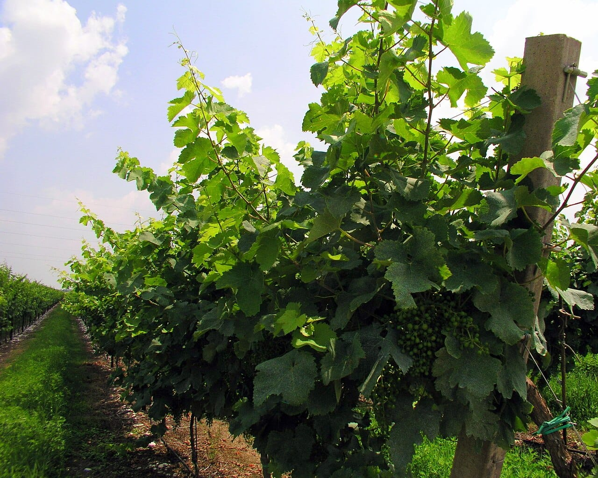

# 威尼托普罗塞克路线

这条路线从瓦尔多比亚德内的比索尔1542开始，到富马内的阿莱格里尼结束。前者是格雷拉与罐式发酵的起泡酒世界，后者是科维纳与风干葡萄的红酒世界；两地相距约一个半小时，却像跨了两个葡萄酒国家。把两者放在同一天，不是为了多喝几杯，而是为了看清威尼托内部的技术分岔：同样是“意大利东北部”，一个追求压力与新鲜，一个追求浓度与氧化。

图：威尼托普罗塞克路线所在的威尼托风貌配图。摄影：Vineyard, San Giorgio di Valpolicella, Veneto, Italy。署名：Unknown photographer，CC BY-SA 2.0，来自 Wikimedia Commons（[来源](https://commons.wikimedia.org/w/index.php?curid=354325)）。这张照片用于说明产区环境与访问语境，不标定威尼托普罗塞克路线的门店、酒庄或活动现场。

## 一条横跨两个产区的线

第一站在圣斯特凡诺，属于 Conegliano Valdobbiadene Prosecco Superiore DOCG 的核心地带；第二站在富马内，属于瓦坡里切拉经典产区。行政上都在威尼托，地理上却隔着威尼斯平原与维罗纳丘陵。开车从瓦尔多比亚德内出发，经科内利亚诺、特雷维索或维罗纳方向，约一个半小时；具体路线取决于是否走高速。

顺序可以反过来：先到富马内看风干房与酒窖，再北上瓦尔多比亚德内。但起泡酒适合白天品鉴，红酒更适合晚餐；若只有一天，建议上午在比索尔，午后开车到阿莱格里尼，把红酒留到傍晚。路线不追求“两个产区都看完”，它只提供两个清晰的对照样本。

## 格雷拉与瓦尔多的陡坡

[格雷拉](ref:glera)是普罗塞克的法定主品种，Conegliano Valdobbiadene Prosecco Superiore DOCG 要求至少 85%。它酸度高、酒精轻、香气偏白花、青苹果与梨，适合做清爽的起泡酒。瓦尔多比亚德内的山丘由古代海床与冰川沉积形成，土壤混杂泥灰岩、砂岩与砾石，排水快，昼夜温差大，果实因此保留酸度与香气。

坡向在这里比纬度更重要。山丘多呈东西走向，南坡种葡萄，北坡保留林地；海拔从约 100 米到 500 米，高处更凉，成熟更慢。官方把这种地形下的栽培称为“英雄式”：坡陡、地块窄、机械进不去。你看到的不是一块整齐的葡萄园，而是一张由石墙、草埂与小地块拼成的地图。

## 手工采收的六百小时

官方资料给出的数字很直接：在瓦尔多比亚德内管理一公顷葡萄园，至少需要 600 小时人工，是机械化方式的好几倍。采收必须手工，果实装进小箱，靠人背或小型运输车下山；坡太陡的地方，连运输车也进不去。这不是“情怀”，而是成本结构：人工小时直接进入酒价。

2019 年，这片山丘被列入 UNESCO 世界遗产，理由正是人与地形长期互动形成的农业景观。遗产身份带来旅游，也带来压力：游客增多、土地价格上升、年轻一代是否愿意继续做高强度的坡地农业。喝一瓶普罗塞克时，可以想一下这 600 小时落在谁身上，以及酒价是否覆盖了它。

## 卡特兹、里韦与 Grave di Stecca

卡特兹（Cartizze）是瓦尔多比亚德内的一个小坡，法定面积只有 107 公顷，位于 San Pietro di Barbozza、Santo Stefano 与 Saccol 之间，被官方称为产区的质量顶点。它的格雷拉更成熟，酒体更饱满，香气偏黄苹果、蜂蜜与花香；可以做成不同甜度，从 Brut 到 Dry 都有。卡特兹不是“最甜的普罗塞克”，而是“最有分量的那一块坡”。

里韦（Rive）指陡坡上的小村或小地块，规则更严，酒标写明具体地名。Grave di Stecca 则是另一类案例：在瓦尔多比亚德内，一块约 2.4 公顷、被高石墙围住的单一园，海拔约 270 米，土壤为石灰岩与砾石，形似勃艮第的 clos。它证明普罗塞克也有“围墙里的园地”，不只是大生产。三者放在一起，说明“地块”在威尼托并不是空话。

## 罐式发酵，还是传统法

[起泡酒](ref:sparkling)的第二种发酵方式，决定它的风格与成本。罐式发酵（Charmat/Martinotti）在不锈钢压力罐里完成二次发酵，酵母与酒液接触时间短，保留新鲜果香，成本较低，适合大规模生产；传统法在瓶中进行二次发酵，长时间与酒泥接触，产生面包、坚果与更细的气泡，成本高、周期长。

普罗塞克绝大多数用罐式发酵，这正是它清爽、便宜、适合日常的原因；但罐式并不等于低质，关键是基酒质量、发酵温度与酒泥接触时间。传统法在威尼托也有，例如部分 Alta Langa 与 Franciacorta 风格的酒，但不在本次两站的核心。品鉴时可以问：这款酒是罐式还是瓶式？与酒泥接触多久？答案比“气泡大小”更能解释口感。

## 第一站：比索尔1542

[比索尔](ref:bisol)在圣斯特凡诺，地址 Via Follo 33, 31049 Valdobbiadene (TV)。品牌以 1542 年为历史起点，2014 年加入 Lunelli 集团；酒窖开在岩壁里，温度常年 10°C 到 15°C，适合存放历史瓶与陈年酒。酒窖开放时间为周一至周六 10:00–13:00 与 15:00–18:00，周日 10:00–13:00，参观与品鉴通过 hospitality@bisol.it 预约。

这一站要看的是“陡坡如何变成酒”：从接待区的品牌叙事，到老酒窖的岩壁与拱顶，再到品鉴里的卡特兹、里韦与普通 DOCG。把三款酒横向比较，注意甜度、酸度与酒泥接触的差别，而不是只挑“最贵的一瓶”。酒窖温度低，夏天带薄外套；地面可能湿滑，穿防滑鞋。

## 第二站：阿莱格里尼

[阿莱格里尼](ref:allegrini)在富马内，地址 Via Giare 5, 37022 Fumane (VR)。它的核心是科维纳、风干葡萄与阿玛罗尼：果实采下后放在通风房风干数月，随后长时间发酵与[橡木](ref:oak)陈年。1979 年，Giovanni Allegrini 在 La Grola 顶部只种科维纳，做出 La Poja；今天的产品线还包括 La Grola、Palazzo della Torre 与不同层级的 Amarone。

接待页列出多档体验：45 分钟品鉴 30 欧元/人，1 小时 30 分钟含历史酒窖 45 欧元/人，3 小时葡萄园路线 70 欧元/人，2 小时含风干中心与五个年份垂直品鉴 150 欧元/人，La Grola 山丘体验 190 欧元/人且限 Wine Club 会员。价格与内容以预约页为准；风干房气味浓、空气流动强，对气味敏感的人提前说明。

## 车程、预约与九月

两站之间约一个半小时，加上从威尼斯或维罗纳进出的路程，一天排两站偏紧。建议上午 10:00 到比索尔，参观加品鉴约一个半小时；午餐在科内利亚诺或特雷维索；下午开车到富马内，参加 3 小时或 1 小时 30 分钟的体验。若反过来走，注意比索尔酒窖 18:00 关门，预留至少一个半小时车程。

九月到十月是普罗塞克采收与瓦坡里切拉风干准备期，酒庄最忙，预约要早；春季与初夏更舒服。威尼斯与维罗纳之间的铁路方便，但两座酒庄都不在火车站旁，最后一段需要巴士或出租车。开车的人全程不饮酒，威尼托的乡村道路窄，夜间照明差；指定司机或包车更稳妥。开放时间、预约与价格以官方渠道为准，本页核验日期 2026-11-09，坐标以官方渠道为准。

相关条目：[比索尔酒庄](ref:bisol)、[阿莱格里尼酒庄](ref:allegrini)、[格莱拉](ref:glera)。

## 参考资料

- [Bisol 官方英文站](https://bisol.it/bisol/en/)：圣斯特凡诺酒窖、陡坡、DOCG 系列与品牌历史。
- [Bisol1542 — Strada del Prosecco](https://www.coneglianovaldobbiadene.it/soci/bisol-1542/10475/)：地址、酒窖开放时间、参观与 2014 年加入 Lunelli 集团。
- [Allegrini 接待页](https://allegrini.it/ospitalita/)：体验时长、价格与 Wine Club 活动。
- [Prosecco.it — Area of Origin](https://www.prosecco.it/en/area-of-origin/)：15 个市镇、格雷拉、600 小时人工与 2019 年 UNESCO 遗产。
- [Prosecco.it — DOCG](https://www.prosecco.it/en/conegliano-valdobbiadene-prosecco-superiore-docg/)：1969 年 DOC、2009 年 DOCG 与分类体系。
- [Grave di Stecca — Nino Franco](https://www.ninofranco.it/it/vini/grave-di-stecca/)：围墙单一园、面积、海拔与罐式发酵。

## 相关图像

图：格莱拉。图片：paul Barker Hemings from seregno, 85，CC BY-SA 2.0，via Wikimedia Commons（[原图页面](https://commons.wikimedia.org/wiki/File:Prosecco_vitigni.jpg)）。关联图像：威尼托普罗塞克路线。

