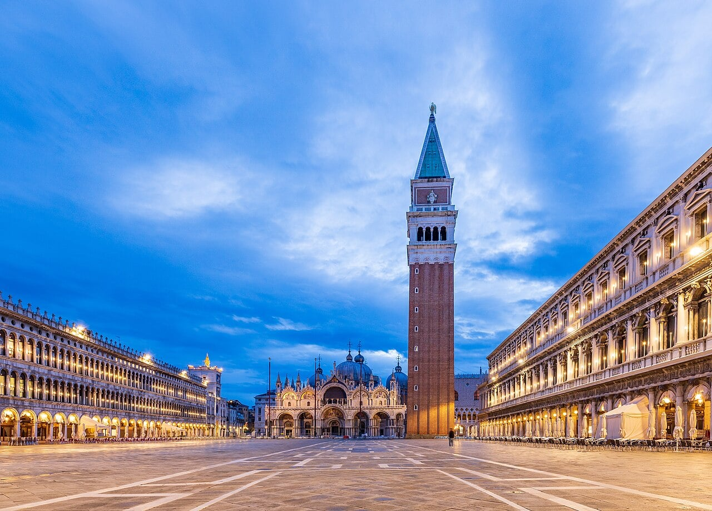

# 威尼斯圣马可广场两站酒吧路线

这条路线把威尼斯圣马可广场周边的两种“喝一杯”串在一起：先在广场上的花神咖啡馆坐一会儿，再走到附近的哈里酒吧喝一杯贝里尼。两站都在广场周边，步行几分钟可达，适合安排在傍晚，从咖啡馆的慢节奏过渡到酒吧的正式感。

图：傍晚的威尼斯圣马可广场，钟楼与行政官邸大楼围出路线所在的广场空间。图片：Matthias Süßen，CC BY-SA 4.0，via [原图页面](https://commons.wikimedia.org/wiki/File:Piazza_San_Marco_(Venice)_at_night-msu-2021-6449-.jpg)。

## 路线概览

- 第一站：[花神咖啡馆（威尼斯）](ref:florian)，地址 Piazza San Marco 56/59，1720 年开业，位于广场拱廊一侧。
- 第二站：[哈里酒吧（威尼斯）](ref:harrys)，地址 Calle Vallaresso 1323，1931 年由朱塞佩·奇普里亚尼创立。
- 方式：步行。从广场穿过拱廊与小巷即可到达，不需要交通工具。
- 建议时长：两到三小时。第一站留四十至六十分钟，步行几分钟，第二站留四十至六十分钟。

## 为什么是这两站

花神咖啡馆代表威尼斯的咖啡馆传统：18 世纪开业，厅堂装饰华丽，露台正对广场，现场常有小型乐队。哈里酒吧代表另一种传统：20 世纪的鸡尾酒吧，空间小而正式，以贝里尼和生牛肉薄片闻名。

两站相隔不远，却能看出两个时代的不同：前者卖的是广场上的时间与场面，后者卖的是吧台后的手艺与配方。把它们放在同一条路线里，比单独去其中一家更容易理解“在威尼斯喝一杯”的多层含义。

## 第一站：花神咖啡馆

花神咖啡馆在圣马可广场，1720 年开业，是欧洲持续经营时间最长的咖啡馆之一。它由多个装饰风格不同的厅组成，露台正对广场；历史上有卡萨诺瓦、拜伦等人物到访的记载。

适合点一杯咖啡或热巧克力，坐在室内看装饰，或在露台看广场人流。需要注意费用结构：这里消费明显高于普通咖啡馆，部分座位可能收取音乐附加费。点单前先确认座位费与演出安排，能避免结账时的意外。旅游旺季建议避开正午。

还有两个常被略过的细节。花神咖啡馆由 Floriano Francesconi 于 1720 年 12 月 29 日创办，最初名为“Alla Venezia Trionfante”（威尼斯得胜），后来才因店主的昵称改称 Florian。它所在的 Procuratie Nuove 是圣马可广场南侧的长廊建筑，咖啡馆因此与广场的公共生活直接相连，而不只是游客的歇脚点。

## 第二站：哈里酒吧

哈里酒吧在卡莱瓦拉雷索街，靠近圣马可广场，1931 年由朱塞佩·奇普里亚尼创立。空间不大，吧台与餐桌紧凑，服务偏正式；招牌是贝里尼（白桃泥与普罗塞克），生牛肉薄片通常作为前菜。

这里适合点一杯贝里尼配简单前菜。若只想体验氛围，可以避开正餐时段；着装不必过度正式，但应尊重场所的安静氛围。价格较高，旺季建议提前确认预订与营业时间。

招牌饮品也有明确来历：贝里尼由朱塞佩·奇普里亚尼在 1948 年创制，以 15 世纪威尼斯画家乔凡尼·贝里尼命名；生牛肉薄片（carpaccio）则在 1950 年为一位遵医嘱吃生肉的威尼斯伯爵夫人调制，名字取自画家维托雷·卡尔帕乔。两段掌故都指向同一个背景：这家酒吧从一开始就与威尼斯的艺术圈交往密切。

## 怎么走

以圣马可广场为唯一地标：先在广场拱廊一侧找到花神咖啡馆，坐完后沿广场西侧走到卡莱瓦拉雷索街，哈里酒吧就在这条街上。全程不需要过桥或乘船，属于广场周边的短距离步行。

实际路线会受广场人流、临时围栏与店铺入口影响，现场以标识为准。若从水上巴士站或贡多拉码头过来，先到广场再按上述顺序走会更顺；具体到达方式以威尼斯公共交通的现场指引为准。

## 花费、预约与时段

两站都属于威尼斯游客核心区的高价场所。花神咖啡馆的费用与座位类型、音乐演出相关；哈里酒吧的费用与菜品、酒水和服务相关。两家都可能出现附加费或最低消费，点单前问清规则比事后争议更省事。

时段上，建议下午晚些时候开始：先在广场坐一会儿，接近傍晚再走到哈里酒吧。这样既能看到广场的日间人流，也能在酒吧进入晚间节奏前坐下。旺季与节假日需要预留等位时间，哈里酒吧建议提前确认预订。

## 边界

营业时间、菜单、价格、座位规则、着装要求与临时歇业以两店官方渠道为准；本页不保证某一天的具体营业状态。历史人物到访与“某某常坐的位置”属于背景叙事，不代表当前服务质量。

本页不提供地图，也不提供坐标：两处场所的经纬度在内容仓中保持为空，没有可核验的坐标来源，因此按项目规则不绘制示意地图，只以文字描述步行关系。威尼斯圣马可广场两站酒吧路线的停靠顺序只作阅读顺序；精确导航请用实时地图并以现场标识为准。

补充阅读：[认识一座城，从一间酒馆开始](ref:c-extra-1)、[酒馆史：从酒肆、客栈到酒吧](ref:c-extra-2)、[意大利](ref:c-extra-3)。

对照阅读：[花神咖啡馆（威尼斯）](ref:florian)、[认识一座城，从一间酒馆开始](ref:c-extra-1)。

相关条目：[哈里酒吧（威尼斯）](ref:harrys)。

**关键事实。**

| 项目 | 内容 |
| --- | --- |
| 一句话定位 | 从圣马可广场的花神咖啡馆走到卡莱瓦拉雷索街的哈里酒吧，两站都在广场周边，步行几分钟可达；一条适合傍晚的短路线，主题是威尼斯咖啡馆到鸡尾酒吧的过渡 |
| 站数 | 2 |
| 交通 | walk |
| 停靠顺序 | 花神咖啡馆（威尼斯）、哈里酒吧（威尼斯） |

**来源与边界。** 本页关于「威尼斯圣马可广场两站酒吧路线」的关键事实，主要由以下来源交叉核对：Caffè Florian（地址、1720 年开业与营业信息；1720 年 12 月 29 日开业、圣马可广场 Procuratie Nuove 位置与“意大利最古老咖啡馆”表述）、Cipriani（哈里酒吧地址、1931 年创立与营业信息）、Comune di Venezia（圣马可广场与周边步行环境）。价格、批次与状态会变，涉及这些字段时以页面所列来源的最新版本为准。正文为项目自写，来源只作核验，不复制原文。

**并读。** 把「威尼斯圣马可广场两站酒吧路线」与「花神咖啡馆（威尼斯）」、「哈里酒吧（威尼斯）」、「认识一座城，从一间酒馆开始」放在一起读时，先确认它们是同一层级还是上下游关系：先确认停靠点与交通，再比较开放时间、预约与步行强度。本页负责给出路线的基本坐标，对照条目补上具体案例与差异；读完再回到本页，才能分清哪些差别属于路线本身，哪些只是产地、批次或品牌选择。
