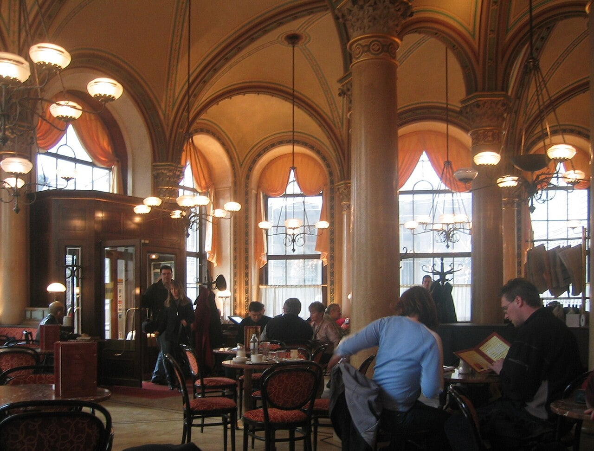
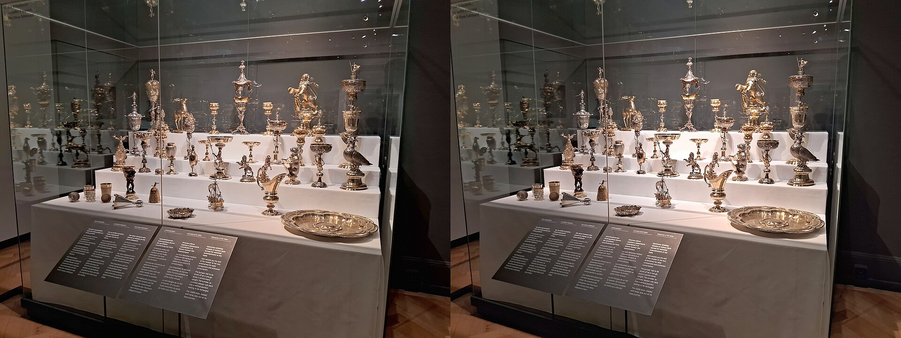
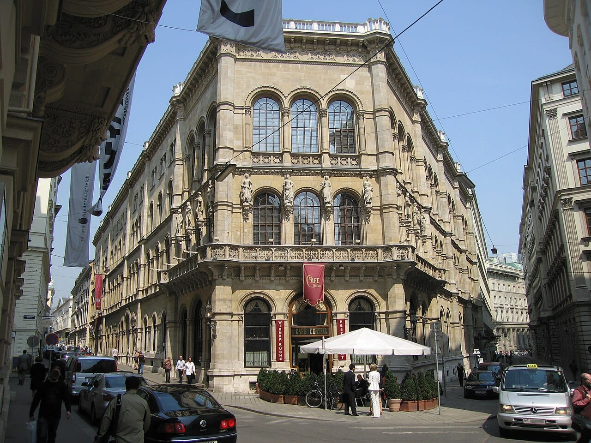

# 维也纳咖啡馆傍晚路线：中央咖啡馆到斯佩尔

这条路线只有两站，却能把维也纳咖啡馆的两种空间放在一起：内城费尔斯特宫里的中央咖啡馆，空间高、拱顶大、游客多；第六区玛利亚希尔夫的斯佩尔咖啡馆，空间更像街区里的公共客厅，大理石桌、Thonet 椅与台球桌都还在使用。两站原本都营业到晚上；中央咖啡馆自 2026 年 3 月起整修，出发前要确认是否已重开，再决定傍晚的起点。

图：维也纳中央咖啡馆的拱廊大厅，吊灯与大理石柱下的座位区。图片：Andreas Praefcke，CC BY 3.0，via [原图页面](https://commons.wikimedia.org/wiki/File:Wien_Cafe_Central_2004.jpg)。

> **先给结论**
> **一句话：** 这页判断维也纳咖啡馆傍晚路线：中央咖啡馆到斯佩尔怎么排、走多久、哪些点不能省。
>
> - **适合谁：** 想把维也纳咖啡馆傍晚路线：中央咖啡馆到斯佩尔排成一日或两日行程、需要知道顺序与停留重点的人。
> - **不适合谁：** 只想看单个地点、不打算按路线走的人。
> - **先看这两点：**
>   - - 第一站：中央咖啡馆，地址 Herrengasse 14, 1010 Wien，1876 年开业，位于费尔斯特宫（Palais Ferstel）底层。
>   - 中央咖啡馆代表“拱廊大厅”。

## 路线概览

- 第一站：[中央咖啡馆](ref:central)，地址 Herrengasse 14, 1010 Wien，1876 年开业，位于费尔斯特宫（Palais Ferstel）底层；2026-11-08 核验时因整体整修关闭，官方称预计 2026 年秋季重开，但未给出确切日期。
- 第二站：[斯佩尔咖啡馆](ref:sperl)，地址 Gumpendorfer Straße 11, 1060 Wien，1880 年开业，位于玛利亚希尔夫区。
- 方式：步行或地铁。两站之间步行约二十分钟到半小时；乘地铁通常需要在市中心换乘一次，到 Museumsquartier（U2）或 Kettenbrückengasse（U4）后再走几分钟。
- 建议时长：两到三小时。第一站六十到九十分钟，换站二十到三十分钟，第二站六十到九十分钟。

## 为什么是这两站

中央咖啡馆代表“拱廊大厅”。它在费尔斯特宫底层，建筑原本容纳维也纳证券交易所，1876 年交易所迁出后，Gustav 与 Hermann Pach 兄弟在底层开出咖啡馆。今天看到的版本与 20 世纪初不同：咖啡馆在 20 世纪中叶一度关闭，1986 年随着费尔斯特宫修复在原建筑内重新开门。它继承了 1876 年的名字、位置与咖啡馆传统，但不是所有家具与装饰都从 1876 年原样保留。它的名气与 20 世纪初的知识分子圈绑在一起，官方叙述列举托洛茨基、弗洛伊德，以及作家阿尔弗雷德·波尔加、斯蒂芬·茨威格、彼得·阿尔滕贝格与建筑师阿道夫·路斯。

斯佩尔代表“街区咖啡馆”。1880 年，这座建筑按照环路时期建筑师 Gross 与 Jelinek 的设计建成，最初叫“Ronacher”；同年十二月，Sperl 家族接手，咖啡馆从此有了沿用至今的名字。1884 年 Adolf Kratochwilla 接手，他的家族一直经营到 1968 年；1895 年前后，Siebenerclub 与 Hagengesellschaft 把这里当作聚会地点；1897 年，维也纳分离派正是从这一艺术圈子里走出来。1968 年 Manfred Staub 接手，1983 年的修复保留了原有空间气氛。它的奖项与历史说明它是被本地人日常使用的场所，而不是只靠“最老”标签维持的景点。

把这两站放在一起，比较的是“大厅”与“街区”：前者让你看到维也纳咖啡馆作为城市门面的样子，后者让你看到它作为日常起居室的样子。两站都适合坐下，不适合站着喝完就走。

## 第一站：中央咖啡馆

为什么去：它的空间本身就是看点。主厅高而开阔，座位上方是石柱与拱顶，靠窗的位置能看到 Herrengasse 的街景；侧厅与拱廊下更安静。维也纳咖啡馆的座位不按“翻台率”设计，桌与桌之间留出距离，一个人带一本书坐一下午是被允许的。它适合作为路线的第一站：空间大、菜单全、对第一次来的人友好。

点什么：咖啡单是维也纳体系的入门课。Wiener Melange 是浓缩咖啡加热奶与奶泡，比例接近“小杯拿铁”但更轻；Einspänner 是高杯装的浓缩，上面覆一层厚奶油；Verlängerter 是“加长”的浓缩，接近淡美式；Kleiner Brauner 与 Großer Brauner 则是小杯或大杯加少量奶。第一次来点 Melange 最稳，想喝浓一点就点 Einspänner，想喝淡一点就点 Verlängerter。甜点可以配 Sachertorte 或 Apfelstrudel；正餐时段也有奥地利菜。

停留多久：六十到九十分钟。开门后的早晨最安静；下午两三点是蛋糕与游客的高峰，门口常排队；晚上有钢琴演奏，气氛更满，但谈话音量也被抬高。傍晚到达时，排队通常比下午短，但仍建议留出等位时间。

实用提醒：地址是 Herrengasse 14, 1010 Wien。乘地铁 U3 到 Herrengasse 站，出站即到；从圣斯蒂芬大教堂步行约五分钟。官方菜单卡曾列出周一至周六 08:00–22:00、周日与假日 10:00–22:00 的营业时段。进门后自己找空位，坐下等侍者过来点单；不要站在门口等“带位”，也不要直接去吧台点。维也纳传统咖啡馆通常不收座位费，也不收“音乐费”；账单是饮品与食物加小费。若在旅游区遇到菜单上标注的座位费或最低消费，以菜单为准。

核验提示：2026-11-08 查看官网时，中央咖啡馆自 2026 年 3 月 16 日起进行整体整修，官方写“预计 2026 年秋季重开”，但页面没有给出已经重开的确切日期，到访前必须再查一次。整修期间，馆方把客人引向同城的 DECENTRAL（Freyung 3/1, 1010 Wien，每日 07:30–22:00）：那是中央咖啡馆团队经营的替代店，供应自制糕点、佛卡夏、咖啡与 spritz。若中央咖啡馆仍未重开，可把第一站换成 DECENTRAL，路线结构与步行距离随之改变，但拱廊大厅的体验无法复制。

## 第二站：斯佩尔咖啡馆

为什么去：它保留了 19 世纪的室内格局与日常使用痕迹。推门进去，先看到的是中央大厅：大理石桌面、Thonet 弯木椅、靠墙的报纸架，以及几张台球桌。空间没有刻意做旧，磨损与修补都在使用中自然留下；1983 年修复时保留的正是这种“继续用下去”的状态。靠窗的位置光线好，适合读报；台球桌一带更热闹；想安静谈话，可以选靠里的桌子。

点什么：咖啡单同样是维也纳体系，Melange、Einspänner、Verlängerter、Kleiner Brauner 与 Großer Brauner 都能点到。店里的招牌是 Sperltorte（斯佩尔蛋糕），维也纳旅游局的介绍也把它列为到店必试；此外还有早餐、维也纳家常菜与自制面点。最稳的组合是 Melange 加一块 Sperltorte；如果想吃咸的，可以点一份维也纳家常菜或早餐，再把咖啡放在后面。

停留多久：六十到九十分钟。开门后的早晨最安静；下午两三点是蛋糕与游客的高峰；周日下午有钢琴演奏，气氛更满，谈话音量也会被抬高。想安静，选靠里或靠窗的位置；想感受老咖啡馆的“公共客厅”气氛，就接受人多与声音大。

实用提醒：地址是 Gumpendorfer Straße 11, 1060 Wien。乘地铁 U4 线到 Kettenbrückengasse，或乘 U2 线到 Museumsquartier，步行约五到十分钟；也可以坐 57A 路公交到 Laimgrubengasse。维也纳旅游局页面列出的营业时间是周一至周六 07:00–22:00，周日与假日 10:00–20:00，周日下午 15:30–17:30 有钢琴演奏。进门自己找空位，坐下等侍者过来，不要站在门口等带位，也不要直接去吧台点单。结账时常见做法是凑整或加 5%–10% 小费，报出含小费的总额，不要把现金留在桌上就走。

## 顺序与交通

建议按“中央咖啡馆 → 斯佩尔咖啡馆”的顺序走。中央咖啡馆在内城，交通最方便，适合作为起点；傍晚先在拱廊大厅里坐一会儿，等天色暗下来，再往西到玛利亚希尔夫。斯佩尔的日常性更强，晚上坐在里面，比白天更容易看到本地客人。

具体走法：

- 步行：从 Herrengasse 出来，经 Graben、Kärntner Straße 与 Opernring 往西南走，再沿 Gumpendorfer Straße 到 11 号，约二十分钟到半小时。这条线会经过内城最热闹的步行区，晚上人流仍多，适合慢慢走。
- 地铁：从中央咖啡馆步行到附近地铁站，乘 U-Bahn 到 Museumsquartier（U2）或 Kettenbrückengasse（U4），再步行五到十分钟到咖啡馆。两站之间通常需要在市中心换乘一次；具体换乘与出入口以维也纳公共交通官方查询与现场指引为准。
- 公交：斯佩尔附近有 57A 路公交到 Laimgrubengasse，适合从玛利亚希尔夫大街方向过来的人。

两站都不需要交通工具才能“到达”，但距离不算近：硬走会花掉半小时，乘地铁则要把进出站与换乘算进去。把步行当作路线的一部分，或者把地铁当作省时间的选项，都比临时决定更稳。

## 时长与预算

两到三小时是合理区间。第一站六十到九十分钟，步行或地铁换站二十到三十分钟，第二站六十到九十分钟。若只想各喝一杯、不点蛋糕，可以压缩到两小时；若在斯佩尔点蛋糕与正餐，时间会自然拉长。

预算上，两站都属于维也纳中等偏上水平，但结构不同：中央咖啡馆的位置与名气带来游客，早餐、下午茶与正餐的预算差别很大；斯佩尔的一杯咖啡加一块蛋糕明显低于一顿正餐。传统维也纳咖啡馆一般不在账单上单列座位费或音乐费，消费就是饮品、食物加小费；遇到菜单上标注的座位费或最低消费，以菜单为准。

周日要特别安排：斯佩尔周日与假日 10:00–20:00，比平日早关门，钢琴演奏在下午 15:30–17:30，而不是晚上。若在周日走这条线，应把斯佩尔放在下午，把中央咖啡馆放在之后或另一天。

## 适合与不适合

适合：想比较维也纳咖啡馆两种空间的人；两到四人的小团体；愿意坐下来、把半小时到一下午交给一张桌子的人；对咖啡单、蛋糕与咖啡馆建筑有兴趣的人；傍晚到夜间仍想找一个安静去处的人。

不适合：赶时间只想站着喝一杯的人；想安静开电话会议的人；预算只够最便宜快餐的人；把咖啡馆当成快速拍照点的人；期待“最老”“第一”这类唯一结论的人（两店的可核查起点分别是 1876 年与 1880 年，“最老”有不同的统计口径）。

带小孩的客人可以进入，但下午与周日下午人多、声音大；斯佩尔的台球桌是营业设施，不是拍照布景，孩子靠近时要看住。

## 实用提示与核验说明

第一，坐下不等于点单。两家店都要自己找空位，坐下等侍者过来；招手时用眼神与轻声示意，不要大声喊。一个人只点一杯咖啡坐两三个小时，在维也纳咖啡馆是成立的；高峰时段长时间占大桌会影响等位，自己判断。

第二，费用结构先看清。传统维也纳咖啡馆通常不收座位费与音乐费；若菜单上标注了座位费或最低消费，以菜单为准，不要套用“维也纳咖啡馆都不收费”的想象。结账时报出含小费的总额，常见是凑整或 5%–10%。

第三，分清“历史”与“原物”。中央咖啡馆在 20 世纪中叶关闭，1986 年重开；今天看到的是修复后的版本，不是 1876 年原样保留的房间。斯佩尔在 1983 年修复，保留的是空间气氛与使用状态；不要把磨损当成布景。

第四，把名人故事当背景。中央咖啡馆的托洛茨基、弗洛伊德与作家名单属于历史叙事；“某人固定坐哪张椅子”多半是后来的传说。斯佩尔的分离派渊源同样属于艺术史背景，不代表今天的服务质量。

第五，本页只描述路线结构与可核查事实：2026-11-08 核验时中央咖啡馆仍在整修，重开日期未定，斯佩尔的营业时间按官方页面记录；两处场所的经纬度在内容仓中保持为空，没有可核验的坐标来源，因此按项目规则不绘制示意地图。维也纳咖啡馆傍晚路线：中央咖啡馆到斯佩尔的停靠顺序只作阅读顺序；精确导航请用实时地图并以现场标识为准。

补充阅读：[认识一座城，从一间酒馆开始](ref:c-extra-1)、[一杯酒里的时间](ref:c-extra-2)、[酒器史：杯子如何改变喝法](ref:c-extra-3)。

相关条目：[中央咖啡馆](ref:central)、[斯佩尔咖啡馆](ref:sperl)、[认识一座城，从一间酒馆开始](ref:c-extra-1)。

维也纳咖啡馆傍晚路线从中央咖啡馆到斯佩尔，座位、音乐附加费与营业时间以各店官网为准；现场以店内公告为准。核验于 2026-11-08。

## 相关图像

图：酒器史：杯子如何改变喝法相关实景照片。图片：VasuVR，CC BY 4.0，via Wikimedia Commons（[原图页面](https://commons.wikimedia.org/wiki/File:SW45-B-18-Bern_History_Museum_Humorous_drinking_vessels_3D.jpg)）。关联图像：维也纳咖啡馆傍晚路线：中央咖啡馆到斯佩尔。

图：中央咖啡馆。图片：User:Florian Prischl，Public domain，via Wikimedia Commons（[原图页面](https://commons.wikimedia.org/wiki/File:Palais_Ferstel.jpg)）。关联图像：维也纳咖啡馆傍晚路线：中央咖啡馆到斯佩尔。
