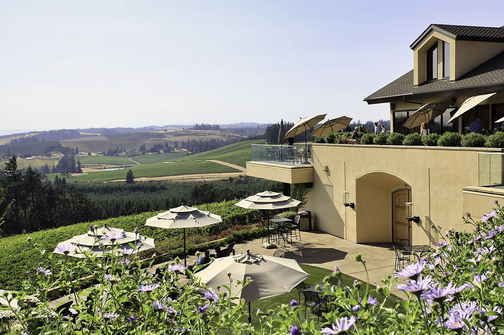

# 威拉米特谷葡萄酒路线

这条路线从波特兰南下，以 Dundee Hills 的杜鲁安俄勒冈与艾瑞两座酒庄为锚点：上午看勃艮第资本如何在 1987 年落地，下午回到 1965 年 David Lett 的原始地块，一天里读完俄勒冈黑皮诺的“两个起点”。全程约 100 公里，适合自驾，从波特兰出发约四十分钟。

图：Willamette Valley Wine Route：Willamette Valley Vineyards Estate in the Salem Hills（Wikimedia Commons）。图片：WillametteValleyVineyards1983，CC BY-SA 4.0，via Wikimedia Commons（[原图页面](https://commons.wikimedia.org/wiki/File:Willamette_Valley_Vineyards_Estate_in_the_Salem_Hills.jpg)）。

## 路线总览

建议 9:00 从波特兰出发，走 I-5 南下，约 9:45 到杜鲁安俄勒冈。上午参观酒庄与品鉴，重点喝 Dundee Hills 黑皮诺与 Roserock；12:00 在 Dundee 或 Dayton 吃午饭；13:30 开车约二十五分钟到麦克明维尔的艾瑞，下午品鉴与葡萄园散步约一个半小时；15:30 之后去麦克明维尔老城或 Carlton 的品酒室，17:30 返程，18:30 左右回到波特兰。

如果从波特兰当日往返，这条路线刚好；如果想多看几家，建议在 Dundee 或 McMinnville 住一晚，把 Yamhill-Carlton 与 Eola-Amity Hills 分到第二天。威拉米特谷的子产区之间车程不远，但每家酒庄都要预约，一天两家是舒服的上限。

## 产区背景

威拉米特谷在俄勒冈西北部，北起波特兰以南、南到 Eugene 附近，西边是 Coast Range、东边是 Cascades。太平洋的水汽被海岸山脉挡住大半，谷地夏天温暖干燥、冬天湿冷，生长季比加州长、比勃艮第略暖；这种“边缘气候”让黑皮诺成熟得慢，酸度高、酒精度低，风格更接近勃艮第而不是加州。

Dundee Hills 在谷地北段，朝东的坡面白天接受阳光、下午有微风，土壤以 Jory 火山土为主——深红色的黏土与铁石，排水好、保水也不错。这里离太平洋约一小时车程，海雾偶尔翻过 Coast Range，让成熟的果实仍保留酸度；坡向与土层的细微差别，往往比酒庄的酿酒哲学更能决定一款酒的质地。1965 年 David Lett 在这里种下第一批黑皮诺，1970 年代其他先锋跟进；1987 年 Robert Drouhin 又在这里买地，让 Dundee Hills 同时拥有“美国起点”与“法国资本”两层叙事。

## 第一站：杜鲁安俄勒冈

杜鲁安俄勒冈在 6750 Breyman Orchards Road，Dayton 附近，从波特兰约四十五分钟。1987 年，勃艮第的 Robert Drouhin 在 Dundee Hills 买下 225 英亩土地，请女儿 Véronique 来做首任酿酒师；1988 年出第一个个人年份，1992 年出第一个 Laurène。今天酒庄有约 235 英亩 estate、130 英亩葡萄，酒厂建在坡地里，利用重力从上层流向下一层，减少泵送对果实的粗暴处理。

酒单以 Dundee Hills 黑皮诺为主：Laurène 是旗舰，Louise 是更柔和的版本，Dundee Hills 是产区级，Roserock 来自 2013 年买下的 Eola-Amity Hills 地块。品鉴时先喝 Dundee Hills 建立基准，再喝 Laurène 看结构与陈年潜力，最后用 Roserock 对比更南、更凉的 Eola-Amity Hills；顺序从轻到重，不要反过来。

酒庄的参观会讲重力流酒厂、Jory 土与勃艮第的对照；如果只想喝一轮，选 Dundee Hills 加 Laurène，时间约一小时。带小孩的话，酒庄外部空间比品鉴室更友好，但品鉴仍需安静；旺季与周末要提前预约。

## 第二站：艾瑞

艾瑞在 935 N. Kutch Street，麦克明维尔，从杜鲁安开车约二十五分钟。1965 年，David Lett 带着约 3,000 根黑皮诺插条从加州来到俄勒冈，同年 2 月 22 日在 Corvallis 附近扦插；1966 年买下 Dundee Hills 的 20 英亩，1970 年出第一个年份。1975 年的 Reserve 在 1979 年巴黎盲品进入前十，1980 年伯恩复赛以 0.2 分之差输给 Drouhin 1959 Chambolle-Musigny，让俄勒冈黑皮诺第一次被勃艮第认真对待。

今天的艾瑞仍由 Lett 家族经营，Jason Lett 在 2005 年接手。酒庄有五片 estate 葡萄园，共约 67 英亩：Original Vines 种于 1966–1974 年，Sisters 从 1989 年起，Outcrop 种于 1982–2000 年，Roland Green 从 1988 年起，Daphne 种于 1974–1984 年、海拔接近 900 英尺。全部有机、非灌溉、自根，Jory 与 Nekia 火山土，单园同配方、野生酵母、约 12% 新桶。

艾瑞的品鉴室不大，风格也旧：没有城堡，没有大屏幕，只有一张桌子与几瓶酒。品鉴时重点比较 Original Vines 与 Sisters：前者更瘦、更矿物、更像 1970 年代的俄勒冈，后者更圆、果味更明显。如果只能买一瓶，选 Original Vines 或 Reserve；如果想理解酒庄的今天，选 Sisters 或 Outcrop。

## 午餐与第三站

午餐有三个选择：Dundee 的餐厅、Dayton 的小店、麦克明维尔老城。Dundee 与 Dayton 选择少但离酒庄近，麦克明维尔选择多、适合下午继续逛；如果下午还要开车，午餐不要配太多酒。麦克明维尔老城有书店、咖啡馆与历史建筑，比再赶一家酒庄更放松。

第三站可以按兴趣选：想看更多黑皮诺，去 Carlton 或 Yamhill 的小型酒庄；想看产区全景，去 Dundee Hills 的观景台或 Carlton 的山坡；想休息，回麦克明维尔老城吃饭。不要再往南冲到 Eola-Amity Hills，车程会把一天拉长到十小时。

如果带小孩，建议把第三站换成麦克明维尔老城或公园，而不是继续品酒；艾瑞与杜鲁安的品鉴室都小，小孩容易无聊。春天与秋天是葡萄园最好看的时候，夏天下午谷地很热，冬天雨多、路滑。

## 季节与路况

威拉米特谷的春天多雨、秋天温和，夏天下午可达三十度，冬天湿冷；采收通常从九月到十月，酒庄最忙，预约名额紧。Dundee Hills 的早晨常有雾，开车要开雾灯；下午雾散后，从山坡能看到 Coast Range 与谷地的层次。

从波特兰到杜鲁安约四十五分钟，从杜鲁安到艾瑞约二十五分钟，从艾瑞回波特兰约五十分钟；如果加 Carlton 或 McMinnville 老城，多留一小时。I-5 与 OR-99W 在周五下午与周末容易堵，返程尽量避开 16:00–18:00；乡间道路窄，晚上有鹿，不要夜间长途驾驶。

## 预约与礼仪

杜鲁安与艾瑞的品鉴都要预约，旺季与周末名额紧；两家都不适合大型团体临时加入，超过六人先发邮件。品鉴时把酒吐进吐酒桶，开车的人只喝一两杯；艾瑞的品鉴室小，不要带大件行李或婴儿车，杜鲁安的外部台阶与坡地也需要好走的鞋。

这条路线不画地图，也不提供实时价格；道路、营业时间与预约规则会变，出发前以两家酒庄官网与 Oregon Wine Board 为准。如果遇到酒庄临时关闭，别硬闯，把麦克明维尔老城或 Carlton 写进行程，一天不会因此作废。

相关条目：[杜鲁安俄勒冈酒庄](ref:ddo)、[艾瑞酒庄](ref:eyrie)、[威拉米特谷](ref:willamette)。

两座酒庄的预约时段并不连在一起，午后转场要预留山路车程；采收季临时封路时，以酒庄当天的通知为准。

## 决策表：一天怎么分段

| 分段 | 时间 | 车程 | 停留 | 适合谁 |
| --- | --- | --- | --- | --- |
| 波特兰 → Dundee Hills | 9:00–9:45 | 约 45 分钟 | — | 自驾、当日往返 |
| 杜鲁安俄勒冈 | 9:45–12:00 | — | 约 2 小时 15 分 | 想比较 Dundee Hills 与 Eola-Amity Hills |
| 午餐：Dundee / Dayton | 12:00–13:30 | — | 约 1 小时 30 分 | 全部 |
| Dundee → McMinnville | 13:30–13:55 | 约 25 分钟 | — | 自驾 |
| 艾瑞酒庄 | 13:55–15:30 | — | 约 1 小时 30 分 | 想看 1965 年起点与老藤 |
| McMinnville 老城 / Carlton | 15:30–17:30 | 20–30 分钟 | 约 2 小时 | 想多喝一间或逛街 |
| 返回波特兰 | 17:30–18:30 | 约 1 小时 | — | 当日往返 |

两家酒庄都必须预约；这是一条“两家刚好、三家太赶”的路线，不是打卡清单。

## 相关图像

图：杜鲁安俄勒冈酒庄相关实景照片。图片：Luke，CC BY-SA 2.0，via Wikimedia Commons（[原图页面](https://commons.wikimedia.org/wiki/File:Wine_Country_of_the_Dundee_Hills,_Oregon.jpg)）。关联图像：威拉米特谷葡萄酒路线。

图："艾瑞酒庄"类别配图。图片：Rvannatta ( talk · contribs ) Image edits: Peteforsyth ( talk · contribs )，CC BY-SA 3.0，via Wikimedia Commons（[原图页面](https://commons.wikimedia.org/wiki/File:Wvatbethel1.jpg)）。关联图像：威拉米特谷葡萄酒路线。

## 常见问题

### 一天够吗？

够，但只适合两家。杜鲁安与艾瑞各留 1.5–2 小时，加上午餐与车程，已经占满一天。想看第三家，建议在 Dundee 或 McMinnville 住一晚，把 Yamhill-Carlton 或 Eola-Amity Hills 放到第二天。

### 没车怎么办？

这条路线公共交通班次少，酒庄之间打车也不稳定；不建议只靠公交。可以包车、参加小团，或提前预约接送，并把两家酒庄的时间固定下来。喝酒的人不要自驾。

### 酒庄怎么预约？

两家都要求提前预约，杜鲁安品鉴通常 10:00–15:00，艾瑞的时段与规则以官网为准。不要临时到门口要求参观；预约时说明人数、是否品鉴、是否需要讲解，并确认取消政策。

> **下一步：** 先读[杜鲁安俄勒冈](ref:drouhin)与[艾瑞](ref:eyrie)两页，理解两家酒庄的差异；再读[威拉米特谷](ref:willamette)产区页与[黑皮诺](ref:pinot)品种页，把路线放回风土背景。

## 延伸阅读与另见

- 相关条目：[domaine-drouhin-oregon](ref:ddo)、[eyrie-vineyards](ref:eyrie)、[willamette-valley](ref:willamette)、[red-wine](ref:red)、[pinot-noir](ref:pinot)。
- 想继续深入，可以把这条路线与索诺马俄罗斯河谷对照：同样是黑皮诺，俄勒冈更冷、更瘦，索诺马更圆、更靠海雾。
- 如果只有半天，选杜鲁安加麦克明维尔老城，不要再去艾瑞；如果只有两小时，选一家，不要试图两家都到。

**关键事实。**

| 项目 | 内容 |
| --- | --- |
| 一句话定位 | 从波特兰南下威拉米特谷，以杜鲁安俄勒冈与艾瑞两座 Dundee Hills 酒庄为锚点；一天里看 1960–70 年代的先锋种植、勃艮第式黑皮诺、老藤与有机栽培，以及 Oregon Wine Board 的产区叙事 |
| 站数 | 2 |
| 交通 | 自驾 |
| 停靠顺序 | 杜鲁安俄勒冈酒庄、艾瑞酒庄 |
