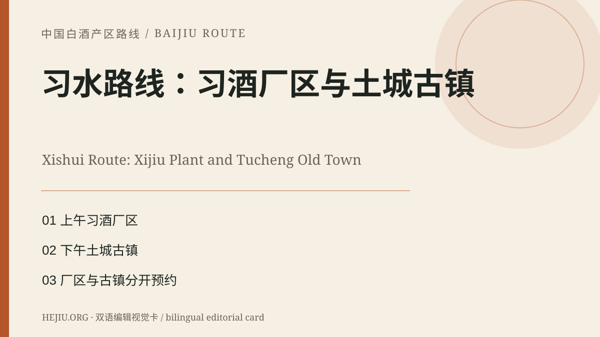

# 习水路线：习酒厂区与土城古镇

习水把两种时间放在同一条河上：习酒镇的酱香生产是产业时间，土城的盐号、渡口与四渡赤水是历史时间。很多人从二郎镇过河，只在习酒厂区门口停一下，再去土城拍照，结果两边都没看懂。这条路线把上午留给厂区与河谷，下午留给纪念馆与老街，先产业后历史，动线更顺。

图：习水路线专属双语视觉卡。项目自制双语视觉卡，用于识别主题，不是现场照片。

> **先给结论**
> **适合谁：** 走川黔酒旅、想同时看酱香厂区与赤水河历史的人；适合自驾或包车。
> **不适合谁：** 只想要古镇拍照、不愿预约厂区的人；两处之间需要车程。
> **一句话：** 上午厂区、下午土城，先看纪念馆再看老街，品鉴后不开车。

## 路线逻辑：厂区与古镇分开

习酒厂区与土城古镇不在同一个空间，也不属于同一种叙事。厂区是正在运转的酱香生产空间，需要预约、门禁与安全边界；土城是古镇、纪念馆与渡口叠在一起的历史空间，需要步行与时间线。把厂区放在上午，是因为生产参访多在白天、体力最好；把土城放在下午，是因为纪念馆与老街可以按单向动线走，傍晚收尾更从容。两段之间留足车程，不要在饭点转场。

## 上午：习酒厂区

习酒镇在赤水河中游，厂区沿山坡展开。看酱香生产抓四条线：高温制曲、重阳下沙、多轮次蒸煮与取酒、长期陈放。看车间时注意曲块培养温度、高粱破碎比例、糟醅堆积的疏松度、窖池密封与轮次取酒；不要只记数字，要看数字如何落在班组与车间。不能进车间时，在展陈看剖面与流程图，再到观景台对照河谷朝向与厂区布局。生产区不翻围栏、不跟货车进门，品鉴问清酒精度、容量与收费，司机不喝。

## 下午：土城古镇

土城要先建立时间线，再走空间。进四渡赤水纪念馆，用地图与时间轴弄清部队如何在赤水河两岸机动、渡口与船只如何影响行动、地方社会如何被战争改变；再看渡口与老街，盐号、船帮、吊脚楼与石阶会变成“运输通道”而不是背景。老街坡道多，穿防滑鞋，按“纪念馆—渡口—老街”单向走，不要来回折返。馆内拍照遵守标识，不用闪光灯对文献与织物；带孩子先讲渡河路线，再让他在地图上找土城。

## 交通、住宿与时间

习酒镇在习水县东部，通常从遵义、泸州或重庆方向进入；山路多，雨雾天慢行。土城在习水县西部，赤水河畔，从习酒镇到土城需要车程，班次少，自驾更灵活。只看厂区外观与展陈约两小时；加土城纪念馆与老街，一天；再串赤水，需要两天。住习水县城或习酒镇一晚比当天往返稳；订房问清热水、停车、早餐与退房。夏天河谷湿热，带水与帽子；雨后石阶湿滑，老人孩子慢走。

## 品鉴、买酒与返程

品鉴后不要在山路自驾，司机不喝；买酒去官方店或授权店，保留发票，不要把“内部酒”“接待酒”当成捡漏。返程前确认班车或代驾，别在土城拖到天黑才找车。吃饭可以试习水羊肉粉、土城苕汤圆、豆花与赤水河鱼，配酱香酒时控制量。若只留半天，选厂区展陈或土城纪念馆之一，不要两头赶；若带孩子，土城优先于厂区，纪念馆的地图任务比记年份有效。

## 一日与两日版本

一日版按“习酒厂区—午饭—土城纪念馆—老街”走，上午不要拖到中午，下午不要把纪念馆排到闭馆前。两日版把第一天留给习酒镇与土城，住习水，第二天去赤水或二郎镇。若遇雨雾，宁可少看一个点，也不要在山路赶夜路；带长辈减少石阶步行，把纪念馆放在体力最好的时段。返程前买酒，司机不参加品鉴；跨县班车提前问，别在老街拖到天黑。若从遵义或泸州当天往返，路上会吃掉大半时间，住习水一晚更稳；若只留半天，选厂区展陈或土城纪念馆之一。带长辈减少石阶，纪念馆放在体力最好的时段；带孩子先看地图与时间轴，再走老街。买酒核对批次，吃饭按本地饭点，山路会车减速，提前准备，带好身份证与预约码；买酒核对批次，石阶慢走，山路不夜间赶路，返程班车提前问，带一件薄外套，纪念馆讲解问场次，住宿确认早餐，吃饭按本地饭点，司机不参加品鉴，带水，记停车点。

## 出发前核对

- 确认厂区参观是否开放
- 上午厂区，下午土城
- 纪念馆先看地图与时间轴
- 石阶多，穿防滑鞋
- 品鉴后不开车
- 买酒只走官方或授权店
- 跨县班车提前问
- 雨季留意山路与湿滑

## 这一路线不适合谁

这条路线把习酒厂区与土城古镇放在一天，适合对生产线与赤水河历史都感兴趣的人。若你只想品鉴，厂区参观的步行与接待流程会显得冗长；若你带着老人或小孩，过河、坡道和石阶需要更多时间。

习水县城到习酒镇有班车，但班次受时段影响；从茅台方向过河也可能遇到检查与拥堵。土城古镇的旧址需要单独购票或预约讲解，节假日容量紧张。

替代方案：只看习酒厂区，或只看土城古镇与赤水河谷；若想串联茅台，至少留两天，不要把三个点压进一天。品鉴后不要立即驾车。

## 参考资料

- 习水县人民政府 — 县情概况 — https://www.xsx.gov.cn/zjxs/xsgk/jj2023/202605/t20260525_90206553.html（习水县人民政府，核对 2026-11-25）
- 习酒 — 公司简介 — https://www.gzxijiu.com/about/introduction?menuId=r_5uFQaERX42fDKDI7O2B（贵州习酒股份有限公司，核对 2026-11-25）
- 遵义市人民政府 — https://www.zunyi.gov.cn/（遵义市人民政府，核对 2026-11-25）
- GB/T 2260-2007 中华人民共和国行政区划代码（国家标准化管理委员会，核对 2026-11-25）

相关条目：[习酒厂区（习酒镇）](ref:distillery)、[土城古镇（习水）](ref:tucheng)、[习酒](ref:brand)、[酱香型白酒](ref:style)、[贵州省](ref:region)、[第一次喝白酒怎么选](ref:guide)、[中国酒史纲](ref:history)。

## 相关图像

图：贵州省。图片：Huangdan2060，CC BY 3.0，via Wikimedia Commons（[原图页面](https://commons.wikimedia.org/wiki/File:Huangguoshu_Waterfall_in_October_2020,_Picture12.jpg)）。关联图像：习水路线：习酒厂区与土城古镇。

图：习酒。图片：Lhzss8，CC BY-SA 4.0，via Wikimedia Commons（[原图页面](https://commons.wikimedia.org/wiki/File:%E4%B8%80%E6%AC%BE%E4%B9%A0%E9%85%92.jpg)）。关联图像：习水路线：习酒厂区与土城古镇。
