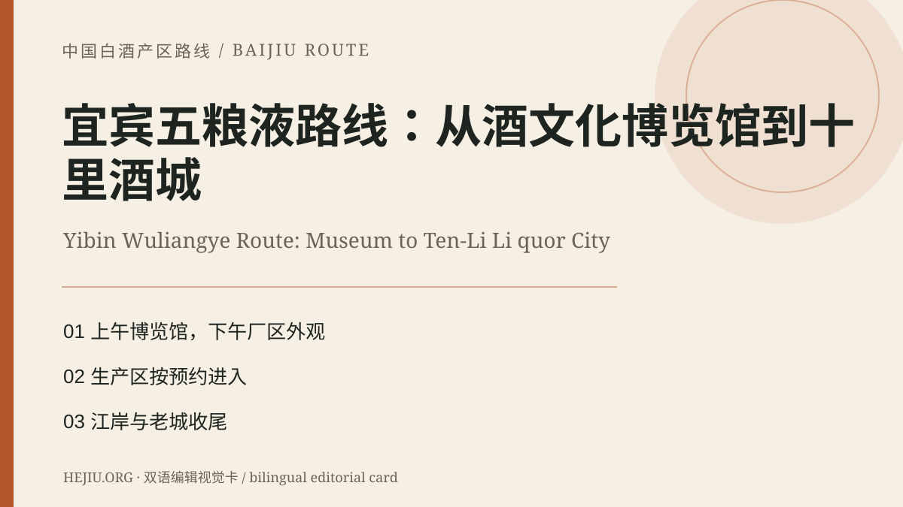

# 宜宾五粮液路线：从酒文化博览馆到十里酒城

宜宾的酒旅很容易被压成“到五粮液大门拍一张照”。这条路线把一天分成两半：上午在博览馆里把浓香型白酒的工艺链路弄明白，下午沿十里酒城的公共道路看厂区如何沿岷江展开，最后回到老城与江边收尾。它不追求走完所有车间，而是让你在看到规模时知道规模由什么构成。

图：宜宾五粮液路线专属双语视觉卡。项目自制双语视觉卡，用于识别主题，不是现场照片。

> **先给结论**
> **适合谁：** 第一次到宜宾、想在一天内建立浓香型白酒框架的人；适合自驾或打车。
> **不适合谁：** 想把厂区当自由景区、不愿预约的人；生产区不是开放步道。
> **一句话：** 上午看馆，下午看厂区外观与江岸，车间按官方线路，品鉴后不开车。

## 路线为什么先馆后厂

先看展馆不是为了“打卡室内”，而是为了给下午的厂区外观提供解释。浓香型白酒的连续生产靠窖池、窖泥、糟醅、蒸馏与陈放共同完成；如果先到厂区，你看到的只是大建筑、管道和货车，很难把“一口窖池如何工作”放进整条链路。博览馆里的剖面、器具与流程图能把工艺拆开，下午再沿公共道路看厂区尺度，就知道那些建筑分别对应制曲、发酵、蒸馏、仓储与包装。先建立框架，再看规模，信息才不会被体量压垮。

## 上午：在博览馆建立浓香框架

博览馆看四件事：原料如何配比，曲块如何培养，泥窖如何连续使用，原酒如何分级陈放与勾调。浓香型白酒多用高粱、大米、糯米、小麦、玉米等粮食，具体配方因厂而异；制曲决定曲香与发酵动力；窖池的窖泥是微生物群落的家，连续使用与日常养护比“年份”两个字更重要。看展时不要只拍酒瓶，拍下流程图与剖面，下午在厂区外面对照建筑位置。若馆内有讲解，先听工艺，再听品牌故事；两者不要混在一起。

## 下午：十里酒城的公共动线

十里酒城沿岷江展开，厂区道路、门户、江岸与部分公共空间可以步行或坐车经过，但正在运转的车间、仓库与物流通道不能自行进入。下午的走法是“从江岸看尺度，从门户看布局，从展馆看细节”：先在允许的公共路段看厂区如何沿江铺开，再到门户与展示点确认制曲、酿酒、陶坛库与包装的相对位置。不要翻越围栏、跟着货车进门，也不要用无人机贴近厂区拍摄。遇到生产车辆与上下班人流，主动让行。

## 交通、预约与雨天备选

从宜宾西站打车到岷江西路约半小时上下，五粮液机场在市区西北，车程视路况；公交线路会调整，以实时地图为准。博览馆与厂区外观半天可完成，全天加入老城与江边更稳。生产区参观按官方公告预约，是否开放、能否拍照、是否收费都可能变化，出发前一天再确认。雨天把室外厂区外观缩短，改为博览馆加老城室内点位；夏天酒糟气味重，敏感的人戴口罩，穿防滑鞋。

## 品鉴、买酒与返程

品鉴要问清酒精度、容量与收费，小杯慢饮，不空腹；司机不喝，品鉴后不要开车。买酒去官方店或授权店，保留发票；不要把“内部酒”“接待酒”当成捡漏，来源不清的酒不要带上车。返程前留二十分钟在江边坐一会儿，比多赶一个点更能感受酒城尺度。若还要去李庄或蜀南竹海，把远郊单独放一天，不要塞进厂区半日。晚饭可以试宜宾燃面、李庄白肉与江鱼，配酒控制量。

## 一日与两日版本

一日版按“博览馆—厂区外观—江岸—老城”走，午饭在市区，下午不要安排品鉴后自驾。两日版把第一天留给酒厂与老城，第二天去李庄或蜀南竹海，把远郊单独成段。若只留半天，放弃老城，集中看博览馆与一段厂区外观；若带长辈，减少步行，把展馆剖面先看懂，再坐车看门户与江岸。无论哪种版本，生产区都只走官方线路，品鉴与买酒分开处理。如果只走半天，上午博览馆加一段江岸，下午不要进老城；如果带长辈，坐车看门户与江岸，步行只留展馆。夏天把室外段放到傍晚，雨天改成展馆加冠英古街；李庄与竹海各留一天，不要和厂区拼。返程前在江边坐二十分钟，别把时间全花在找车；司机不参加品鉴，买酒留到最后，出发前一天再确认开放。带水，记停车点，慢走，提前准备，带好身份证。

## 出发前核对

- 确认博览馆与生产区预约
- 上午看展，下午看外观
- 生产区不翻围栏
- 品鉴后不开车
- 买酒留到返程前
- 雨天改室内备选
- 夏天带口罩与防滑鞋
- 远郊单独安排一天

## 这一路线不适合谁

如果你只想在半天内看一个博物馆，这条路线会显得松散；它把博览馆、十里酒城和宜宾老城串起来，更适合留一整天。也不是亲子友好型路线：厂区步行多、品鉴环节不适合未成年人，带孩子时建议只保留博物馆与江边。

交通上，宜宾市区公交可以到部分点位，但厂区之间步行距离长，夏天湿热；打车或包车更省力。返程若赶高铁，至少预留一小时从厂区回站。

替代方案：时间紧时只看五粮液酒文化博览馆；想看更多酒种，可把宜宾与泸州拆成两天，不要在同一天硬串。买酒与寄送按官方渠道规则，别在路边临时摊位解决。

## 参考资料

- 国家文物局博物馆年报 — 五粮液酒文化博览馆 — http://nb.ncha.gov.cn/museumdetail.html?msg=695e97ba55204e019622a4a0c22255c5&nianfen=2025（国家文物局，核对 2026-11-25）
- 宜宾市人民政府 — 中国酒都宜宾 — https://www.yibin.gov.cn/xxgk/rdgz/202309/t20230911_1903005.html（宜宾市人民政府，核对 2026-11-25）
- Wuliangye Group — About us — https://www.wuliangye.com.cn/en/about/Introduce.html（Wuliangye Group，核对 2026-11-25）
- 四川省网上红色基地 — 五粮液酒文化博物馆 — https://hsjd.scdjw.com.cn/cover01.html?id=116（四川省网上红色基地，核对 2026-11-25）

相关条目：[五粮液酒文化博览馆](ref:museum)、[五粮液酒厂（十里酒城）](ref:estate)、[五粮液](ref:brand)、[浓香型白酒](ref:style)、[四川省](ref:region)、[第一次喝白酒怎么选](ref:guide)、[中国酒史纲](ref:history)。
