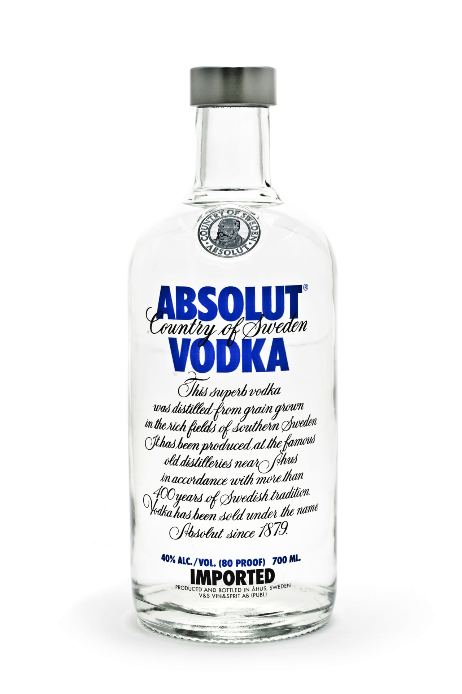

# Absolut

Absolut is a Swedish [vodka](ref:vodka) brand now owned by [Pernod Ricard](ref:producer). It is sold on single-origin production, winter wheat and continuous [distillation](ref:distillation), while its clear bottle, minimal label and long-running artistic advertising have made it one of the most widely recognised vodka brands in the world.

Figure: A bottle of Absolut Vodka, with its clear glass and blue lettering. Image: Justus Blümer, CC BY 3.0, via [source page](https://commons.wikimedia.org/wiki/File:Absolut_vodka_bottle.png).

## Brand definition

A brand, a distillery and a category are three layers. Absolut is the brand, vodka is the category, and the distillery at Åhus in southern Sweden is the production site. Treating the brand name as a category name, or reading "Absolut" as a statutory grade, leads to the wrong conclusions.

"Absolut" means "absolute" or "complete" in Swedish. The name comes from an "absolutely pure" phrasing in the early product name and belongs to naming tradition; it is not a third-party test result and does not mean every version has the same purity. The name and the chemical profile of the liquid are two different things.

The brand covers an original version and several flavoured versions with different recipes, sugar levels, aromas and strengths. Anyone asking "what does Absolut taste like" should first say whether they mean the original or a flavoured expression; treating a flavoured version as the original misreads the brand's base style.

## Owning producer

The brand's producer is [Pernod Ricard](ref:producer), a multinational wine and spirits group headquartered in Paris with businesses in vodka, whisky, anise-based spirits and wine. Absolut is one of the core brands of its vodka portfolio.

Production has long been concentrated at Åhus in Sweden, and official wording emphasises "one source": the spirit is made in one region, where water, wheat and distillation facilities provide a stable flavour base. Global distribution and brand operations sit within the group, while the exact ownership transaction year and structure should be taken from official disclosure.

Ownership and production location should be read separately: the brand belongs to Pernod Ricard and production is concentrated in Sweden, but labels, importers and packaging can differ by market. The origin, producer and importer on a label are the direct evidence of where a particular bottle came from.

## Product line

Public product material usually centres on Absolut Original, made from winter wheat and continuous distillation with a clean, grainy profile. Flavoured versions include Citron, Peppar, Vanilia, Raspberri, Lime, Wild Berries and Mandrin among others, and the flavours on sale are not identical in every market.

The brand also has a premium line, Absolut Elyx, positioned around copper distillation and a more elaborate process, plus limited packaging for duty-free, gift packs and specific campaigns. Strength, volume, sugar level and aroma intensity differ between versions, and the range changes by market, so the current list should be checked on the brand's official site.

Buyers should verify the product name, flavour designation, strength, volume, origin and producer on the label rather than judging by bottle colour or the word "Absolut". The sweetness and aroma of a flavoured version come from its recipe and do not describe the original product.

## Positioning and price band

The brand sits in a mainstream-to-mid-market price band: the original is a common base for mixing and restaurant use, flavoured versions serve home mixing and parties, and Elyx reaches into the premium segment. Prices vary with country, channel, tax, promotions and pack size, so this brand gives no specific retail price.

A price band is market positioning, not a quality grade. Judging vodka involves raw material, the number of [distillations](ref:distillation), filtration, water and balance, and cannot be inferred from the word "Absolut" or from price. Products with the same name may also differ in version and volume between markets.

For consumers, a more practical approach is to decide the purpose first — mixing, sipping, pairing or gifting — and then compare strength, volume, origin and flavour designation on the label. Treating an advertising line as a quality conclusion hides the real differences in flavour and recipe.

## History

The brand history usually begins with a distillery at Åhus in southern Sweden in the 19th century, with the exact founding year to be taken from official brand history. In the late 1970s the distillery launched a new product under the Absolut name for international markets, with an early name connected to "absolutely pure" spirit; a consistent bottle shape, minimal label and artistic advertising then built recognition quickly around the world.

From the 1980s, the brand worked with artists and designers on advertising and limited bottles, creating a tradition of combining art and commerce; such collaborations are cultural assets, not proof of product quality or age. The brand later went through ownership consolidation and eventually became part of Pernod Ricard, with the exact transaction points to be taken from official disclosure.

The distillery's founding, the launch of the Absolut brand and the move into a large group are milestones at different levels and should not be compressed into one year. Advertising history and product history should also be told separately, so that communication success is not mistaken for quality certification.

## Name and marks

"Juedui Futejia" is a direct Chinese translation of Absolut Vodka, in which "juedui" corresponds to Absolut and "futejia" to the category. The Chinese name carries no recipe or grade information; the English brand often appears simply as Absolut, with the typeface and layout on the bottle and label forming the main recognition.

The brand's marks are the clear glass bottle, simple lettering, silver and blue label elements and a layout without much extra decoration. Early labels deliberately reduced the amount of text so that the brand name became the visual centre; the design has been widely imitated, which also creates counterfeit risk. Buyers should check security marks, the producer, the batch and the official channel.

"Absolut" shares a root with "absolute" in Swedish, but the Chinese word "juedui" is not a quality grade or legal classification. Treating the brand name as proof of "the purest" mistakes marketing language for a technical standard.

## Common misconceptions

First, taking "Absolut" as a statutory purity grade. It is a brand name, not a test or legal category.
Second, assuming vodka is all the same because it is clear and neutral. Raw material, water, distillation and filtration all affect the taste.
Third, treating flavoured versions as the original plus juice. Their recipes and aroma design are separate products.
Fourth, assuming the Swedish origin is the filling location of every bottle. Read the origin and bottling information on the label.
Fifth, judging quality from price or advertising. Advertising spend and liquid quality are not the same thing.
Sixth, assuming products with the same name in different markets are identical. Strength, volume and recipe can differ by version.

**At a glance:** A Swedish vodka brand now owned by Pernod Ricard, sold on single-origin production, winter wheat and continuous distillation, and known for its clear bottle, minimal label and long-running art collaborations.

For Absolut, begin with the product line, then the producer named on the label, and finish with the market it is sold in; that order keeps the account grounded.

## Further reading

- [Pernod Ricard](ref:producer): the owning producer.
- [Vodka](ref:vodka): the category, ingredients and basic process.
- [Distillation](ref:distillation): the key production step for spirits.
- [Wheat](ref:wheat): the grain the brand emphasises.
- [How to read a label](ref:label-guide): checking strength, origin and producer.
