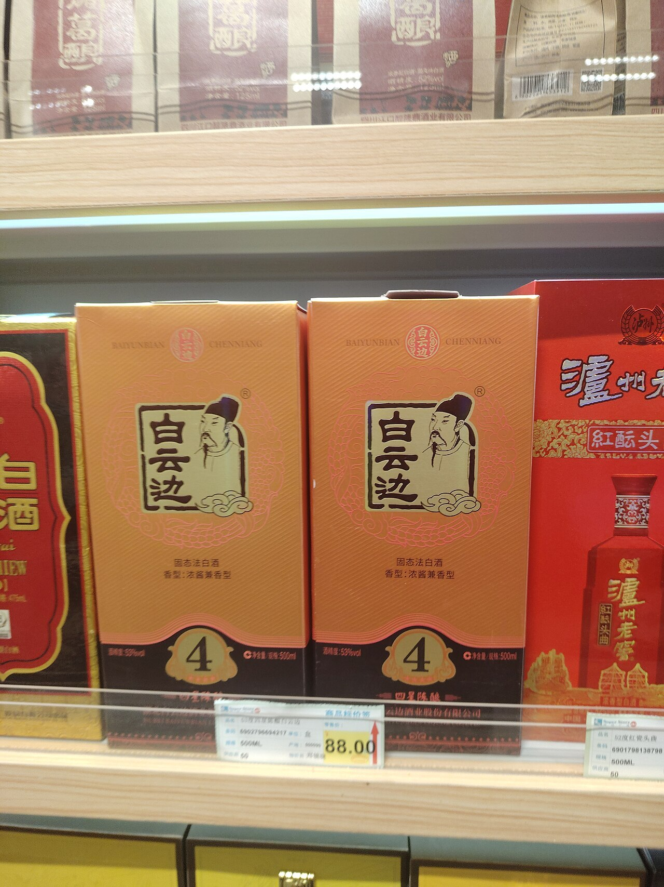

# Baiyunbian

Baiyunbian is a [mixed-aroma baijiu](ref:mixed-aroma) brand from Songzi, Hubei, named after Li Bai's line "borrow the moonlight from Dongting, and sail to buy wine where the clouds are white". Its identity comes from a style judgement: the entry leans toward the cellar and grain notes of strong aroma, while the finish carries the caramel and depth of sauce aroma — "strong head, sauce tail". The brand's lines run through vintage, era and star series, across a wide price range.

Figure: Baiyunbian. Photograph: 一款白云边酒. Credit: Lhzss8, CC BY-SA 4.0, via Wikimedia Commons ([source](https://commons.wikimedia.org/w/index.php?curid=196443757)).

## The brand name: a product of a Tang poem

"Baiyunbian" is first a geographical image, then a baijiu trademark. Li Bai's poem describes a moonlit night by Dongting Lake and buying wine; the brand borrows the combination of "white clouds" and "wine", not a brewing process. Understanding this prevents treating the poem as a quality proof.

The brand name and the production place do not fully overlap: Baiyunbian is made in Songzi, while the poem is set by Dongting. The brand borrows cultural geography, not an administrative boundary. On the bottle, the producer and origin remain the basis.

## Aroma position: the textbook of mixed aroma

Mixed aroma requires both the cellar and grain notes of strong aroma and the sauce, caramel and roasted notes of sauce aroma, with a mouthfeel balancing fullness and finesse. National standard GB/T 23547 sets clear requirements, and Baiyunbian is one of the most frequently cited examples of the category.

"Mixed aroma" is not a simple blend of two spirits; it involves arrangements from [qu-making](ref:qu-making) and [fermentation](ref:fermentation) to spirit extraction. The strong-aroma part stresses continued grain and mixed steaming; the sauce-aroma part stresses high-temperature stacking and multiple extraction rounds; the base spirits are combined in proportion.

## Product lines: vintage, era and star

The public product display divides Baiyunbian into three main lines: vintage, era and star. The vintage series is named Fifteen, Twenty and Thirty; the era series borrows period memories; the star series uses star labels.

The three lines are not three brands but price and occasion zones under one brand. Vintage carries business and gifting, era covers nostalgia and banquets, and star is closer to everyday drinking. Choose the occasion first, then the series.

## The vintage series: from fifteen to thirty

The vintage series is the core. Public material shows: Thirty Years at 53%vol in 668ml; Twenty Years in 45%vol and 42%vol at 500ml; Fifteen Years commonly at 45%vol in 500ml. In 2025, "Baiyunbian 15 (45%vol)" won the "Hubei production-area body design excellence award".

The year number is part of the product name, not the age of the liquid. The company may blend base spirits of different ages, and the ratio is process information. Reading "Fifteen Years" as "the whole bottle was stored for fifteen years" is the most common misreading.

## Strength choices and drinking occasions

The same series often offers several strengths: higher strength highlights aroma and structure, lower strength emphasises a soft entry. The difference between 42%vol, 45%vol and 53%vol is not just "how strong", but also how the aroma is released and how long the finish lasts.

Banquets often use 42%vol or 45%vol, while business and gifting prefer 53%vol. Choose by the drinker's habit and the food, not by the year number alone. Higher strength does not mean better quality; the right mouthfeel matters more.

## Flavour structure: strong head, sauce tail

"Strong head, sauce tail" is the most common summary: the entry has strong-aroma cellar, grain and sweetness; the middle turns to sauce-aroma caramel, nuts and depth; the finish is relatively long. The balance differs by vintage and strength.

Flavour description is a sensory summary, not a quality grade. What can be checked is the aroma type, strength, volume, standard and production date on the label. Treating "strong head, sauce tail" as a fixed recipe also ignores batch variation.

## Packaging and banquet culture

Baiyunbian packaging uses white, gold and red; the vintage series favours symmetry and year numbers, the era series uses retro labels, and the star series uses star symbols for visual layering. Gift boxes often appear at weddings, birthday banquets and business exchanges.

Packaging also creates misjudgement: a bigger box or more gold does not mean a better liquid. Judgement should return to the label and the channel, not the packaging cost.

## Channels and regional depth

The core market is Hubei, with Songzi and Jingzhou as the home market and Wuhan and the Jianghan Plain as priorities. Channels are mainly distributors, tobacco-and-liquor shops and banquet group purchases, with supermarkets and e-commerce as supplements. The brand is highly visible in local banquet markets.

Outside the province, Baiyunbian enters through its mixed-aroma difference but faces national names and local brands. Public material does not disclose provincial sales shares, and this page does not speculate.

## Honours and reputation

The "Hubei production-area body design excellence award" is a 2025 industry award judging aroma, mouthfeel and regional style. It shows a product has a place in professional review, but it does not mean every batch is identical.

Among consumers, Baiyunbian is often seen in Hubei as a "mixed-aroma representative" and a "banquet liquor"; outside the province it is more often treated as a "Hubei speciality". That regional gap is the reality the brand faces in national expansion.

## Boundary with the producer

The [producer](ref:producer) handles brewing, capacity, equity and standard participation; the brand handles names, series, price bands and consumer communication. Participating in drafting a standard does not mean every bottle is made to the highest grade, and the brand's historical narrative does not describe the company's equity structure.

For Baiyunbian, mixing the two layers leads to inferences such as "drafting the standard makes every bottle premium" or "the reform changed the recipe". Reading them separately keeps corporate governance and product choice in their own places.

## Buying and identification

First check whether the producer is Hubei Baiyunbian Distillery Co., Ltd.; second whether the aroma type is strong-sauce mixed aroma; third the strength, volume and standard; fourth the series name and batch. The year number should be read only as part of the product name.

For banquets, look at Fifteen and Twenty; for business gifting, Thirty; for everyday drinking, the star series. In every case, official channels and anti-counterfeit checks come before claims of "internal price" or "special supply".

## Common misconceptions

First, taking "mixed aroma" for a blend of two spirits. It is a complete process route from qu-making to fermentation.
Second, treating the year number as bottle age. It is usually part of the product name.
Third, taking Baiyunbian for a sauce-aroma brand. It is mixed aroma, not sauce aroma.
Fourth, treating "strong head, sauce tail" as a fixed recipe. Series and strengths differ markedly.
Fifth, judging authenticity by packaging or price. Anti-counterfeit checks, channels and labels are more reliable.

## Further reading

- [Hubei Baiyunbian Distillery](ref:producer): the company behind the brand.
- [Hubei](ref:hubei) and [China](ref:china): the regional background.
- [Baijiu](ref:baijiu) and [mixed-aroma baijiu](ref:mixed-aroma): the brand's category and aroma.
- [Qu-making](ref:qu-making) and [fermentation](ref:fermentation): key steps in mixed-aroma production.
