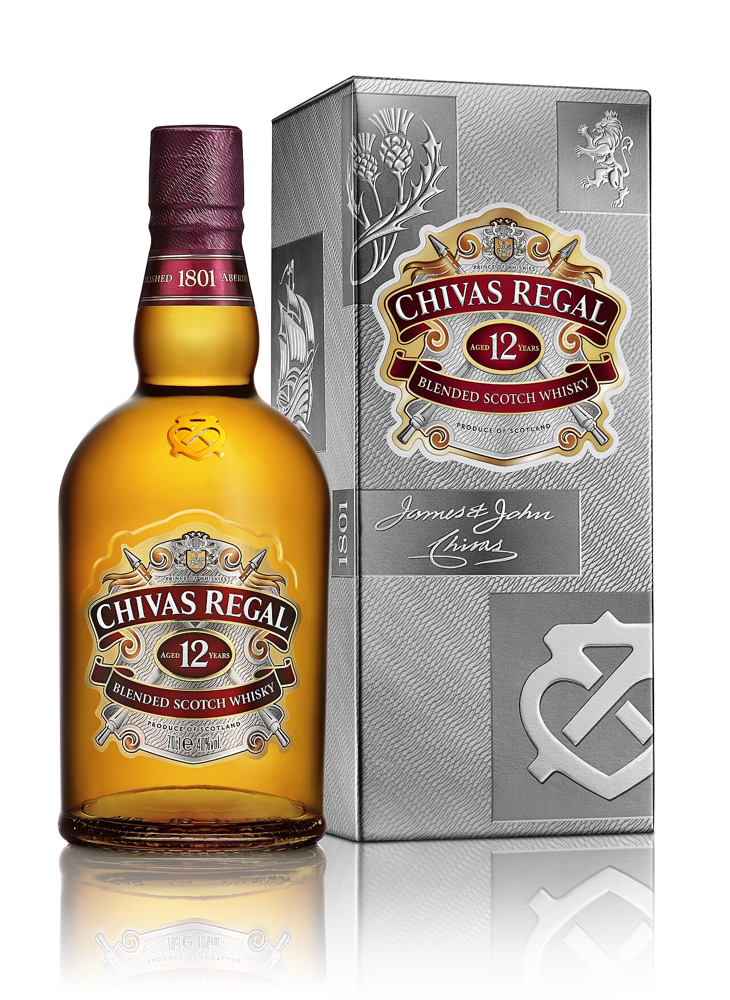

# Chivas Regal

Chivas Regal is a Scotch blended whisky brand operated by Chivas Brothers under [Pernod Ricard](ref:producer). It is known for its 12-year and 18-year age statements and a smooth blending style, and it is one of the representative names in premium [blended whisky](ref:blend) as well as one of the best-known [Scotch whiskies](ref:scotch) in the Chinese market.

Figure: Chivas Regal. Image: Chivas Holdings (IP) Limited, CC BY-SA 4.0, via Wikimedia Commons ([source page](https://commons.wikimedia.org/wiki/File:Chivas_image_for_wikipedia.jpg)).

## Brand definition

A brand, an operating company and a product are three different layers. Chivas Regal is the brand, Chivas Brothers is the company that handles production and brand operations, and a particular bottle is the product. Mixing the brand name with the company name easily leads to the belief that Chivas Brothers only makes Chivas Regal, or that every Chivas Regal product shares one recipe.

Chivas Regal is not a single malt but a blended whisky. Under Scotch whisky rules, a blend combines malt and grain whiskies from several distilleries, and the brand is responsible for selecting casks, blending them and keeping the flavour stable. [Whisky](ref:whisky) is the larger category, and blending is only one production route within it.

The word "Regal" in the name means royal or regal and belongs to the language of brand positioning, not to an official certification or a regional grade. Anyone asking "what does Chivas Regal taste like" should first name the 12-year, 18-year or no-age-statement version.

## Owning producer

The brand's producer is [Pernod Ricard](ref:producer), a multinational wine and spirits group headquartered in Paris with businesses in vodka, whisky, anise-based spirits and wine. Scotch whisky is handled by Chivas Brothers, and Chivas Regal is its core blended brand.

Chivas Brothers operates several distilleries, blending facilities and bottling sites in Scotland, some of them in Speyside, which supply malt whisky for the blends. The brand's whisky selection draws on different regions and distilleries, so it is not correct to say that Chivas Regal equals one particular distillery.

Ownership and production location should be read separately: the brand belongs to Pernod Ricard, blending and bottling are organised within the Chivas Brothers system, and the full set of cask sources and origins is not usually disclosed. What a consumer can check directly is the producer, bottler, age statement and origin on the label.

## Product line

Public product material commonly lists Chivas Regal 12 Year Old, 18 Year Old and 25 Year Old as the core age series, where the number is the minimum age of all whiskies in the bottle. The 12-year is the mainstay of retail and restaurant channels, the 18-year serves mid-to-high-end gifting and banquets, and the 25-year is positioned for higher-end collecting and gifting.

Beyond the age series there are Chivas Regal Extra (no age statement, with a fuller flavour), Chivas Regal Mizunara (a version treated or finished in Japanese mizunara oak), and duty-free, gift-pack and limited editions for different markets. Strength, volume, packaging and availability vary by market, and the current list should be checked on the brand's official site.

Buyers should verify the full product name, age statement, strength, volume, producer and batch on the label rather than looking only at bottle colour or the word "Regal". An age number is a minimum maturation requirement, not an average age, and it does not represent the actual age of any single cask in the blend.

## Positioning and price band

The brand spans a mid-to-high price band: the 12-year covers everyday drinking and restaurants, the 18-year reaches into business dinners and gifting, and the 25-year and special editions target high-end collecting. Prices move with market, channel, tax, promotions and pack size, so this brand gives no specific retail price.

A price band is market positioning, not a quality grade. The quality of a blended whisky depends on the whisky selection, [oak maturation](ref:oak) conditions and blending skill, and cannot be inferred from the age number or the price alone. Duty-free, gift-pack and standard retail versions may also differ.

For consumers, a more useful approach is to decide the purpose first — sipping, serving with ice, mixing or gifting — and then compare age statements and flavour within that purpose. Treating "older is always better" as the only standard ignores blending style and personal preference.

## History

The brand story usually begins with a grocery business in Aberdeen, Scotland, in the early 19th century. Chivas Brothers sold groceries and premium foods and later expanded into whisky; in the early 20th century Chivas Regal appeared as a blended whisky aimed at the premium market and reached markets such as the United States through exports and shipping. Official brand histories differ slightly on the exact founding and launch years, so those details should be taken from official sources.

By the middle of the 20th century, the 12-year Chivas Regal had become the brand's core product, with the age statement and smooth style together shaping market recognition. The brand later went through several ownership and business changes and eventually became part of Pernod Ricard through its Scotch whisky business; the exact transaction year and structure should be taken from official disclosure.

The grocery origin, the premium blended positioning and the move into a large group are milestones at different levels and should not be compressed into one year. Advertising, sponsorship and collaborations are brand communication, not proof of product quality or age.

## Name and marks

"Zhi Hua Shi" is a Chinese transliteration of Chivas Regal, in which Chivas is the family surname and Regal means royal or regal. The Chinese name carries no age or grade information; slightly different renderings may exist in different regions, but they refer to the same brand.

The brand's marks include the bottle crest, the shield device, the typeface and the colour scheme. The age numbers 12, 18 and 25 are the central identifiers on the label and represent minimum maturation; no-age-statement versions are separated by series name and flavour positioning. The crest and the "Regal" wording belong to brand visual tradition and are not a statutory origin or official certification.

Counterfeit products can copy the bottle shape and crest, so buyers should check security marks, the producer, the batch and the official channel. The importer information on the Chinese label is also worth reading, especially for duty-free and cross-border products.

## Common misconceptions

First, treating Chivas Regal as a single malt. It is a blend drawing on several distilleries.
Second, treating 12 years as an average age. The number is the minimum age of all whiskies in the bottle.
Third, reading "smooth" as low quality or dilution. Smoothness is a blending goal and a flavour design, not proof of low quality.
Fourth, taking "Regal" as an official royal warrant. It is brand naming and visual language.
Fifth, equating Chivas Regal with everything Chivas Brothers makes. The company also operates other whisky brands and distilleries.
Sixth, judging quality from age or price alone. Whisky selection, cask types and blending skill matter just as much.

## Further reading

- [Pernod Ricard](ref:producer): the owning producer.
- [Scotch whisky](ref:scotch): the rules and category background for blended Scotch.
- [Whisky](ref:whisky): the wider category and its basic process.
- [Scotland](ref:scotland): the brand's origin and production tradition.
- [Blend](ref:blend): the basic idea of blended whisky.
- [Oak maturation](ref:oak): how maturation affects flavour and colour.
- [Whisky intro](ref:guide): an introduction from category to tasting.
