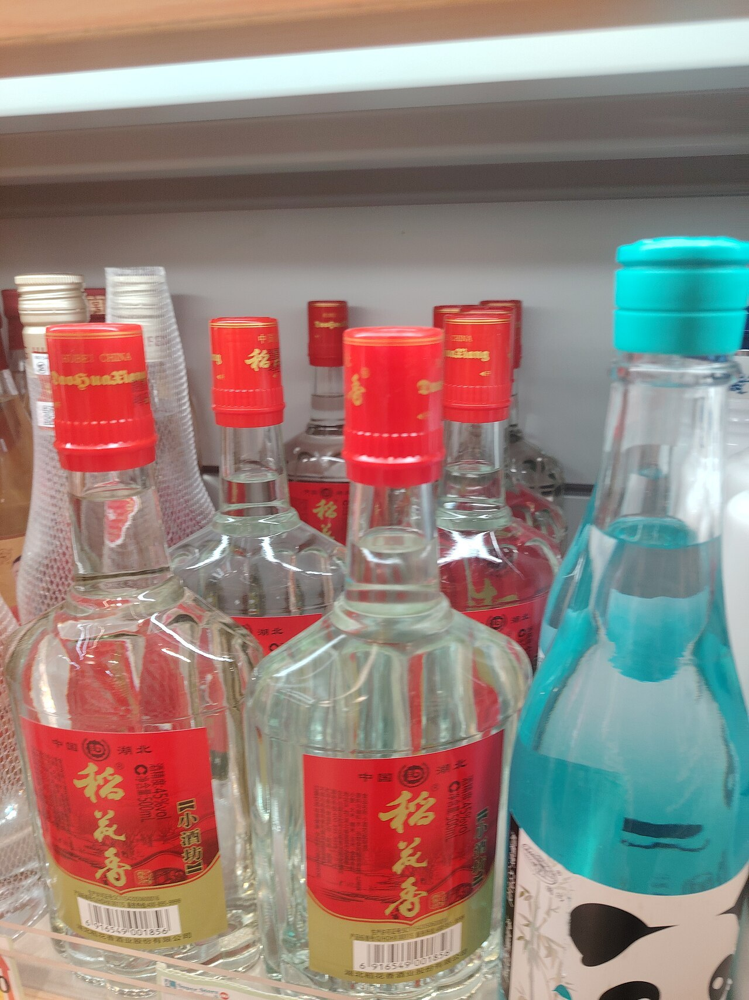

# Daohuaxiang

Daohuaxiang is a baijiu brand from Yichang, its name taken from Xin Qiji's line "rice flowers fragrance says a bumper year, frogs croak everywhere". It is more than a strong-aroma trademark: at the top sits "Qingyang", in banquets the "Huoli family", in traditional channels "Zhenpin", and in recent years a soy-aroma "Shouchaojian" series. Its product structure is far more complex than "regional strong aroma" suggests.

Figure: Daohuaxiang. Photograph: 经典装稻花香酒. Credit: Lhzss8, CC BY-SA 4.0, via Wikimedia Commons ([source](https://commons.wikimedia.org/w/index.php?curid=196443823)).

## The brand name: from Song poetry to the shelf

"Daohuaxiang" is first an agricultural image, then a baijiu trademark. The Song poem describes a summer night in the rice fields and the expectation of a good harvest; the brand borrows the associations of "bumper year" and "rural roots", not a brewing process. Understanding this prevents mistaking the poetry in the name for a quality guarantee.

The brand name is identical to the group name, which is unusual. Group, distillery and brand share the same three characters, so consumers easily count the group's diversified businesses as part of the brand. Checking the producer and series on the label is more effective.

## Positioning: regional strong aroma across price points

Daohuaxiang's main body is [strong-aroma baijiu](ref:strong-aroma), with prices from everyday value to above a thousand yuan, and Hubei as the core market. It uses several series to occupy banquets, gifting, group purchases and township markets, giving wide coverage but a relatively dispersed brand memory.

This "multi-series, multi-price" approach has the advantage of channel fit and the disadvantage of scattered recognition. Consumers may remember "Qingyang" but not how it relates to "Huoli". The brand page exists to separate that relationship.

## Product-line map

The public product centre shows four main lines: Qingyang, the Huoli family, Zhenpin and Shouchaojian. Qingyang carries the premium image, Huoli covers banquets and daily drinking, Zhenpin guards traditional distribution, and Shouchaojian makes a soy-aroma attempt.

The four lines are not four independent brands but product bands under one brand. They share the Daohuaxiang master brand; differences lie in aroma, strength, packaging and channel. Choose the occasion first, then the series.

## Qingyang: the premium flagship

Qingyang is the premium flagship. The company describes its body as "strong head, soy tail": the rich pit aroma, sweetness and clean finish of strong aroma combined with the elegance and long finish of soy aroma. The Classic Edition is 52%vol in a 500mL bottle, and the bottle shape draws on the Zenghouyi chime bells.

In 2024 the company launched Qingyang Appreciation, Zunya and Crystal editions, forming a premium matrix of "Classic + Appreciation + Zunya + Crystal" and giving the whole brand a quotable ceiling.

## The Huoli family: banquets and everyday drinking

The Huoli family includes Huoli Hao, Huoli Star and Huoli Type, with upgraded versions. The name stresses "vitality" and targets gatherings with friends, weddings and festivals; the packaging uses bright colour blocks and large type for shelf recognition.

This family is the volume base. Its price is closer to an ordinary banquet budget, with channels in tobacco-and-liquor shops, township supermarkets and banquet group purchases. Value should be judged by strength, volume and standard, not by the word "upgraded".

## Zhenpin: traditional channels

Zhenpin includes Zhenpin No. 1, Zhenpin Xiao No. 1 and New Zhenpin, with names built from "number + Zhenpin". It serves traditional distribution and gift-giving in acquaintance networks, with more formal packaging and a price band between Huoli and Qingyang.

" No. 1" and "Xiao No. 1" are product names, not grade numbers, and have no industry-wide ranking meaning. Similar names may appear in different years or channels; check the producer, strength and batch.

## Shouchaojian: a soy-aroma experiment

Shouchaojian is a recent move, with publicly visible Soy Aroma 15, Soy Aroma 10 and Soy Aroma 5 products. The numbers usually express product tier or base-liquor age, not a legal grade; the label and official explanation govern.

Crossing from strong aroma to soy aroma shows the company wants a place in the soy-aroma boom; but the two lines differ greatly in process and flavour, and judging Shouchaojian still requires the soy-aroma standard and label.

## Flavour and drinking occasions

The strong-aroma main line shows pit aroma, grain aroma and sweetness, with a smooth entry and a grainy finish; Qingyang is more complex because of its "strong head, soy tail" and suits slow drinking and gifting; Huoli stresses an easy entry for shared banquets; Shouchaojian leans toward soy-aroma elegance and length.

Flavour descriptions are sensory summaries, not quality grades. Different strengths and batches within a series can vary. What can be checked is the aroma type, strength, volume, standard and production date on the label.

## Packaging and visual symbols

The packaging strategy is "one master brand, zoned series": the master brand keeps calligraphy and rice-ear imagery, Qingyang uses chime-bell shapes and dark gift boxes, Huoli uses bright colours and large type, and Zhenpin uses gold and symmetry. The visual differences help shoppers sort the shelf quickly, but a bigger box or more gold does not mean a better liquid.

## Channels and marketing

The channel focus is Hubei, with Yichang as the base and Wuhan and the western Hubei city cluster as priorities; outside the province, distributors lead expansion. Marketing centres on distributor conferences, the spring sugar-and-liquor fair, banquet promotion and terminal display, stressing "home-town liquor" and the "bumper year" image. At the 2025 distributor conference the company released 5 series and 15 new products, using "multiple series plus multiple launches" to keep channel interest.

## Honours and consumer perception

Daohuaxiang has strong local recognition in Hubei, often seen as "Yichang's calling card" and a "western Hubei famous liquor", with an advantage built on long channel work and banquet occasions. Outside the province, perception often stops at "a Hubei liquor".

## Boundary with the producer

The [producer](ref:producer) handles brewing, capacity, equity and financial reports; the brand handles names, series, price bands and consumer communication. The group also has packaging, logistics and other baijiu brands, none of which belong to the Daohuaxiang brand's product lines.

## Buying and identification

First check whether the producer is Hubei Daohuaxiang Distillery Co., Ltd.; second the aroma type and strength; third the standard and volume; fourth the series name and batch. Strong-aroma products can be checked against GB/T 10781.1, while soy-aroma products should correspond to the soy-aroma standard.

For banquets, the Huoli family is the first stop; for gifting, Qingyang and Zhenpin; for curiosity, Shouchaojian. In every case, official channels and anti-counterfeit checks come before claims of "internal price" or "special supply".

## Common misconceptions

First, treating Daohuaxiang as only a strong-aroma product. The brand also has the soy-aroma Shouchaojian.
Second, treating "Qingyang" as an aroma type. It is a series name, with a "strong head, soy tail" style.
Third, treating "No. 1" and "Xiao No. 1" as grades. They are product names.
Fourth, treating the Song-poem origin as a quality proof. The name is cultural narrative.

Daohuaxiang is best read by starting with the product line, moving to the producer named on the label, and ending with the market it is sold in.

## Further reading

- [Hubei Daohuaxiang Distillery](ref:producer): the company and group structure behind the brand.
- [Hubei](ref:hubei) and [China](ref:china): the brand's regional and market background.
- [Baijiu](ref:baijiu) and [strong-aroma baijiu](ref:strong-aroma): the brand's main category.
- [Qu-making](ref:qu-making): a key step in forming the strong-aroma style.
