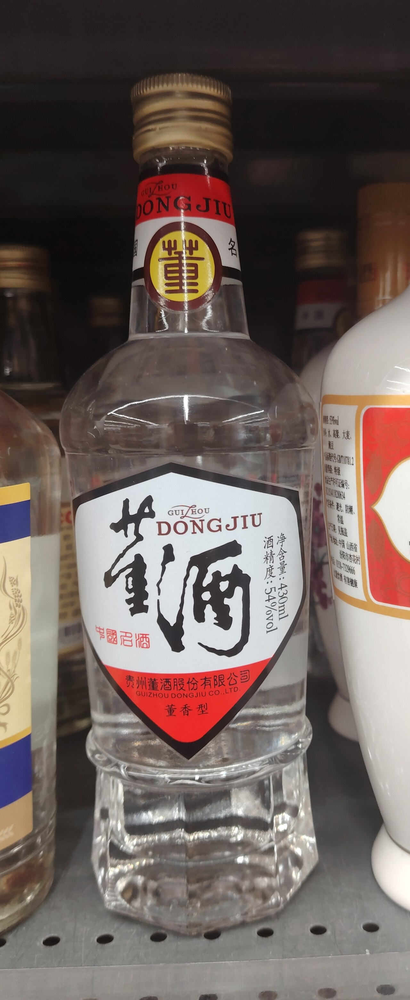

# Dongjiu

Dongjiu is a Dong-aroma baijiu brand from Donggongsi, Zunyi, Guizhou, held by [Guizhou Dongjiu Co., Ltd.](ref:producer). Dong-aroma is also called medicinal-aroma. Its process uses herbs in the qu, separate large and small qu, and twin cellars, and key products include Guomi Dongjiu and Guomi Baicaoxiang.

Figure: Dongjiu. Image: Lhzss8, CC BY-SA 4.0, via Wikimedia Commons ([source page](https://commons.wikimedia.org/wiki/File:%E4%B8%80%E7%93%B6%E7%BB%8F%E5%85%B8%E8%A3%85%E8%91%A3%E9%85%92.jpg)).

## Brand definition

For Dongjiu, a brand and a producer are two different entities. The brand answers "what is this bottle called and whom is it for"; the producer answers "who owns the trademark, who organises production and who bears legal responsibility". This page records the brand layer: name, product line, positioning and marks; see the producer entry for corporate history and ownership.

A brand is also not a single product. One brand can have several series, strengths, volumes and price bands, so a question such as "what does Dongjiu taste like" needs a specific product first, because the base-liquor makeup of the Guomi series and the Baicaoxiang series differs.

## Owning producer

The brand's producer is [Guizhou Dongjiu Co., Ltd.](ref:producer), located in Donggongsi, Huichuan district, Zunyi. The company was registered as a joint-stock company in 1994, was later restructured, and from 2007 pushed forward with recovery of production and the brand.

The producer entry records registration details, plant location and the local standard. This page keeps only what relates directly to the brand, so corporate history and product history are not conflated.

## Product line

Public product material lists Guomi Dongjiu, Teji Guomi, Guomi Baicaoxiang and Micang Jingdian Dong. The Guomi series carries distribution and gifting, Teji Guomi sits higher, Baicaoxiang became an important product in the brand's market recovery after its 2018 launch, and the Micang series emphasises storage and collecting.

The product pages describe the process as follows: herbs are added when making the qu, two qu types and two cellars are used, fermentation is long, and base liquors of different vintages are blended. Some statements, such as the formula and process being state-secret technology, are public company claims; this page reports the brand claim but does not treat marketing language as an independently verifiable technical conclusion.

Strength, volume, packaging and standards change by year. Buyers should check the producer, strength, net content and standard on the label rather than the series name alone.

## Positioning and price band

The brand covers a band from mid-market to high-end: Micang and the regular Guomi series serve banquets and everyday gifting, while Teji Guomi and Baicaoxiang reach high-end gifting and collecting. Prices change with year, channel and promotions, so this page gives no specific retail price and does not treat one promotion as long-term positioning.

A price band is market positioning, not a quality grade. Judging the liquid means looking at raw materials, qu making, fermentation, storage and the label standard, not price or packaging alone.

## History

The modern history of Dongjiu has clear points: production resumed in 1957, the liquor was named a Guizhou famous liquor in 1959, and it was chosen among the national eight famous liquors in 1963. These three steps established its representative position within Dong-aroma and turned "Dong-aroma" from a local flavour into an aroma category the industry could discuss.

In 2008 a Guizhou local standard identified Dongjiu as the representative of Dong-aroma, giving the aroma name a clearer correspondence with the product. The company was later restructured, rebuilt production and its cultural narrative from 2007, resumed national market expansion after Baicaoxiang launched in 2018, and started an expansion project in 2021. These are public company milestones and have nothing to do with the age of the liquid in a bottle.

## Name and marks

"Dongjiu" takes its name from the producing place, Donggongsi; "Dong" is both a place name and the source of the aroma name. Dong-aroma is also called medicinal-aroma; the two terms point to one style, but "medicinal" is easily misread as a medicinal liquor. The distinction matters: Dongjiu is baijiu, herbs take part in qu making, and the herbs are not steeped in the liquor.

Buyers should check the trademark, producer, anti-counterfeit marks and batch information. Similar names and counterfeit packaging exist, and bottle shape or the character "Dong" alone is not reliable.

## Common misconceptions

First, treating Dong-aroma as a medicinal or health liquor. It is baijiu; herbs are used in qu making, not steeped in the liquor.
Second, conflating the brand with the joint-stock company. The brand is a market mark; the company is a legal entity.
Third, treating the 1957 resumption of production as the brand's founding year. Workshop and earlier production history came before it.
Fourth, treating the "state-secret formula" as an independently verifiable technical conclusion. It is a public brand claim.
Fifth, treating price as a quality grade. Price is market positioning, not a process standard.

Dongjiu is not defined by the word “herbal” alone. Its identity comes from the combination of two kinds of qu, herbal ingredients in the qu, and a double-mash distillation that brings medicinal and ester notes together. Product lines such as Guomi and Baicaoxiang occupy different positions, but the style name is not a quality grade. The resumption of production, the national liquor awards and the provincial standard are separate timelines, and none of them is a bottle-age claim.

**In brief:** A Dong-aroma (also called medicinal-aroma) baijiu brand from Donggongsi, Zunyi, Guizhou, held by Guizhou Dongjiu Co., Ltd. Its process uses herbs in the qu, separate large and small qu, and twin cellars, with key products including Guomi Dongjiu and Guomi Baicaoxiang. 

Dongjiu is best read by starting with the product line, moving to the producer named on the label, and ending with the market it is sold in.

Put [Guizhou Dongjiu Co., Ltd.](ref:producer)'s owning company next to [Baijiu](ref:baijiu)'s product lines; the difference marks the boundary.

**Key facts.**

| Item | Detail |
| --- | --- |
| In one line | A Dong-aroma (also called medicinal-aroma) baijiu brand from Donggongsi, Zunyi, Guizhou, held by Guizhou Dongjiu Co., Ltd. Its process uses herbs in the qu, separate large and small qu, and twin cellars, with key product… |
| Owner | Guizhou Dongjiu Co., Ltd. |
| Region | Guizhou |
| Official site | chinadongjiu.com |

**Sources and limits.** The key claims about Dongjiu are checked against the following sources: Guizhou Dongjiu Co., Ltd. — company introduction (the plant location, the Dong-aroma positioning, the 2007 restructuring and the 2018 launch of Baicaoxiang), Guizhou Dongjiu Co., Ltd. — development history, Guizhou Dongjiu Co., Ltd. — product page (the Guomi series and the company wording on herbs in the qu and twin cellars) and 4 sources in total. For current products, addresses or opening status, use chinadongjiu.com. Prices, batches and status change; the body is project-written and does not reproduce source text.

## Further reading

- [Guizhou Dongjiu Co., Ltd.](ref:producer): the producer entry.
- [Guizhou](ref:guizhou): the Zunyi producing area.
- [Baijiu](ref:baijiu): the category Dongjiu belongs to.
- [Qu making](ref:qu-making) and [sorghum](ref:sorghum): the raw material and starting step of Dong-aroma production.
