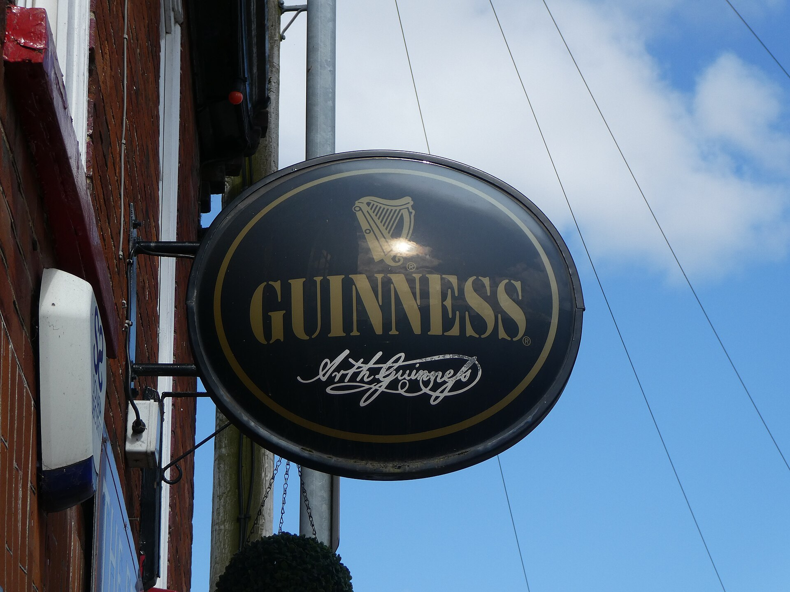

# Guinness

Guinness is a beer brand originating in Dublin, Ireland, known for its dark stout and now owned by [Diageo](ref:producer). The brand is closely associated with the St. James's Gate brewery, the dark colour produced by roasted barley and the nitrogen-conditioned foam that shapes its texture. It is one of the defining names in the [stout](ref:stout) style and one of the most recognisable brands in the world of [beer](ref:beer).

Figure: Related photograph of Guinness. Image: Sebastiandoe5, CC BY-SA 4.0, via Wikimedia Commons ([source page](https://commons.wikimedia.org/wiki/File:Guinness_Pub_Sign.jpg)).

## Brand definition

A brand, a brewery and a category are three different layers. Guinness is a brand, stout is a beer style, and "black beer" is merely a loose Chinese colloquialism for dark beer. Mixing the three leads to claims such as "every dark beer is Guinness" or "Guinness only makes one product", both of which are wrong.

One brand covers several products: a draught-style version for pubs and restaurants, canned or bottled versions for retail, stronger export versions, and an alcohol-free version. Their recipes, strengths, pasteurisation and packaging are not identical, so a question such as "what does Guinness taste like" needs a specific product first.

A brand is also not a single brewery. Guinness has a long-established brewery at St. James's Gate in Ireland and also produces through breweries and licensees in several other countries. The origin, producer and licensing arrangement for a given bottle should be read from its label.

## Owning producer

The brand's producer is [Diageo](ref:producer), a multinational drinks group headquartered in London and formed in 1997 from the merger of Guinness and Grand Metropolitan. Guinness was itself one of the merging parties. The group's portfolio covers whisky, vodka, gin, liqueurs and beer, and Guinness is the core brand of its beer business.

The group handles brand strategy, global distribution and capital allocation, while brewing is carried out by breweries and licensees in Ireland and elsewhere. The producer, origin and importer on the label are the direct evidence of a bottle's actual source; the same brand may be brewed or distributed by different entities in different markets.

Ownership should be separated from brewing location: the brand belongs to Diageo, but that does not mean every bottle is brewed in Dublin. Licensed brewing is common in the beer industry. Local water, ingredients and freshness can affect the beer, while the brand uses a common standard to preserve its recognisable character.

## Product line

Public product material commonly lists Guinness Draught, where nitrogen helps create a tight foam and a smooth texture and retail cans often contain a nitrogen device; Guinness Original or Extra Stout, with a more direct flavour; Guinness Foreign Extra Stout, sold in selected markets with higher strength and a more intense profile; and Guinness 0.0, an alcohol-free version for consumers who avoid or limit alcohol.

Names, strengths, volumes and packaging differ by market. The nitrogen version is about foam texture and mouthfeel rather than "a stronger drink", while export versions emphasise concentration and the ability to travel. The range changes with the market, so current availability should be checked against the brand site and local retailers.

Buyers should verify the product name, strength, volume, producer, origin and freshness date on the label rather than judging by colour alone. The dark colour comes from roasted barley and the recipe; it does not directly mean high strength or high bitterness.

## Positioning and price band

The brand sits in a mass-to-mid-market price band: the draught-style version is a fixture of pubs and restaurants, cans and bottles serve retail and home consumption, export and special versions reach towards the mid-to-high end, and the alcohol-free version addresses newer demand. Prices vary with country, channel, tax, promotions and pack size, so this page gives no specific retail price.

A price band is market positioning, not a quality grade. Freshness, ingredients, fermentation and filling conditions strongly affect beer flavour, and the same brand can differ between markets and batches. "Imported" or "more expensive" does not automatically mean better.

For consumers, a more practical approach is to start from the occasion — pairing with food, a gathering, drinking alone or mixing — and then compare strength, volume, origin and freshness date on the label. Part of the difference between beer on draught and beer in a can comes from pressure, temperature and foam structure, not only from the recipe.

## History

The brand story usually begins in the mid-18th century, when Arthur Guinness took the St. James's Gate brewery in Dublin on a very long lease; the exact year and lease details should be taken from official brand history. Through the 18th and 19th centuries, porter and stout developed in the British and Irish beer markets, and Guinness grew from a local brewery into a brand sold across markets.

In the 19th and 20th centuries, railways, shipping and exports carried Guinness to continental Europe, North America and further afield, while the brewery went through repeated changes in process, scale and ownership. In 1997 Guinness and Grand Metropolitan merged to form Diageo, bringing the brand into a multinational group. The St. James's Gate site later developed a visitor experience open to the public, but tourism and brewing are separate activities.

Taking the brewery lease, the emergence of the stout style and the group merger are milestones at different levels and should not be compressed into one year; advertising and cultural campaigns in the brand story are not product quality certifications either.

## Name and marks

"Jianlishi" is a common Chinese rendering of Guinness, following Cantonese transliteration practice and widely used in mainland China as well. The brand name comes from the founder's surname and does not refer to a place or a category. Chinese also uses "Jinisi" for Guinness World Records, a records business rather than a beer product, although its name likewise traces to the Guinness family and company.

The brand's marks include the harp device, the black-and-gold palette, the typeface and the can structure. The harp is a traditional Irish symbol that Guinness has long used as a trademark element, while the black-and-gold palette and dark beer together create shelf recognition. Counterfeit products can copy colours and lettering, so checking the producer, security marks, batch and official channel matters.

"Black beer" is a Chinese colloquial label, not a legal category for Guinness; the products usually appear on labels as stout or draught. Treating the colloquial term as a product name makes it easy to buy the wrong version.

## Common misconceptions

First, equating Guinness with all dark beer. It is one stout brand, and other breweries make dark beer too.
Second, assuming darker means more bitter or stronger. Colour comes from roasted barley; bitterness and strength are separate label facts.
Third, treating Guinness World Records as a Guinness product. The records business and the beer business are separate.
Fourth, assuming every market gets the same recipe. Export, locally licensed and draught versions differ.
Fifth, treating an Irish brand as meaning every product is made in Ireland. Licensed and overseas brewing is common; read the label.
Sixth, thinking nitrogen makes the beer stronger. Nitrogen mainly affects foam texture and mouthfeel.

## Further reading

- [Diageo](ref:producer): the owning producer.
- [Beer](ref:beer): the category, ingredients and basic process.
- [Stout](ref:stout): the beer style Guinness belongs to.
- [Ireland](ref:ireland): the brand's origin and brewing tradition.
- [How to read a label](ref:label-guide): checking strength, origin and producer.
