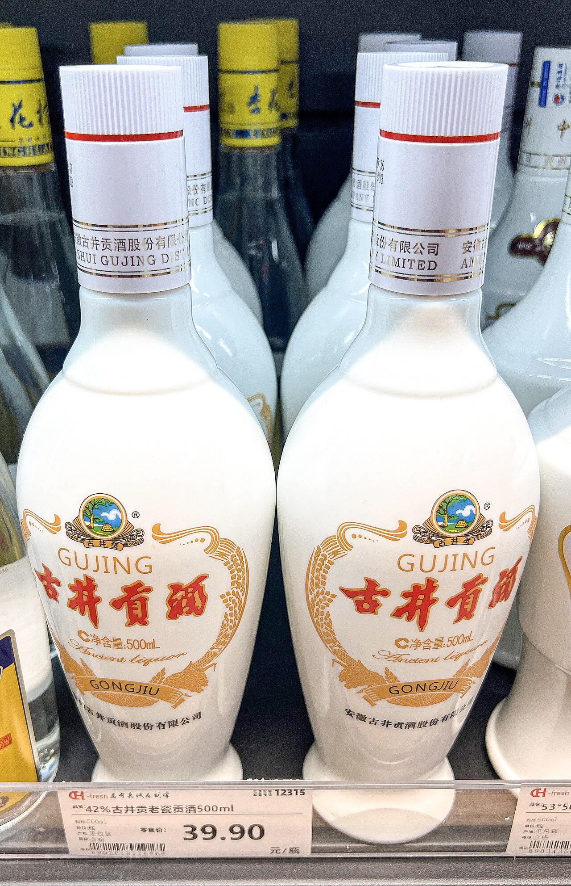

# Gujing Gongjiu

Gujing Gongjiu comes from [Bozhou, Anhui](ref:bozhou) and is produced by [Anhui Gujing Distillery Co., Ltd.](ref:producer). It is a [strong-aroma baijiu](ref:strong-aroma) brand best known for its "Nianfen Yuanjiang" series. It uses local water, solid-state mud-pit fermentation and continued mash recycling, with products from 40%–52% ABV.

Figure: Gujing Gongjiu. Image: N509FZ, CC BY-SA 4.0, via Wikimedia Commons ([source page](https://commons.wikimedia.org/wiki/File:Gujing_Gongjiu_at_a_supermarket_in_Beijing_(20241109164639).jpg)).

## Definition and position

Gujing Gongjiu is a brand name within the strong-aroma route of [baijiu](ref:baijiu). The brand is held by the producer, and the specific product is another level: the brand answers what it is called, the company answers who makes it, and the product answers what is in this bottle.

"Gongjiu" (tribute wine) belongs to historical narrative and brand naming and should not be treated as verifiable historical fact. A common story links it to Cao Cao and Han-dynasty tribute, but details differ across sources; this brand treats it as naming background, not as chronological evidence. Listing and business information can be checked on the producer page.

## Origin and environment

Bozhou lies in northwestern Anhui on the Huaibei Plain, with the Guo River running through it and a warm-temperate semi-humid monsoon climate: cold dry winters, hot rainy summers. Gujing Town is the core production site, and local water and pit environment form the base. The region page covers geography and industry in more detail.

Climate affects qu making and fermentation: cold winters help control fermentation speed, while summer heat tests workshop cooling and hygiene. Bozhou is also a centre for Chinese medicinal materials, so pharmacy and distilling coexist, and industrial support and logistics also shape production. A region is not one factor but climate, water, raw materials and long practice combined.

## Raw materials and qu

The main material is sorghum and qu is made from wheat, with some products adding rice, glutinous rice or corn. Strong aroma has multi-grain and single-grain routes, and the ratio shapes aroma structure. Sorghum starch, grain integrity and cooking degree decide fermentation start-up and yield.

Qu is a major flavour source. Strong aroma mostly uses medium-to-high-temperature qu, whose microbial composition affects pit and grain aroma. Qu-room temperature, humidity and turning schedule are company process with limited public detail; the ingredient list and standard on the label are what consumers can check.

## Production

The typical flow is: milling, moistening, cooking, cooling, adding qu, pit fermentation, removal, distillation, graded storage, blending and bottling. Strong aroma uses solid-state mud-pit fermentation, and continuous use and continued mash recycling gradually stabilise the microbial environment; pit age and maintenance affect flavour.

Distillation cuts the run into fractions, keeping heads and tails apart and using the middle as the main base. New spirit is stored by grade and then blended to unify style. Blending is not simple dilution; it combines base spirits of different grades and ages, and dilution water must be treated to avoid off-notes.

## Flavour and tasting

Gujing Gongjiu typically balances pit aroma, grain aroma and sweet aroma, with a mellow sweet entry, a relatively soft body and a clean finish. Series and strengths differ clearly, and one description cannot cover all products. High-strength versions are hotter, low-strength versions softer.

Taste from a small cup: check whether the pit aroma is clean and free of off-notes, then sip for sweetness and body. Water lowers heat and opens aroma but changes structure; ice is not traditional. When comparing with Sichuan strong aroma, note differences in pit-aroma intensity and mouthfeel direction.

## Product lines and labels

"Nianfen Yuanjiang" is a product series name, not the actual age of every drop. Age statements, base-spirit proportions and seasoning-spirit information should follow the label and official company explanation. Products in the series differ clearly in strength, volume and price.

The producer, aroma type, strength, standard and volume on the label are the basics for identity. Counterfeits and similar names exist, so buy through official channels and check anti-counterfeit marks. Channel versions and gift boxes should also be checked on the label; price and packaging do not equal quality.

## Drinking and pairing

Suited to neat sipping in a small cup, often at banquets and as gifts. Huizhou dishes, braised food, roast chicken and beef or mutton suit it; heavy chilli magnifies the heat and should be avoided before tasting. Low-strength products should not be kept long after opening, and high-strength products need dark, cool storage.

When used in mixed drinks, high strength significantly changes the balance and requires re-adjusting sugar and acid. Banquet customs around urging drinks are not a tasting standard; drink in moderation and avoid rapid drinking on an empty stomach. Do not drink while driving or taking medication.

## Common misconceptions

First, treating "Nianfen Yuanjiang" as the actual age of every drop. It is a series name.
Second, treating "Gongjiu" as a verifiable historical date. It is largely brand narrative.
Third, equating Gujing Gongjiu with the whole Bozhou region. It is one representative brand.
Fourth, that higher strength is more authentic. Strength serves product design.
Fifth, judging authenticity by packaging or price. Anti-counterfeit checks, channels and labels are reliable.

**In brief:** A strong-aroma baijiu brand from Bozhou, Anhui, known for its "Nianfen Yuanjiang" series and products across several strengths.

For Gujing Gongjiu, begin with the product line, then the producer named on the label, and finish with the market it is sold in; that order keeps the account grounded.

[Anhui Gujing Distillery Co., Ltd.](ref:producer)'s owning company and [Baijiu](ref:baijiu)'s product lines form a useful pair: the contrast shows where one ends and the other begins.

Gujing Gongjiu is a strong-aroma baijiu from Gujing Town, Bozhou, Anhui; its name refers to the ancient well and the distillery's pit fermentation.

**Key facts.**

| Item | Detail |
| --- | --- |
| In one line | A strong-aroma baijiu brand from Bozhou, Anhui, known for its "Nianfen Yuanjiang" series and products across several strengths. |
| Owner | Anhui Gujing Distillery Co., Ltd. |
| Region | Bozhou |
| Official site | gujing.com |

**Sources and limits.** The key claims about Gujing Gongjiu are checked against the following sources: Industry body (origin, product range and public company information; strong-aroma baijiu and continued-mash terms), Oxford University Press (Consulted for entries on Chinese baijiu and strong-aroma styles). For current products, addresses or opening status, use gujing.com. Prices, batches and status change; the body is project-written and does not reproduce source text.

## Further reading

- [Anhui Gujing Distillery Co., Ltd.](ref:producer): producer identity and listing information.
- [Bozhou](ref:bozhou): regional geography, industry and places to visit.
- [Baijiu](ref:baijiu): the broad category and aroma-type system.
- [Strong-aroma baijiu](ref:strong-aroma): pits, continued mash and the flavour framework.

Product ranges, packaging and ownership change, so check the current label and the company's own disclosures.
