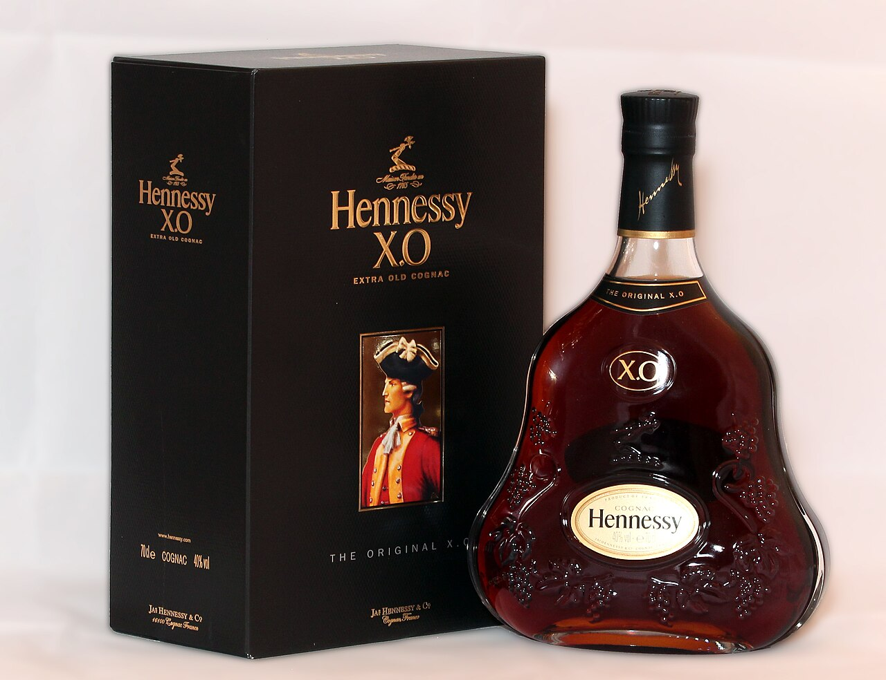

# Hennessy

Hennessy is a French Cognac brand operated by Moët Hennessy under [LVMH](ref:producer). It is known for its VS, VSOP and XO grades and long-matured blended eaux-de-vie, and it is one of the representative names of [brandy](ref:brandy) from the Cognac region as well as one of the best-known imported spirits in the Chinese market.

Figure: Hennessy. Image: Dmitrij Rodionov, CC BY-SA 4.0, via Wikimedia Commons ([source page](https://commons.wikimedia.org/wiki/File:Hennesy_XO_close.jpg)).

## Brand definition

A brand, a region and a grade are three different concepts. Hennessy is the brand, Cognac is a protected French region and category of grape spirit, and VS, VSOP and XO are Cognac grades. Treating the brand name as a category name produces the false conclusion that all Cognac is Hennessy.

Cognac must be produced in the Cognac region of France, distilled from grapes and matured in oak under appellation rules. Hennessy is a house and brand within that region, not a synonym for the region; other houses also make Cognac there.

The brand covers different grades and different series with different blends, minimum maturation, packaging and positioning. Anyone asking "what does Hennessy taste like" should first say whether they mean VS, VSOP, XO or a higher-end series.

## Owning producer

The brand's producer is [LVMH](ref:producer), a French luxury group headquartered in Paris. Its drinks business is run by the subsidiary Moët Hennessy and covers Champagne, wine, Cognac and whisky. Hennessy is the core brand of the Moët Hennessy Cognac portfolio.

The group handles brand strategy, global distribution and capital allocation, while production, maturation and blending are carried out by the brand's houses, cellars and blending teams in the Cognac region. What consumers can check directly is the producer, origin, grade, strength and importer on the label.

Ownership and production location should be read separately: the brand belongs to LVMH and production and maturation are concentrated in the Cognac region, but packaging, volume, Chinese labels and gift versions differ by market. Ownership does not change the appellation rules.

## Product line

Public product material commonly lists VS (Very Special), VSOP (Very Superior Old Pale) and XO (Extra Old), whose letters correspond to different minimum oak maturation requirements set by Cognac industry rules and stated in official material. Higher-end series such as Paradis serve collectors and top-level gifting.

Beyond the grade series there are artist collaborations, zodiac editions, anniversary editions and duty-free versions. Strength, volume, packaging and availability change by market, and the same grade may differ between markets. The current range should be checked on the brand site and local retail channels.

Buyers should verify the grade letters, strength, volume, origin, producer and batch on the label rather than looking only at bottle shape or colour. The grade letters represent minimum maturation requirements; they do not mean a single vintage, nor the actual age of every component in the blend.

## Positioning and price band

The brand spans a mainstream-to-premium price band: VS is often used for mixing and entry-level drinking, VSOP is the mainstay of retail and restaurant channels, XO serves high-end banquets and gifting, and series such as Paradis sit at the top for collecting. Prices vary with market, channel, tax, promotions and pack size, so this page gives no specific retail price.

A price band is market positioning, not a quality grade. Cognac quality depends on grape sources, [distillation](ref:distillation), [oak maturation](ref:oak) conditions and blending skill, and cannot be inferred from grade letters or price alone. Gift-pack, duty-free and standard retail versions may also differ.

In the Chinese market, Cognac is often associated with banquets, business gifting and festivals, and that setting influences pricing and packaging but not the legal grade. Judging a bottle should still return to the label and the appellation rules.

## History

The brand story usually begins in the 18th century, when Richard Hennessy, an Irish officer in French service, founded the house in the Cognac region; the exact year should be taken from official brand history. Family management later expanded into Europe and other markets, and the export trade and shipping networks of Cognac drove the brand's international growth.

In the 20th century, Hennessy was combined with Champagne house Moët & Chandon and related businesses to form Moët Hennessy; after LVMH was created in 1987, the drinks business became part of that luxury group. Growth in Asia, especially Chinese banquet and gifting demand, became an important part of the brand's global business.

The founding of the house, the combination with Moët and the move into LVMH are milestones at different levels and should not be compressed into one year. Advertising, collaborations and events are brand communication, not certification of quality or grade.

## Name and marks

"Xuanni Shi" is a Chinese transliteration of Hennessy; the name comes from the founder's surname and does not refer to a region or a grade. The Chinese rendering is broadly consistent across markets, and the English name usually appears as Hennessy alone; Cognac is a category name, not part of the brand name.

The brand's marks include the family crest, typeface, bottle shape and grade label. The grade letters are the central identifiers: VS, VSOP and XO each correspond to a different minimum maturation requirement; the label may also state origin, strength, volume and batch. Crest and colours belong to brand visual tradition and are not a statutory grade.

Counterfeit products can copy bottle shapes and crests, so buyers should check security marks, the producer, the batch and the official channel. The importer and distributor on the Chinese label are also worth reading, especially for gift packs and duty-free products.

## Common misconceptions

First, equating Hennessy with all Cognac. It is one house within the region, and other houses also make Cognac.
Second, treating XO as a single-vintage spirit. XO is a grade representing minimum maturation, not a vintage year.
Third, assuming VSOP is sweeter than VS. Grade is not about sweetness; the difference comes mainly from maturation and blending.
Fourth, equating Cognac with all brandy. Cognac is a protected sub-category of brandy, and other brandies follow different rules.
Fifth, treating different Chinese renderings as different brands. Xuanni Shi is the standard rendering, and Hennessy refers to the same brand.
Sixth, judging quality directly from grade or price. The origin of the eaux-de-vie, maturation conditions and blending skill matter just as much.

**Short definition:** A French Cognac brand operated by Moët Hennessy under LVMH, known for its VS, VSOP and XO grades and long-matured blended eaux-de-vie, and one of the defining names of the Cognac region.

## Further reading

- [LVMH](ref:producer): the owning producer.
- [Brandy](ref:brandy): the wider category and its basic process.
- [France](ref:france): the regional background of Cognac.
- [Oak maturation](ref:oak): how maturation affects the flavour and colour of Cognac.
- [Distillation](ref:distillation): the key process for grape spirits.
- [First tasting](ref:guide): an introduction to colour, aroma and palate.
