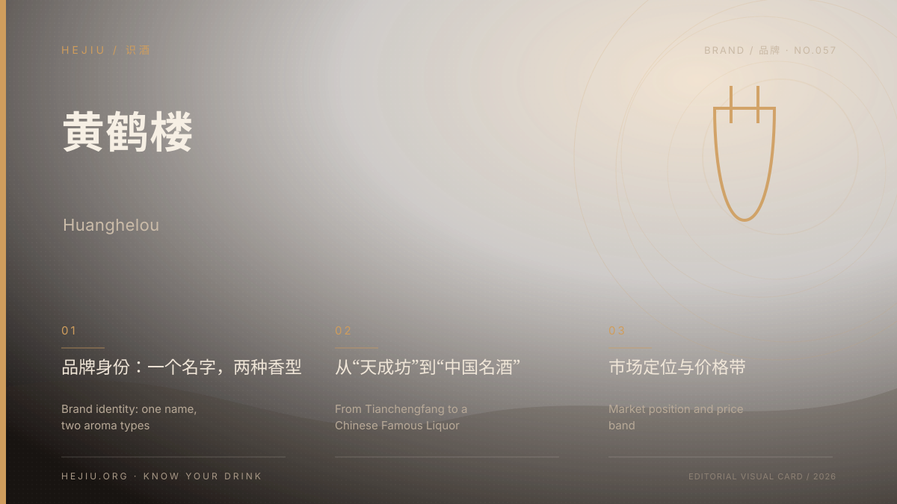

# Huanghelou

Huanghelou is a baijiu brand from Wuhan, held by [Huanghelou Distillery](ref:producer). What makes it unusual is that the brand covers light-aroma products under the "Southern School Great Light Aroma" banner, a strong-aroma product called "Gengshang Cenglou", and a Chenxiang series named after years. Buying a bottle of Huanghelou starts not with the company background but with the aroma type and series on the label.

Figure: Huanghelou. Project-generated or category illustration used for Chinese alcohol culture context; not a photograph of the subject.

## Brand identity: one name, two aroma types

The three characters "Huanghelou" are at once a place name, a tower name and a trademark. As a brand it does not equal one aroma type. [Light aroma](ref:light-aroma) is the historical main line, rooted in the Hanfen craft of the Wuhan distillery; strong-aroma products serve the broader banquet market. The two lines share the brand and channels but stand on different process and flavour systems.

## From Tianchengfang to a Chinese Famous Liquor

The company website traces the brand to a story from 223 AD and to 1898, when Zhang Zhidong presented the wine to the emperor and the name "Tianchengfang" was bestowed. These are corporate narratives that explain product names such as Tianchengfang; they should not be treated as independent historical evidence.

The checkable timeline begins in 1952 with the state-run Wuhan Distillery: 1979, output exceeded 10000 tonnes; 1984, the fourth national evaluation named it a "Chinese Famous Liquor"; 1989, it retained the title at the fifth evaluation; 2011, it became a "China Time-honoured Brand"; 2017, it became a "China Well-known Trademark"; 2024, it entered the Hubei provincial intangible cultural heritage list. Today's "revival of a famous liquor" story rests on these points.

## Market position and price band

Huanghelou's main price band sits in banquets and gifting, with the Lou series and Chenxiang year-labelled products carrying the image at the top, and Ecological Original Pulp and Gengshang Cenglou covering everyday gatherings below. Public material gives no single national recommended price; actual prices vary by region, channel and promotion, so this brand does not quote a figure.

Compared with Daohuaxiang and Baiyunbian in the same province, Huanghelou's difference is the historical label of a "famous light-aroma liquor"; compared with northern light-aroma brands, it carries a clear Wuhan identity.

## Southern School Great Light Aroma: the light-aroma main line

Southern School Great Light Aroma is the brand's current strategic main line. The company says it inherits the century-old Hanfen brewing craft, and sums up the style as "clean, quiet and soft, a full tower". The products use sorghum, barley and peas, with low-temperature daqu and the separate-steaming, clean-firing route; the cleanliness of [qu-making](ref:qu-making) and fermentation directly affects whether the aroma stays pure.

"Southern School" is a contrast with Shanxi light aroma: the same clean steaming, under Wuhan's warm and humid climate, gives a softer entry and a fuller body. It is not a separate aroma type in the national standard, but a company style name.

## Chenxiang: a product tier named after years

The Chenxiang series uses year numbers: the website shows Chenxiang 1952, Chenxiang 1979, Chenxiang 1989 and Chenxiang 1999. The numbers refer to key years in brand history, not to years in the bottle; they express a tribute to historical moments and cannot be read as age.

The taste description centres on "more elegant aroma, softer entry, a more refreshing finish". The series page does not state an aroma type for each product, so the bottle label is the guide. Treating the year number as cask age is the most common misreading of this series.

## Ecological Original Pulp: the banquet occasion

Ecological Original Pulp is positioned as a wedding-banquet wine, stressing upgrades in "quality, taste and packaging" and a softer, gentler drinking experience. The name combines "ecological", pointing to raw materials and environment, with "original pulp", pointing to a process expression of no added water.

"Original pulp" has no unified legal definition in the baijiu industry, and companies use it differently. Judging a bottle still depends on the standard, strength and producer.

## The Lou series and Gengshang Cenglou

The Lou series is named after the tower, with products such as Lou 20 and Lou 16 carrying the famous-liquor image and gifting occasions; the company says they are exported. "Gengshang Cenglou" is a strong-aroma product made from water, sorghum, glutinous rice, rice, wheat and maize, with strengths of 52%vol and 38%vol in 500ml bottles.

Two aroma labels under one brand show that a brand is not an aroma type. Read the "aroma type" line first, then decide which product line the bottle belongs to.

## Packaging and visual symbols

Huanghelou packaging uses the tower, river waves and calligraphy, with red and gold dominant in gift boxes, stressing "Wuhan's calling card" and "famous-liquor gifting". These symbols strengthen regional recognition and also encourage buyers to mistake packaging grade for liquid grade.

## Channels and marketing

The brand's base is Hubei, with Wuhan and its surroundings as the core market, using banquets, group purchases, tobacco-and-liquor shops and e-commerce in parallel. After the acquisition, Huanghelou was folded into Gujing Gongjiu's "dual famous-liquor matrix, dual-market resonance and dual-brand drive" system, so channel coordination and spending follow the parent's rhythm.

In marketing the brand repeatedly uses three phrases — "old famous liquor", "Southern School Great Light Aroma" and "dual famous liquors" — and launches new products at events such as the spring sugar-and-liquor fair. The strategy trades historical assets for channel trust rather than fighting on price alone.

## Honours and consumer perception

"Chinese Famous Liquor", "China Time-honoured Brand", "China Well-known Trademark" and "Hubei provincial intangible cultural heritage" are the four honours most often cited. They come respectively from the 1984 and 1989 evaluations, the 2011 Ministry of Commerce recognition, the 2017 trademark recognition and the 2024 heritage list.

Consumer perception splits by region: buyers in Hubei know its banquet status and history, while buyers outside the province more often see it as a "Wuhan speciality" or a "Gujing Gongjiu brand".

## Boundary with the producer

The [producer](ref:producer) handles sites, capacity, equity and financial reports; the brand handles names, series, price bands and consumer communication. What Gujing Gongjiu took control of in 2016 was the company, not a transfer of the Huanghelou trademark to Anhui; origin and producer on the label remain the basis for judging.

## Buying and identification

First the producer and origin; second the aroma type and strength; third the standard and volume; fourth the series name and batch. Light-aroma products can be checked against GB/T 10781.2, while strong-aroma products should correspond to the strong-aroma standard. Official channels and anti-counterfeit checks come before claims of "internal price" or "special supply".

## Common misconceptions

First, assuming Huanghelou makes only light aroma. The brand also has the strong-aroma Gengshang Cenglou.
Second, treating the Chenxiang year numbers as age. They refer to brand-history milestones.
Third, treating "original pulp" as a legal grade. The industry has no unified definition.
Fourth, treating "Chinese Famous Liquor" as a current quality guarantee. It reflects the 1984 and 1989 evaluations.

Read Huanghelou through the product line, then the producer named on the label, and finally the market it is sold in. The sequence matters.

## Further reading

- [Huanghelou Distillery](ref:producer): the company and ownership structure behind the brand.
- [Hubei](ref:hubei) and [China](ref:china): the brand's regional and market background.
- [Baijiu](ref:baijiu) and [light-aroma baijiu](ref:light-aroma): the category and aroma route.
- [Qu-making](ref:qu-making): a key step in forming the light-aroma style.
