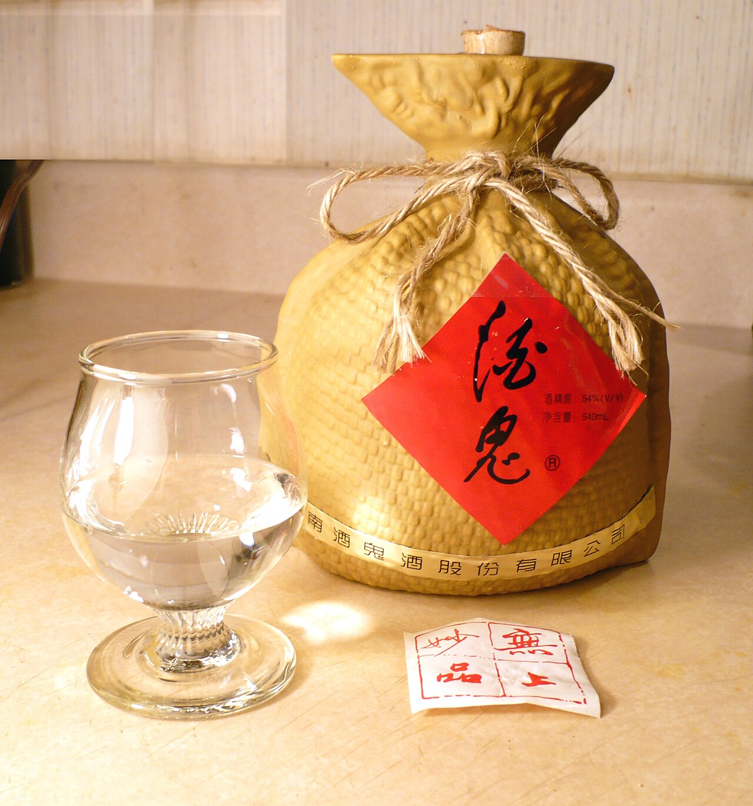

# Jiugui

Jiugui is one of the few Chinese baijiu brands that acquired an image before it acquired a category. Its sack-shaped bottle, red-paper label and "supreme fine product" seal are easier to remember than most baijiu packaging, while its fuyu aroma is hard to explain through strong, sauce or light aroma alone. The brand belongs to Jiugui Liquor Co., Ltd. and is made in Jishou, Xiangxi. Understanding it means looking at Huang Yongyu's design, the natural setting of western Hunan, and the plasticiser scandal of 2012 that still shadows the brand.

Figure: Jiugui. Image: Badagnani, CC BY 3.0, via Wikimedia Commons ([source page](https://commons.wikimedia.org/wiki/File:Jiugui.jpg)).

## Xiangxi and Jishou: origin before brand

Xiangxi is a mountainous prefecture in western Hunan. Jishou sits in a river valley of the Wuling range, with a humid climate and active microbial environment. The production base is in Jishou, and the company treats local water, climate and microbes as the external conditions for fuyu aroma. The origin story is not mere decoration: a multi-grain, multi-qu, long-fermentation process does depend on stable temperature and humidity and on pit microbiology.

## 1956: the Jishou distillery

The Jishou distillery was founded in 1956. It was one of the earlier workshop distilleries in Xiangxi and the industrial predecessor of Jiugui. In 1997 Jiugui Liquor Co., Ltd. listed on the Shenzhen Stock Exchange, and in 2016 the company became a member of the COFCO group. Keeping 1956, 1997 and 2016 apart makes the three stages visible: local workshop, listed company and central state-owned control.

## 1983: the Xiangquan ceramic bottle

In 1983, under Huang Yongyu's design, Xiangquan switched to an earth-brown fluted ceramic bottle. The choice was unusual at the time, when baijiu mostly used glass or clear bottles; Xiangquan used ceramic to stress earthiness and handwork. Xiangquan later became a mass-price product, but its ceramic bottle remains the starting point of the brand's visual history.

## 1987: the sack bottle and the name

In 1987 Huang Yongyu returned from Hong Kong to Fenghuang with a sack-shaped bottle design and wrote the two characters for "Jiugui". The sack bottle, red-paper label and seal together form the brand's visual identity and made Jiugui a representative case of ceramic and sack-shaped packaging. The design turned rusticity into wildness and converted the regional feeling of Xiangxi into a recognisable commercial language.

## Fuyu aroma: three aromas in one sip

Fuyu aroma is often summarised as strong at the front, light in the middle and sauce at the finish: the entry shows the pit and grain notes of strong aroma, the middle turns clean and fresh, and the tail carries the toasted, savoury length of sauce aroma. Technically it uses multiple grains, multiple qu types, long fermentation and long storage to generate several aroma layers within one pit system. Reading it as "strong aroma plus sauce aroma" is inaccurate: the aromas are formed during fermentation and distillation, not blended afterwards.

## The product ladder

Public product material lists Neican, Jiugui and Xiangquan. Neican targets the high end, Jiugui serves business and gifting, and Xiangquan reaches a broader consumer group. The three share a production system but differ in price band and channel. Neican is commonly 52% vol in 500 mL, while Jiugui and Xiangquan offer more strengths and volumes.

## Price bands and occasions

Xiangquan sits roughly at 50-150 yuan for everyday drinking and banquets; the main Jiugui range at 300-600 yuan for business and gifting; and Neican can reach 800-1200 yuan for high-end and collecting occasions. A price band is positioning, not a quality grade; a ceramic bottle or sack shape is not proof of quality either, and the liquid still has to be judged by ingredients, process, storage and label.

## Packaging and recognition

The sack bottle is Jiugui's strongest identifier and also its most imitated feature. Buyers should check the full producer name, anti-counterfeiting marks, batch and execution standard, especially for low-priced products in e-commerce and gift channels. Neican and Jiugui differ in bottle shape, colour and gift box, so the word "Jiugui" alone does not establish the tier.

## Channels and market

Jiugui is strongest in Hunan and expands into Guangdong, Shandong, Henan and Jiangsu through dealers, group purchases, e-commerce and gifting. Fuyu aroma is less widely understood than strong or sauce aroma, so the brand must keep explaining "three aromas in one sip". That is both a differentiation advantage and a cost in national expansion. Since 2024 the baijiu industry has entered an adjustment period, the upper-mid band has come under pressure, and Jiugui's growth rhythm has also been affected.

## Historical points

The Jishou distillery was founded in 1956. Xiangquan adopted its ceramic bottle in 1983. In 1987 Huang Yongyu designed the sack bottle and named the brand Jiugui. The company listed in Shenzhen in 1997 and became a COFCO member in 2016. In November 2012 media reported that 50-degree Jiugui contained 1.08 mg/kg of the plasticiser DBP, 260% above the standard; the company suspended trading, resumed it, apologised and then carried out rectification. That incident is one of the most serious quality crises in the brand's history.

## Honours and controversy

The company's public identity includes China Well-known Trademark and Hunan Famous Brand, and the sack bottle has often been discussed as a packaging case. Controversy has three strands. First, the 2012 plasticiser incident caused long-term damage to trust, even though later testing and rectification indicated that the relevant risk had been brought under control. Second, fuyu aroma carries high education costs and is easily mistaken for a marketing concept. Third, competition in the upper-mid band is intense, and Neican's high-end position requires continuous channel and brand investment.

## Reading a bottle

First identify the series: Neican, Jiugui or Xiangquan. Then check strength and volume. Next read ingredients and the execution standard to confirm a multi-grain fuyu-aroma spirit. Finally check producer, batch and anti-counterfeiting marks. The sack bottle is an identifier, not a grade; the same shape can hold different series at different prices.

## Common misconceptions

First, do not conflate the brand with the joint-stock company. Second, Jiugui is not a single product. Third, the sack-bottle design is not a general standard for modern packaging. Fourth, 1987 is not the year the company was founded. Fifth, fuyu aroma is not a simple blend of strong and sauce aroma.

Jiugui is best read by starting with the product line, moving to the producer named on the label, and ending with the market it is sold in.

[Jiugui Liquor Co., Ltd.](ref:producer) and [Qu making](ref:qu-making) are the nearest useful comparisons: one clarifies owning company, the other tests product lines.

## Further reading

- [Jiugui Liquor Co., Ltd.](ref:producer): the producer entry.
- [Baijiu](ref:baijiu): the category and basic process.
- [Qu making](ref:qu-making): the starting point of baijiu production.

Further reading: [Fu-aroma baijiu](ref:c-extra-1), [Absolut](ref:c-extra-2).
