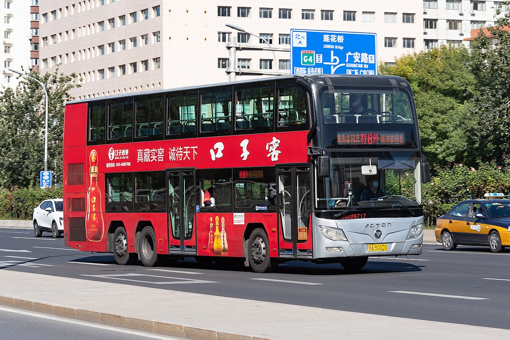

# Kouzijiao

Kouzijiao belongs to a very specific setting: the old town of Suixi on the Huaibei plain, where rivers and roads meet and where distillery workshops once lined the streets. The place gave the brand the word "kouzi", a local term for a junction or opening, while "jiao" refers to the fermentation pit. Together they point to origin and to pit fermentation at once. The brand is owned by Anhui Kouzi Distillery Co., Ltd. and is one of the clearest expressions of Jianxiang aroma in Chinese baijiu. The useful way to understand it is not to treat "Jianxiang" as strong aroma plus sauce aroma, but to look at how multiple qu types, multiple grains, long fermentation and long storage create two aromatic layers inside one pit system.

Figure: Kouzijiao. Image: N509FZ, CC BY-SA 4.0, via Wikimedia Commons ([source page](https://commons.wikimedia.org/wiki/File:30226717_at_Liuliqiaonan_(20201017130410).jpg)).

## Suixi: workshops before the brand

Suixi has a long brewing record, which local material traces back beyond the Spring and Autumn period. In 2018 the Ming-Qing distillery workshop complex at Suixi was excavated; public reports describe it as the largest excavated brewing site in China, with fermentation pits, distillation facilities and workshop layouts still legible. For the brand, the value of such archaeology is not a "year endorsement" but material evidence of continuity: the old pits and old workshops that Kouzijiao talks about sit in a real urban space.

## 1949: the state distillery

On 18 May 1949 the state-owned Suixi People's Distillery was established. It is the predecessor of Anhui Kouzi Distillery Co., Ltd. The company later went through restructuring, shareholding reform and brand consolidation, and gradually made Kouzijiao the main line. Treating 1949 as the start of the modern enterprise is more accurate than equating the length of local brewing culture with the age of the brand.

## Jianxiang: a category of its own

Jianxiang is not a cocktail of strong-aroma and sauce-aroma spirits. It builds on strong-aroma pit fermentation, continuous mash recycling and mixed steaming, while borrowing high-temperature qu making, stacking and multi-round fermentation from sauce-aroma practice. The result is often described as a strong-aroma opening with a sauce-aroma finish, or as a coordinated two-aroma profile. Kouzijiao's public process summary is "multiple qu types, multiple grains, long fermentation, long storage", which the company calls one-step Jianxiang. The company also hosts the secretariat of the Jianxiang-aroma subcommittee of the national baijiu standardisation technical committee, a role that makes it an organiser in category standards rather than only a seller.

## The product ladder

Public product material lists Kouzijiao, Lao Kouzi, Kouzifang and Kouzijiu. The Kouzijiao main line uses vintage numbers to mark tiers, with five-year, ten-year and twenty-year levels commonly seen; Lao Kouzi and Kouzifang serve banquets and everyday drinking, while Kouzijiu is closer to the entry level. Strength, volume and packaging differ considerably between series, so the bottle label, not the three characters "Kouzijiao", should decide what is inside.

## Price bands and occasions

Kouzijiu and Kouzifang mostly sit below 100 yuan, Lao Kouzi around 100-200 yuan, Kouzijiao Ten commonly at 300-400 yuan, Twenty at 600-800 yuan, and Thirty or higher products above 1000 yuan. The ladder is closely tied to banquet culture in Anhui, Jiangsu and Henan: the hundred-yuan tier is about value, the three-hundred tier about face, and the six-hundred-plus tier about gifting. Prices move with region and promotion and are not fixed list prices.

## Packaging and recognition

Kouzijiao bottles are relatively heavy, with deep red, gold and terracotta tones, and the vintage number sits at the visual centre; gift boxes emphasise pit storage and age. The design is easy to recognise on a banquet table and equally easy to imitate. Checking the producer, anti-counterfeiting code, batch and execution standard is more reliable than judging by bottle shape.

## Channels and market

The company is strongest in Anhui, especially Huaibei, Suzhou, Bozhou and Hefei, and reaches neighbouring markets in Jiangsu, Henan and Shandong. Distribution is mainly through dealers and terminal stores, supported by banquet policies, group purchases and festival promotions. Jianxiang aroma is well understood inside Anhui and needs more explanation outside it, which is the main friction in national expansion.

## Historical points

The state-owned Suixi People's Distillery was founded on 18 May 1949. On 29 June 2015 Anhui Kouzi Distillery Co., Ltd. listed on the Shanghai Stock Exchange, becoming the 17th listed baijiu company on the A-share market and the first listed Jianxiang-aroma baijiu company. In 2018 the Ming-Qing distillery workshop complex was excavated. In 2025 the Suixi distillery site entered an industry tourism destination list. A listing is a capital-market point and a site is a regional point; neither replaces the other.

## Honours and controversy

The company's public profile includes National Geographical Indication Protected Product, the Jianxiang-aroma subcommittee secretariat, and recent industry labels such as a leading high-end Jianxiang brand. Controversy has three main strands. First, vintage numbers are product names, and consumers may read them as the age of all base spirit in the bottle. Second, Jianxiang lacks the everyday recognition of strong or sauce aroma, so explanation costs are high. Third, competition within Anhui is intense, and channel inventory and price order come under periodic pressure.

## Reading a bottle

First identify the series: Kouzijiao, Lao Kouzi, Kouzifang or Kouzijiu. Then check the vintage number and strength. Next read ingredients and the execution standard to see whether it is a multi-grain Jianxiang spirit. Finally check producer and batch. A bottle that says only "Jianxiang" without a specific product name is giving incomplete information.

## Common misconceptions

First, do not conflate the brand with the joint-stock company. Second, Kouzijiao is not a single product. Third, Jianxiang is not a simple blend of strong and sauce aroma. Fourth, the length of Suixi's brewing tradition is not the history of the modern brand. Fifth, a vintage number is not an exact age statement for every drop.

To read Kouzijiao, start with the product line, then the producer named on the label, then the market it is sold in; no single check settles it.

[Anhui Kouzi Distillery Co., Ltd.](ref:producer)'s owning company and [Anhui](ref:anhui)'s product lines form a useful pair: the contrast shows where one ends and the other begins.

**Short definition:** A Jianxiang-aroma baijiu brand from Suixi, Huaibei, Anhui, known for a one-step Jianxiang process using multiple qu types and grains; the range covers the Kouzijiao vintage series, Lao Kouzi, Kouzifang and Kouzijiu, and the company listed in 2015.

**Key facts.**

| Item | Detail |
| --- | --- |
| In one line | A Jianxiang-aroma baijiu brand from Suixi, Huaibei, Anhui, known for a one-step Jianxiang process using multiple qu types and grains; the range covers the Kouzijiao vintage series, Lao Kouzi, Kouzifang and Kouzijiu, and … |
| Owner | Anhui Kouzi Distillery Co., Ltd. |
| Region | Anhui |
| Official site | kouzi.com |

**Sources and limits.** The key claims about Kouzijiao are checked against the following sources: Kouzi official website — company profile (the Jianxiang-aroma positioning, the Suixi brewing tradition and the state distillery starting point), Kouzi official website — congratulations on the successful A-share listing of Anhui Kouzi Distillery (the listing date, product series and the company's role in Jianxiang standardisation), Kouzi official website — brand origin (the Suixi brewing culture and brand points) and 4 sources in total. For current products, addresses or opening status, use kouzi.com. Prices, batches and status change; the body is project-written and does not reproduce source text.

## Further reading

- [Anhui Kouzi Distillery Co., Ltd.](ref:producer): the producer entry.
- [Baijiu](ref:baijiu): the category and basic process.
- [Anhui](ref:anhui): the Hui liquor region and the baijiu map.
- [Qu making](ref:qu-making): the starting point of baijiu production.

Further reading: [Mixed aroma baijiu](ref:c-extra-1).
