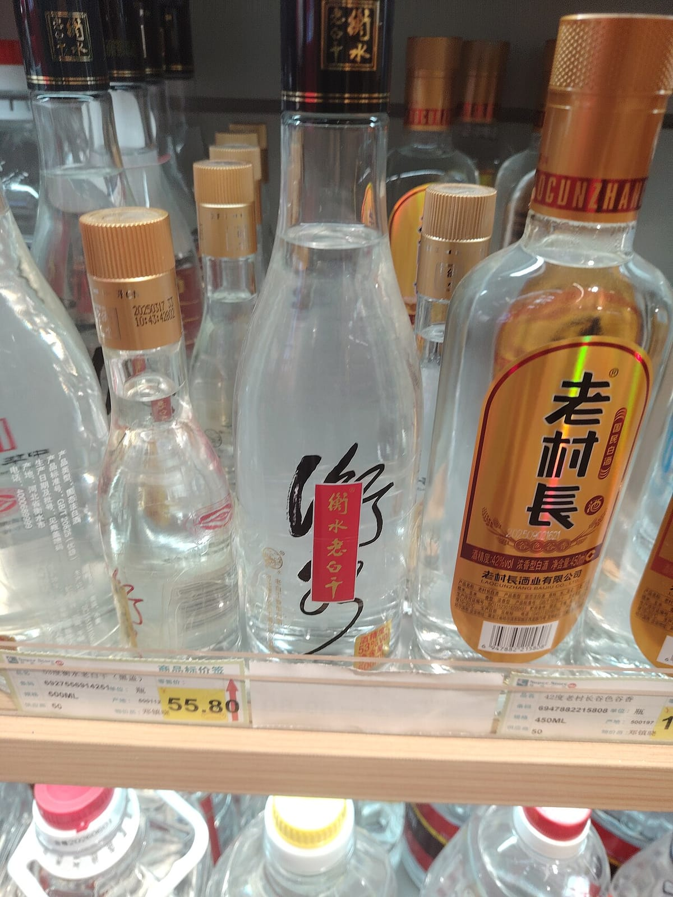

# Hengshui Laobaigan

Hengshui Laobaigan is a Laobaigan-aroma baijiu brand under [Hebei Hengshui Laobaigan Liquor Co., Ltd.](ref:producer). The company originates from the state-run Hengshui distillery formed in 1946 after the government took over 18 traditional private workshops, and listed on the Shanghai Stock Exchange in October 2002. The company also owns Bancheng Shaoguo, Wuling and Wenwang Gongjiu.

Figure: Hengshui Laobaigan. Image: Lhzss8, CC BY-SA 4.0, via Wikimedia Commons ([source page](https://commons.wikimedia.org/wiki/File:%E7%BB%8F%E5%85%B8%E8%A3%85%E8%A1%A1%E6%B0%B4%E8%80%81%E7%99%BD%E5%B9%B2.jpg)).

## Brand definition

A brand and a producer are two different entities. The brand answers "what is this bottle called and whom is it for"; the producer answers "who owns the trademark, who organises production and who bears legal responsibility". This brand records the brand layer: name, product line, positioning and marks; see the producer entry for corporate history.

For Hengshui Laobaigan, "Laobaigan" is at once an aroma-type name, a brand name and a product name. Aroma type is a classification of process and flavour, a brand is a market mark, and a product is a specific specification; the three are not interchangeable.

## Owning producer

The brand's producer is [Hebei Hengshui Laobaigan Liquor Co., Ltd.](ref:producer). The company originates from the state-run Hengshui distillery formed in 1946 and listed on the Shanghai Stock Exchange on 29 October 2002. Ownership of the brand and trademark, the organisation of production and disclosure rest with that company and its subsidiaries.

The producer entry records the formation, listing and multi-brand structure. This brand keeps only what relates directly to the brand, so corporate history and brand history are not conflated.

## Product line

The core brand is Hengshui Laobaigan, with public product material covering mass to mid-to-high price bands. Products differ by strength, volume and packaging, and some series serve banquets, business and gifting.

The company also owns Bancheng Shaoguo, Wuling and Wenwang Gongjiu, each in a different region and with a different aroma type and process. A multi-brand structure means one brand's flavour cannot describe the whole company's products.

Strength, volume, packaging and price change by year and channel. Buyers should check the brand, product name, strength, net content, ingredients, producer and standard on the label.

The three brands differ in geography and aroma: Bancheng Shaoguo comes from Chengde in Hebei, Wuling from Changde in Hunan on a sauce-aroma route, and Wenwang Gongjiu from Linquan in Anhui, mainly strong aroma. They entered the listed company through an alcohol-asset acquisition completed in 2018, so Hengshui Laobaigan is one arm of a group brand matrix, not the whole of it.

## Positioning and price band

The brand covers a band from mid-market to mid-to-high end: mass series serve everyday drinking and banquets, and higher series serve business and gifting. Prices change with year, channel and promotions, so this brand gives no specific retail price.

A price band is market positioning, not a quality grade. Judging the liquid means looking at raw materials, process, storage time and label information, not packaging or the aroma-type name alone.

## History

For Hengshui Laobaigan, in 1946 the government took over 18 traditional private workshops in Hengshui and formed the Ji'nan Administrative Office State-run Hengshui Distillery, the direct predecessor of the company. On 29 October 2002 Hebei Hengshui Laobaigan Liquor Co., Ltd. listed on the Shanghai Stock Exchange.

Company material traces brewing history back more than 1900 years and sums up the local tradition as rising in the Han, flourishing in the Tang and taking its name in the Ming. This belongs to regional and brand narrative and cannot convert the length of history directly into the founding year of the modern company.

In process terms, Laobaigan aroma uses sorghum and a medium-temperature daqu as the saccharifying and fermenting agent, ferments in earthen jars and steams and distils separately, with products made to GB/T 20825, Laobaigan aroma baijiu. The jars keep the grain from soil and separate steaming reduces off-notes; the route sits next to light aroma but shows a fuller aroma and a stronger body.

## Name and marks

"Laobaigan" was originally a colloquial term for a strong, dry baijiu and later became an aroma-type and brand name. "Hengshui" marks the origin, and the two form today's product name.

For Hengshui Laobaigan, trademarks, bottle shapes, colours and label layout belong to the brand's mark system, but counterfeit products can imitate the look. Buyers should check the producer, anti-counterfeiting marks, batch and official channel rather than bottle shape or dominant colour alone.

## Common misconceptions

First, conflating the brand with the joint-stock company. The brand is a market mark; the company is a legal entity.
Second, treating "Laobaigan" only as an aroma type. It is also a brand name and a product name.
Third, treating 1946 as the year the joint-stock company was founded. 1946 is the year the state-run distillery was formed.
Fourth, treating a brewing tradition of more than 1900 years as the length of the modern company's history. Regional tradition and corporate history are different scales.
Fifth, treating the group's multiple brands as one aroma type. Bancheng Shaoguo, Wuling and Wenwang Gongjiu differ in aroma type and region.

**Short definition:** A Laobaigan-aroma baijiu brand under Hebei Hengshui Laobaigan Liquor Co., Ltd.; the company originates from the state-run Hengshui distillery formed in 1946 and listed in 2002.

Begin with the product line, move on to the producer named on the label, and finish with the market it is sold in. That order keeps the reading of Hengshui Laobaigan practical.

[Hebei Hengshui Laobaigan Liquor Co., Ltd.](ref:producer) and [China](ref:china) are the two useful reference points for Hengshui Laobaigan. [Hebei Hengshui Laobaigan Liquor Co., Ltd.](ref:producer) sets out owning company; [China](ref:china) brings in product lines. Read them together.

Hengshui Laobaigan is a laobaigan-aroma baijiu from Hebei, made by ground-jar fermentation and separate steaming of grain and mash; the style is clean and mellow rather than strong-aroma.

The name laobaigan refers to the old white dry style, not to a single producer or a quality grade.

**Key facts.**

| Item | Detail |
| --- | --- |
| In one line | A Laobaigan-aroma baijiu brand under Hebei Hengshui Laobaigan Liquor Co., Ltd.; the company originates from the state-run Hengshui distillery formed in 1946 and listed in 2002. |
| Owner | Hebei Hengshui Laobaigan Liquor Co., Ltd. |
| Region | China |
| Official site | hengshuilaobaigan.net |

**Sources and limits.** The key claims about Hengshui Laobaigan are checked against the following sources: Hengshui Laobaigan official website — company profile (the 1946 state-run distillery and the 2002 listing), Laobaigan 2025 annual and 2026 first-quarter results briefing — company introduction (the brands and production base), Hengshui Laobaigan official website — industry summit: Laobaigan and the flowering of the greater light-aroma family (the claim of more than 1900 years of brewing history) and 4 sources in total. For current products, addresses or opening status, use hengshuilaobaigan.net. Prices, batches and status change; the body is project-written and does not reproduce source text.

## Further reading

- [Hebei Hengshui Laobaigan Liquor Co., Ltd.](ref:producer): the producer entry.
- [Baijiu](ref:baijiu): the category and basic process.
- [China](ref:china): the broad context of China's drinks map and regions.
- [Qu making](ref:qu-making): the starting point of baijiu production.
