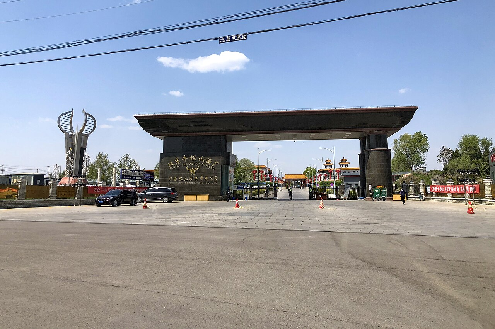

# Niulanshan

Niulanshan is the baijiu brand of [Beijing Shunxin Agriculture's Niulanshan Distillery](ref:producer), centred on er-guotou craft and the mass price band. Its lines span light-aroma er-guotou, strong-aroma Niulanshan Chenniang and Bainian Niulanshan, covering everyday spirits as well as banquet and gift products.

Figure: Niulanshan. Image: N509FZ, CC BY-SA 4.0, via Wikimedia Commons ([source page](https://commons.wikimedia.org/wiki/File:Niulanshan_Distillery_headquarters_(20200424130839).jpg)).

## Brand definition

Brand and producer are two entities. The brand answers "what is this bottle called and who is it for", while the producer answers "who owns the trademark, who organises production and who carries legal responsibility". This page records the brand layer: name, product lines, positioning and marks; company history and site are covered under the producer entry.

"Niulanshan" is both a place name and a brand name. The place refers to Niulanshan town in Shunyi district, Beijing, and the brand carries the local brewing tradition. Discussion should separate the "production-area place name" from the "registered trademark"; a place name is not a generic term that any company may use as a mark.

## Owning producer

The brand is operated by the [Niulanshan Distillery](ref:producer), a branch of Shunxin Agriculture whose predecessor was the state-run Niulanshan distillery founded in October 1952. In 1998 the parent, Beijing Shunxin Agriculture Co., Ltd., listed on the Shenzhen Stock Exchange.

Brand, distillery and listed company are three layers: the brand is a market mark, the distillery is the production subject, and the listed company is the capital and disclosure subject. A bottle label normally shows both brand and producer, so check the exact names and addresses.

## Product lines

The first line is er-guotou, a light-aroma route known for cleanliness, crispness and value for money, covering open-bottle spirits and several price points. The second is Niulanshan Chenniang, a [strong-aroma](ref:strong-aroma) route commonly 42% ABV in 500 mL, made to the solid-liquid baijiu standard and widely seen in mass catering.

The third line is banquet and gift series such as Bainian Niulanshan, with packaging and price bands above everyday spirits. Different lines have different aroma types, standards and raw-material structures, and one line cannot describe the whole brand.

There is also a price ladder between the lines: open-bottle spirits emphasise everyday drinking and catering distribution, while gift boxes emphasise banquets and gifting. A price band is a market position, not a quality league table.

## Positioning and price band

Niulanshan has long been known for the mass price band and wide distribution. Its core strengths are availability, stable supply and a familiar flavour. It does not sell on high-end scarcity but on "buyable every day, acceptable price, stable flavour", which produces scale.

This positioning has two consequences: broad product coverage, and clearly different prices across channels. When discussing price, establish whether it is a guide price, a supermarket price or a catering price; one figure cannot describe the national market.

Prices move with channel, region and supply and demand, and this page gives no figures. Treating sales volume as proof of quality, or a low price as low quality, are common misreadings; quality judgment should return to the label, the standard and the actual drink.

## History

Company material traces Niulanshan brewing back several hundred years and lists er-guotou craft as national intangible cultural heritage. The state-run Niulanshan distillery was founded in 1952 and is the direct starting point of the modern company.

After the parent listed in 1998, Niulanshan gradually expanded capacity and product lines into a structure centred on er-guotou with several aroma types in parallel. In the historical narrative, "several hundred years" refers to craft and place tradition, "1952" to the state-run distillery, and "1998" to the listing; the three time scales must not be mixed.

## Name and marks

"Niulanshan" as a trademark carries both place and brand meaning. The Niulanshan characters on the bottle, together with producer name, aroma type, strength, net volume and standard, are the basic identifiers. Each series also has its own sub-marks and packaging system.

Er-guotou is a craft name, not a brand name. Other companies may also make baijiu by er-guotou craft, so "er-guotou" does not equal "Niulanshan"; conversely, Niulanshan does not make only er-guotou.

## Relationships

The brand links down to the [producer](ref:producer), sideways to the aroma systems of [baijiu](ref:baijiu) and [strong-aroma baijiu](ref:strong-aroma), and to the product [Niulanshan Chenniang](ref:chenniang). These four relationships locate the brand within "company, aroma type and product".

Niulanshan is better understood through the erguotou process and a mass-market price position than through the single word “cheap”. The process discards the head and tail of the distillate and keeps the middle cut, producing a direct, clean profile. The brand belongs to the Shunxin agriculture group and includes both light-aroma erguotou and strong-aroma aged products. A low price does not mean that every bottle shares one process or one grade. Erguotou is a process route, while Niulanshan Chennian is a strong-aroma product; their raw materials, qu and fermentation cycles are not the same. A brand name should not be used as a stand-in for aroma type or grade.

For Niulanshan, begin with the product line. Then look at the producer named on the label, and finally ask the market it is sold in. The answers point to different choices, not to a single score.

**In brief:** A baijiu brand of Beijing Shunxin Agriculture's Niulanshan Distillery, centred on er-guotou craft and the mass price band, with lines spanning light-aroma er-guotou, strong-aroma Niulanshan Chenniang and Bainian Niulanshan.

A common misreading treats Niulanshan as one specific bottle. The correction is to ask which company owns it, then which product lines it covers, and keep the answers apart.

Niulanshan is known for er-guotou, a light-aroma baijiu distilled from sorghum and made in Shunyi, Beijing.

**Key facts.**

| Item | Detail |
| --- | --- |
| In one line | A baijiu brand of Beijing Shunxin Agriculture's Niulanshan Distillery, centred on er-guotou craft and the mass price band, with lines spanning light-aroma er-guotou, strong-aroma Niulanshan Chenniang and Bainian Niulansh… |
| Owner | Beijing Shunxin Agriculture Niulanshan Distillery |
| Region | China |

**Sources and limits.** The key claims about Niulanshan are checked against the following sources: Industry body (the founding date, time-honoured brand, well-known trademark and intangible heritage information; er-guotou craft and product positioning). Prices, batches and status change; the body is project-written and does not reproduce source text.

**Read alongside.** Put Niulanshan next to Beijing Shunxin Agriculture Niulanshan Distillery, Baijiu, Strong-aroma baijiu: the first fixes identity and boundary, the others provide a region, process or peer comparison. Read this page first, then return to those entries; the links become coordinates, not decoration.

## Further reading

- [Beijing Shunxin Agriculture Niulanshan Distillery](ref:producer): company history, site and craft tradition.
- [Baijiu](ref:baijiu): the broad category and aroma types.
- [Strong-aroma baijiu](ref:strong-aroma): the aroma route of Niulanshan Chenniang.
- [Niulanshan Chenniang](ref:chenniang): specification, standard and flavour.
