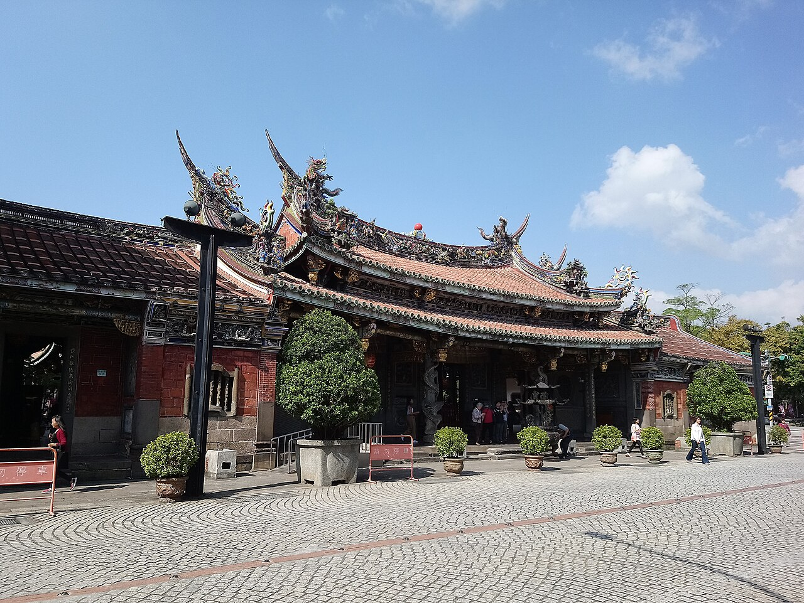

# Taipai

Taipai is one of the few Shaoxing [huangjiu](ref:yellow-wine) brands to turn "handmade winter brewing" into a product name. It does not rely on a single blockbuster; instead it uses three lines, handmade, aged and export, to split one regional identity into different price levels and occasions. Understanding Taipai is less about company scale than about how the brand translates craft language into labels consumers remember.

Figure: Taipai. Image: 寺人孟子, CC BY-SA 4.0, via Wikimedia Commons ([source page](https://commons.wikimedia.org/wiki/File:%E5%A4%A7%E9%BE%8D%E5%B3%92%E4%BF%9D%E5%AE%89%E5%AE%AE%E4%B8%89%E5%B7%9D%E6%AE%BF.jpg)).

## Brand definition

A brand answers what it is called, whom it sells to and why it is remembered, not who owns it or how much it can produce. Taipai is held and operated by [Zhejiang Taipai Shaoxing Rice Wine Co., Ltd.](ref:producer); the trademark, product lines and packaging system are managed by the brand owner, and production takes place at the company's site in Shaoxing.

Taipai, "Taipai Shaoxing wine" and "Taipai Handmade Winter Brew" are not the same layer. The first is a brand, the others are product names or specific bottles. Questions about price, age or taste need a named product first; otherwise the flavour of a gift box is easily applied to an everyday bottle.

## Origin and brand association

Much of a Shaoxing wine brand's value comes from its origin. The Jian Lake water system, low winter temperatures, glutinous rice and wheat qu together form the consumer image of "Shaoxing huangjiu". Taipai places the regional name prominently on packaging to borrow that collective recognition.

Origin association is an asset and a constraint. A product labelled Shaoxing wine must meet the geographical indication's requirements on area, raw materials and process; the brand cannot treat origin as pure marketing, nor describe non-Shaoxing production as "Shaoxing style". Origin and standard on the label are the evidence for checking such claims.

## Turning handmade winter brewing into a product

"Handmade winter brewing" began as a process description: fermenting in vats at low winter temperatures, stirring by hand to regulate heat and oxygen, then pressing, boiling, jarring and ageing. Taipai distilled it into a product name so consumers could grasp a difference without knowing the process.

[Taipai Handmade Winter Brew](ref:drink) represents this line. It stresses season, handwork and time cost, and is priced above ordinary mechanised wine. But "handmade" describes a way of working, not a legal grade; handmade wines still differ in raw materials, fermentation control and ageing, and cannot be lumped together.

## The aged series

The aged series is graded by time in storage and covers the upper-middle price bands. The age figure usually refers to the base wine's storage or the minimum age stated for the product, a definition set by the company's product notes; it does not mean every drop in the bottle reaches that age.

Longer ageing usually gives a fuller body and deeper colour, but storage conditions and blending proportions also shape style. Treating age as the only standard ignores raw material and craft; treating age as investment value misreads huangjiu, which is a drink rather than an endlessly appreciating collectible.

## Export and packaging

Export is an important part of the Taipai label. Shaoxing wine has steady demand in overseas Chinese markets and Asian restaurant channels, and export products must meet destination-market rules on labelling, additives and strength declarations, so the same wine may carry different packaging and labels in different markets.

Export series often use smaller formats, more prominent English lettering and gift boxes, and cost more than domestic versions of the same size. A shopper buying an "export version" at home should check producer, importer and label language, and not mistake a packaging difference for a quality difference.

## Price bands

Taipai spans from everyday drinking to premium gifting: ordinary bottles serve the family table, aged wine serves banquets, and handmade winter brew and gift boxes serve presents. The ladder is clear, but several series can sit at one price, so bottles need individual comparison.

A price band is market positioning, not a quality grade. A high price may come from age, packaging or channel, and a low price may reflect promotion or a simple pack. Value for money depends on volume, age, sugar type and standard, not the number alone.

## Packaging and gifting

Huangjiu is a strong gifting category, and Taipai invests in packaging: clay jars, porcelain bottles, wooden boxes and carriers visualise "Shaoxing", "tradition" and "handmade". Gift boxes usually cost more than a simple pack of the same size, and the difference comes from packaging and channel rather than necessarily from the liquid.

Packaging is part of brand identity and a weak point in anti-counterfeiting. Counterfeit Taipai packaging exists, so buyers should check anti-counterfeit marks, producer and batch rather than bottle shape and colour alone.

## Honours and the heritage narrative

The official site and public material stress the handmade winter brewing technique and intangible-cultural-heritage workshop status. That narrative adds cultural depth, but heritage designation applies to a craft and its transmission, not to the quality grade of a particular product.

Honours need a subject: a title won by the region, a designation given to the company, or an award given to a product. Merging all three into "national quality" strips the information of checkability. Consumers can treat it as cultural background, but it cannot replace judgment about a specific bottle.

## Drinking occasions

Taipai covers home drinking, small gatherings, festive gifting and restaurant channels. Everyday bottles suit warming and home cooking, aged wine suits banquets and slow drinking, and handmade winter brew and gift boxes suit presents and festivals.

How huangjiu is served shapes the experience: warming brings out aroma and sweetness, while chilling suits fresher styles. Judging every series by one serving method produces shallow conclusions. The serving suggestion on the pack is more useful than a generic guide.

## Position in the competitive landscape

Shaoxing has many huangjiu brands; Taipai shares a production area, a geographical indication and a craft tradition with firms such as Guyuelongshan and Kuaijishan, while differing in product structure, channels and price bands. Taipai's edge lies in the recognisability of handmade winter brewing and its export channels.

Competition is not only between brands but between categories. Huangjiu competes with baijiu, beer and low-alcohol drinks for occasions, and younger consumers still see it as traditional. Whether Taipai's handmade story can become a daily choice for a new generation is the brand's long-term question.

## Consumer perception and misconceptions

First, treating "handmade winter brewing" as a quality grade. It describes a way of working and a seasonal schedule.
Second, treating the age figure as the age of every drop. Use the product notes.
Third, treating export versions as higher quality. Markets and packaging differ; the liquid may be the same.
Fourth, treating heritage status as product certification. It applies to craft and transmission.
Fifth, treating the Shaoxing geographical indication as a quality ranking. It fixes area and process requirements.
Sixth, judging authenticity by price or packaging. Channel, anti-counterfeit marks and labels are more reliable.

## Division of labour with the producer page

The brand page asks which bottle to buy, for what occasion and at roughly what price; the [producer page](ref:producer) asks who holds the trademark, where the plant is and how capacity and exports are organised. Both say "Taipai", but one faces shopping and the other corporate verification. Putting equity and capacity on the brand page, or flavour on the company page, makes readers look in the wrong place.

## Further reading

- [Zhejiang Taipai Shaoxing Rice Wine Co., Ltd.](ref:producer): company information, production area and craft features.
- [Taipai Handmade Winter Brew](ref:drink): specification, process and flavour.
- [Huangjiu](ref:yellow-wine): the broad category, classification and basic process.
- [Qu making](ref:qu-making): the role of wheat qu and wine starter.
- [China](ref:china): the Chinese drinks map and how production areas are organised.
