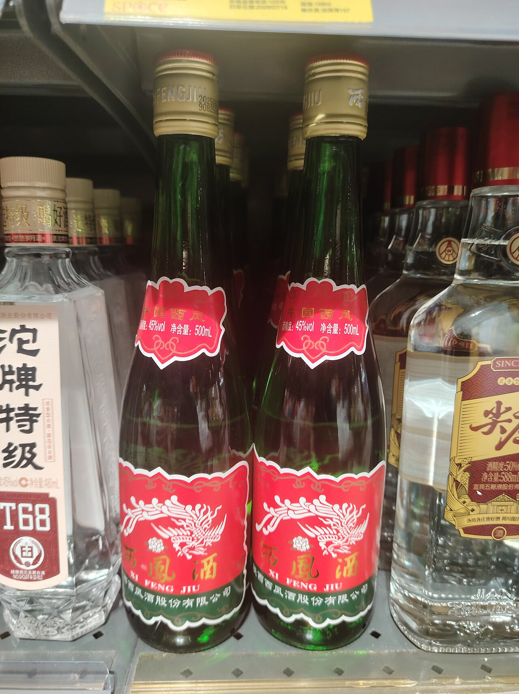

# Xifengjiu

Xifengjiu's recognition rests on two words: feng aroma and jiuhai. The first says it belongs to none of the light, strong or sauce aroma categories; the second says it uses a distinctive vessel for storage. The brand turns these craft concepts into product names and packaging language, then uses series such as Hong Xifeng and the old green bottle to cover different price levels. Reading Xifeng means separating aroma identity from product tier.

Figure: Xifengjiu. Image: Lhzss8, CC BY-SA 4.0, via Wikimedia Commons ([source page](https://commons.wikimedia.org/wiki/File:%E5%B0%8F%E7%93%B6%E8%A3%85%E8%A5%BF%E5%87%A4%E9%85%92.jpg)).

## Brand identity

Xifengjiu is a feng-aroma [baijiu](ref:baijiu), and its trademark and product system are held by [Shaanxi Xifeng Liquor Group Co., Ltd.](ref:producer). The brand name is not the same as "Xifeng Group" or "Xifeng joint-stock company", and a question about price or collecting value needs a specific series and strength first.

Recognising Xifeng needs three things: the trademark, the series name and the strength. The official product centre lists many series, named after colours, age concepts, cultural themes and storage concepts, so the word "Xifeng" alone cannot establish a tier.

## What feng aroma is

Feng aroma uses sorghum as raw material, barley, wheat and peas for qu, solid-state fermentation in earthen cellars, [qu making](ref:qu-making), fractional distillation and then jiuhai storage and blending. It is often described as "clean but not thin, rich but not heavy", sitting between light and strong aroma.

But feng aroma is not a simple blend of light and strong; it is a type formed by its own process. Reading it as a "middle flavour created by blending" ignores the combined effect of earthen cellars, qu proportions and jiuhai storage. An aroma type is a process outcome, not a marketing label.

## Origin and the brand name

Xifengjiu comes from Fengxiang in western Guanzhong, Shaanxi, now part of Baoji's Fengxiang district. The area has a warm temperate continental monsoon climate, four clear seasons, concentrated rain and relatively dry air, which helps qu making and storage. Local sorghum, water and cellar conditions form the base of the feng style.

"Xifeng" is shortened from "Xifu Fengxiang". Fengxiang is a historical place name and one source of the feng-aroma name. The brand name carries an origin association, but origin is not a quality guarantee; firms and batches within one area still differ.

## Hong Xifeng

Hong Xifeng was launched in 2019 as the core product for premiumisation and national expansion. Red packaging and the character "hong" reinforce recognition, its price sits at the top of the brand ladder, and it carries business banquets and high-end gifting.

A premium product's value combines brand, liquid and occasion. Hong Xifeng carries a visible brand premium, so buyers should separate occasion value from drinking value: the first comes from face and gifting, the second from the wine. Mixing them leads to over- or under-rating a bottle.

## Zhencang and Jiuhai Chencang

Zhencang is positioned upper-mid and Jiuhai Chencang mid, and both use the words "chen" and "cang" to build a sense of time. They cost less than Hong Xifeng and more than the old green bottle, and they are the brand's mainstay for banquets and business occasions.

"Chencang" describes a storage method and a time concept; it does not mean every drop in the bottle reaches a given age. Base-liquor composition and blending ratios should be read from the product notes and label. Treating a series name as an age guarantee is the most common misreading in this price band.

## The old green bottle

The old green bottle is Xifeng's mass-market liquor, with a green glass bottle and a simple label that create strong visual memory. Its price is accessible and its taste stable, serving everyday drinking and popular restaurants, and it is where many consumers first meet Xifeng.

The "old" refers to packaging continuity and market memory, not an age statement. Its success shows that a brand image need not be built only on premium products; but the brand must keep balancing mass volume against premium image.

## Cultural collaboration series

Huashan Lun Jian and Guohua Ci are cultural collaborations, the first borrowing wuxia culture and the second porcelain and national-flower imagery. They target gifting and collecting, invest heavily in packaging design and cost more than regular products of the same size.

Collaborations create topics and reasons to give gifts; they do not change the liquid. Buyers should separate a collaboration premium from a quality premium: the first comes from design and cultural theme, the second from fruit and craft. Treating a collaboration as a quality grade is the easiest misreading in a marketing context.

## Jiuhai and the storage narrative

"Jiuhai" means a large storage vessel woven from strips and lined inside, a storage feature of the feng-aroma process. The vessel is breathable, and the liquor slowly oxidises and esterifies inside, developing a flavour different from clay jars or stainless steel.

Jiuhai is a vessel, not packaging gimmickry and not proof of age. Some products use "Jiuhai Jiaoling" in their names, combining vessel and time concepts; consumers should read the base-liquor composition in the product notes rather than the series name alone.

## Price bands

Xifengjiu runs from the old green bottle in the tens of yuan to Hong Xifeng above a thousand yuan. Hong Xifeng carries the premium image, Zhencang and Jiuhai Chencang cover the upper-mid and mid bands, the old green bottle holds the mass price, and cultural collaborations fill gifting and collecting.

For Xifengjiu, the wider the ladder, the harder brand management becomes. Premium products need a scarcity story, mass products need distribution and value for money, and the marketing languages do not match. Consumers should read price as a positioning signal, not a quality grade.

## Packaging and visual identity

Xifeng's packaging divides clearly by colour: Hong Xifeng uses red, the old green bottle uses green, Guohua Ci uses porcelain texture, and Huashan Lun Jian uses a wuxia theme. Colour and material help consumers locate a product quickly, but are also easy for counterfeiters to imitate.

Wording such as "Zhencang", "Chencang" and "Jiaoling" belongs to brand narrative, not legal grades. Judging a product means checking producer, strength, net content and standard, which are harder to fake than graphics.

## Honours and the famous-liquor narrative

Public material often lists Xifeng among the famous liquors of the first national evaluation in 1952. Such historical honours build trust, but they result from long accumulation by the region and the company; they do not mean every product meets the same standard.

Company awards, aroma-type recognition and product medals are three different kinds of honour. A question about "what Xifeng has won" should specify the brand, the company or a particular product, along with the organiser and year. Merging all three into "national famous liquor" strips the information of its checkability.

## Consumer perception and misconceptions

First, conflating the brand with the joint-stock company. The brand is a market mark; the company is a legal entity.
Second, treating feng aroma as a blend of light and strong aroma. It is a type formed by its own process.
Third, treating "jiuhai" as a packaging concept. It is a vessel that takes part in storage.
Fourth, treating year numbers in series names as the age in the bottle. Use the label explanation.
Fifth, treating a cultural collaboration as a quality grade. It only states a design theme.
Sixth, treating price as a quality grade. Price is market positioning.

## Division of labour with the producer page

The brand page asks which bottle to buy, for what occasion and at what price; the [producer page](ref:producer) asks who owns the company, how restructuring and equity work and where the plant is. Both say "Xifeng", but one faces shopping and the other corporate verification. Putting equity and capacity on the brand page, or flavour on the company page, makes readers look in the wrong place.

## Further reading

- [Shaanxi Xifeng Liquor Group Co., Ltd.](ref:producer): the producer entry.
- [Xifengjiu](ref:xifeng-drink) and [Hong Xifeng](ref:hongxifeng): product entries.
- [Baijiu](ref:baijiu): the category and aroma-type system.
- [Qu making](ref:qu-making): the starting step of the feng-aroma process.
