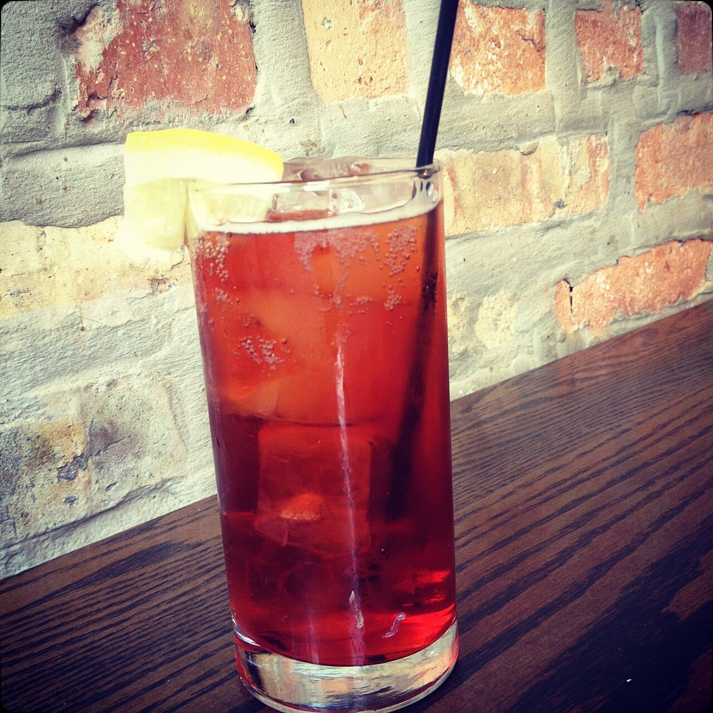

# Americano

The Americano is a low-alcohol bitter aperitif: Campari, sweet vermouth and soda water, built on ice in a rocks glass and garnished with an orange slice. It is bright ruby in colour, fine in bubbles, bitter first and sweet after, with a long finish of herbs and citrus.

The name invites misunderstanding. It is not called Americano because Americans love it, but because American travellers and journalists in nineteenth-century Milan drank it, and the locals gave the drink their nickname. The name is a label; the formula is Italian.

Figure: An americano made with Campari, sweet vermouth and soda water. Image: Conrad and Peter, CC BY 2.0, via Wikimedia Commons ([source page](https://commons.wikimedia.org/wiki/File:Americano_cocktail_at_Nightwood_Restaurant.jpg)).

## Bitter, sweet and bubbles

Campari supplies bitterness and colour, sweet vermouth supplies sweetness, body and herbal aroma, and soda supplies bubbles and dilution. None can be removed: without Campari the drink becomes sweet water; without vermouth the bitterness is hard; without soda it is too strong and syrupy.

The structure resembles the negroni but is lighter. The negroni replaces soda with gin, raising alcohol and thickening the body; the Americano uses bubbles to stretch the bitterness, which makes it a good pre-dinner drink and a good drink for a long conversation. It is a drink for two glasses, not one that ends the evening.

## The formula: Campari and sweet vermouth

The IBA standard is 30 millilitres of Campari, 30 millilitres of sweet vermouth and soda water to taste. Equal parts keep bitter and sweet symmetrical; for a bitter drink, raise Campari to 40 millilitres; for a sweeter one, raise the vermouth.

The vermouth matters greatly. Italian sweet vermouths such as Cinzano or Martini Rosso are sweeter and more vanilla; French sweet vermouths are drier and more herbal. Campari's bitterness comes from orange peel, rhubarb, ginseng and other botanicals, and the vermouth can either echo or contrast with them.

Soda must be cold and fresh. Bubbles are the skeleton of the drink, and flat soda makes it dull. Do not substitute tonic water: its quinine bitterness stacks on Campari and makes the drink harsh. Cola is worse, since its sugar and caramel bury the herbs.

## Method: build in the glass

Fill a highball or rocks glass with ice, pour in the Campari and vermouth and stir gently to chill and slightly dilute. Then pour soda down the side of the glass and stir once to combine. Do not shake hard or the bubbles will disappear.

An orange slice is the standard garnish. Place it on the rim or in the glass and press it gently to release the oil; do not squeeze the juice, which would add acidity and break the bitter-sweet balance. An orange twist also works and adds aroma. The garnish is not decoration: it supplies the citrus top note the drink otherwise lacks.

Use a rocks glass for weight and stability, or a highball for longer bubble life. Ice should be large and hard so it melts slowly and the drink does not become water in ten minutes. Chill the glass first.

## Milan and the prehistory of the negroni

The Americano is usually traced to 1860s Milan and Gaspare Campari, who created it at his bar. It was first called Milano-Torino, because Campari came from Milan and the sweet vermouth from Turin. American visitors took to it, and the name gradually became Americano.

In 1919, Count Camillo Negroni in Florence asked a bartender to replace the soda in his Americano with gin, and the negroni was born. The story is widely repeated and historians dispute details, but the idea that the Americano is the negroni's predecessor has become standard cocktail history.

The drink is inseparable from Italian aperitivo culture. A bitter, low-alcohol drink before dinner stimulates appetite without intoxication. The habit spread globally, and the Americano became the entry point to bitter cocktails.

## Variations and common mistakes

Common variations include the Americano Perfecto, with a dash of orange bitters; the Americano con Gin, essentially a lighter negroni; the Americano Sour, with lemon and sugar for a bitter-sour structure; and the Milano-Torino, with a different vermouth ratio that emphasises the two cities.

Four mistakes recur. First, soda that is not cold enough, so bubbles vanish. Second, an unbalanced Campari-to-vermouth ratio, too bitter or too sweet. Third, small ice that melts too fast and dilutes the drink. Fourth, squeezing the orange slice, whose acidity breaks the balance. The Americano looks simple but is sensitive to temperature and proportion.

For a home bartender: chill the glass and soda, use large hard ice, mix the two liquors first and add bubbles last, and press the orange slice without squeezing. The target is clean bitterness, not aggressive bitterness.

Americanos also vary by city: Milan leans on Campari, Turin on vermouth, Rome on more soda. At a bar you can ask for it bitter or sweet and the ratio will be adjusted; at home, start equal and tune to your own taste. The glass matters too: a highball gives the bubbles room, while a coupe concentrates the bitterness.

## See also and references

- Negroni: see [negroni](ref:negroni).
- Boulevardier: see [boulevardier](ref:boulevardier).
- Vermouth: see [vermouth](ref:vermouth).
- Rocks glass: see [rocks glass](ref:rocks).
- Stirring: see [stirring](ref:stirring).

**Short definition:** A low-alcohol aperitif of Campari, sweet vermouth and soda water, dating to 1860s Milan. The balance of bitter, sweet and bubbles makes it the direct predecessor of the negroni.

Start with the base and the ratio. From there, consider the dilution and the ice, then the garnish and the glass. That is how a practical judgment about Americano is built.

Put [Negroni](ref:negroni)'s base liquor next to [Vermouth](ref:vermouth)'s technique and ratio; the difference marks the boundary.

A common misreading treats Americano as a base-liquor brand. The correction is to ask which base liquor it uses, then which ratio and technique it needs, and keep the answers apart.

Sources for Americano include International Bartenders Association, Oxford University Press, CocktailDB, Make Me a Cocktail.

Equal parts Campari and sweet vermouth, topped with soda; the classic ratio is 1:1:1.

**Key facts.**

| Item | Detail |
| --- | --- |
| In one line | A low-alcohol aperitif of Campari, sweet vermouth and soda water, dating to 1860s Milan. The balance of bitter, sweet and bubbles makes it the direct predecessor of the negroni. |
| Style | IBA Unforgettables |
| Origin | Milan, Italy |

**Sources and limits.** The key claims about Americano are checked against the following sources: International Bartenders Association (Used to check the IBA category, ingredients and ratio), Oxford University Press (Used to check cocktail history and terminology), CocktailDB (Used to cross-check recipe structure and common variations) and 5 sources in total. Prices, batches and status change; the body is project-written and does not reproduce source text.

For Americano, this cocktail was last checked in 2026; prices, batches and availability change, so confirm them against the sources below.
