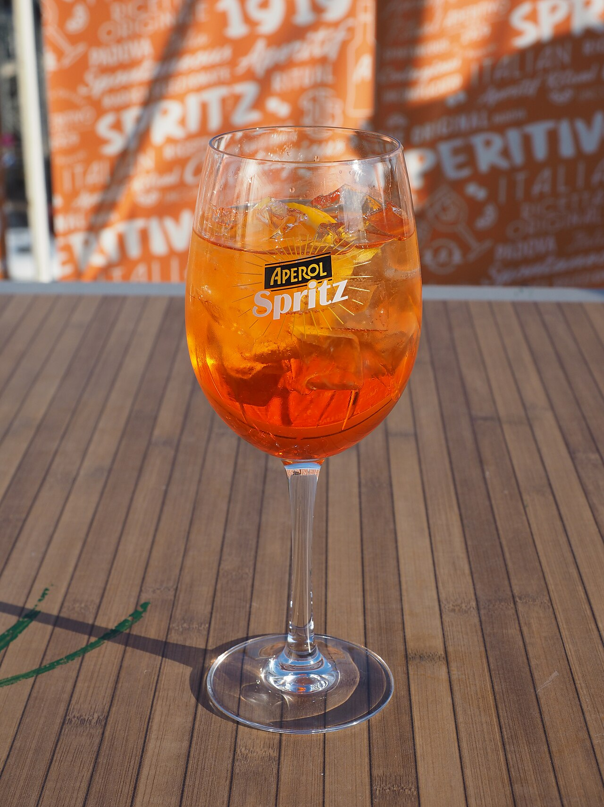

# Aperol Spritz

The Aperol Spritz is a low-alcohol aperitif made from Aperol, Prosecco and soda water. It is usually built over plenty of ice in a large wine glass or rocks glass, using the familiar three-two-one ratio, and finished with a slice of orange. Orange peel, a noticeable sweetness and a steady stream of bubbles define the drink, which is bright orange-red in the glass.

Figure: Aperol Spritz. Image: JIP, CC BY-SA 4.0, via Wikimedia Commons ([source page](https://commons.wikimedia.org/wiki/File:Aperol_Spritz_aboard_Viking_Mariella.jpg)).

## Origin and naming

The word "Spritz" is tied to drinking habits in north-eastern Italy, especially the aperitif culture of the Veneto. The widely told story traces the practice of diluting bitter liqueurs or wine with sparkling water to the period of Austro-Hungarian influence in northern Italy, but the exact date, place and route of transmission are not fully documented. It is better to present the story as widely told than to treat one year as settled fact.

Aperol itself is an Italian bitter aperitif, and the brand gradually established a style built around orange, gentle bitterness and relatively low alcohol during the twentieth century. The brand's official material presents the Aperol Spritz as a core way to drink Aperol, but marketing material and historical research are different kinds of evidence. The first explains how a brand wants its product consumed; the second examines how the drink developed within a wider drinking history.

"Spritz" does not mean Aperol. Italian Spritzes can be made with different bitter liqueurs, different sparkling wines or even still white wine. The Aperol Spritz is simply the best-known branch. Treating "Spritz" as a synonym for "Aperol" creates confusion when ordering and when discussing recipes. A more accurate description is a Spritz built on Aperol and a sparkling-wine structure.

## Recipe structure

A common formula is 90 ml Prosecco, 60 ml Aperol and 30 ml soda water, which is three parts to two parts to one. The ratio is easy to remember and easy to scale up or down with the glass. Prosecco supplies bubbles, acidity and a light body; Aperol supplies orange, bitterness and sweetness; soda water lengthens the drink and lowers the overall concentration. The order of assembly does not change the basic structure, but it does affect how well the bubbles survive and how evenly the drink mixes.

Prosecco is not the only option. Other dry sparkling wines can replace it, but their sweetness, acidity and bubble strength will change the result. A sweeter sparkling wine makes the whole drink sweeter, while a weakly sparkling wine makes the texture feel flat. Soda water should not be replaced by still mineral water, because the lack of carbonation removes the refreshing signature of a Spritz. Tonic water adds quinine bitterness and pushes the drink into a different style.

The amount of Aperol sets the bitter-sweet direction. Aperol contains sugar, so a higher proportion makes the drink denser and sweeter while also making the bitterness more prominent; a lower proportion makes it closer to a glass of sparkling wine. The soda water seems minor, but it controls dilution and how long the bubbles last. A glass full of ice dilutes further, so a recipe should state the glass type and ice volume, not only three numbers.

## Flavour and balance

The first impression is orange peel and sweetness, followed by a mild bitterness and herbal notes, with bubbles lifting the aroma. The drink does not rely on alcoholic strength; it creates an appetite through bitterness, sweetness, carbonation and low temperature. The central balance is the ratio between Aperol and sparkling wine. Too much Aperol makes the drink syrupy and lets bitterness overwhelm the bubbles; too much Prosecco makes the orange fade and turns the glass into ordinary sparkling wine.

Temperature matters a great deal. If the ingredients are not cold and there is little ice, the bubbles disappear quickly and the sweetness feels sticky. If there is too much ice, the second half of the glass becomes pale, watery orange. The ideal is pre-chilled ingredients, enough ice but not a mound of it, and drinking soon after mixing. The orange slice is not only decoration: squeezing the peel adds aroma, but pressing the flesh too hard can release excess bitterness.

Low alcohol is an important feature, but "low" does not mean "none". The alcohol in one glass depends on the Aperol-to-Prosecco ratio and the glass size, and several glasses add up to a meaningful total. Treating the drink as something that can be refilled indefinitely makes it easy to ignore that accumulation. Sipping slowly with food and water is closer to the purpose of an aperitif than drinking quickly.

## Method

The usual method is to build the drink directly. Chill the glass and the ingredients, fill the glass with ice, add the Aperol, then the Prosecco, and finally the soda water. Lift the mixture once or twice with a bar spoon or a long stirrer so that the colour and bubbles are even. Do not shake; shaking drives off carbonation. Do not over-stir either, because bubbles are part of the structure.

Large wine glasses, rocks glasses or larger highball glasses are common. A wider rim helps the aroma spread. Use a fresh orange, cut a reasonably thick slice and squeeze the peel over the surface. Pre-chilling the glass is useful, but an aggressively frozen glass can temporarily mute the aroma. Use clean, hard ice that melts slowly; crushed ice dilutes the drink too quickly.

At home, measure the three parts first and then adjust to the glass. If Prosecco is unavailable, another dry sparkling wine can work, but try a small glass first to check its sweetness and bubble strength. To reduce sweetness, use less Aperol or a drier sparkling wine. To increase bitterness, a small addition of another bitter liqueur is possible, but that already moves away from the standard formula.

## Variations

Replacing Aperol with Campari gives a Campari Spritz, with stronger bitterness and a deeper colour. Replacing it with another Italian bitter such as Select creates a regional Spritz with its own character. Some versions use still white wine for part of the sparkling wine, giving a lighter body and fewer bubbles; tonic water in place of soda adds quinine bitterness. A frozen, blended version turns the drink into a slushy.

A variation should state what was replaced. Calling a Campari drink an "Aperol Spritz" suggests that the formula has not changed. Adjustments in sweetness and bitterness should also appear in the name or description, such as "less Aperol" or "dry sparkling wine version". Only when the variables are clear does a comparison between versions mean anything.

## How to order and drink

Start with the base and the ratio. From there, consider the dilution and the ice, then the garnish and the glass. That is how a practical judgment about Aperol Spritz is built.

The drink suits aperitif service with salted nuts, olives, crisps, hard cheese and light food. Sweet-bitter notes set off salt, and the bubbles refresh the palate. Sip slowly and avoid drinking quickly on an empty stomach; do not drink and drive, and avoid alcohol during pregnancy or while taking medication that interacts with it. As a low-alcohol drink it fits a long meal, but the total intake still counts.

In Italian bars, a Spritz often arrives with a small bowl of crisps or olives, meant to keep the guest company while waiting for dinner. For a home gathering, chill the ingredients in advance but do not mix the Aperol and sparkling wine too far ahead, or the bubbles will fade. Pour along the inside of the glass to reduce foam and to keep the layers clear.

## Common misconceptions

First, that the Aperol Spritz is an orange soft drink. It contains alcohol, bitterness and herbal depth. Second, that only Prosecco is authentic. Other dry sparkling wines can produce the same family of drink with a different flavour. Third, that more Aperol is more "authentic". The ratio is a style choice, and too much Aperol buries the bubbles. Fourth, that the drink should be shaken or vigorously stirred. That costs carbonation and flattens the texture. Fifth, that low alcohol means unlimited drinking. Total alcohol intake still depends on the number of glasses and the ratio.

## See also

- [Aperitif](ref:aperitif): the function of pre-dinner drinking and the role of bitter drinks.
- [Sparkling wine](ref:sparkling): the structural differences between Prosecco and other sparkling wines.
- [Veneto](ref:veneto): the Italian regional background of Spritz drinking habits.
- [Choosing a glass](ref:glass): how glass shape affects aroma, ice volume and bubbles.
- [Aroma](ref:aroma): how orange peel and herbal notes are released in the glass.
