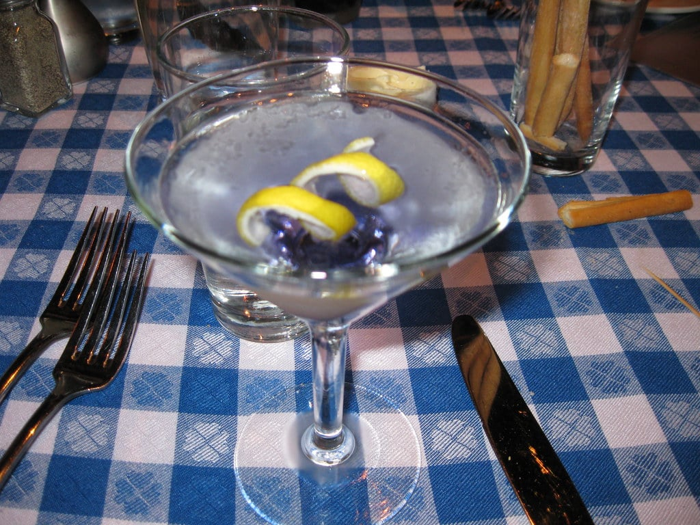

# Aviation

The Aviation is one of the few cocktails whose colour is itself evidence of the recipe. Its pale violet comes from crème de violette, not from syrup or food dye; when that liqueur disappeared from the market, the drink quietly became something else. To understand it, start in New York in 1916.

Figure: An Aviation in a coupe, with pale lavender-grey liquid, a lemon twist and a dark cocktail cherry. Image: Binder Of Daemons, CC BY 2.0, via [source page](https://www.flickr.com/photo.gne?id=3810873586).

## Hugo Ensslin at the Hotel Wallick

The drink first appears in Hugo Ensslin's *Recipes for Mixed Drinks*, published in New York in 1916. Ensslin was the head bartender at the Hotel Wallick, and the book collected a large cross-section of the recipes then circulating in American bars. The Aviation was one of them.

The name belongs to the aviation enthusiasm of the period. In 1916 the Wright brothers' first powered flight was only a little more than a decade old, and aircraft still carried the glamour of speed, machinery and the sky. "Aviation" set up a deliberate contrast with the pale violet liquid in the glass.

## The 1916 Build: Two-Thirds Gin, One-Third Lemon

Ensslin's original is very different from the modern bar version: two-thirds gin, one-third lemon juice, two dashes of maraschino and two dashes of crème de violette, shaken with cracked ice and strained. There is no added syrup; the only sweetness comes from the two dashes of maraschino, so the drink is drier, sharper and far more gin-led than what most bars serve today.

That ratio corrects a common misunderstanding. The Aviation is not a sweet floral liqueur drink. In the original, the flowers are a two-dash accent and the body is gin and lemon. The sweeter, more vividly purple versions came later, as bars leaned into the colour and aroma.

## The Working Recipe

The public IBA recipe pulls the proportions back toward an easier balance: 45 ml gin, 15 ml maraschino, 15 ml lemon juice and 1 bar spoon of crème de violette. For acid balance, see [Acidity](ref:acidity).

| Ingredient | Amount | Role |
| --- | --- | --- |
| Gin (London Dry) | 45 ml | Juniper and citrus frame |
| Maraschino liqueur | 15 ml | Cherry, nut and sweetness |
| Fresh lemon juice | 15 ml | Acidity; modern recipes often use 20–22.5 ml |
| Crème de violette | 1 bar spoon (about 5 ml) | Colour and floral note; less is more |

- **Ratio:** gin: maraschino: lemon: violette is roughly 9: 3: 3: 1.
- **Glass:** a chilled coupe or a small cocktail glass.
- **Ice:** shaking ice only; no ice in the glass.
- **Method:** shake with ice for 10–12 seconds, then double-strain.
- **Garnish:** a brandied cherry, optional; the drink works without one.

## After the Violette Ran Out

Crème de violette began disappearing from the American market in the 1930s. Drink Lab places the turning point in 1930, when Harry Craddock simply left the violette out of the *Savoy Cocktail Book* because the liqueur had become hard to find; a whole generation of bartenders then learned a "violette-free" Aviation.

That version became the default: gin, maraschino and lemon, pale in colour and light in perfume, closer to a cherry-accented sour. Luxardo dates the original's return to the 2000s and notes that crème de violette came back to the American market around 2004; Drink Lab gives 2007. The exact year is told differently, but the sequence — disappearance, the violette-free style, the 2000s revival — is clear.

## Reading the Colour

The Aviation is not vivid purple. It is pale violet, grey-blue, sometimes almost grey, depending on the brand and amount of violette and on the yellow of the lemon juice. Five millilitres and fifteen millilitres do not produce the same drink.

Past a certain point the floral note stops being delicate, turns perfumed, then turns soapy. Five to seven millilitres is the usual working range; above 10 ml the violette buries both the gin's juniper and the maraschino's cherry-stone character. The more garish the colour, the more likely the drink has moved toward candy.

## Gin and Maraschino

[Gin](ref:gin) is the frame. London Dry juniper, citrus peel and dry botanicals support the violette; Old Tom is sweeter and softer, pushing the drink toward candy; a heavily floral gin fights the violette instead of supporting it.

Maraschino is not cherry syrup. It is a [liqueur](ref:liqueur) distilled from cherries and cherry stones, with nutty, cherry-stone and faintly bitter notes. It supplies sweetness and mid-palate complexity. Replace it with an ordinary cherry liqueur and the drink becomes sweeter and more plainly fruity; the dry floral edge is gone.

## Shake, Double-Strain, Coupe

The Aviation is a shaken drink. Combine everything with ice, shake for 10–12 seconds, and double-strain into a chilled coupe. Double-straining catches shards of ice and pulp, keeping the liquid clear and the colour clean; a single strain lets fine ice slip into the glass within minutes.

The coupe is the usual vessel. A wide, shallow bowl collects the aroma at the rim and shows the pale violet clearly. Chill it well: a warm glass lets the drink warm within minutes and the floral note goes loose. For the role of the double strain, see [Filtration](ref:filtration).

## Why It Is Not a Pink Lady

The Aviation and the [Pink Lady](ref:pink-lady) are often grouped as "coloured gin sours." The difference is where the colour comes from and what the texture is. The Aviation's pale violet comes from crème de violette, and the liquid is clear and foam-free; the Pink Lady's pink comes from grenadine, and egg white gives it a fine layer of foam.

The recipes diverge further. The Aviation uses maraschino for cherry and sweetness and no egg; the Pink Lady uses applejack for fruit, grenadine for colour and egg white for texture. Calling both "floral gin drinks" erases those structural differences. Next to a [Dry Martini](ref:dry-martini), the Aviation also rests on a gin base, but adds maraschino and violette and carries more acidity.

## Common Failures

First, too much violette. Once the flowers cover the juniper, the drink tastes like perfume; 5–7 ml is enough.

Second, too little lemon. Maraschino and violette are both sweet, and without enough acidity the drink cloys; too much lemon, however, flattens the floral note.

Third, too much maraschino. It is not only sweetness; in excess, cherry takes over the mid-palate.

Fourth, a short shake or a coarse strain. The drink is not cold enough, ice shards land in the glass, and both colour and texture look rough.

Fifth, violet syrup instead of violette liqueur. The syrup has no alcoholic or herbal structure, the colour is more garish, and the flavour reads as candy.

## Variations and a Non-Alcoholic Version

- **Aviation Sans Violette:** omit the violette and keep gin, maraschino and lemon; this is the violette-free style that spread after the 1930s.
- **A sharper build:** raise the lemon to 20–22.5 ml for a drier, more austere sour.
- **Crème Yvette instead:** a violet liqueur with added spice, pinker in colour and sweeter on the palate.
- **Better cherry:** use a brandied or cocktail cherry rather than a sugar-heavy maraschino cherry.

A non-alcoholic version can only be an approximation: 45 ml of 0.0% gin, 10 ml cherry syrup, 5 ml violet syrup and 20 ml fresh lemon, shaken with ice and double-strained. The colour and the floral note are close, but without gin's juniper and alcoholic weight the drink is thinner and sweeter.

Start with [Gin](ref:gin) for base liquor, then read [Acidity](ref:acidity) for technique and ratio. Seeing both keeps Aviation from being confused with a neighbouring idea.

**At a glance:** Recorded in 1916 by Hugo Ensslin of New York's Hotel Wallick in Recipes for Mixed Drinks, the Aviation combines gin, maraschino, lemon juice and crème de violette; it is pale violet to grey-blue and usually garnished with a cherry.
