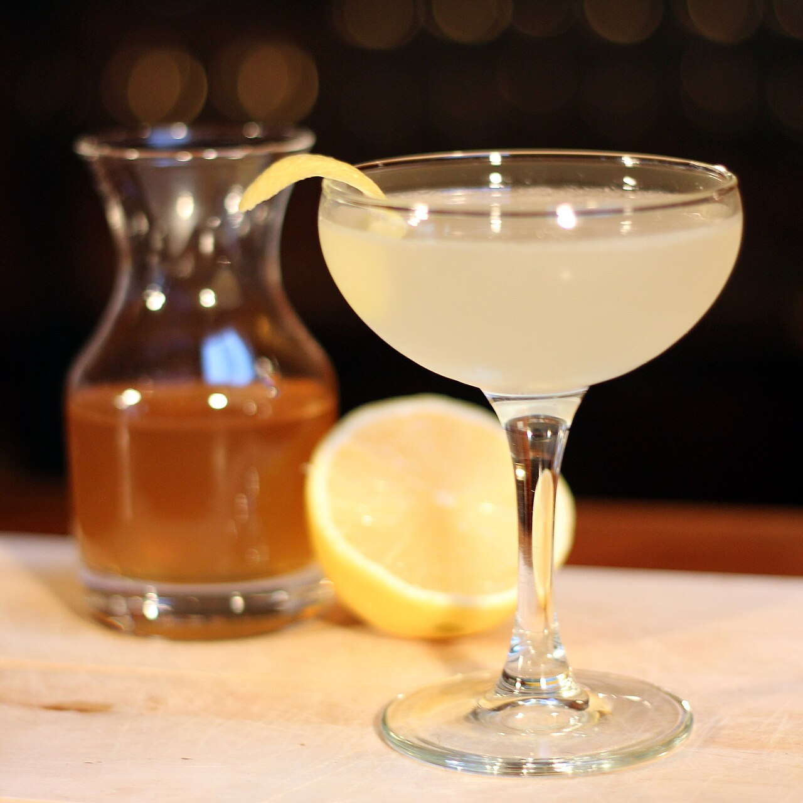

# Bee's Knees

The Bee's Knees is a classic cocktail of gin, lemon juice and honey syrup. It belongs to the sour family, and its structure can be written as gin, lemon and something sweet, with honey replacing sugar. Honey brings floral aroma, viscosity and a thicker mouthfeel, so the drink is softer and more perfumed than an ordinary gin sour. It is usually shaken and strained into a coupe without ice, with an optional lemon or orange peel.

Figure: Bee's Knees. Image: Will Shenton, CC BY-SA 3.0, via Wikimedia Commons ([source page](https://commons.wikimedia.org/wiki/File:Bee%27s_Knees.jpg)).

## A "good thing" from the Prohibition years

The drink is usually placed in the context of American Prohibition, which ran from 1920 to 1933. During those years the legal supply of spirits was uneven and homemade gin was often rough and harsh; honey and lemon did more than taste good, they covered the edges of poor liquor. That explanation is widely repeated and sounds plausible, but it should be handled carefully: it is a later rationalisation, not a recipe note left by the people who drank it. Honey had been used in drinks before Prohibition; what Prohibition did was make the combination of sweet, citrus and spirit more popular.

What is clearer is that the Bee's Knees circulated in American drinking culture in the 1920s and stayed in bars and recipe books after Repeal. It became popular not because it was complicated but because it was simple: three ingredients, one shaker, one glass. For home mixing it is also easier than many classics, because honey syrup keeps longer than fresh juice.

## The name: from slang to a cocktail

"The bee's knees" was 1920s American slang for something excellent, the best of its kind. Related phrases included "the cat's pajamas" and "the elephant's eyebrows", all built on the same joke of naming an animal part as the finest thing around. Calling the drink Bee's Knees does not mean it has anything to do with a bee's legs; it means the drink is very good.

That style of naming also suited Prohibition: it sounded harmless, funny and a little sweet, not like a strong drink. The bee in the name also happens to echo the honey in the recipe, which makes the name feel descriptive even though it began as slang. Whether the name came before the recipe or the recipe before the name is not documented; it is more likely that a bar gave the drink a catchy name and the formula settled afterwards.

## Frank Meier and the Ritz: a trace, not an archive

The most common attribution credits Frank Meier. He was an Austrian-born bartender who served as head bartender at the Ritz in Paris in the 1920s and later wrote his own recipe book. Supporters of the story say that Meier created the Bee's Knees in Paris and that it travelled back to the United States; others argue that it was an American Prohibition-era drink to which a famous bartender's name was later attached.

The problem is that no uncontested 1920s recipe book records a "Frank Meier original Bee's Knees". Meier did work at the Ritz and did record a great many cocktails, but "he invented this drink" and "this drink was served in his bar" are different claims. This page therefore says "often traced to", does not treat the Ritz as the single birthplace and does not fix a specific year.

The distinction has practical value. A Bee's Knees ordered in Paris may be made in a drier European style; one ordered in New York may be sweeter and more honey-forward. The same name carrying different versions in different cities is not a mistake but a normal result of transmission.

## Honey syrup: 1:1, 2:1 and 3:1

Honey cannot simply replace granulated sugar. It dissolves slowly in cold liquid, so a spoonful dropped into a shaker tends to sink, clump, sweeten unevenly and leave the drink sticky. The professional solution is to make honey syrup first, then chill it. The ratio is usually written as honey to water, by volume.

1:1 is the easiest version: equal volumes of honey and water, stirred until dissolved and kept cold. Sweetness is moderate, the syrup pours easily and the amount is easy to control, which makes it good for home use. 2:1 is richer, with more honey aroma and a thicker texture, but it can become hard to pour when cold and may need to be warmed or stirred before use. 3:1 is the "rich syrup" preferred by many modern bars: less water, the most concentrated honey flavour and the highest sweetness, but one millilitre is sweeter than one millilitre of 1:1, so the recipe must be adjusted.

The ratio changes texture as well as sweetness. More water makes a thinner syrup, a lighter body and a more diluted floral note. Less water makes a thicker syrup that coats the palate, lengthens the finish and becomes cloying more easily. Honey is roughly 80% sugar, so a 3:1 syrup is not "low sugar" but "low water". A recipe that says "15 ml honey syrup" without stating the ratio can produce very different sweetness from the same number, which is a common reason home versions fail.

Make the syrup with warm water rather than boiling water, stirring only until dissolved. Boiling drives off the floral aroma and darkens the colour. Cool, bottle and refrigerate, and use a clean spoon so that water or juice does not get into the bottle. The honey variety matters too: clover honey is mild, orange blossom is clearly floral, and buckwheat is dark and molasses-like, so it should be used with more caution.

## Three common formulas: IBA, brand and modern bar

The IBA lists the Bee's Knees in its New Era category. Its formula is 52.5 ml gin, 2 teaspoons of honey syrup (about 10 ml), 22.5 ml fresh lemon juice and 22.5 ml fresh orange juice. The method is to stir the honey with the lemon and orange juices until dissolved, add the gin, shake with ice and strain into a chilled cocktail glass; the garnish is optionally a lemon or orange zest.

Two details stand out. First, the IBA version contains orange juice, while the classic three-ingredient formula usually does not; orange lowers the alcohol content, adds fruit and pushes the drink toward a honey-citrus sour. Second, the ingredient list says "honey syrup" while the method says to stir honey with the juices until dissolved; the two are not quite the same. In practice, making the syrup first is more reliable than trying to dissolve neat honey in cold juice.

A common modern bar version is 60 ml gin, 22.5 ml lemon juice and 15 ml honey syrup, usually made with 3:1 rich syrup. Beefeater's published version is 50 ml gin, 25 ml lemon juice and 15 ml honey syrup. The first is stronger and drier; the second is softer and more acidic. Set side by side, the differences come mainly from the gin proportion and the concentration of the honey syrup, not from one version being more authentic.

## The relationship to a Gin Sour

A Gin Sour is the basic form of the sour family: gin, lemon juice and sugar, shaken and strained into a glass. The Bee's Knees has exactly the same structure, with honey syrup in place of sugar. It is therefore often described as a Gin Sour with honey, or a honeyed gin sour.

The substitution changes more than flavour. Sugar gives a clean sweetness; honey gives a floral, slightly waxy sweetness and adds viscosity and body. Sugar syrup is clear and neutral; honey syrup may carry colour and a faint mineral note. Honey is also slightly more acidic than sugar syrup, so at the same perceived sweetness the drink can feel rounder and softer.

Egg white is another difference. A Gin Sour often includes egg white, shaken to a fine foam for a silkier texture; a Bee's Knees usually does not. Honey already supplies enough body, and egg white on top can make the drink too thick and mute the honey's perfume. For a lighter version, leave the egg white out; if you want the dense foam of a traditional sour, add half an egg white, but then the drink is closer to a honey gin sour than to the classic Bee's Knees.

## Choosing the gin

[Gin](ref:gin) is the frame of the drink. London dry gin, with juniper and citrus peel, cuts through the honey and keeps the drink from becoming syrupy. Plymouth style is softer and closer to the waxy texture of honey, but the syrup should be reduced slightly. Navy-strength gin is high in alcohol, and because honey adds body, the drink can taste both hot and thick unless it is diluted enough.

Very aromatic modern gins are best avoided. Honey already brings flowers; if the gin also carries strong floral, tea or tropical fruit notes, the drink becomes muddled. Nor should a cheap gin be hidden behind honey: honey can cover roughness, but it cannot build a frame. A useful test is to smell the gin first: if its aroma points in the same direction as honey and lemon, it will work; if the gin is already "full", choose a cleaner bottle.

## Shaking, dilution and temperature

The Bee's Knees is [shaken](ref:shake). Honey syrup is viscous and only a full shake integrates it with the lemon and gin; the lemon also needs shaking to release its aroma. Shake for 10–12 seconds, until the ice sound dulls and the tin frosts. Too short a shake leaves the syrup at the bottom, so the first sips are thin and the last are sweet; too long a shake melts too much ice and washes out the honey aroma.

Fine-strain after shaking, especially with homemade syrup or fresh lemon. A fine mesh holds back pulp, foam and ice shards and gives a cleaner texture; if you use egg white, it also makes the foam finer. Strain into a chilled glass and do not add ice, or dilution will continue.

Dilution affects sweetness more than acidity. Honey's sweetness is restrained when cold and grows as the drink warms; a warm glass or slow drinking makes the second half sweeter and stickier. The ideal is chilled ingredients, a cold glass, a full shake and drinking while the drink is still cool.

## Glassware and garnish

Traditionally the drink is served in a [coupe](ref:coupe) or a cocktail glass. A coupe has a wide bowl and a slightly narrowed rim, which gathers the honey and lemon aroma, and its stem keeps the hand from warming the liquid. A martini glass has a wider rim, so aroma escapes faster and the drink warms sooner. A 150–200 ml coupe is enough; fill about two-thirds and leave headspace for aroma.

The garnish is optional. Lemon peel oil reinforces the citrus; orange peel oil echoes the orange juice in the IBA version. Honey is already aromatic, so there is no need for a sugar rim or candied fruit. If you use orange peel, express the oil and wipe it around the rim rather than leaving it in the drink, where it can turn bitter. If you use a lemon wheel, cut it thin so that pulp does not fall in and change the texture.

## Variations: the Gold Rush and other directions

Replace the gin with bourbon and you have the structure of a Gold Rush: bourbon, lemon and honey syrup. Bourbon's vanilla and caramel sit naturally with honey, and the result is sweeter, thicker and better suited to cold weather. It is not the "authentic version" of the Bee's Knees but another classic built on the same template with a different base.

The IBA's orange-juice version can be read as a honey-citrus sour: orange adds fruit, lowers the alcohol and makes the drink easier to serve, but it also makes the honey aroma less focused. There are also versions made with lavender honey, rosemary honey or smoked honey, where the herbs and flowers change the direction of the drink. Any such change should be reflected in the name or the description, or comparisons between drinks with the same name mean nothing.

## Common failures

First, using cold honey straight from the jar. It does not dissolve, it sinks and clumps, and the sweetness is uneven. Second, an unstated syrup ratio. Fifteen millilitres of 1:1 syrup and 15 ml of 3:1 syrup are very different in sweetness. Third, too much honey. The drink becomes sticky and cloying and covers the gin and lemon. Fourth, old lemon juice; both acidity and aroma are lacking, so the honey tastes sweeter. Fifth, too short a shake, which leaves the syrup unintegrated. Sixth, the wrong gin; a very floral gin fights the honey, and a very cheap gin cannot carry the drink. Seventh, a warm glass or slow drinking, after which the sweetness rises and the drink becomes tiring.

## Ordering and drinking

Order a Bee's Knees with gin, and ask for the honey syrup not to be too sweet. Ask which honey is used and how strong the syrup is. For a drier drink, reduce the syrup or add lemon; for a sweeter one, add syrup, accepting that it also adds viscosity. If the strength is a concern, ask about the pour size, or choose the version with orange juice.

It works as an aperitif, and also in the afternoon or after dinner with nuts, honey desserts, fruit tarts, soft cheese and fried food. Honey's sweetness meets fat, and the lemon cuts through richness. Sip slowly and watch the temperature; the alcohol content is moderate, but honey makes the spirit less obvious, so it is easy to drink too fast. Do not drink and drive, and avoid alcohol during pregnancy or while taking medication that interacts with it.

## See also

- [Gin](ref:gin): the frame of the drink and the choice of style.
- [Shaking](ref:shake): integrating honey syrup, chilling and fine-straining.
- [Coupe glass](ref:coupe): bowl shape, rim and aroma.
- [US Prohibition](ref:prohibition): the historical setting in which the drink became popular.
- [Cocktail basics](ref:basics): sour structure and sweet-acid balance.
