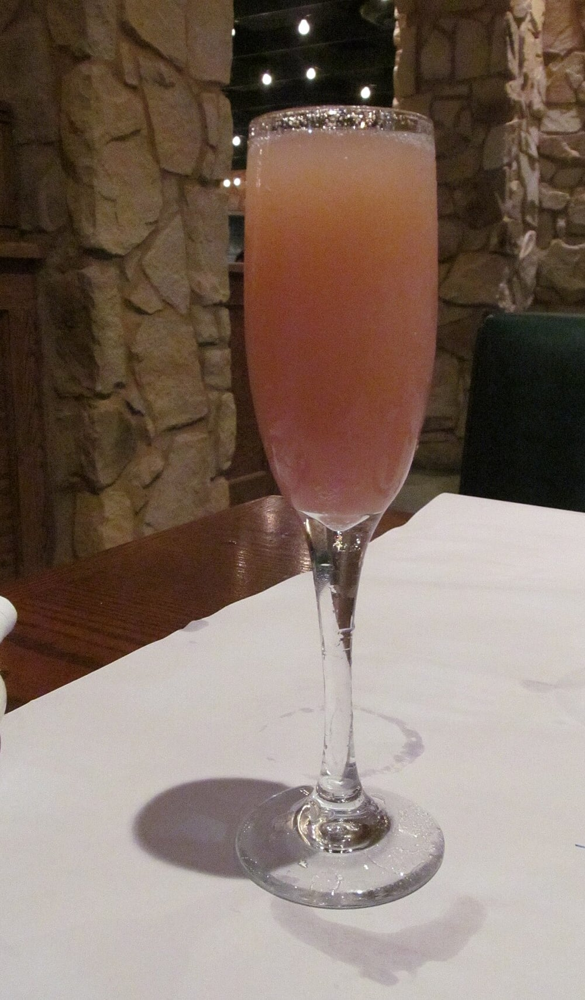

# Bellini

The Bellini is a sparkling cocktail of Prosecco and white peach purée, often treated as the symbol of Venetian brunch and aperitif drinking. It has only two main ingredients and no complicated method, yet it demands ripe peaches, a well-judged purée texture, cold wine and careful handling of bubbles. A good Bellini tastes of peaches with bubbles, not of sweet soda.

Figure: A Bellini in a flute, with peach-pink liquid and a thin cap of foam. Image: John Phelan, CC BY-SA 3.0, via [source page](https://commons.wikimedia.org/wiki/File:Bellini_Cipriani,_Macaroni_Grill,_Dunwoody_GA.jpg).

## Origin: Venice and Harry's Bar

The Bellini is usually traced to [Harry's Bar](ref:harrys-venice) in Venice and dated to 1948. The brand account credits Giuseppe Cipriani and explains the name through the Venetian painter Giovanni Bellini: the soft pink-orange colour is said to have reminded him of a robe in one of the paintings. The story is widely repeated and is promoted by the brand itself, but the exact date and the inspiration are brand narrative rather than independently documented fact.

What is clear is the connection to Venetian drinking: white peaches ripen in Italy in summer, Prosecco comes from the nearby [Veneto](ref:veneto), and the two meet in the same season. The drink also appears on Harry's Bar's menu alongside carpaccio, forming the venue's signature pairing. Name, place and season together explain why the drink belongs to Venice.

## Recipe and proportions

The public IBA recipe is 100 ml Prosecco and 50 ml white peach purée. Pour the purée into a chilled flute, add the Prosecco slowly and stir once gently to combine. That is two parts wine to one part purée; the result is low in alcohol and sweet mainly from the fruit.

The proportions can be adjusted to the peaches and the Prosecco. Purée usually sits between 40 and 60 ml and Prosecco between 100 and 150 ml. More purée gives a thicker, more fruit-smoothie texture; more Prosecco gives more bubbles and freshness. If the peaches are very sweet, use less purée; if the Prosecco is very dry, use a little more. For the wine's structure, see [sparkling wine](ref:sparkling).

## Choosing the Prosecco

Prosecco is mainly made from the Glera grape using tank fermentation, which gives fresh fruit and relatively light bubbles, usually at 11%–12% abv. It is not Champagne: Champagne undergoes a second fermentation in the bottle, with more bready, yeasty and nutty notes and a higher price. Prosecco is common in a Bellini because its green apple, white flower and citrus aromas do not overpower the peach.

Choose brut or extra dry rather than dolce. A sweet Prosecco makes the whole glass too sweet and hides the peach's acidity. The wine must be well chilled; when warm, the bubbles disappear quickly and the purée turns cloying. Use an opened bottle promptly, because sparkling wine that has stood too long loses its tension.

## White peach purée and the season

The traditional peach is the white peach, with pale flesh, fine aroma and soft acidity. Ripeness decides the result: underripe fruit is hard, sour and aromatic only in a green way, while overripe fruit oxidises and tastes of cooked fruit. The Italian peach season falls roughly in summer, so the traditional Bellini is seasonal; frozen purée or fruit purée is used out of season, with a noticeable difference.

Texture matters too. Straining the purée gives a smoother, more syrup-like drink; leaving the fibre gives more flesh. Either way, avoid adding much sugar, because ripe peaches are sweet enough. Purée can be chilled ahead, but it should not sit exposed to air for long, or it browns and loses aroma. For how aroma is released, see [aroma](ref:aroma).

## Technique and bubbles

A Bellini is built, not shaken. Shaking drives off carbonation and foams the purée, making the drink feel hollow. Put the purée into a chilled flute first, pour the Prosecco slowly down the inside of the glass, then lift once with a bar spoon. Over-stirring also destroys bubbles; the aim is an even colour, not a completely homogeneous liquid.

Use a flute or a tulip glass of about 150–200 ml. A narrower rim collects aroma and slows the loss of bubbles. The glass must be clean and free of grease, or bubbles will cling to the walls and vanish. For shape and aroma, see [choosing a glass](ref:glass). Do not fill to the brim; leave space for the aroma to gather.

## Variations and related drinks

Strawberry purée instead of peach gives a Rossini; pomegranate juice gives a Tintoretto; citrus or orange gives a Puccini. A Mimosa, made with orange juice and sparkling wine, has a similar structure but more acidity and a more orange colour. Still white wine instead of Prosecco produces something closer to white wine with fruit purée, with no bubbles and a different style.

Name a variation by what was replaced. Calling a strawberry version a Bellini suggests that nothing has changed. Ratios should follow the fruit: strawberries and pomegranate differ in sugar and acidity, so 50 ml of peach purée cannot simply be transferred. If using jam or sweetened purée, reduce the sugar further. When comparing a variation with the original, first check that fruit, sugar and bubbles are being compared like for like.

## Common misconceptions

First, using yellow peaches or sweetened peach juice instead of white peach purée; colour, aroma and sweetness all drift. Second, serving warm Prosecco, which loses bubbles quickly and makes the purée taste sticky. Third, stirring hard or shaking; the bubbles are structure, not decoration. Fourth, using too much purée, which turns the drink into diluted jam rather than a cocktail.

Fifth, assuming a Bellini must be made with Champagne. Champagne can make a good fruit sparkler, but it changes the flavour and the cost, and the traditional recipe uses Prosecco. Sixth, mixing a large batch in advance; a Bellini is best made to order, because bubbles and aroma both fade. Seventh, ignoring the acidity of the fruit. A squeeze of lemon can rescue an over-sweet peach, but too much turns the drink into something else.

## See also

- [Sparkling wine](ref:sparkling): how Prosecco differs from Champagne.
- [Harry's Bar, Venice](ref:harrys-venice): the birthplace of the Bellini.
- [Veneto](ref:veneto): the home of Prosecco and the peach tradition.
- [Choosing a glass](ref:glass): how a flute shapes bubbles and aroma.
- [Aroma](ref:aroma): how peach and floral notes are released.

**At a glance:** A Venetian classic of Prosecco and white peach purée, usually dated to Harry's Bar in 1948 and credited to Giuseppe Cipriani; the ratio is commonly two parts Prosecco to one part purée, with peach season and temperature deciding the flavour.
