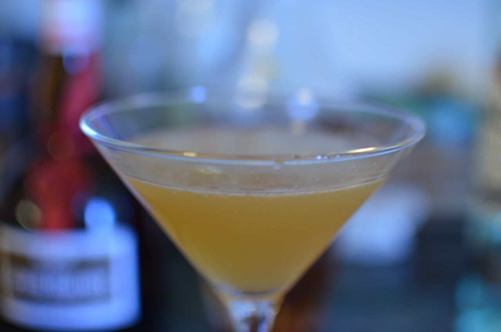

# Between the Sheets

Between the Sheets is a classic better known for its name than its drink. White rum, cognac, orange liqueur and lemon juice, shaken and strained into a coupe. Its structure sits between the Sidecar and the margarita: rum's cane sweetness, cognac's grape, the liqueur's citrus and the lemon's acid.

The drink was popular in 1930s Paris and is linked to the bartending culture of Harry's New York Bar. The suggestive name made it a symbol of the Prohibition and Jazz Age, but the drink itself is not frivolous; it is a tightly built sour.

Figure: A Between the Sheets of white rum, cognac, orange liqueur and lemon juice. Image: Zach, CC BY-SA 4.0, via Wikimedia Commons ([source page](https://commons.wikimedia.org/wiki/File:Between_The_Sheets_Cocktail.jpg)).

## Rum, cognac and orange liqueur

White rum supplies cane sweetness and lightness. Its neutral, clean profile balances cognac's weight; without rum the drink becomes a cognac Sidecar and loses its tropical roundness. Use a light, clean white rum, not an aged one that would bury the cognac.

Cognac supplies grape aroma and backbone. Its fruit, flower and oak carry the lemon's acid; without cognac the drink becomes a rum sour and loses depth. The cognac need not be expensive, but it needs concentration and aroma.

Orange liqueur supplies citrus and sugar. Its peel oil, sugar and alcohol connect rum and cognac and balance the lemon; without it the drink is too sour and dry. Triple sec's moderate sweetness suits the drink.

Lemon juice supplies acid and freshness. Fresh juice's acid and aroma cut the weight of the three spirits; bottled juice is too sharp and breaks the balance. At 1.5 centilitres, half the volume of each spirit, the acidity is just right.

## The formula: three spirits and lemon

The IBA standard is three centilitres each of white rum, cognac and orange liqueur, with 1.5 centilitres of lemon juice. The three spirits are equal and the lemon is halved; the total is about 105 millilitres, filling a coupe to about seven tenths.

For more acidity, raise the lemon to two centilitres; for more sweetness, raise the liqueur to four. But three, three, three and one and a half is the classic and the most balanced version.

Use a light white rum, Cuban or Puerto Rican in style. Use a VS or VSOP cognac with clear fruit and a moderate price; a very old cognac would be masked by the lemon and liqueur. Choose a colourless or pale orange liqueur to keep the colour.

Squeeze the lemon fresh and strain out the pulp and seeds. Pulp clouds the drink and seeds bring bitterness; strained juice is clearer and purer in acid. Choose thin-skinned, juicy lemons, left at room temperature for a day to yield more juice.

## Method: shake and chill the glass

Put the rum, cognac, orange liqueur and lemon juice into a shaker with ice and shake for ten to twelve seconds. Shaking integrates and chills the four; too short and the drink is uneven, too long and the ice dilutes it.

For Between the Sheets, strain through a fine mesh into a chilled coupe. The strainer holds back the ice and keeps the drink clear; the wide bowl releases the aroma and the curve supports the body. Chill the glass so the drink stays cold.

The garnish can be omitted, or a lemon twist or a cherry added. The twist reinforces the citrus, the cherry echoes the name's ambiguity; the traditional drink is usually ungarnished, letting the liquid speak.

Smell first, then sip. Rum's sweetness, cognac's fruit, the peel's citrus and the lemon's acid appear in turn; as the drink warms, the cognac's wood and the peel's bitterness grow. The layers come from the equal spirits.

## Paris and the name

Between the Sheets is said to have originated in 1930s Paris, linked to Harry's New York Bar. Run by the Scotsman Harry MacElhone, it was a gathering place for Americans in the Jazz Age and invented or popularised several classics.

The name is explained in several ways: as "between the sheets" in the intimate sense, or as "between the two beds", perhaps referring to the bar's layout or a room. There is no reliable primary record, but the ambiguity is clearly deliberate.

The drink was popular from the 1930s to the 1950s and faded with the decline of the classics. The twenty-first-century revival brought it back as a test of a bartender's sour balance. The name still draws attention, but the drink deserves to be taken seriously.

For the drinker, the name is cultural context, not drinking advice. The drink is strong, with three equal spirits and lemon only for balance; sip slowly and do not be fooled by the name or the colour.

## Variations and common mistakes

Common variations include Between the Sheets with aged rum instead of white; with Grand Marnier instead of triple sec; with yuzu instead of lemon; and the Sidecar, without rum, using only cognac, orange liqueur and lemon.

Four mistakes recur. First, a cognac too old, which overwhelms the rest. Second, too much lemon, which makes the drink sour. Third, shaking too long, which dilutes it. Fourth, a warm glass, which loses the aroma. Balance decides the drink.

For a home bartender, the practical advice is: three equal spirits, half the lemon, fresh and strained, shake for ten seconds, strain into a cold glass, and garnish not at all or with a lemon twist. The target is an elegant sour, not a sweetly suggestive drink.

## See also and references

- Rum: see [rum](ref:rum).
- Brandy: see [brandy](ref:brandy).
- Orange liqueur: see [orange liqueur](ref:triple).
- Shaking: see [shaking](ref:shaking).
- Coupe: see [coupe](ref:coupe).

**Short definition:** A classic of white rum, cognac, orange liqueur and lemon juice, sitting between the Sidecar and the margarita. The name belongs to Paris bar culture and carries a deliberate ambiguity.

To read Between the Sheets, start with the base and the ratio, then the dilution and the ice, then the garnish and the glass; no single check settles it.

[Rum](ref:rum) and [Triple Sec](ref:triple) are the two useful reference points for Between the Sheets. [Rum](ref:rum) sets out base liquor; [Triple Sec](ref:triple) brings in technique and ratio. Read them together.

**Key facts.**

| Item | Detail |
| --- | --- |
| In one line | A classic of white rum, cognac, orange liqueur and lemon juice, sitting between the Sidecar and the margarita. The name belongs to Paris bar culture and carries a deliberate ambiguity. |
| Style | IBA Contemporary Classics |
| Origin | Paris, France |

**Sources and limits.** The key claims about Between the Sheets are checked against the following sources: International Bartenders Association (Used to check the IBA category, ingredients and ratio), Oxford University Press (Used to check cocktail history and terminology), CocktailDB (Used to cross-check recipe structure and common variations) and 5 sources in total. Prices, batches and status change; the body is project-written and does not reproduce source text.

For Between the Sheets, this page was last checked in 2026; prices, batches and availability change, so confirm them against the sources below.
