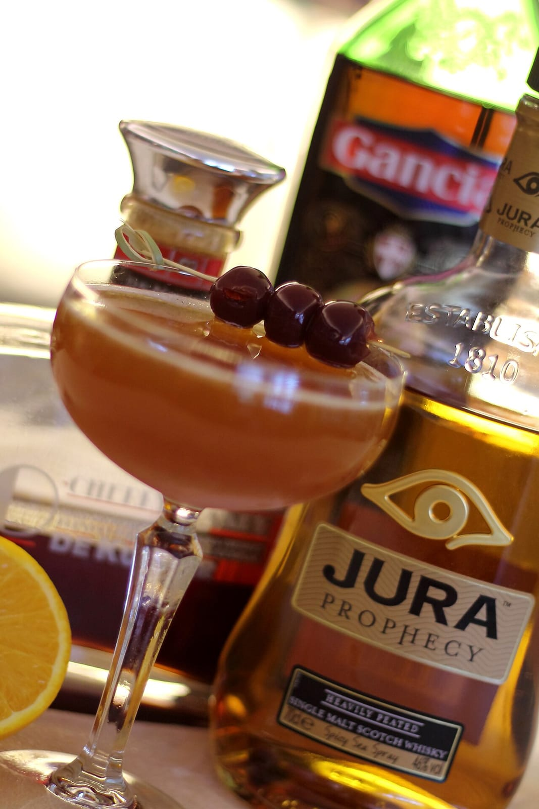

# Blood and Sand

Blood and Sand is a classic whose name is stronger than its drink. Scotch, cherry liqueur, sweet vermouth and orange juice, in four equal parts, shaken and strained into a coupe. Deep red, like sand and blood in a bullring; rich in flavour, with smoke, fruit, bitter sweetness and citrus interwoven.

The name comes from the 1922 film Blood and Sand, adapted from the story of a Spanish bullfighter. Starring Rudolph Valentino, the film is said to have inspired the cocktail for its premiere or promotion. The drama of the name makes the drink one of the most striking classics.

Figure: A Blood and Sand of Scotch, cherry liqueur, sweet vermouth and orange juice. Image: Cocktailmarler, CC BY-SA 4.0, via Wikimedia Commons ([source page](https://commons.wikimedia.org/wiki/File:Blood_and_Sand.jpg)).

## Scotch and cherry

Scotch supplies the backbone and the smoke. Blended Scotch, with malt, peat and grain, can carry the sweetness of cherry and vermouth; a single malt also works but is stronger and may overwhelm the rest. Avoid a heavily peated whisky, which turns the drink medicinal.

Cherry liqueur supplies fruit and sweetness. Made by macerating cherries, sweetening and lowering the alcohol, it is deep red and tart-sweet; with Scotch's smoke it is a classic pairing, smoke and cherry. Choose a natural-tasting brand that is not excessively sweet.

Sweet vermouth supplies herb and bitter sweetness. Its wormwood, clove, cinnamon and sugar balance the cherry and connect to the Scotch's smoke; without vermouth the drink is sweet and one-dimensional. Sweet vermouth suits the drink better than dry.

Orange juice supplies acid and freshness. Fresh juice's acid and fruit cut the weight of Scotch and cherry; bottled juice is too sweet and makes the drink cloying. At one quarter of the total, the juice cannot be reduced without losing balance.

## The formula: four equal parts

The IBA standard is three centilitres each of Scotch, cherry liqueur, sweet vermouth and orange juice. Three centilitres is thirty millilitres, 120 in total, filling a coupe to about eight tenths. The four equal parts are the drink's signature and its easiest ratio to remember.

For more strength, raise the Scotch to four centilitres and lower the juice to two; for more fruit, raise the cherry liqueur to four. But the four equal parts are the classic and the most balanced version.

Use a blended Scotch. Its smoke and grain sweetness integrate with cherry, vermouth and orange; a single malt's personality is too strong for the balance. Avoid bourbon or rye, whose sweetness and spice do not suit the drink.

Choose a deep-red, natural-tasting cherry liqueur. Too sweet and the drink becomes cherry syrup; too sour and it loses roundness. Use an Italian-style sweet vermouth with moderate herb and sugar.

## Method: shake and orange peel

Put the Scotch, cherry liqueur, vermouth and orange juice into a shaker with ice and shake for ten to twelve seconds. Shaking integrates the four and chills them; too short and the drink is uneven, too long and the ice dilutes it.

For Blood and Sand, strain through a fine mesh into a chilled coupe. The strainer holds back the ice and keeps the drink clear; the wide bowl releases the aroma and the curve supports the body. Chill the glass so the drink stays cold.

Garnish with an orange peel. Pare a strip, squeeze its oils and lay it at the rim or in the glass; the aroma reinforces the juice's citrus and brightens the colour. Skip the cherry, which would repeat the liqueur's sweetness.

Smell the peel first, then sip. Smoke, cherry, herb and citrus appear in turn; as the drink warms, the cherry and vermouth grow sweeter. The layers come from the four equal parts.

## The film and the bullfighter

Blood and Sand is a 1922 American silent film adapted from Vicente Blasco Ibáñez's novel about a bullfighter's rise and fall. Starring Rudolph Valentino, it became a major box-office success of its year.

The cocktail is said to have been created for the premiere or promotion of the film, though the creator and place are not reliably recorded. The common account is that a bar in London or New York launched it around 1922, taking the film's title.

The title refers to the sand of the bullring and the blood of the bullfighter, a symbol of glory and death. The drink's deep red echoes the image, and its smoke and cherry resemble the bullfighter's romance and tragedy.

The drink was popular from the 1930s to the 1950s, was later forgotten, and returned in the twenty-first-century classic revival. Today it is a representative Scotch cocktail and a test of a bartender's sense of balance.

## Variations and common mistakes

Common variations include Blood and Sand with mezcal instead of Scotch for more smoke; with blood orange juice for a deeper colour; Sand and Blood, with less cherry and more Scotch; and a Blood and Sand Flip, with a whole egg.

Four mistakes recur. First, a whisky too peated, which turns the drink medicinal. Second, a cherry liqueur too sweet, which turns it to syrup. Third, juice that is not fresh, which lacks acidity. Fourth, shaking too long, which dilutes the drink. Balance decides the result.

For a home bartender, the practical advice is: use blended Scotch, natural cherry liqueur and vermouth, fresh orange juice, four equal parts, shake for ten seconds, strain into a cold glass, and squeeze the orange peel last. The target is smoky cherry balance, not sweet cherry wine.

## See also and references

- Scotch whisky: see [Scotch whisky](ref:scotch).
- Vermouth: see [vermouth](ref:vermouth).
- Shaking: see [shaking](ref:shaking).
- Coupe: see [coupe](ref:coupe).
- Sweet: see [sweet](ref:sweet).

**At a glance:** A classic of equal parts Scotch, cherry liqueur, sweet vermouth and orange juice, shaken and deep red. Named after the 1922 bullfighting film, it is rich and balanced. 

For Blood and Sand, begin with the base and the ratio. Then look at the dilution and the ice, and finally ask the garnish and the glass. The answers point to different choices, not to a single score.

The comparison with [Scotch whisky](ref:scotch) and [Shaking](ref:shaking) runs through base liquor and technique and ratio. Each answers a different question.

**Key facts.**

| Item | Detail |
| --- | --- |
| In one line | A classic of equal parts Scotch, cherry liqueur, sweet vermouth and orange juice, shaken and deep red. Named after the 1922 bullfighting film, it is rich and balanced. |
| Style | IBA Contemporary Classics |
| Origin | United Kingdom |

**Sources and limits.** The key claims about Blood and Sand are checked against the following sources: International Bartenders Association, Oxford University Press (Used to check cocktail history and terminology), CocktailDB (Used to cross-check recipe structure and common variations) and 5 sources in total. Prices, batches and status change; the body is project-written and does not reproduce source text.

For Blood and Sand, this cocktail was last checked in 2026; prices, batches and availability change, so confirm them against the sources below.
