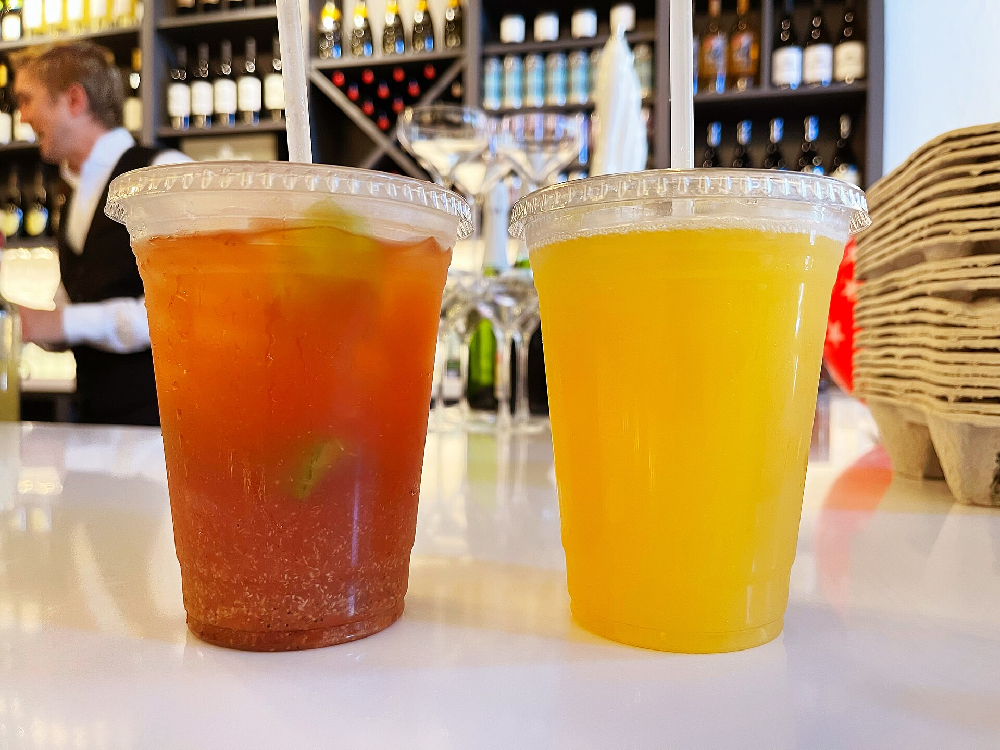

# Bloody Mary

The Bloody Mary is a long drink built on vodka and tomato juice, sharpened with lemon, deepened with Worcestershire sauce, warmed with hot sauce and seasoned with salt and pepper. It is usually built over ice in a highball glass and garnished with a celery stalk and a lemon wedge, sometimes with a celery-salt rim. The colour is deep, the texture thick and the alcohol relatively moderate, which is why it is often served at brunch.

Figure: Related photograph of Bloody Mary. Image: Missvain, CC BY 4.0, via Wikimedia Commons ([source page](https://commons.wikimedia.org/wiki/File:Sausage_Emporium_-_July_4_2021_-_Sarah_Stierch.jpg)).

## The boundaries of the drink

The Bloody Mary is a savoury long drink, not a glass of juice. Its frame is vodka, tomato juice and acidity; the seasonings only adjust that frame. Vodka supplies alcohol and structure, but a good vodka should be clean and unobtrusive. Tomato juice supplies texture, umami and colour. Lemon supplies the acidity that keeps thick tomato from feeling dull. Worcestershire brings fermented savouriness and spice, hot sauce brings heat, and salt and black pepper lift the whole.

It is also not simply “tomato juice with alcohol”. Without acidity the drink tastes like diluted tomato soup; without salt the sweetness of the tomato feels blunt; without spice it feels flat. Too much seasoning, on the other hand, buries the tomato. The quality of a Bloody Mary depends far more on the balance of these few grams than on the price of the vodka.

## Origin and dispute

The Bloody Mary is often traced to [Harry's New York Bar](ref:harrys) in Paris. A common account has the bartender Fernand Petiot mixing vodka with tomato juice in the 1920s; after moving to the King Cole Bar at the St. Regis in New York in 1934, he added salt, pepper, Worcestershire sauce and hot sauce and served it as a “Red Snapper”. Another account credits the entertainer George Jessel with a vodka-and-tomato drink around 1927.

Each account has supporters, but none is settled by contemporary written evidence. The defensible statement is that the drink took shape in American bar culture in the 1920s and 1930s, that both Paris and New York left early versions, and that the people, dates and naming remain disputed. There is also no agreement on whether “Bloody Mary” refers to Queen Mary I, a customer called Mary, or something else. Saying “often attributed” and “disputed” is more honest than offering a single answer.

## Recipe and proportions

The public IBA recipe is 45 ml vodka, 90 ml tomato juice, 15 ml fresh lemon juice, 2 dashes Worcestershire sauce, hot sauce to taste, salt and black pepper, built over ice and garnished with celery and a lemon wedge. That is one part vodka to two parts tomato juice, with 15 ml of lemon for acidity.

In practice the proportions have room to move. Vodka can range from 45 to 60 ml and tomato juice from 90 to 180 ml; more tomato gives a thicker, lower-strength drink but can taste thin. Lemon usually sits between 10 and 20 ml, Worcestershire between 2 and 4 dashes, hot sauce between 2 and 4 dashes, with a pinch of salt and freshly ground pepper. Rather than memorising numbers, make the IBA version once and adjust to the concentration and acidity of the juice.

## What each ingredient does

Tomato juice decides texture. Canned and bottled juices differ widely in thickness, salt and sweetness; some are already salted, some are thin. Taste the juice first: if it is salty, add less salt later; if it lacks acidity, add more lemon. Once opened, tomato juice oxidises quickly, and old juice can taste metallic or sour.

Vodka decides the frame. The Bloody Mary does not need an expensive vodka, but it needs a clean one; spirits with pronounced grain sweetness or oiliness clash with tomato. Lemon juice provides acidity and lift, and fresh is more reliable than bottled. Worcestershire sauce contributes anchovy, tamarind and spice, and a few dashes are enough. Hot sauce provides heat and the sourness of fermented chilli. Salt improves the whole, black pepper adds spice and a light prickle. The celery stalk is both garnish and aroma; a celery-salt rim adds savouriness but also salt.

## Technique and texture

A Bloody Mary is usually built over ice, or rolled between two tins. Rolling mixes and lightly aerates without the hard chill and dilution of shaking. Vigorous shaking whips the tomato into foam, makes the drink feel hollow and sharpens the spices. For general structure, see [cocktail basics](ref:cocktails-guide).

Order matters: put ice in the glass, add vodka, tomato juice, lemon and seasonings, then lift from the bottom with a bar spoon so that salt and sauces are evenly distributed. Add celery salt or hot sauce in small amounts and taste before adding more. Use plenty of ice and chill the glass; with too little ice the drink warms quickly and the tomato turns cloying. For the principles of ice and temperature, see [ice and temperature](ref:ice). For the glass, see [choosing a glass](ref:glass).

## Variations and ordering

Gin instead of vodka usually gives a Red Snapper; tequila instead of vodka gives a Bloody Maria; without alcohol it is a Virgin Mary. Clam-and-tomato juice makes a Canadian Bloody Caesar, and a beer-based version with tomato and chilli moves towards the Michelada idea. Some versions add beef broth, horseradish or pickles; these are local variations, not default ingredients.

When ordering, state heat, acidity and salt: “less spicy”, “extra lemon”, “no celery salt”. If the drink is made to order, ask for the seasonings on the side and taste the vodka-and-tomato base first. As a brunch drink it suits eggs, bacon, toast and salty food, but the alcohol is still there: a 45 ml vodka version contains about 18 ml of pure alcohol. For the calculation, see [alcohol by volume](ref:abv).

## Common misconceptions

First, treating the Bloody Mary as a hangover cure. Alcohol only postpones discomfort; it does not speed up ethanol metabolism, and drinking more adds to the total. Second, shaking hard. Foamy tomato tastes hollow and the spices turn harsh. Third, ignoring the salt and acidity already in the juice, which leads to over-seasoning. Fourth, too little ice; as a long drink warms, the sweetness of tomato and the salt of the sauces drift out of balance.

Fifth, letting the garnish take over. A “salad” of olives, pickles, prawns and cheese can look impressive, but it changes the temperature and aroma and makes recipes hard to compare. Sixth, treating the celery stalk as optional decoration. Its aroma and freshness are part of the structure.

## See also

- [Vodka](ref:vodka): the alcoholic frame of the drink.
- [Harry's New York Bar](ref:harrys): the Paris bar in the origin story.
- [Cocktail basics](ref:cocktails-guide): building, stirring and dilution.
- [Choosing a glass](ref:glass): highball capacity and pre-chilling.
- [Ice and temperature](ref:ice): why a long drink needs enough ice.
- [Alcohol by volume](ref:abv): real strength in a long drink.

Bloody Mary is best approached through the base and the ratio, then the dilution and the ice, and then the garnish and the glass. One check alone will not settle it.

[Vodka](ref:vodka) and [A cocktail is another way in](ref:cocktails-guide) answer different questions about Bloody Mary: base liquor and technique and ratio. Read them as a pair, not as alternatives.
